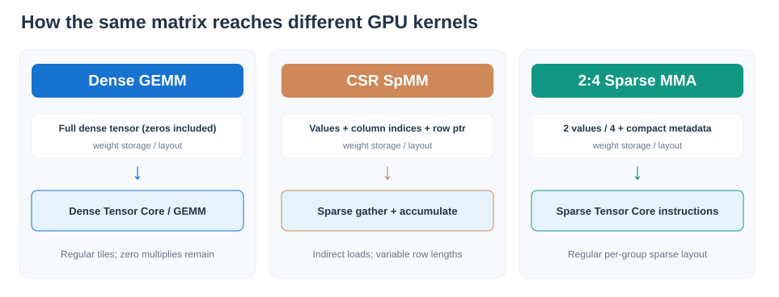
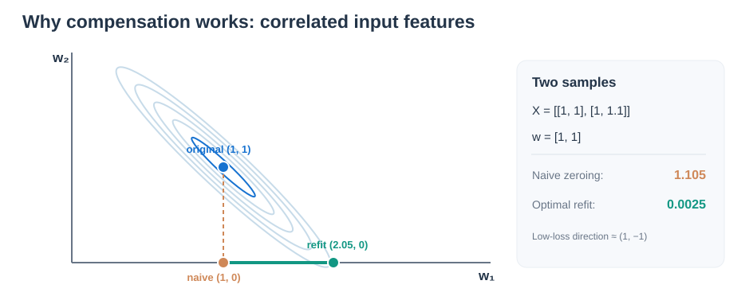
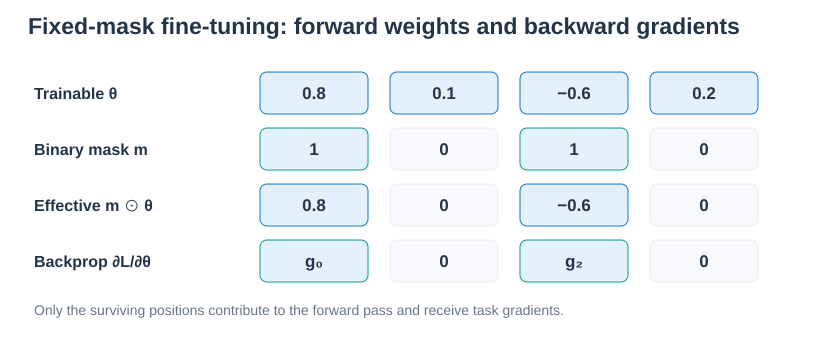
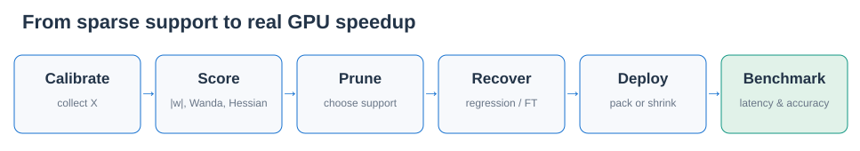

**Efficient ML · Part I.** Pruning turns learned redundancy into more efficient operators. We can use it to reduce weight storage, replace expensive dense operations with sparse GPU kernels, or shrink channels and heads so that the network performs smaller dense matrix multiplications.

Start with a linear layer without bias. For sample $b$ and output feature $n$, take the dot product of input row $x_{b:}$ and weight row $w_{n:}$:

$$
\boxed{y_{bn}=\sum_{k=0}^{K-1}x_{bk}w_{nk}=x_{bk}w_{nk}}.
$$

The last expression uses **Einstein summation notation**. The repeated index $k$ is summed over input features, while the free indices $b,n$ each label an entry of the result. In matrix form, $Y=XW^\top$, with $X\in\mathbb R^{B\times K}$, $W\in\mathbb R^{N\times K}$, and $Y\in\mathbb R^{B\times N}$. In PyTorch, this is `torch.einsum("bk,nk->bn", x, w)` or `torch.nn.functional.linear(x, w)`.

We will build a complete compression pipeline: **represent and execute sparse operators → choose weights using importance scores → reconstruct and fine-tune the remaining weights → apply the same principles to attention and convolution**. Each stage has a concrete mathematical objective and a corresponding implementation.

## 1. Sparse computation, formats, and regularity

Suppose we introduce a binary support mask $m_{nk}\in\{0,1\}$ and define effective weights

$$
\widetilde w_{nk}=m_{nk}w_{nk},\qquad
\widetilde y_{bn}=\sum_k x_{bk}\widetilde w_{nk}.
$$

The next step is to turn that mask into an efficient operator. There are two principal strategies. **Sparse execution** retains the original tensor dimensions and processes packed nonzero weights. **Structured pruning** removes entire dimensions, giving a smaller dense operator. Block sparsity and $N{:}M$ sparsity provide intermediate, GPU-friendly structures.


*Figure 1. Five ways to represent a smaller computation, from arbitrary zeros to physically reduced matrix dimensions.*

**Unstructured sparsity and CSR.** Each zero in weight row $n$ contributes exactly zero to its dot product. We can restrict the sum to the set $\Omega_n$ of nonzero input positions for that row.

$$
\Omega_n=\{k:\widetilde w_{nk}\neq0\},\qquad
\boxed{\widetilde y_{bn}=\sum_{k\in\Omega_n}x_{bk}\widetilde w_{nk}}.
$$

**Compressed sparse row (CSR)** packs the rows consecutively. Row $n$ starts at offset $r_n$ and contains $r_{n+1}-r_n$ entries. The last offset $r_N$ is the total number of nonzeros. At each packed position $p$ in row $n$, the stored column $c_p$ tells us which input to read, and the stored value is $v_p=\widetilde w_{n,c_p}$. Substituting $k=c_p$ into the restricted sum gives

$$
\boxed{\widetilde y_{bn}=\sum_{p=r_n}^{r_{n+1}-1}x_{b,c_p}v_p}.
$$

For example,

$$
\widetilde W=
\begin{bmatrix}
1&0&0&2\\
0&3&0&0\\
4&0&5&0
\end{bmatrix},\quad
v=[1,2,3,4,5],\quad
c=[0,3,1,0,2],\quad
r=[0,2,3,5].
$$

For output channel $n=0$, the offsets $r_0=0$ and $r_1=2$ give $p=0,1$. Their columns are $0,3$, so $\widetilde y_{b0}=x_{b0}+2x_{b3}$. Different output rows or tiles can be processed by different GPU warps. Each warp reads the packed weight values, gathers the corresponding activations, and accumulates the products. Block-sparse kernels organize the surviving values into contiguous tiles to give the GPU larger units of work.

A direct PyTorch implementation of the same operation is:

~~~python
import torch

W = torch.tensor([[1., 0., 0., 2.],
                  [0., 3., 0., 0.],
                  [4., 0., 5., 0.]])
X = torch.randn(6, 4)                   # [B, K]
W_csr = W.to_sparse_csr()                # [N, K]
Y_sparse = torch.sparse.mm(W_csr, X.T).T # [B, N]
Y_dense = torch.einsum("bk,nk->bn", X, W)
torch.testing.assert_close(Y_sparse, Y_dense)
~~~

An FP16 dense matrix uses $2NK$ bytes. With INT32 indices and row offsets, CSR uses $2\,\mathrm{nnz}$ bytes for values, $4\,\mathrm{nnz}$ for columns, and $4(N+1)$ for offsets, before any container or alignment overhead. Comparing $6\,\mathrm{nnz}+4(N+1)$ with $2NK$ gives a storage break-even density of roughly one third when the offset array is small. Runtime also depends on input gathers and how unevenly the nonzeros are distributed across rows.

**2:4 semi-structured sparsity.** Assume $K$ is divisible by four. Each input index has a group $g$ and an offset $r$, so $k=4g+r$ with $0\le r<4$. In each weight row $n$, the mask keeps exactly two positions per group.

$$
\boxed{\sum_{r=0}^{3}m_{n,4g+r}=2}.
$$

Rewrite the dense sum as $\sum_g\sum_{r=0}^{3}x_{b,4g+r}m_{n,4g+r}w_{n,4g+r}$. Two of the mask entries in each inner sum are zero. Label the other two offsets $j_{ng0},j_{ng1}$ and store their values as $v_{ngq}=w_{n,4g+j_{ngq}}$. The inner sum now visits only the two packed slots $q$.

$$
\boxed{\widetilde y_{bn}=\sum_g\sum_{q=0}^{1}x_{b,4g+j_{ngq}}v_{ngq}}.
$$

For example, $[0.8,0.05,-0.6,0.02]$ is packed as values $[0.8,-0.6]$ with position metadata $[0,2]$. The contribution to one output is $0.8x_{b,4g}-0.6x_{b,4g+2}$. A Sparse Tensor Core executes this pattern at the level of matrix tiles, using a compact, regular representation of both values and positions [1,2].

<figure class="note-diagram note-diagram-2to4">
  <picture>
    <source media="(max-width: 680px)" srcset="figures/03_2to4_matrix_mobile.svg">
    
  </picture>
  <figcaption><strong>Figure 2.</strong> 2:4 sparsity is applied independently to every group of four weights along the reduction dimension. The packed format stores two values and their locations per group.</figcaption>
</figure>

Four dense FP16 weights take $4\cdot16=64$ bits. In the packed format, two retained weights take $2\cdot16=32$ bits and their two offsets take $2\cdot2=4$ bits. That gives $36/64=\mathbf{9/16}$ of the dense weight storage in the documented PyTorch representation [2]. A $4096\times4096$ FP16 matrix takes $4096^2\cdot2$ bytes, or 32 MiB. The packed size is $32\cdot9/16=18$ MiB.

Dense execution accumulates $K$ products for every one of the $BN$ output entries, giving $BNK$ multiply–accumulates (MACs). A 2:4 kernel processes two products for each of the $K/4$ groups, giving $BNK/2$ active MACs. At $B=1024$ and $N=K=4096$, these counts are about **17.18 billion** and **8.59 billion**. The actual speedup depends on the kernel and the cost of moving data.

**Structured pruning** reduces the size of a tensor dimension. Consider a two-layer MLP:

$$
h_{bi}=\phi(x_{bk}a_{ik}),\qquad y_{bo}=h_{bi}u_{oi}.
$$

If the retained hidden indices form a set $S$, the pruned output is $\widetilde y_{bo}=\sum_{i\in S} h_{bi}u_{oi}$. For each $i\in S$, keep row $i$ of $a$ to compute $h_{bi}$ and column $i$ of $u$ to use it. Reindexing both matrices in the same order gives $\widetilde a\in\mathbb R^{|S|\times K}$ and $\widetilde u\in\mathbb R^{O\times|S|}$. Their total parameter count goes from $I(K+O)$ to $|S|(K+O)$, and the two dense multiplications require $B|S|(K+O)$ MACs instead of $BI(K+O)$.

**Measuring sparsity and performance.** We describe a compressed operator using both its zero fraction and the regularity of its structure:

$$
\text{sparsity}=\frac{N_{\rm zero}}{N_{\rm total}},
\qquad
\text{density}=1-\text{sparsity}.
$$

A pattern can be unstructured, block-sparse, $N{:}M$ sparse, or structured along whole channels and heads. The same sparsity ratio can produce different performance because each pattern has a different representation and kernel.

| Quantity | Measurement | Example |
|---|---|---|
| Sparsity | Zero entries / total entries | 2:4 gives 50% |
| Compressed weight size | Values plus metadata | 32 MiB → about 18 MiB for the FP16 example |
| Effective arithmetic | Number of active MACs | $BNK\to BNK/2$ for 2:4 |
| Kernel latency | CUDA event timing | Compare equal input shapes and precision |
| Model throughput | Tokens/second or examples/second | Measure full prefill/decode workloads |



*Figure 3. Dense GEMM computes regular full tiles; CSR SpMM gathers packed nonzeros; 2:4 sparse MMA combines fixed sparsity metadata with specialized Tensor Core computation.*

To translate a kernel speedup into a workload speedup, let $t$ be the original runtime and $f$ the fraction spent in the kernel. If the kernel becomes $s$ times as fast, the new runtime is $(1-f)t+ft/s$. Amdahl's law gives the speedup as the ratio $t/[(1-f)t+ft/s]$. For $f=0.70$ and $s=2$, this is $1/(0.30+0.70/2)\approx1.54\times$. Benchmark **prefill and decode separately** in language models because the matrix shapes and fraction of time spent in each kernel can differ. NVIDIA supplies general sparse operations through cuSPARSE and specialized 2:4 sparse GEMM through cuSPARSELt [1,3].

The next experiment compares two implementations of the same pruned linear operator: a dense tensor containing zeros and a packed 2:4 sparse tensor. It verifies the outputs and benchmarks both GPU execution paths.

```python
import torch
import torch.nn.functional as F
from torch.sparse import to_sparse_semi_structured

assert torch.cuda.is_available(), "2:4 sparse kernel example requires CUDA"
N = K = 256                 # multiples of 64 for FP16 in the documented API
B = 1024
x = torch.randn(B, K, device="cuda", dtype=torch.float16)
w = torch.randn(N, K, device="cuda", dtype=torch.float16)

# Each four-element group keeps the two largest magnitudes.
g = w.reshape(N, K // 4, 4)
keep_idx = g.abs().topk(2, dim=-1).indices
mask = torch.zeros_like(g).scatter_(-1, keep_idx, 1).reshape(N, K)
w_dense_zeroed = w * mask
w_packed = to_sparse_semi_structured(w_dense_zeroed)

with torch.inference_mode():
    yd = F.linear(x, w_dense_zeroed)  # dense GEMM, despite 50% zeros
    ys = F.linear(x, w_packed)        # supported sparse GEMM path
    print("max abs error:", (yd - ys).abs().max().item())

    def ms_per_call(fn, iterations=200):
        for _ in range(20):
            fn()
        torch.cuda.synchronize()
        start, end = torch.cuda.Event(enable_timing=True), torch.cuda.Event(enable_timing=True)
        start.record()
        for _ in range(iterations):
            fn()
        end.record()
        torch.cuda.synchronize()
        return start.elapsed_time(end) / iterations

    print("dense ms:", ms_per_call(lambda: F.linear(x, w_dense_zeroed)))
    print("2:4   ms:", ms_per_call(lambda: F.linear(x, w_packed)))
```

Both timed paths use the same masked weight matrix. The dense path stores its zeros explicitly, and the sparse path packs the matrix before timing. The warm-up runs precede the CUDA events, and synchronization ensures the measured GPU work has finished before reading the elapsed time. The ratio of dense to sparse latency measures the benefit for this shape and GPU [2].

## 2. Pruning scores, Hessians, and regression reconstruction

Pruning jointly chooses which connections survive (the **support**) and what values they take. For a weight budget of at most $P$ positions, the objective is

$$
\min_{m,\theta}\mathcal L(m\odot\theta),
\qquad m_{nk}\in\{0,1\},\qquad \|m\|_0\le P.
$$

Here $m\odot\theta$ is the elementwise product and $\|m\|_0=\sum_{n,k}m_{nk}$ counts retained positions. Fixing $m$ leaves a weight-fitting problem. Finding $m$ requires choosing among many possible supports, so practical methods typically use a score to rank candidates and then refit the retained weights. The mask family determines which candidates compete. A 2:4 mask, for example, must keep two positions in every group even if the four highest scores across two neighboring groups all fall in the same group.

The table summarizes the scores derived below. $g$ and $H$ denote the gradient and Hessian of the chosen loss with respect to the weights.

<div class="score-catalog" role="list" aria-label="Comparison of pruning importance scores">
  <div class="score-row" role="listitem">
    <div class="score-name">Magnitude</div>
    <div class="score-formula">$s_{nk}=\lvert w_{nk}\rvert$</div>
    <div class="score-desc">Keep weights with large absolute magnitude.</div>
  </div>
  <div class="score-row" role="listitem">
    <div class="score-name">Wanda-style</div>
    <div class="score-formula">$s_{nk}=\lvert w_{nk}\rvert\sqrt{\sum_b x_{bk}^{\,2}}$</div>
    <div class="score-desc">Weight magnitude scaled by the input feature's activation energy.</div>
  </div>
  <div class="score-row" role="listitem">
    <div class="score-name">First-order</div>
    <div class="score-formula">$s_i=\lvert w_i g_i\rvert$</div>
    <div class="score-desc">Approximate task-loss change under weight removal.</div>
  </div>
  <div class="score-row" role="listitem">
    <div class="score-name">Optimal Brain Damage (OBD)</div>
    <div class="score-formula">$s_p\simeq \tfrac12 H_{pp}w_p^2$</div>
    <div class="score-desc">Second-order cost of deleting one weight with others fixed.</div>
  </div>
  <div class="score-row" role="listitem">
    <div class="score-name">Optimal Brain Surgeon (OBS)</div>
    <div class="score-formula">$s_p\simeq \frac{w_p^2}{2(H^{-1})_{pp}}$</div>
    <div class="score-desc">Minimum quadratic loss increase after optimal compensation.</div>
  </div>
</div>

A compact implementation of magnitude and activation-aware scoring is:

```python
import torch

# Calibration activations X: [B, K]; weights W: [N, K]
B, K, N = 128, 16, 8
X = torch.randn(B, K)
W = torch.randn(N, K)

magnitude = W.abs()
input_scale = X.square().sum(dim=0).sqrt()  # [K]
wanda = magnitude * input_scale[None, :]    # [N, K]

# Keep the top 50% in each output row
keep = wanda.topk(K // 2, dim=-1).indices
mask = torch.zeros_like(W)
mask.scatter_(1, keep, 1.0)

assert (mask == 0).float().mean().item() == 0.5
```

### From a deleted weight to the Wanda score

In the dot product for output row $n$, setting $w_{nk}$ to zero removes exactly the term $x_{bk}w_{nk}$. The other output rows keep their weights. Across the calibration examples, the change in output row $n$ therefore has norm

$$
\begin{aligned}
\|\Delta y_{:n}\|_2
&=\sqrt{\sum_b (-x_{bk}w_{nk})^2}\\
&=|w_{nk}|\sqrt{\sum_b x_{bk}^2}.
\end{aligned}
$$

This gives the Wanda score. If all input columns have the same norm, it ranks weights in the same order as magnitude pruning. If several weights in one row are removed together, their output changes add before squaring, so correlations between input columns can change the combined error. Wanda uses the single-deletion norm to rank candidates within each output row [4].

### Taylor expansion and the first-order score

Flatten the weights under consideration into a vector $w$ and keep all other parameters fixed. Write a nonzero perturbation as $\Delta w=\varepsilon u$, where $\varepsilon=\|\Delta w\|_2$ is the step size and $u$ is its unit direction. Define $f(t)=\mathcal L(w+tu)$, so the loss change is $f(\varepsilon)-f(0)$. For a twice continuously differentiable loss, the chain rule first gives $f'(t)=\sum_i u_i\,\partial_i\mathcal L(w+tu)$. Differentiating each partial derivative along $u$ gives the second derivative. Evaluating at $t=0$ yields

$$
\begin{aligned}
f'(0)&=\sum_i g_i u_i,
&g_i&=\left.\frac{\partial\mathcal L}{\partial w_i}\right|_w,\\
f''(0)&=\sum_{i,j}u_i H_{ij}u_j,
&H_{ij}&=\left.\frac{\partial^2\mathcal L}
{\partial w_i\,\partial w_j}\right|_w.
\end{aligned}
$$

The one-variable Taylor expansion at $t=0$ gives $f(\varepsilon)-f(0)=\varepsilon f'(0)+\tfrac12\varepsilon^2 f''(0)+o(\varepsilon^2)$. In the linear term, $\varepsilon u_i=\Delta w_i$. In the quadratic term, $\varepsilon^2 u_i u_j=\Delta w_i\Delta w_j$. Substituting both gives

$$
\begin{aligned}
\Delta\mathcal L
&=\mathcal L(w+\Delta w)-\mathcal L(w)\\
&=g^\top\Delta w
+\tfrac12\Delta w^\top H\Delta w
+o(\|\Delta w\|_2^2).
\end{aligned}
$$

At a differentiable unconstrained local minimum of this loss, each one-dimensional function $t\mapsto\mathcal L(w+t e_i)$ has a minimum at $t=0$. Its derivative there is $g_i=0$, so the linear term vanishes. Here $e_i$ is the unit vector in coordinate $i$. For a trained checkpoint, $g$ may only be small, and it must be computed for the same objective used in the expansion. Dropping the linear term is justified for a candidate perturbation when $|g^\top\Delta w|$ is negligible at the accuracy required, for example when it is much smaller than $\tfrac12|\Delta w^\top H\Delta w|$. A small gradient by itself does not establish that comparison, and deleting a large weight can also make the Taylor remainder important.

Setting weight $w_p$ to zero with every other weight fixed means $\Delta w_p=-w_p$ and $\Delta w_i=0$ for $i\ne p$. The linear term is then $-g_p w_p$. A first-order rule can rank deletions by the magnitude $|g_pw_p|$. The signed product $-g_pw_p$ is the predicted change, which can be positive or negative away from stationarity.

### Optimal Brain Damage and Optimal Brain Surgeon

**Optimal Brain Damage (OBD).** In the quadratic approximation near stationarity, first evaluate the cost of deleting one weight while freezing all others. Write $\Delta w=-w_p e_p$, or componentwise $\Delta w_i=-w_p\delta_{ip}$, where $\delta_{ip}$ equals one for $i=p$ and zero otherwise. Both indices of the quadratic term must then equal $p$ for the product to survive.

$$
\begin{aligned}
s_p^{\rm OBD}
&=\tfrac12\sum_{i,j}(-w_p\delta_{ip})H_{ij}(-w_p\delta_{jp})\\
&=\tfrac12 w_p^2 H_{pp}.
\end{aligned}
$$

Rank a smaller $s_p^{\rm OBD}$ as less costly to prune. This single-deletion calculation uses only $H_{pp}$ because the other coordinates were held fixed. When using the scores to predict the total cost of deleting several weights at once, adding them amounts to a diagonal approximation: jointly deleted coordinates can contribute cross terms $H_{ij}\Delta w_i\Delta w_j$.

**Optimal Brain Surgeon (OBS).** Freeze the deleted coordinate at its new value of zero and choose the adjustments to all other coordinates that minimize the same quadratic model. Assume $H$ is symmetric positive definite on the parameters being adjusted, so the quadratic is strictly convex and $C=H^{-1}$ exists.

$$
\min_{\Delta w}\;\tfrac12\Delta w^\top H\Delta w
\quad\text{subject to }e_p^\top\Delta w=-w_p.
$$

Add the constraint to the objective as $\lambda(e_p^\top\Delta w+w_p)$. Setting the derivative with respect to $\Delta w$ to zero gives $H\Delta w+\lambda e_p=0$. Multiplying by $C$ gives $\Delta w=-\lambda C e_p$. Its $p$-th coordinate has to equal $-w_p$, which fixes the multiplier:

$$
-\lambda C_{pp}=-w_p
\quad\Longrightarrow\quad
\lambda=\frac{w_p}{C_{pp}},\qquad
\boxed{\Delta w_i^*=-\frac{w_p}{C_{pp}}C_{ip}}.
$$

To compute the cost, use $H\Delta w^*=-\lambda e_p$ in the quadratic objective:

$$
\begin{aligned}
s_p^{\rm OBS}
&=\tfrac12(\Delta w^*)^\top H\Delta w^*\\
&=-\tfrac12\lambda(\Delta w^*)_p\\
&=\boxed{\frac{w_p^2}{2C_{pp}}}.
\end{aligned}
$$

OBS ranks each deletion by this compensated cost and also gives the update to apply if that weight is deleted. The entries $C_{ip}$ with $i\ne p$ determine how surviving weights move. For diagonal $H$, those entries vanish and $C_{pp}=1/H_{pp}$, so OBS gives the same score as OBD. More generally, keeping all survivors fixed is one feasible OBS update, so the optimized OBS cost cannot exceed the OBD cost for that deletion in the same quadratic model. If the curvature is ill-conditioned, a common approximation uses $H+\mu I$ with damping $\mu$ chosen to make the curvature positive definite and improve conditioning [5].

### Layer-wise reconstruction as least squares

For one linear layer, fix its calibration inputs $X$ and use its original outputs $Y=XW^\top$ as targets. A candidate sparse matrix $\widetilde W$ gives prediction $\widetilde Y=X\widetilde W^\top$. Minimize the sum of squared residuals over examples and output features, with $\mathcal S$ the set of matrices allowed by the pruning constraint:

$$
\min_{\widetilde W\in\mathcal S}\mathcal L_{\rm rec}(\widetilde W),
\qquad
\mathcal L_{\rm rec}(\widetilde W)=\tfrac12\|\widetilde Y-Y\|_F^2.
$$

Let $\Delta w_{nk}=\widetilde w_{nk}-w_{nk}$. The residual at $(b,n)$ is $\sum_k x_{bk}\Delta w_{nk}$. Multiply this sum by a second copy with index $\ell$, then collect the terms that depend on $b$:

$$
\begin{aligned}
\mathcal L_{\rm rec}
&=\tfrac12\sum_{b,n}
   \Bigl(\sum_k x_{bk}\Delta w_{nk}\Bigr)
   \Bigl(\sum_\ell x_{b\ell}\Delta w_{n\ell}\Bigr)\\
&=\tfrac12\sum_n\sum_{k,\ell}
   \Delta w_{nk}H^{\rm rec}_{k\ell}\Delta w_{n\ell},\\
H^{\rm rec}_{k\ell}&=\sum_b x_{bk}x_{b\ell}=(X^\top X)_{k\ell}.
\end{aligned}
$$

For each output row $n$, the derivative with respect to $\Delta w_{nk}$ is $\sum_\ell H^{\rm rec}_{k\ell}\Delta w_{n\ell}$ because $X^\top X$ is symmetric. Differentiating once more gives $H^{\rm rec}_{k\ell}$. Each row has the same Hessian block, and mixed derivatives across distinct output rows are zero. This Hessian is exact for the fixed-input reconstruction objective. At $\widetilde W=W$, the residual is zero, so the reconstruction loss is stationary and its Taylor expansion is exactly quadratic.

If we delete only $w_{nk}$ and freeze the other weights, its cost is $\tfrac12 w_{nk}^2H^{\rm rec}_{kk}=\tfrac12 s_{nk}^2$ for Wanda's score $s_{nk}$. The off-diagonal entries $\sum_bx_{bk}x_{b\ell}$ capture how input columns interact, which is what lets other weights compensate. SparseGPT uses this fixed-input objective and second-order weight updates in an efficient blockwise algorithm [6].

After choosing a shared input support $S$, form $X_S$ from the retained columns of $X$. Let $Z=\widetilde W_{:,S}^{\top}$ contain the unknown retained weights. The residual is $X_SZ-Y$, and the gradient of $\tfrac12\|X_SZ-Y\|_F^2$ with respect to $Z$ is $X_S^\top(X_SZ-Y)$. Setting it to zero gives the normal equations.

$$
X_S^\top X_S Z=X_S^\top Y.
$$

If the retained columns are linearly independent, multiply by $(X_S^\top X_S)^{-1}$ to obtain the unique solution. The pseudoinverse $X_S^\dagger$ gives that same solution in the full-rank case and selects the minimum-norm least-squares solution when the columns are dependent.

$$
\boxed{Z=X_S^\dagger Y}.
$$

When different output rows retain different input positions, solve the same problem per row using its own $S_n$ and target column $Y_{:n}$. Some regression-based structured pruning methods use LASSO to choose a shared channel support and then refit the weights by least squares [7].

### Two-weight example

Take two samples with

$$
X=\begin{bmatrix}1&1\\1&1.1\end{bmatrix},\qquad
w=\begin{bmatrix}1\\1\end{bmatrix},\qquad
y=Xw=\begin{bmatrix}2\\2.1\end{bmatrix}.
$$

Delete weight $w_2$. Holding $w_1=1$ gives prediction $[1,1]^\top$ and residual $[-1,-1.1]^\top$. The loss is $\tfrac12[1^2+(1.1)^2]=1.105$. The OBD formula gives the same cost since $H^{\rm rec}_{22}=1^2+(1.1)^2=2.21$ and $w_2=1$.

Allow the surviving weight to take value $a$. Its prediction is $[a,a]^\top$, so the new loss is $\tfrac12[(a-2)^2+(a-2.1)^2]$. Its derivative is $(a-2)+(a-2.1)$, which vanishes at $a=2.05$. The residual becomes $[0.05,-0.05]^\top$, giving a loss of $\tfrac12[(0.05)^2+(-0.05)^2]=0.0025$.

To see how OBS recovers that result, use the reconstruction Hessian. Its determinant is $2\cdot2.21-2.1^2=0.01$, so its inverse is

$$
H^{\rm rec}=\begin{bmatrix}2&2.1\\2.1&2.21\end{bmatrix},
\qquad
C=\frac{1}{0.01}\begin{bmatrix}2.21&-2.1\\-2.1&2\end{bmatrix}
=\begin{bmatrix}221&-210\\-210&200\end{bmatrix}.
$$

Since $p=2$ and $w_2=1$, OBS takes the second column of $C$ and multiplies it by $-1/C_{22}=-1/200$. This gives $\Delta w=[1.05,-1]^\top$, so the new weights are $[2.05,0]^\top$. The OBS cost $1/(2\cdot200)=0.0025$ equals the least-squares loss because both minimize the same exact quadratic under $w_2+\Delta w_2=0$.



*Figure 4. Highly correlated input features produce a narrow low-loss valley. Deleting $w_2$ is inexpensive if $w_1$ is allowed to move along that valley.*

The calculation can be reproduced in PyTorch:

```python
import torch
X = torch.tensor([[1., 1.], [1., 1.1]], dtype=torch.float64)
w = torch.tensor([1., 1.], dtype=torch.float64)
y = X @ w
naive = torch.tensor([1., 0.], dtype=torch.float64)
w1 = torch.linalg.lstsq(X[:, :1], y).solution.item()
refit = torch.tensor([w1, 0.], dtype=torch.float64)
err = lambda z: 0.5 * ((X @ z - y) ** 2).sum().item()
print(f"naive = {err(naive):.4f}; refit = {err(refit):.4f}; w1 = {w1:.2f}")
# naive = 1.1050; refit = 0.0025; w1 = 2.05
```

## 3. Recovery fine-tuning and sparse deployment

Once the sparse support has been chosen and locally reconstructed, **fine-tuning recovers task-level behavior across the network**. The remaining weights can adapt together, including compensation across different layers.

Keep the mask fixed while optimizing new trainable weights $\theta_{nk}$:

$$
\widetilde w_{nk}=m_{nk}\theta_{nk},\qquad
\boxed{\min_\theta\mathcal L(m\odot\theta)}.
$$

For each sample $b$, the output $\widetilde y_{bn}=\sum_j x_{bj}m_{nj}\theta_{nj}$ depends on $\theta_{nk}$ through just the $j=k$ term. Its derivative is $x_{bk}m_{nk}$, and outputs in other rows have zero derivative with respect to $\theta_{nk}$. Let $g_{bn}=\partial\mathcal L/\partial\widetilde y_{bn}$ be the upstream gradient for sample $b$ and feature $n$. The chain rule sums the contributions from all samples:

$$
\frac{\partial\mathcal L}{\partial\theta_{nk}}
=\sum_b g_{bn}\frac{\partial\widetilde y_{bn}}{\partial\theta_{nk}}
=\boxed{m_{nk}\sum_b x_{bk}g_{bn}}.
$$

When $m_{nk}=1$, the weight receives the usual gradient. When $m_{nk}=0$, its loss gradient is zero and the effective weight stays zero even if an optimizer changes the underlying parameter through momentum or weight decay. In code, apply `effective_weight = weight * mask` on every forward pass.



*Figure 5. The fixed mask defines the subnetwork that learns during recovery: retained positions are optimized, and removed connections remain absent.*

There are three useful recovery objectives, which can also be combined:

| Objective | Example | What it restores |
|---|---|---|
| Local reconstruction | $\lVert h^{\rm sparse}-h^{\rm teacher}\rVert_2^2$ | Internal representations or layer outputs |
| Teacher distillation | $T^2\operatorname{KL}(p^{\rm teach}\Vert p^{\rm stud})$ | Original model's predictive distribution |
| Task loss | Token cross-entropy / supervised target loss | Downstream task quality |

For a language model, let $b$ index valid token positions, $v$ index vocabulary entries, and $t_b$ be the target token at position $b$. The supervised term averages $-\log p^{\rm stud}_{b,t_b}$ using the ordinary softmax at temperature $1$. For distillation, take the teacher and student logits $z^{\rm teach},z^{\rm stud}$ on the same inputs. At temperature $T>0$, apply the same transformation to each model's logits:

$$
p_{bv}(T)=\frac{\exp(z_{bv}/T)}{\sum_u\exp(z_{bu}/T)}.
$$

For $M$ valid token positions, average the per-token KL divergences from the teacher to the student. Add this term to the supervised loss with separate coefficients:

$$
\begin{aligned}
\mathcal L_{\rm KD}
&=\frac{T^2}{M}\sum_{b,v}p^{\rm teach}_{bv}(T)
\log\frac{p^{\rm teach}_{bv}(T)}{p^{\rm stud}_{bv}(T)},\\
\mathcal L&=\lambda_{\rm CE}\mathcal L_{\rm CE}+
\lambda_{\rm KD}\mathcal L_{\rm KD}.
\end{aligned}
$$

The teacher probabilities are fixed targets. Differentiating $\log p^{\rm stud}_{bu}(T)=z^{\rm stud}_{bu}/T-\log\sum_v\exp(z^{\rm stud}_{bv}/T)$ with respect to $z^{\rm stud}_{bv}$ gives $(\mathbf 1_{u=v}-p^{\rm stud}_{bv}(T))/T$. The unscaled per-token KL therefore has gradient $(p^{\rm stud}_{bv}(T)-p^{\rm teach}_{bv}(T))/T$. At high $T$, expanding each exponential to first order in $1/T$ makes both distributions approach uniform with deviations of order $1/T$. Their difference and the explicit factor $1/T$ together make the unscaled gradient of order $1/T^2$. Multiplying by $T^2$ offsets this change in scale. With a full-model objective, surviving weights in multiple layers can compensate together.

The example below uses **2:4 pruning followed by teacher-guided recovery** on a toy network. Its teacher supplies continuous outputs, so the student minimizes mean squared error under a fixed 2:4 mask. The script reports that error before and after fine-tuning.

```python
import copy
import torch
import torch.nn as nn
import torch.nn.functional as F
from torch.nn.utils import prune

torch.manual_seed(0)
device = "cuda" if torch.cuda.is_available() else "cpu"
teacher = nn.Sequential(nn.Linear(32, 64), nn.GELU(), nn.Linear(64, 8)).to(device).eval()
student = copy.deepcopy(teacher).train()

def mask_2_4(weight):
    n, k = weight.shape
    assert k % 4 == 0
    group = weight.detach().reshape(n, k // 4, 4)
    keep = group.abs().topk(2, dim=-1).indices
    mask = torch.zeros_like(group)
    return mask.scatter_(-1, keep, 1).reshape_as(weight)

for layer in student.modules():
    if isinstance(layer, nn.Linear):
        prune.custom_from_mask(layer, "weight", mask_2_4(layer.weight))

x = torch.randn(256, 32, device=device)
with torch.no_grad():
    target = teacher(x)
    before = F.mse_loss(student(x), target).item()

opt = torch.optim.AdamW(student.parameters(), lr=1e-3, weight_decay=0)
for step in range(100):
    opt.zero_grad()
    loss = F.mse_loss(student(x), target)
    loss.backward()
    opt.step()

with torch.no_grad():
    after = F.mse_loss(student(x), target).item()
print(f"reconstruction MSE: {before:.5f} -> {after:.5f}")

# Export only after recovery; remove() does not compress or accelerate the layer.
for layer in student.modules():
    if isinstance(layer, nn.Linear):
        assert torch.all(layer.weight[layer.weight_mask == 0] == 0)
        prune.remove(layer, "weight")
```

**From recovered weights to an inference operator.** A practical sequence is: calibrate the model with representative inputs, select the mask, optionally perform OBS/regression compensation, fine-tune while enforcing the selected support, and export the result in the format expected by the target GPU. For 2:4 deployment, validate the two-per-four constraint and pack the trained values and position metadata. For structured pruning, instantiate narrower layers and copy the retained weight slices. The output is a recovered model whose arithmetic and memory footprint match the chosen hardware strategy.



*Figure 6. A pruning system combines support selection, error compensation, recovery training, and sparse-kernel deployment.*

## 4. Extensions: attention and convolution

**Attention.** Let $t$ index query positions, $s$ key/value positions, $h$ heads, and $d=0,\ldots,D_h-1$ coordinates within each head of width $D_h$. The Q, K, and V projections each sum over the input-feature index $k$. For example, query coordinate $(h,d)$ is $\sum_k x_{btk}W^Q_{hdk}$. In Einstein notation the three projections are

$$
\begin{aligned}
q_{bthd}&=x_{btk}W^Q_{hdk},\\
\kappa_{bshd}&=x_{bsk}W^K_{hdk},\\
v_{bshd}&=x_{bsk}W^V_{hdk}.
\end{aligned}
$$

For one query $t$ and head $h$, take a dot product with each key $s$. If the query and key coordinates are independent with zero mean and unit variance, the unscaled dot product has variance $D_h$. Dividing by $\sqrt{D_h}$ puts the score on a scale that is independent of head width under that assumption. Normalize over the key positions $s$, then use those probabilities to average the value vectors:

$$
\begin{aligned}
a_{bhts}&=\frac{\sum_d q_{bthd}\kappa_{bshd}}{\sqrt{D_h}},\\
\alpha_{bhts}&=\frac{\exp(a_{bhts})}{\sum_{s'}\exp(a_{bhts'})},\\
z_{bthd}&=\sum_s\alpha_{bhts}v_{bshd}.
\end{aligned}
$$

The output projection adds contributions across heads and their coordinates, $y_{bto}=\sum_h\sum_d z_{bthd}W^O_{ohd}$. These equations show where pruning acts. **Projection-weight sparsity** removes entries in the projection matrices. **Head pruning** removes entire $h$ blocks. **Attention-map sparsity** restricts which query–key pairs contribute to the softmax and the value sum.

In standard multi-head attention, the softmax for each head depends only on that head's queries and keys. If we retain heads $S$, zeroing the discarded head outputs means the final sum runs only over $h\in S$. We can compute that same sum with smaller matrices by keeping the corresponding **output rows** in Q, K, V and **input columns** in $W^O$. In the flattened projection layout, coordinate $(h,d)$ has index $hD_h+d$. With four heads of width eight, keeping heads $0,2,3$ keeps slices $[0,8)$, $[16,24)$, and $[24,32)$. The concatenated width becomes 24, while the output projection still produces the original model width. For grouped-query and multi-query attention, keep a shared key/value head wherever a retained query head still uses it.


*Figure 7. Head pruning reduces the concatenated head dimension while preserving the surrounding residual/model width.*

This minimal self-attention implementation physically removes selected heads by slicing Q/K/V and the output projection:

```python
import math
import torch
from torch import nn

class TinyMHA(nn.Module):
    def __init__(self, d_model=32, n_heads=4, d_head=8):
        super().__init__()
        self.n_heads, self.d_head = n_heads, d_head
        self.q = nn.Linear(d_model, n_heads * d_head, bias=False)
        self.k = nn.Linear(d_model, n_heads * d_head, bias=False)
        self.v = nn.Linear(d_model, n_heads * d_head, bias=False)
        self.out = nn.Linear(n_heads * d_head, d_model, bias=False)

    def forward(self, x):  # [B, T, Dmodel]
        b, t, _ = x.shape
        proj = lambda layer: layer(x).reshape(b, t, self.n_heads, self.d_head)
        q, k, v = proj(self.q), proj(self.k), proj(self.v)
        attn = torch.einsum("bthd,bshd->bhts", q, k) / math.sqrt(self.d_head)
        z = torch.einsum("bhts,bshd->bthd", attn.softmax(-1), v)
        return self.out(z.reshape(b, t, -1))

@torch.no_grad()
def keep_heads(old, heads):
    d_model = old.q.in_features
    new = TinyMHA(d_model, len(heads), old.d_head).to(old.q.weight.device)
    idx = torch.tensor([h * old.d_head + d for h in heads
                        for d in range(old.d_head)], device=old.q.weight.device)
    for name in ("q", "k", "v"):
        getattr(new, name).weight.copy_(getattr(old, name).weight[idx, :])
    new.out.weight.copy_(old.out.weight[:, idx])
    return new

old = TinyMHA()
small = keep_heads(old, [0, 2, 3])
assert small(torch.randn(2, 5, 32)).shape == (2, 5, 32)
print(old.q.weight.shape, small.q.weight.shape)  # [32,32] -> [24,32]
```

**Convolution.** For a stride-one 2D convolution with padding already reflected in the input indices, output channel $o$ at spatial position $(h,u)$ is a sum over input channels $c$ and kernel offsets $r,s$. With bias omitted, this is

$$
\boxed{y_{bohu}=\sum_{c,r,s}x_{bc,h+r,u+s}K_{ocrs}}.
$$

Individual entries $K_{ocrs}$ can be pruned. In structured **filter pruning**, deleting filter $o$ removes all weights $K_{o:::}$ and the corresponding bias entry if present. To see how this affects the next layer, let $a$ be the first layer's output after any channel-wise activation and let $S$ be the retained channels. Zeroing the discarded channels in $a$ leaves the second layer with

$$
\widetilde z_{bqhu}
=\sum_{o\in S}\sum_{r,s} a_{bo,h+r,u+s}K^{(2)}_{qors},
$$

where $q$ is a second-layer output channel. A physically smaller pair of layers computes this same sum by slicing the first kernel's output axis and the second kernel's input axis in the same order. The second kernel keeps all its output filters, so its output channel count stays the same. With BatchNorm, slice the matching per-channel parameters and statistics. Residual additions require both inputs to agree on retained channels, while concatenation and grouped or depthwise convolution require updating the channel indices or group structure.


*Figure 8. Conv1's retained output-channel indices determine Conv2's retained input-channel slices, producing two smaller convolution operators.*

For a simple two-convolution chain, channel pruning can be implemented with tensor slicing, without any sparse matrix library:

```python
import torch
from torch import nn

conv1 = nn.Conv2d(3, 8, kernel_size=3, padding=1)
conv2 = nn.Conv2d(8, 16, kernel_size=3, padding=1)

# Keep five filters with the largest L2 norm.
score = conv1.weight.detach().flatten(1).norm(dim=1)
keep = score.topk(5).indices.sort().values
small1 = nn.Conv2d(3, 5, 3, padding=1)
small2 = nn.Conv2d(5, 16, 3, padding=1)
with torch.no_grad():
    small1.weight.copy_(conv1.weight[keep])
    small1.bias.copy_(conv1.bias[keep])
    small2.weight.copy_(conv2.weight[:, keep])  # crucial downstream slice
    small2.bias.copy_(conv2.bias)

x = torch.randn(2, 3, 32, 32)
y = small2(torch.relu(small1(x)))
assert y.shape == (2, 16, 32, 32)
```

For CNNs, channel selection may also use activation statistics, first/second-order loss estimates, or sparse regression followed by least-squares reconstruction [7]. Attention heads can be scored using group norms or their effect on a validation loss; head-level redundancy has been investigated directly [9].

**Takeaway.** A complete pruning method specifies its **sparse operator** (CSR, blocks, 2:4, or smaller dense tensors), its **support-selection rule** (magnitude, activations, or curvature), its **weight recovery** (regression, OBS compensation, fine-tuning, or distillation), and its **GPU implementation**. Together, these choices turn model redundancy into reduced storage, reduced arithmetic, and faster execution.

**References:** [1] [NVIDIA cuSPARSELt](https://docs.nvidia.com/cuda/cusparselt/) and its [2:4 explanation](https://developer.nvidia.com/blog/exploiting-ampere-structured-sparsity-with-cusparselt/); [2] [PyTorch semi-structured sparse tensors](https://docs.pytorch.org/docs/stable/sparse.html); [3] [NVIDIA cuSPARSE](https://docs.nvidia.com/cuda/cusparse/index.html); [4] [Wanda (ICLR 2024)](https://proceedings.iclr.cc/paper_files/paper/2024/hash/14c856c7a41297804de4c4890e846b25-Abstract-Conference.html); [5] [Optimal Brain Surgeon (1993)](https://authors.library.caltech.edu/records/tzehb-vz706); [6] [SparseGPT (2023)](https://arxiv.org/abs/2301.00774); [7] [Channel Pruning via LASSO and Reconstruction (ICCV 2017)](https://openaccess.thecvf.com/content_iccv_2017/html/He_Channel_Pruning_for_ICCV_2017_paper.html); [8] [PyTorch `prune.remove`](https://docs.pytorch.org/docs/stable/generated/torch.nn.utils.prune.remove.html); [9] [Are Sixteen Heads Really Better than One? (NeurIPS 2019)](https://mlanthology.org/neurips/2019/michel2019neurips-sixteen/).

**Standalone code examples:** [`sparse_gpu_benchmark.py`](code/sparse_gpu_benchmark.py) · [`importance_scores.py`](code/importance_scores.py) · [`regression_obs_demo.py`](code/regression_obs_demo.py) · [`fixed_mask_finetune.py`](code/fixed_mask_finetune.py) · [`attention_head_pruning.py`](code/attention_head_pruning.py) · [`cnn_channel_pruning.py`](code/cnn_channel_pruning.py).
