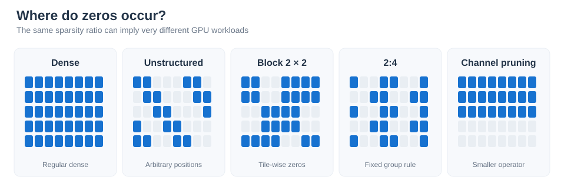
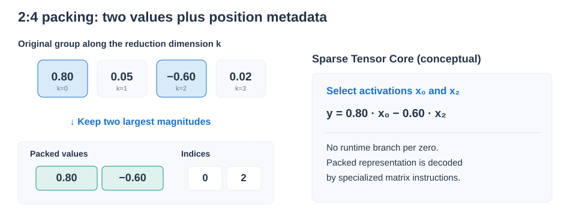
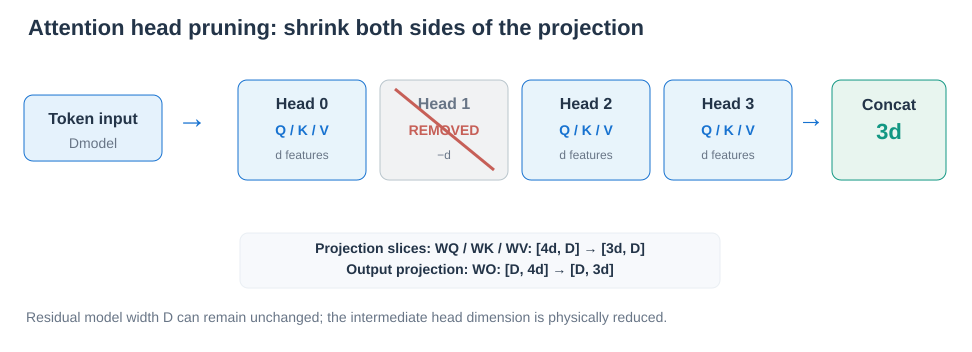

**Efficient ML · Part I.** From sparse weight representations to GPU kernels, pruning criteria, and post-pruning recovery.

We use a linear layer as the running example, with **Einstein summation** over repeated indices:

$$
\boxed{y_{bn}=x_{bk}w_{nk}},\qquad
x\in\mathbb R^{B\times K},\quad
w\in\mathbb R^{N\times K},\quad
y\in\mathbb R^{B\times N}.
$$

Here $b$ indexes examples/tokens, $k$ input features, and $n$ output features. For example, `torch.einsum("bk,nk->bn", x, w)` is equivalent to `torch.nn.functional.linear(x, w)` without bias. The three questions to keep separate are **what to remove**, **how to compute the remaining weights**, and **how to recover the lost function**.

## 1. Sparse computation, formats, and regularity

**Zeroing weights does not automatically accelerate a GPU.** After pruning, introduce a binary mask $m_{nk}$ and effective weights $\widetilde w_{nk}=m_{nk}w_{nk}$. The mathematical output is still

$$
y_{bn}=x_{bk}\widetilde w_{nk}.
$$

A conventional dense GEMM still loads and processes the dense matrix—including zeros. Actual speedup requires either a kernel that understands the sparse representation or a physically smaller, still-dense operator.



*Figure 1. Five patterns, with the same conceptual input/output axes. A channel-pruned matrix has fewer rows; it is not merely a large matrix with zeroed rows.*

**Unstructured sparsity and CSR.** A zero pattern can be arbitrary. For each output $n$, let $\Omega_n=\{k:\widetilde w_{nk}\neq0\}$. Then

$$
y_{bn}=\sum_{k\in\Omega_n}x_{bk}\widetilde w_{nk}.
$$

A compressed sparse row (CSR) matrix stores nonzero values $v_p$, column indices $c_p$, and row offsets $r_n$. Computation becomes

$$
\boxed{y_{bn}=\sum_{p=r_n}^{r_{n+1}-1}x_{b,c_p}v_p}.
$$

For example,

$$
\widetilde W=\begin{bmatrix}1&0&0&2\\0&3&0&0\\4&0&5&0\end{bmatrix},\quad
v=[1,2,3,4,5],\quad c=[0,3,1,0,2],\quad r=[0,2,3,5].
$$

A CSR SpMM kernel can assign output rows/tiles to threads or warps, read the stored values, gather $x_{b,c_p}$, and accumulate products. The drawback is that $c_p$ causes indirect activation reads and rows may contain different amounts of work. CSR is especially attractive at *high* sparsity, not necessarily at only 50% sparsity. For example, FP16 dense weights require $2NK$ bytes; CSR with FP16 values and INT32 column indices requires approximately $6\operatorname{nnz}+4(N+1)$ bytes, so ignoring row-pointer overhead, it saves storage only when more than roughly two-thirds of entries are zero.

**2:4 semi-structured sparsity.** Rather than allowing arbitrary zeros, partition the reduction dimension into four-element groups, $k=4g+r$, $r\in\{0,1,2,3\}$, and impose

$$
\boxed{\sum_{r=0}^{3}m_{n,4g+r}=2}.
$$

For each group, retain two *positions* and pack two weight values $v_{ngq}$ together with their local positions $j_{ngq}\in\{0,1,2,3\}$, for $q\in\{0,1\}$. The corresponding computation is

$$
\boxed{y_{bn}=\sum_g\sum_{q=0}^{1}x_{b,4g+j_{ngq}}v_{ngq}}.
$$



*Figure 2. Packing encodes both surviving values and their positions. The hardware does not need an `if weight != 0` branch for every multiplication.*

On compatible NVIDIA GPUs, Sparse Tensor Core instructions use this structured metadata to select the relevant activation elements while performing sparse matrix-multiply–accumulate operations. **2:4 halves the relevant mathematical multiply–accumulate count**, but the matrix operation's measured speedup depends on tile dimensions, dtype, data movement, and kernel overhead; end-to-end model speedup is usually smaller than the theoretical factor. A packed FP16 2:4 tensor in the documented PyTorch representation occupies **9/16 of the dense storage** (values plus metadata), rather than exactly one-half [1, 2].

**Structured pruning** removes an entire logical dimension. Consider a two-layer MLP:

$$
h_{bi}=\phi(x_{bk}a_{ik}),\qquad y_{bo}=h_{bi}u_{oi}.
$$

If we retain only hidden units $s\in S$, we create $\widetilde a\in\mathbb R^{|S|\times K}$ and $\widetilde u\in\mathbb R^{O\times|S|}$; the original hidden dimension $I$ becomes $|S|$. No sparse kernel is needed: the GEMMs are simply smaller. The same principle applies to deleting CNN channels and attention heads, provided all dependent weight slices are removed consistently.


*Figure 3. The same zeros can lead to three very different GPU execution paths. The layout, not merely the zero count, is decisive.*

Sparsity itself is a scalar,

$$
\text{sparsity}=\frac{N_{\rm zero}}{N_{\rm total}},\qquad
\text{density}=1-\text{sparsity}.
$$

But the **regularity of the sparse pattern** is a separate property: arbitrary element locations, fixed blocks, $N{:}M$ constraints, and full channels have progressively stronger structural restrictions. This is not a universally defined single numeric score. For deployed models, report at least four distinct quantities:

| Quantity | Definition / diagnostic | What it tells you |
|---|---|---|
| Sparsity | `#zero / #total` | Fraction of masked weights |
| Storage | Compressed tensor bytes, including metadata | Actual memory savings |
| Effective MACs | Dense: $BNK$; ideal 2:4: $BNK/2$ | Arithmetic that can potentially be skipped |
| Latency | GPU time for the real shapes and workload | Actual inference improvement |

A quick Amdahl-law check illustrates the difference between kernel and model speed: if 70% of a workload benefits from a 2× faster sparse GEMM and the other 30% is unchanged, overall speedup is only $1/(0.30+0.70/2)\approx1.54\times$. This is an illustrative calculation, not a benchmark.

For a Transformer, measure **prefill** and **decode** separately: large prefill GEMMs and small decode GEMMs have different computational/communication bottlenecks. Sparse weight storage may help bandwidth-sensitive execution, but metadata and kernel inefficiencies can erase the gain. NVIDIA provides general unstructured sparse routines through cuSPARSE and structured sparse GEMM through cuSPARSELt [1, 3].

The minimal PyTorch experiment below shows the difference between *zeroed dense* weights and a *packed sparse* weight. It requires a supported CUDA GPU, PyTorch build, dtype, and dimensions; the CPU-only examples in later sections do not.

```python
import torch
import torch.nn.functional as F
from torch.sparse import to_sparse_semi_structured

assert torch.cuda.is_available(), "2:4 sparse kernel example requires CUDA"
N = K = 256                 # multiples of 64 for FP16 in the documented API
B = 1024
x = torch.randn(B, K, device="cuda", dtype=torch.float16)
w = torch.randn(N, K, device="cuda", dtype=torch.float16)

# Each four-element group keeps the two largest magnitudes.
g = w.reshape(N, K // 4, 4)
keep_idx = g.abs().topk(2, dim=-1).indices
mask = torch.zeros_like(g).scatter_(-1, keep_idx, 1).reshape(N, K)
w_dense_zeroed = w * mask
w_packed = to_sparse_semi_structured(w_dense_zeroed)

with torch.inference_mode():
    yd = F.linear(x, w_dense_zeroed)  # dense GEMM, despite 50% zeros
    ys = F.linear(x, w_packed)        # supported sparse GEMM path
    print("max abs error:", (yd - ys).abs().max().item())

    def ms_per_call(fn, iterations=200):
        for _ in range(20):
            fn()
        torch.cuda.synchronize()
        start, end = torch.cuda.Event(enable_timing=True), torch.cuda.Event(enable_timing=True)
        start.record()
        for _ in range(iterations):
            fn()
        end.record()
        torch.cuda.synchronize()
        return start.elapsed_time(end) / iterations

    print("dense ms:", ms_per_call(lambda: F.linear(x, w_dense_zeroed)))
    print("2:4   ms:", ms_per_call(lambda: F.linear(x, w_packed)))
```

These are **forward-only inference** times for this particular shape, not an end-to-end LLM benchmark. See the exact compatibility requirements in the PyTorch sparse documentation [2].

## 2. Pruning scores, Hessians, and regression reconstruction

**Choosing a support is different from refitting its weights.** Given a budget of $P$ retained weights, we seek a mask $m$ with $\lVert m\rVert_0\le P$, then adjust the retained weights to limit the loss. The mask can be selected globally, per output channel, per $N{:}M$ group, or per structural group; these constraints change the problem. In 2:4 magnitude pruning, for example, we keep the two largest $|w_{n,4g+r}|$ *within each group*, not the globally largest half of all weights.

Here are the principal score families:

| Method | Importance of an individual weight | Interpretation |
|---|---|---|
| Magnitude | $s_{nk}=|w_{nk}|$ | Weight size; no data dependence |
| Wanda-style | $s_{nk}=|w_{nk}|\sqrt{\sum_b x_{bk}^2}$ | Weight magnitude weighted by observed input scale |
| First-order | $s_i=|w_i g_i|$ | Magnitude of local task-loss change if deleted |
| OBD | $s_p\approx \tfrac12H_{pp}w_p^2$ | Curvature cost when only that weight changes |
| OBS | $s_p\approx w_p^2/[2(H^{-1})_{pp}]$ | Minimum quadratic cost *after* optimizing other weights |

A compact implementation of magnitude and activation-aware scoring is:

```python
import torch
# Calibration activations X: [B, K]; linear weight W: [N, K].
B, K, N = 128, 16, 8
X, W = torch.randn(B, K), torch.randn(N, K)
magnitude = W.abs()
wanda = W.abs() * X.square().sum(dim=0).sqrt()[None, :]

# Per-output, 50%-sparse mask from Wanda scores.
keep = wanda.topk(k=K // 2, dim=1).indices
mask = torch.zeros_like(W).scatter_(1, keep, 1)
assert (mask == 0).float().mean() == 0.5
```

Wanda's score is easy to motivate from the linear equation. Removing one $w_{nk}$ alone changes output $n$ by $\Delta y_{bn}=-x_{bk}w_{nk}$, so the calibration-set output-change norm is precisely $|w_{nk}|\lVert x_{:k}\rVert_2$. It is still a heuristic for *joint* pruning, because deleting multiple weights introduces correlated errors [4].

**Second-order pruning.** Flatten the parameters under consideration into $w_i$. Near a stationary point of some chosen loss $\mathcal L$, the second-order approximation is

$$
\Delta\mathcal L\approx \tfrac12\Delta w_iH_{ij}\Delta w_j,
\qquad H_{ij}=\frac{\partial^2\mathcal L}{\partial w_i\partial w_j}.
$$

If we simply set $w_p=0$, then $\Delta w_i=-w_p\delta_{ip}$, giving OBD's diagonal score $\frac12w_p^2H_{pp}$. OBS instead allows every surviving weight to change. With the constraint $\Delta w_p=-w_p$, solve

$$
\min_{\Delta w}\;\tfrac12\Delta w_iH_{ij}\Delta w_j
\quad\text{subject to }\Delta w_p=-w_p.
$$

Introducing a Lagrange multiplier $\lambda$, stationarity gives $H_{ij}\Delta w_j+\lambda\delta_{ip}=0$. Let $C=H^{-1}$. Substituting the constraint yields

$$
\boxed{\Delta w_i^*=-\frac{w_p}{C_{pp}}C_{ip}},\qquad
\boxed{\Delta\mathcal L_p^*=\frac{w_p^2}{2C_{pp}}}.
$$

These formulas assume the local quadratic model and an invertible positive-definite Hessian (or a suitably regularized approximation). The off-diagonal entries of $C$ describe how *other* weights can compensate for deleting weight $p$; the score uses the **inverse-Hessian diagonal**, not $H_{pp}$ [5].

**Regression / layer-wise reconstruction.** Rather than approximating the entire model's task loss, keep the calibration inputs of one Linear layer fixed and use its original outputs as targets:

$$
\min_{\widetilde W\in\mathcal S}
\mathcal L_{\rm rec}
=\frac12\sum_{b,n}\bigl(x_{bk}\widetilde w_{nk}-x_{bk}w_{nk}\bigr)^2,
$$

where $\mathcal S$ specifies an allowed sparse support/pattern. Let $\Delta w_{nk}=\widetilde w_{nk}-w_{nk}$, and rename the second contracted input index to $\ell$:

$$
\begin{aligned}
\mathcal L_{\rm rec}
&=\tfrac12(x_{bk}\Delta w_{nk})(x_{b\ell}\Delta w_{n\ell})\\
&=\tfrac12\Delta w_{nk}\underbrace{(x_{bk}x_{b\ell})}_{H_{k\ell}}\Delta w_{n\ell}.
\end{aligned}
$$

Thus for each output row, **the exact Hessian of this local squared-reconstruction loss is**

$$
\boxed{H_{k\ell}=\sum_bx_{bk}x_{b\ell}\;=\;(X^\top X)_{k\ell}}.
$$

This is *not* the full model's task-loss Hessian. The equivalence is specific to a **fixed-input linear layer with squared output reconstruction**. It also explains why OBS-style second-order updates naturally appear in reconstruction-based pruning, including SparseGPT [6].

Once a set of input features $S$ is fixed, ordinary least squares can fit the surviving row of weights. In matrix notation, given original output $Y=XW^\top$,

$$
\boxed{\widetilde W_S^\top=X_S^\dagger Y},
$$

where $X_S^\dagger$ is the pseudoinverse. With full column rank, $X_S^\dagger=(X_S^\top X_S)^{-1}X_S^\top$. Support selection is usually the harder, combinatorial part; some **regression-based structured pruning** methods use LASSO to select channels and then least squares to reconstruct the outputs [7].

**A fully worked two-weight example.** Take two samples with

$$
X=\begin{bmatrix}1&1\\1&1.1\end{bmatrix},\qquad
w=\begin{bmatrix}1\\1\end{bmatrix},\qquad
y=Xw=\begin{bmatrix}2\\2.1\end{bmatrix}.
$$

We want $w_2=0$. Naively keeping $w_1=1$ gives $\widehat y=[1,1]^\top$ and loss $\frac12\lVert\widehat y-y\rVert_2^2=1.105$. Regression refits $w_1$:

$$
\widetilde w_1
=\frac{\sum_bx_{b1}y_b}{\sum_bx_{b1}^2}
=\frac{2+2.1}{2}=2.05,
$$

so the loss becomes **0.0025**. Here $H=X^\top X=\begin{bmatrix}2&2.1\\2.1&2.21\end{bmatrix}$ and $H^{-1}=\begin{bmatrix}221&-210\\-210&200\end{bmatrix}$. OBS predicts $\Delta w=[1.05,-1]^\top$ and the *same* loss **0.0025**. This exact agreement occurs because the local regression objective is quadratic and we imposed the same pruning constraint.


*Figure 4. Highly correlated input features produce a narrow low-loss valley. Deleting $w_2$ is inexpensive if $w_1$ is allowed to move along that valley.*

You can verify the numbers independently:

```python
import torch
X = torch.tensor([[1., 1.], [1., 1.1]], dtype=torch.float64)
w = torch.tensor([1., 1.], dtype=torch.float64)
y = X @ w
naive = torch.tensor([1., 0.], dtype=torch.float64)
w1 = torch.linalg.lstsq(X[:, :1], y).solution.item()
refit = torch.tensor([w1, 0.], dtype=torch.float64)
err = lambda z: 0.5 * ((X @ z - y) ** 2).sum().item()
print(f"naive = {err(naive):.4f}; refit = {err(refit):.4f}; w1 = {w1:.2f}")
# naive = 1.1050; refit = 0.0025; w1 = 2.05
```

## 3. Recovery fine-tuning and sparse deployment

After selecting a support, **fixed-mask fine-tuning** optimizes only its surviving effective connections. Parameterize the pruned layer as

$$
\widetilde w_{nk}=m_{nk}\theta_{nk},\qquad
\min_\theta\mathcal L(m\odot\theta).
$$

If $g_{bn}=\partial\mathcal L/\partial y_{bn}$, then by the chain rule

$$
\boxed{\frac{\partial\mathcal L}{\partial\theta_{nk}}=m_{nk}x_{bk}g_{bn}}.
$$

For $m_{nk}=0$, the *effective* weight and its task gradient remain zero. This is why the mask must stay in the forward graph during training. Merely overwriting weights with zero once is insufficient: subsequent optimizer steps may make them nonzero. Optimizer momentum or weight decay can modify the underlying $\theta$, but a fixed forward mask preserves the effective zero pattern.


*Figure 5. The same binary mask filters forward weights and backward gradients. The example is independent of optimizer choice.*

There are three useful recovery objectives, which can also be combined:

| Objective | Example | What it restores |
|---|---|---|
| Local reconstruction | $\lVert h^{\rm sparse}-h^{\rm teacher}\rVert_2^2$ | Internal representations or layer outputs |
| Teacher distillation | $T^2\operatorname{KL}(p^{T}\Vert p^{S})$ | Original model's predictive distribution |
| Task loss | Token cross-entropy / supervised target loss | Downstream task quality |

For a language model, a common full-model objective is $\mathcal L=\lambda_{\rm CE}\mathcal L_{\rm CE}+\lambda_{\rm KD}\mathcal L_{\rm KD}$, where $p^T_{bv}=\operatorname{softmax}_v(z^T_{bv}/T)$ and $p^S_{bv}=\operatorname{softmax}_v(z^S_{bv}/T)$; then $\mathcal L_{\rm KD}=T^2\sum_{b,v}p^T_{bv}\log[p^T_{bv}/p^S_{bv}]$. A token-weighted average can be applied in implementation. Unlike layer-wise regression, full-model fine-tuning lets *other layers* compensate for the removed connections.

The code below uses PyTorch pruning reparameterization to keep the **2:4 mask fixed during training**, recovering the pruned student against a frozen teacher. It runs on CPU or GPU and uses synthetic data solely to demonstrate mechanics.

```python
import copy
import torch
import torch.nn as nn
import torch.nn.functional as F
from torch.nn.utils import prune

torch.manual_seed(0)
device = "cuda" if torch.cuda.is_available() else "cpu"
teacher = nn.Sequential(nn.Linear(32, 64), nn.GELU(), nn.Linear(64, 8)).to(device).eval()
student = copy.deepcopy(teacher).train()

def mask_2_4(weight):
    n, k = weight.shape
    assert k % 4 == 0
    group = weight.detach().reshape(n, k // 4, 4)
    keep = group.abs().topk(2, dim=-1).indices
    mask = torch.zeros_like(group)
    return mask.scatter_(-1, keep, 1).reshape_as(weight)

for layer in student.modules():
    if isinstance(layer, nn.Linear):
        prune.custom_from_mask(layer, "weight", mask_2_4(layer.weight))

x = torch.randn(256, 32, device=device)
with torch.no_grad():
    target = teacher(x)
    before = F.mse_loss(student(x), target).item()

opt = torch.optim.AdamW(student.parameters(), lr=1e-3, weight_decay=0)
for step in range(100):
    opt.zero_grad()
    loss = F.mse_loss(student(x), target)
    loss.backward()
    opt.step()

with torch.no_grad():
    after = F.mse_loss(student(x), target).item()
print(f"reconstruction MSE: {before:.5f} -> {after:.5f}")

# Export only after recovery; remove() does not compress or accelerate the layer.
for layer in student.modules():
    if isinstance(layer, nn.Linear):
        assert torch.all(layer.weight[layer.weight_mask == 0] == 0)
        prune.remove(layer, "weight")
```

**Practical order.** Choose the deployment pattern first; calibrate using representative activations; select the mask and optionally reconstruct its weights; evaluate the immediate loss increase; fine-tune with the support fixed; export to a supported compressed sparse tensor or a physically narrower model; measure accuracy, compressed bytes, and GPU latency. At large pruning ratios, iterative prune–recover cycles can be more stable than a single abrupt cut. For strict 2:4 inference, check the pattern *after* recovery. A dense LoRA update merged into a sparse base can violate the pattern, so its deployment needs a sparsity-preserving strategy. `prune.remove()` only materializes zeros; it does not by itself call a sparse GPU kernel [8].


*Figure 6. Efficient pruning starts with a deployment target, not merely a zero count.*

## 4. Extensions: attention and convolution

**Attention.** For a Transformer input $x_{btk}$, with token positions $t,s$, heads $h$, and head dimension $d$, define

$$
q_{bthd}=x_{btk}W^Q_{hdk},\quad
\kappa_{bshd}=x_{bsk}W^K_{hdk},\quad
v_{bshd}=x_{bsk}W^V_{hdk}.
$$

Then

$$
a_{bhts}=\frac{q_{bthd}\kappa_{bshd}}{\sqrt{D_h}},\quad
\alpha_{bhts}=\operatorname{softmax}_s(a_{bhts}),\quad
z_{bthd}=\alpha_{bhts}v_{bshd},
$$

followed by $y_{bto}=z_{bthd}W^O_{ohd}$, summing over $h,d$. There are three distinct sparsity targets: **weight sparsity** inside Q/K/V/output projections, **head pruning** (delete a complete $h$), and **attention-map sparsity** (skip selected token pairs $(t,s)$, which is a different computation-sparsity problem).

For structured head pruning, deleting head $h$ means deleting the corresponding **output rows** of $W^Q,W^K,W^V$, the corresponding **input columns** of $W^O$, and updating head reshaping. Merely setting a head's output to zero leaves its original projection cost in place. With grouped-query or multi-query attention, shared KV heads require additional consistency rules.



*Figure 6. Head pruning decreases the number of concatenated head features sent into the output projection. Residual/model width can remain unchanged.*

Here is a **runnable minimal multi-head attention** implementation that physically removes heads and updates all projection matrices:

```python
import math
import torch
from torch import nn

class TinyMHA(nn.Module):
    def __init__(self, d_model=32, n_heads=4, d_head=8):
        super().__init__()
        self.n_heads, self.d_head = n_heads, d_head
        self.q = nn.Linear(d_model, n_heads * d_head, bias=False)
        self.k = nn.Linear(d_model, n_heads * d_head, bias=False)
        self.v = nn.Linear(d_model, n_heads * d_head, bias=False)
        self.out = nn.Linear(n_heads * d_head, d_model, bias=False)

    def forward(self, x):  # [B, T, Dmodel]
        b, t, _ = x.shape
        proj = lambda layer: layer(x).reshape(b, t, self.n_heads, self.d_head)
        q, k, v = proj(self.q), proj(self.k), proj(self.v)
        attn = torch.einsum("bthd,bshd->bhts", q, k) / math.sqrt(self.d_head)
        z = torch.einsum("bhts,bshd->bthd", attn.softmax(-1), v)
        return self.out(z.reshape(b, t, -1))

@torch.no_grad()
def keep_heads(old, heads):
    d_model = old.q.in_features
    new = TinyMHA(d_model, len(heads), old.d_head).to(old.q.weight.device)
    idx = torch.tensor([h * old.d_head + d for h in heads
                        for d in range(old.d_head)], device=old.q.weight.device)
    for name in ("q", "k", "v"):
        getattr(new, name).weight.copy_(getattr(old, name).weight[idx, :])
    new.out.weight.copy_(old.out.weight[:, idx])
    return new

old = TinyMHA()
small = keep_heads(old, [0, 2, 3])
assert small(torch.randn(2, 5, 32)).shape == (2, 5, 32)
print(old.q.weight.shape, small.q.weight.shape)  # [32,32] -> [24,32]
```

**Convolution.** For a stride-one 2D convolution (assuming spatial indices already account for padding),

$$
\boxed{y_{bohu}=x_{bc,h+r,u+s}K_{ocrs}}.
$$

Here $c$ is the input channel, $o$ the output channel, and $r,s$ kernel offsets; the repeated $c,r,s$ indices are summed. Individual entries $K_{ocrs}$ can be pruned, but structured **filter pruning** deletes an entire output-channel slice $K_{o:::}$. The output channel disappears from the feature map, so the next convolution must remove the matching **input-channel** slice. BatchNorm channels, residual branches, concatenations and grouped/depthwise convolutions require additional coordination in real architectures.


*Figure 7. For physical channel pruning, the retained output-channel indices of Conv1 must be used to slice Conv2's input-channel dimension.*

For a simple two-convolution chain, channel pruning can be implemented with tensor slicing, without any sparse matrix library:

```python
import torch
from torch import nn

conv1 = nn.Conv2d(3, 8, kernel_size=3, padding=1)
conv2 = nn.Conv2d(8, 16, kernel_size=3, padding=1)

# Keep five filters with the largest L2 norm.
score = conv1.weight.detach().flatten(1).norm(dim=1)
keep = score.topk(5).indices.sort().values
small1 = nn.Conv2d(3, 5, 3, padding=1)
small2 = nn.Conv2d(5, 16, 3, padding=1)
with torch.no_grad():
    small1.weight.copy_(conv1.weight[keep])
    small1.bias.copy_(conv1.bias[keep])
    small2.weight.copy_(conv2.weight[:, keep])  # crucial downstream slice
    small2.bias.copy_(conv2.bias)

x = torch.randn(2, 3, 32, 32)
y = small2(torch.relu(small1(x)))
assert y.shape == (2, 16, 32, 32)
```

For CNNs, channel selection may also use activation statistics, first/second-order loss estimates, or sparse regression followed by least-squares reconstruction [7]. Attention heads can be scored using group norms or their effect on a validation loss; head-level redundancy has been investigated directly [9].

**Summary.** A pruning method has three distinct design decisions: the **support/structure** (arbitrary elements, 2:4, blocks, channels, heads), the **score and compensation rule** (magnitude, activation-aware, curvature, regression), and the **recovery/deployment method** (fixed-mask fine-tuning, distillation, compressed sparse kernels, or smaller dense tensors). Numerical sparsity alone is not a GPU performance metric.

**References:** [1] [NVIDIA cuSPARSELt](https://docs.nvidia.com/cuda/cusparselt/) and its [2:4 explanation](https://developer.nvidia.com/blog/exploiting-ampere-structured-sparsity-with-cusparselt/); [2] [PyTorch semi-structured sparse tensors](https://docs.pytorch.org/docs/stable/sparse.html); [3] [NVIDIA cuSPARSE](https://docs.nvidia.com/cuda/cusparse/index.html); [4] [Wanda (ICLR 2024)](https://proceedings.iclr.cc/paper_files/paper/2024/hash/14c856c7a41297804de4c4890e846b25-Abstract-Conference.html); [5] [Optimal Brain Surgeon (1993)](https://authors.library.caltech.edu/records/tzehb-vz706); [6] [SparseGPT (2023)](https://arxiv.org/abs/2301.00774); [7] [Channel Pruning via LASSO and Reconstruction (ICCV 2017)](https://openaccess.thecvf.com/content_iccv_2017/html/He_Channel_Pruning_for_ICCV_2017_paper.html); [8] [PyTorch `prune.remove`](https://docs.pytorch.org/docs/stable/generated/torch.nn.utils.prune.remove.html); [9] [Are Sixteen Heads Really Better than One? (NeurIPS 2019)](https://mlanthology.org/neurips/2019/michel2019neurips-sixteen/).

**Standalone code examples:** [`sparse_gpu_benchmark.py`](code/sparse_gpu_benchmark.py) · [`importance_scores.py`](code/importance_scores.py) · [`regression_obs_demo.py`](code/regression_obs_demo.py) · [`fixed_mask_finetune.py`](code/fixed_mask_finetune.py) · [`attention_head_pruning.py`](code/attention_head_pruning.py) · [`cnn_channel_pruning.py`](code/cnn_channel_pruning.py).
