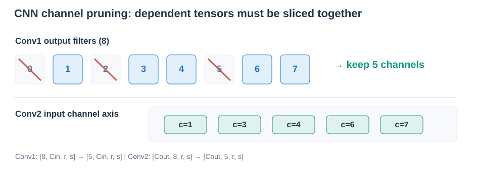

**Efficient ML · Part I.** Pruning turns learned redundancy into more efficient operators. We can use it to reduce weight storage, replace expensive dense operations with sparse GPU kernels, or shrink channels and heads so that the network performs smaller dense matrix multiplications.

The starting point is a linear layer, written using **Einstein summation notation**:

$$
\boxed{y_{bn}=x_{bk}w_{nk}},\qquad
x\in\mathbb R^{B\times K},\quad
w\in\mathbb R^{N\times K},\quad
y\in\mathbb R^{B\times N}.
$$

Here $b$ indexes examples or tokens, $k$ input features, and $n$ output features. Repeated indices are summed, so the equation corresponds to `torch.einsum("bk,nk->bn", x, w)` or `torch.nn.functional.linear(x, w)` without bias.

We will build a complete compression pipeline: **represent and execute sparse operators → choose weights using importance scores → reconstruct and fine-tune the remaining weights → apply the same principles to attention and convolution**. Each stage has a concrete mathematical objective and a corresponding implementation.

## 1. Sparse computation, formats, and regularity

Suppose we introduce a binary support mask $m_{nk}\in\{0,1\}$ and define effective weights

$$
\widetilde w_{nk}=m_{nk}w_{nk},\qquad y_{bn}=x_{bk}\widetilde w_{nk}.
$$

The next step is to turn that mask into an efficient operator. There are two principal strategies. **Sparse execution** retains the original tensor dimensions and processes packed nonzero weights. **Structured pruning** removes entire dimensions, giving a smaller dense operator. Block sparsity and $N{:}M$ sparsity provide intermediate, GPU-friendly structures.


*Figure 1. Five ways to represent a smaller computation, from arbitrary zeros to physically reduced matrix dimensions.*

**Unstructured sparsity and CSR.** Let $\Omega_n$ denote the surviving input indices for output channel $n$:

$$
\Omega_n=\{k:\widetilde w_{nk}\neq0\},\qquad
\boxed{y_{bn}=\sum_{k\in\Omega_n}x_{bk}\widetilde w_{nk}}.
$$

We can implement this restricted sum with **compressed sparse row (CSR)** storage. CSR consists of nonzero values $v_p$, their input-column indices $c_p$, and row offsets $r_n$. The sparse matrix multiplication becomes

$$
\boxed{y_{bn}=\sum_{p=r_n}^{r_{n+1}-1}x_{b,c_p}v_p}.
$$

For example,

$$
\widetilde W=
\begin{bmatrix}
1&0&0&2\\
0&3&0&0\\
4&0&5&0
\end{bmatrix},\quad
v=[1,2,3,4,5],\quad
c=[0,3,1,0,2],\quad
r=[0,2,3,5].
$$

For output channel $n=0$, the kernel reads the first two packed values and computes $y_{b0}=x_{b0}+2x_{b3}$. Different output rows or tiles can be processed by different GPU warps. Each warp reads the packed weight values, gathers the corresponding activations, and accumulates the products. In block-sparse kernels, the surviving values are organized into contiguous tiles to give the GPU larger units of work.

A direct PyTorch implementation of the same operation is:

~~~python
import torch

W = torch.tensor([[1., 0., 0., 2.],
                  [0., 3., 0., 0.],
                  [4., 0., 5., 0.]])
X = torch.randn(6, 4)                   # [B, K]
W_csr = W.to_sparse_csr()                # [N, K]
Y_sparse = torch.sparse.mm(W_csr, X.T).T # [B, N]
Y_dense = torch.einsum("bk,nk->bn", X, W)
torch.testing.assert_close(Y_sparse, Y_dense)
~~~

CSR gives us flexible sparse computation; the layout of column indices controls gather behavior, and row offsets determine how work is distributed across threads. As a concrete storage calculation, FP16 dense weights occupy $2NK$ bytes, while CSR with FP16 values and INT32 column indices occupies approximately $6\,\mathrm{nnz}+4(N+1)$ bytes. This helps decide the sparsity level at which compression becomes worthwhile.

**2:4 semi-structured sparsity.** For a more regular GPU operator, partition the reduction dimension into groups of four, $k=4g+r$, $r\in\{0,1,2,3\}$, and keep exactly two positions in each group:

$$
\boxed{\sum_{r=0}^{3}m_{n,4g+r}=2}.
$$

Write $v_{ngq}$ for retained value $q\in\{0,1\}$ and $j_{ngq}\in\{0,1,2,3\}$ for its original position. The contraction becomes

$$
\boxed{y_{bn}=\sum_g\sum_{q=0}^{1}x_{b,4g+j_{ngq}}v_{ngq}}.
$$

For example, $[0.8,0.05,-0.6,0.02]$ is packed as values $[0.8,-0.6]$ with position metadata $[0,2]$. The contribution to one output is $0.8x_{b,4g}-0.6x_{b,4g+2}$. A Sparse Tensor Core executes this pattern at the level of matrix tiles, using a compact, regular representation of both values and positions [1,2].


*Figure 2. Two surviving values and their positions form a compact unit that Sparse Tensor Core instructions can process directly.*

For an FP16 linear layer, 2:4 pruning retains half of the effective weight multiplications. A supported PyTorch packed 2:4 representation occupies **9/16 of the dense weight storage**, including metadata [2]. Consider a $4096\times4096$ FP16 weight matrix: dense storage is 32 MiB, while the documented packed representation requires about 18 MiB. For a batch dimension $B=1024$, the dense contraction performs approximately **17.18 billion multiply–accumulates (MACs)**; 2:4 sparse arithmetic uses **8.59 billion**. This is the arithmetic and storage budget the specialized kernel exploits.

**Structured pruning** removes an entire logical dimension. Consider a two-layer MLP:

$$
h_{bi}=\phi(x_{bk}a_{ik}),\qquad y_{bo}=h_{bi}u_{oi}.
$$

If we retain only hidden units $s\in S$, we create $\widetilde a\in\mathbb R^{|S|\times K}$ and $\widetilde u\in\mathbb R^{O\times|S|}$; the original hidden dimension $I$ becomes $|S|$. No sparse kernel is needed: the GEMMs are simply smaller. The same principle applies to deleting CNN channels and attention heads, provided all dependent weight slices are removed consistently.

**Measuring sparsity and performance.** We describe a compressed operator using both its zero fraction and the regularity of its structure:

$$
\text{sparsity}=\frac{N_{\rm zero}}{N_{\rm total}},
\qquad
\text{density}=1-\text{sparsity}.
$$

A pattern can be unstructured, block-sparse, $N{:}M$ sparse, or structured along whole channels and heads. The same sparsity ratio can produce different performance because each pattern has a different representation and kernel.

| Quantity | Measurement | Example |
|---|---|---|
| Sparsity | Zero entries / total entries | 2:4 gives 50% |
| Compressed weight size | Values plus metadata | 32 MiB → about 18 MiB for the FP16 example |
| Effective arithmetic | Number of active MACs | $BNK\to BNK/2$ for 2:4 |
| Kernel latency | CUDA event timing | Compare equal input shapes and precision |
| Model throughput | Tokens/second or examples/second | Measure full prefill/decode workloads |


*Figure 3. Dense GEMM computes regular full tiles; CSR SpMM gathers packed nonzeros; 2:4 sparse MMA combines fixed sparsity metadata with specialized Tensor Core computation.*

The kernel turns arithmetic reduction into runtime speedup. For example, if a workload spends 70% of its time in a GEMM that becomes twice as fast, Amdahl's law gives an overall acceleration of $1/(0.30+0.70/2)\approx1.54\times$. This also motivates benchmarking **prefill and decode separately** in language models. NVIDIA supplies general sparse operations through cuSPARSE and specialized 2:4 sparse GEMM through cuSPARSELt [1,3].

The next experiment compares two implementations of the same pruned linear operator: a dense tensor containing zeros and a packed 2:4 sparse tensor. It verifies the outputs and benchmarks both GPU execution paths.

```python
import torch
import torch.nn.functional as F
from torch.sparse import to_sparse_semi_structured

assert torch.cuda.is_available(), "2:4 sparse kernel example requires CUDA"
N = K = 256                 # multiples of 64 for FP16 in the documented API
B = 1024
x = torch.randn(B, K, device="cuda", dtype=torch.float16)
w = torch.randn(N, K, device="cuda", dtype=torch.float16)

# Each four-element group keeps the two largest magnitudes.
g = w.reshape(N, K // 4, 4)
keep_idx = g.abs().topk(2, dim=-1).indices
mask = torch.zeros_like(g).scatter_(-1, keep_idx, 1).reshape(N, K)
w_dense_zeroed = w * mask
w_packed = to_sparse_semi_structured(w_dense_zeroed)

with torch.inference_mode():
    yd = F.linear(x, w_dense_zeroed)  # dense GEMM, despite 50% zeros
    ys = F.linear(x, w_packed)        # supported sparse GEMM path
    print("max abs error:", (yd - ys).abs().max().item())

    def ms_per_call(fn, iterations=200):
        for _ in range(20):
            fn()
        torch.cuda.synchronize()
        start, end = torch.cuda.Event(enable_timing=True), torch.cuda.Event(enable_timing=True)
        start.record()
        for _ in range(iterations):
            fn()
        end.record()
        torch.cuda.synchronize()
        return start.elapsed_time(end) / iterations

    print("dense ms:", ms_per_call(lambda: F.linear(x, w_dense_zeroed)))
    print("2:4   ms:", ms_per_call(lambda: F.linear(x, w_packed)))
```

The measured ratio of dense to sparse latency quantifies the benefit of this operator on the test GPU. The same measurement can be repeated for the matrix sizes encountered during model inference [2].

## 2. Pruning scores, Hessians, and regression reconstruction

The goal of pruning is to choose a **support** (which connections survive) and then fit the remaining weights to preserve the model's function. With $P$ retained parameters, write

$$
\min_{m,\theta}\mathcal L(m\odot\theta),
\qquad m_{nk}\in\{0,1\},\qquad \|m\|_0\le P.
$$

A scoring rule approximates the increase in loss when a parameter or group is removed. The support constraint specifies how scores are compared: globally, per output row, per 2:4 group, or per channel/head. After selecting the support, reconstruction determines how the surviving weights should change.

Here are the principal score families:

| Method | Importance of an individual weight | Interpretation |
|---|---|---|
| Magnitude | $s_{nk}=|w_{nk}|$ | Weight size; no data dependence |
| Wanda-style | $s_{nk}=|w_{nk}|\sqrt{\sum_b x_{bk}^2}$ | Weight magnitude weighted by observed input scale |
| First-order | $s_i=|w_i g_i|$ | Magnitude of local task-loss change if deleted |
| OBD | $s_p\approx \tfrac12H_{pp}w_p^2$ | Curvature cost when only that weight changes |
| OBS | $s_p\approx w_p^2/[2(H^{-1})_{pp}]$ | Minimum quadratic cost *after* optimizing other weights |

A compact implementation of magnitude and activation-aware scoring is:

```python
import torch
# Calibration activations X: [B, K]; linear weight W: [N, K].
B, K, N = 128, 16, 8
X, W = torch.randn(B, K), torch.randn(N, K)
magnitude = W.abs()
wanda = W.abs() * X.square().sum(dim=0).sqrt()[None, :]

# Per-output, 50%-sparse mask from Wanda scores.
keep = wanda.topk(k=K // 2, dim=1).indices
mask = torch.zeros_like(W).scatter_(1, keep, 1)
assert (mask == 0).float().mean() == 0.5
```

The Wanda score follows directly from the linear contraction. If we delete one weight at a fixed $(n,k)$, then $\Delta y_{bn}=-x_{bk}w_{nk}$, and the output-change norm over calibration examples is $|w_{nk}|\lVert x_{:k}\rVert_2$. Magnitude ranks the weight itself; Wanda ranks its observed contribution under the input distribution [4].

**Second-order pruning uses local loss curvature to estimate which deletion can be compensated most efficiently.** Flatten the parameters under consideration into $w_i$. Near a trained stationary solution, Taylor expansion gives

$$
\Delta\mathcal L\approx \tfrac12\Delta w_iH_{ij}\Delta w_j,
\qquad H_{ij}=\frac{\partial^2\mathcal L}{\partial w_i\partial w_j}.
$$

If we simply set $w_p=0$, then $\Delta w_i=-w_p\delta_{ip}$, giving OBD's diagonal score $\frac12w_p^2H_{pp}$. OBS instead allows every surviving weight to change. With the constraint $\Delta w_p=-w_p$, solve

$$
\min_{\Delta w}\;\tfrac12\Delta w_iH_{ij}\Delta w_j
\quad\text{subject to }\Delta w_p=-w_p.
$$

Introducing a Lagrange multiplier $\lambda$, stationarity gives $H_{ij}\Delta w_j+\lambda\delta_{ip}=0$. Let $C=H^{-1}$. Substituting the constraint yields

$$
\boxed{\Delta w_i^*=-\frac{w_p}{C_{pp}}C_{ip}},\qquad
\boxed{\Delta\mathcal L_p^*=\frac{w_p^2}{2C_{pp}}}.
$$

The correction vector $\Delta w^*$ reallocates the deleted weight's contribution to other parameters. Its off-diagonal entries encode compensatory directions; the score $w_p^2/(2C_{pp})$ quantifies the minimum quadratic loss increase after that adjustment. In implementations, a damped curvature matrix can provide a stable inverse [5].

**Regression / layer-wise reconstruction.** Rather than approximating the entire model's task loss, keep the calibration inputs of one Linear layer fixed and use its original outputs as targets:

$$
\min_{\widetilde W\in\mathcal S}
\mathcal L_{\rm rec}
=\frac12\sum_{b,n}\bigl(x_{bk}\widetilde w_{nk}-x_{bk}w_{nk}\bigr)^2,
$$

where $\mathcal S$ specifies an allowed sparse support/pattern. Let $\Delta w_{nk}=\widetilde w_{nk}-w_{nk}$, and rename the second contracted input index to $\ell$:

$$
\begin{aligned}
\mathcal L_{\rm rec}
&=\tfrac12(x_{bk}\Delta w_{nk})(x_{b\ell}\Delta w_{n\ell})\\
&=\tfrac12\Delta w_{nk}\underbrace{(x_{bk}x_{b\ell})}_{H_{k\ell}}\Delta w_{n\ell}.
\end{aligned}
$$

Thus for each output row, **the exact Hessian of this local squared-reconstruction loss is**

$$
\boxed{H_{k\ell}=\sum_bx_{bk}x_{b\ell}\;=\;(X^\top X)_{k\ell}}.
$$

This is the **exact layer-wise reconstruction Hessian** for fixed inputs. It exposes the connection: regression supplies the squared-output reconstruction objective, and second-order methods exploit its curvature to update weights efficiently. SparseGPT follows this principle with efficient blockwise updates [6].

Once a set of input features $S$ is selected, we can solve directly for the remaining weights. Given original output $Y=XW^\top$, least squares yields

$$
\boxed{\widetilde W_S^\top=X_S^\dagger Y},
$$

where $X_S^\dagger$ is the pseudoinverse. With full column rank, $X_S^\dagger=(X_S^\top X_S)^{-1}X_S^\top$. Support selection is usually the harder, combinatorial part; some **regression-based structured pruning** methods use LASSO to select channels and then least squares to reconstruct the outputs [7].

**A fully worked two-weight example.** Take two samples with

$$
X=\begin{bmatrix}1&1\\1&1.1\end{bmatrix},\qquad
w=\begin{bmatrix}1\\1\end{bmatrix},\qquad
y=Xw=\begin{bmatrix}2\\2.1\end{bmatrix}.
$$

We want $w_2=0$. Naively keeping $w_1=1$ gives $\widehat y=[1,1]^\top$ and loss $\frac12\lVert\widehat y-y\rVert_2^2=1.105$. Regression refits $w_1$:

$$
\widetilde w_1
=\frac{\sum_bx_{b1}y_b}{\sum_bx_{b1}^2}
=\frac{2+2.1}{2}=2.05,
$$

so the loss becomes **0.0025**. Here $H=X^\top X=\begin{bmatrix}2&2.1\\2.1&2.21\end{bmatrix}$ and $H^{-1}=\begin{bmatrix}221&-210\\-210&200\end{bmatrix}$. OBS predicts $\Delta w=[1.05,-1]^\top$ and the *same* loss **0.0025**. This exact agreement occurs because the local regression objective is quadratic and we imposed the same pruning constraint.


*Figure 4. Highly correlated input features produce a narrow low-loss valley. Deleting $w_2$ is inexpensive if $w_1$ is allowed to move along that valley.*

The calculation can be reproduced in PyTorch:

```python
import torch
X = torch.tensor([[1., 1.], [1., 1.1]], dtype=torch.float64)
w = torch.tensor([1., 1.], dtype=torch.float64)
y = X @ w
naive = torch.tensor([1., 0.], dtype=torch.float64)
w1 = torch.linalg.lstsq(X[:, :1], y).solution.item()
refit = torch.tensor([w1, 0.], dtype=torch.float64)
err = lambda z: 0.5 * ((X @ z - y) ** 2).sum().item()
print(f"naive = {err(naive):.4f}; refit = {err(refit):.4f}; w1 = {w1:.2f}")
# naive = 1.1050; refit = 0.0025; w1 = 2.05
```

## 3. Recovery fine-tuning and sparse deployment

Once the sparse support has been chosen and locally reconstructed, **fine-tuning recovers task-level behavior across the network**. The remaining weights can adapt together, including compensation across different layers.

Keep the mask fixed while optimizing new trainable weights $\theta_{nk}$:

$$
\widetilde w_{nk}=m_{nk}\theta_{nk},\qquad
\boxed{\min_\theta\mathcal L(m\odot\theta)}.
$$

Let $g_{bn}=\partial\mathcal L/\partial \widetilde y_{bn}$ be the gradient propagated to a linear output. Applying the chain rule,

$$
\boxed{\frac{\partial\mathcal L}{\partial\theta_{nk}}=m_{nk}x_{bk}g_{bn}}.
$$

The mask participates in both the forward pass and the backward graph. Surviving connections receive gradients and are optimized; removed connections stay zero in the effective computation. In code, the essential operation is `effective_weight = weight * mask` throughout training.


*Figure 5. The fixed mask defines the subnetwork that learns during recovery: retained positions are optimized, and removed connections remain absent.*

There are three useful recovery objectives, which can also be combined:

| Objective | Example | What it restores |
|---|---|---|
| Local reconstruction | $\lVert h^{\rm sparse}-h^{\rm teacher}\rVert_2^2$ | Internal representations or layer outputs |
| Teacher distillation | $T^2\operatorname{KL}(p^{T}\Vert p^{S})$ | Original model's predictive distribution |
| Task loss | Token cross-entropy / supervised target loss | Downstream task quality |

For a language model, a common full-model objective is $\mathcal L=\lambda_{\rm CE}\mathcal L_{\rm CE}+\lambda_{\rm KD}\mathcal L_{\rm KD}$, where $p^T_{bv}=\operatorname{softmax}_v(z^T_{bv}/T)$ and $p^S_{bv}=\operatorname{softmax}_v(z^S_{bv}/T)$; then $\mathcal L_{\rm KD}=T^2\sum_{b,v}p^T_{bv}\log[p^T_{bv}/p^S_{bv}]$. A token-weighted average can be applied in implementation. Unlike layer-wise regression, full-model fine-tuning lets *other layers* compensate for the removed connections.

The example below implements **2:4 pruning followed by teacher-guided recovery**. The dense teacher supplies the target outputs, while the student learns under a fixed 2:4 mask. The script reports reconstruction MSE before and after fine-tuning.

```python
import copy
import torch
import torch.nn as nn
import torch.nn.functional as F
from torch.nn.utils import prune

torch.manual_seed(0)
device = "cuda" if torch.cuda.is_available() else "cpu"
teacher = nn.Sequential(nn.Linear(32, 64), nn.GELU(), nn.Linear(64, 8)).to(device).eval()
student = copy.deepcopy(teacher).train()

def mask_2_4(weight):
    n, k = weight.shape
    assert k % 4 == 0
    group = weight.detach().reshape(n, k // 4, 4)
    keep = group.abs().topk(2, dim=-1).indices
    mask = torch.zeros_like(group)
    return mask.scatter_(-1, keep, 1).reshape_as(weight)

for layer in student.modules():
    if isinstance(layer, nn.Linear):
        prune.custom_from_mask(layer, "weight", mask_2_4(layer.weight))

x = torch.randn(256, 32, device=device)
with torch.no_grad():
    target = teacher(x)
    before = F.mse_loss(student(x), target).item()

opt = torch.optim.AdamW(student.parameters(), lr=1e-3, weight_decay=0)
for step in range(100):
    opt.zero_grad()
    loss = F.mse_loss(student(x), target)
    loss.backward()
    opt.step()

with torch.no_grad():
    after = F.mse_loss(student(x), target).item()
print(f"reconstruction MSE: {before:.5f} -> {after:.5f}")

# Export only after recovery; remove() does not compress or accelerate the layer.
for layer in student.modules():
    if isinstance(layer, nn.Linear):
        assert torch.all(layer.weight[layer.weight_mask == 0] == 0)
        prune.remove(layer, "weight")
```

**From recovered weights to an inference operator.** A practical sequence is: calibrate the model with representative inputs, select the mask, optionally perform OBS/regression compensation, fine-tune while enforcing the selected support, and export the result in the format expected by the target GPU. For 2:4 deployment, validate the two-per-four constraint and pack the trained values and position metadata. For structured pruning, instantiate narrower layers and copy the retained weight slices. The output is a recovered model whose arithmetic and memory footprint match the chosen hardware strategy.


*Figure 6. A pruning system combines support selection, error compensation, recovery training, and sparse-kernel deployment.*

## 4. Extensions: attention and convolution

**Attention.** For a Transformer input $x_{btk}$, with token positions $t,s$, heads $h$, and head dimension $d$, define

$$
q_{bthd}=x_{btk}W^Q_{hdk},\quad
\kappa_{bshd}=x_{bsk}W^K_{hdk},\quad
v_{bshd}=x_{bsk}W^V_{hdk}.
$$

Then

$$
a_{bhts}=\frac{q_{bthd}\kappa_{bshd}}{\sqrt{D_h}},\quad
\alpha_{bhts}=\operatorname{softmax}_s(a_{bhts}),\quad
z_{bthd}=\alpha_{bhts}v_{bshd},
$$

followed by $y_{bto}=z_{bthd}W^O_{ohd}$, summing over $h,d$. These equations identify three useful targets: **projection-weight sparsity** compresses Q/K/V/output matrices; **head pruning** removes complete $h$-indexed blocks; **attention-map sparsity** reduces the set of query–key pairs $(t,s)$ evaluated by an attention kernel.

For structured head pruning, deleting head $h$ means deleting the corresponding **output rows** of $W^Q,W^K,W^V$, the corresponding **input columns** of $W^O$, and updating head reshaping. A head-pruned implementation slices the corresponding Q/K/V projection rows and output-projection input columns, then updates the reshape and head count. Grouped-query and multi-query attention use a consistent mapping between query heads and their shared KV heads.


*Figure 7. Head pruning reduces the concatenated head dimension while preserving the surrounding residual/model width.*

This minimal self-attention implementation physically removes selected heads by slicing Q/K/V and the output projection:

```python
import math
import torch
from torch import nn

class TinyMHA(nn.Module):
    def __init__(self, d_model=32, n_heads=4, d_head=8):
        super().__init__()
        self.n_heads, self.d_head = n_heads, d_head
        self.q = nn.Linear(d_model, n_heads * d_head, bias=False)
        self.k = nn.Linear(d_model, n_heads * d_head, bias=False)
        self.v = nn.Linear(d_model, n_heads * d_head, bias=False)
        self.out = nn.Linear(n_heads * d_head, d_model, bias=False)

    def forward(self, x):  # [B, T, Dmodel]
        b, t, _ = x.shape
        proj = lambda layer: layer(x).reshape(b, t, self.n_heads, self.d_head)
        q, k, v = proj(self.q), proj(self.k), proj(self.v)
        attn = torch.einsum("bthd,bshd->bhts", q, k) / math.sqrt(self.d_head)
        z = torch.einsum("bhts,bshd->bthd", attn.softmax(-1), v)
        return self.out(z.reshape(b, t, -1))

@torch.no_grad()
def keep_heads(old, heads):
    d_model = old.q.in_features
    new = TinyMHA(d_model, len(heads), old.d_head).to(old.q.weight.device)
    idx = torch.tensor([h * old.d_head + d for h in heads
                        for d in range(old.d_head)], device=old.q.weight.device)
    for name in ("q", "k", "v"):
        getattr(new, name).weight.copy_(getattr(old, name).weight[idx, :])
    new.out.weight.copy_(old.out.weight[:, idx])
    return new

old = TinyMHA()
small = keep_heads(old, [0, 2, 3])
assert small(torch.randn(2, 5, 32)).shape == (2, 5, 32)
print(old.q.weight.shape, small.q.weight.shape)  # [32,32] -> [24,32]
```

**Convolution.** For a stride-one 2D convolution (assuming spatial indices already account for padding),

$$
\boxed{y_{bohu}=x_{bc,h+r,u+s}K_{ocrs}}.
$$

Here $c$ is the input channel, $o$ the output channel, and $r,s$ kernel offsets; the repeated $c,r,s$ indices are summed. Individual entries $K_{ocrs}$ can be pruned, but structured **filter pruning** deletes an entire output-channel slice $K_{o:::}$. The output channel disappears from the feature map, so the next convolution must remove the matching **input-channel** slice. The same channel mapping propagates through dependent BatchNorm layers, residual branches, concatenations, and grouped/depthwise convolutions.



*Figure 8. Conv1's retained output-channel indices determine Conv2's retained input-channel slices, producing two smaller convolution operators.*

For a simple two-convolution chain, channel pruning can be implemented with tensor slicing, without any sparse matrix library:

```python
import torch
from torch import nn

conv1 = nn.Conv2d(3, 8, kernel_size=3, padding=1)
conv2 = nn.Conv2d(8, 16, kernel_size=3, padding=1)

# Keep five filters with the largest L2 norm.
score = conv1.weight.detach().flatten(1).norm(dim=1)
keep = score.topk(5).indices.sort().values
small1 = nn.Conv2d(3, 5, 3, padding=1)
small2 = nn.Conv2d(5, 16, 3, padding=1)
with torch.no_grad():
    small1.weight.copy_(conv1.weight[keep])
    small1.bias.copy_(conv1.bias[keep])
    small2.weight.copy_(conv2.weight[:, keep])  # crucial downstream slice
    small2.bias.copy_(conv2.bias)

x = torch.randn(2, 3, 32, 32)
y = small2(torch.relu(small1(x)))
assert y.shape == (2, 16, 32, 32)
```

For CNNs, channel selection may also use activation statistics, first/second-order loss estimates, or sparse regression followed by least-squares reconstruction [7]. Attention heads can be scored using group norms or their effect on a validation loss; head-level redundancy has been investigated directly [9].

**Takeaway.** A complete pruning method specifies its **sparse operator** (CSR, blocks, 2:4, or smaller dense tensors), its **support-selection rule** (magnitude, activations, or curvature), its **weight recovery** (regression, OBS compensation, fine-tuning, or distillation), and its **GPU implementation**. Together, these choices turn model redundancy into reduced storage, reduced arithmetic, and faster execution.

**References:** [1] [NVIDIA cuSPARSELt](https://docs.nvidia.com/cuda/cusparselt/) and its [2:4 explanation](https://developer.nvidia.com/blog/exploiting-ampere-structured-sparsity-with-cusparselt/); [2] [PyTorch semi-structured sparse tensors](https://docs.pytorch.org/docs/stable/sparse.html); [3] [NVIDIA cuSPARSE](https://docs.nvidia.com/cuda/cusparse/index.html); [4] [Wanda (ICLR 2024)](https://proceedings.iclr.cc/paper_files/paper/2024/hash/14c856c7a41297804de4c4890e846b25-Abstract-Conference.html); [5] [Optimal Brain Surgeon (1993)](https://authors.library.caltech.edu/records/tzehb-vz706); [6] [SparseGPT (2023)](https://arxiv.org/abs/2301.00774); [7] [Channel Pruning via LASSO and Reconstruction (ICCV 2017)](https://openaccess.thecvf.com/content_iccv_2017/html/He_Channel_Pruning_for_ICCV_2017_paper.html); [8] [PyTorch `prune.remove`](https://docs.pytorch.org/docs/stable/generated/torch.nn.utils.prune.remove.html); [9] [Are Sixteen Heads Really Better than One? (NeurIPS 2019)](https://mlanthology.org/neurips/2019/michel2019neurips-sixteen/).

**Standalone code examples:** [`sparse_gpu_benchmark.py`](code/sparse_gpu_benchmark.py) · [`importance_scores.py`](code/importance_scores.py) · [`regression_obs_demo.py`](code/regression_obs_demo.py) · [`fixed_mask_finetune.py`](code/fixed_mask_finetune.py) · [`attention_head_pruning.py`](code/attention_head_pruning.py) · [`cnn_channel_pruning.py`](code/cnn_channel_pruning.py).
