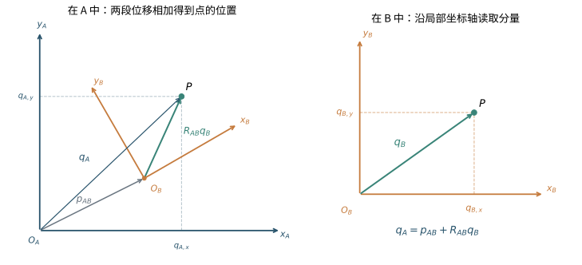
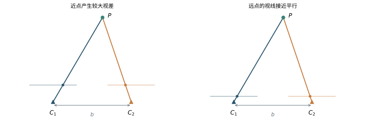
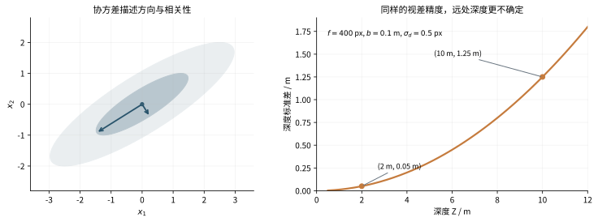
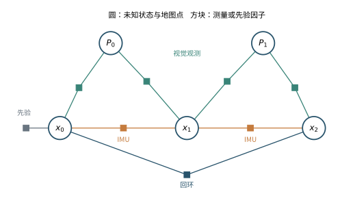
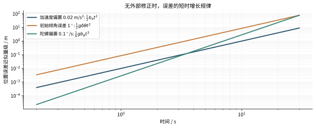

## 阅读目标与范围

拿着一部手机走过房间，手机会不断得到图像，也能读到自身转动和受力有关的信号。我们想从这些读数中知道：它经过了哪些位置，朝向哪里，房间里的物体又在哪里。传感器的读数与这些答案之间，隔着坐标描述、物理模型和带误差的推断。本笔记将逐层建立这几个环节。

这里假定你会使用普通代数、三角函数和二维坐标，知道函数把输入变成输出；不假定你学过机器人学、相机几何、滤波或李群。导数、矩阵、概率在需要时从具体问题引入。SLAM 是 simultaneous localization and mapping 的缩写，中文为“同时定位与建图”。第五章才正式建立它的联合估计问题。在此之前，先认识设备和描述运动所需的数学。

### 导读：先认识传感器和我们想描述的量

#### 相机首先给出什么

数码图像可以看作一个规则网格，每个小格叫像素，保存亮度或颜色。一个像素的位置通常用两项表示：横向第几列、纵向第几行。后文记作 $(u,v)$。例如，图像中一个角点从 $(100,80)$ 移到 $(110,80)$，直接说明的是这个角点在图像上向右移动了十个像素。

仅凭这十个像素，尚不能断定相机在房间里移动了多少米。附近的物体和远处的物体，在相机做同样的平移时往往有不同的图像位移；相机自身转动也能让像素移动。因此，需要建立空间中的点怎样投影到图像上的模型。第六章会从直线与平面的交点推导这个模型，而不会预先把“像素等于某个三维点”当作已知。

这里的**相机**是产生图像的物理设备。后文的**相机坐标系**则是一套附着在设备上的测量规则：选一个原点和三根坐标轴，用它们描述物体相对于相机的位置。设备与描述设备的坐标系要先分清。

#### IMU 首先给出什么

IMU 是 inertial measurement unit，即**惯性测量单元**。在本文使用的基本模型中，它含有三轴陀螺仪和三轴加速度计。这里“三轴”的意思是沿三根指定方向分别输出一个读数。

陀螺仪测量**角速度**，也就是转角随时间变化的快慢，常用单位为弧度每秒。读数表示这一刻转得多快；要知道经过一段时间后转了多少，需要沿时间累积，并处理转动方向的变化。

加速度计的测量含义更容易混淆。它测量的是**比力**，可以先理解为单位质量受到的非引力作用所对应的加速度量；它与我们根据轨迹二次求导得到的运动加速度有区别。静放在桌上的设备，运动加速度为零，加速度计仍会有约一个重力加速度大小的读数，因为桌面在支撑它。自由落体时，理想加速度计的读数反而接近零。第十章会从这个现象建立准确的测量方程，说明怎样结合姿态与重力，恢复用于积分的运动加速度。[R3](#ref-r3)[R13](#ref-r13)

相机给出一幅图像，IMU 给出随时间变化的若干数值，它们都需要时间戳，才能知道不同读数对应哪个时刻。我们暂时只需知道这些读数的物理含义；偏置、噪声、标定和积分方法会在相关章节逐步建立。

#### 位置、姿态和位姿分别描述什么

把手机放在桌面上，保持中心不动而转向另一面，位置可以保持不变，但朝向已经变了。把手机朝向固定，沿桌面移动，又会产生另一种变化。由此分出三个术语：

| 名称 | 回答的问题 | 在三维空间中需要描述的内容 |
|---|---|---|
| 位置 position | 选定的设备原点在哪里 | 相对于一个参照的三个位置分量 |
| 姿态 orientation | 设备的轴朝向哪里 | 三个独立的旋转自由度 |
| 位姿 pose | 原点在哪里，以及轴朝向哪里 | 位置与姿态合在一起 |

“自由度”指独立变化所需的参数数量；它不等于存储所用的数字数量。例如旋转矩阵保存九个数，但这些数彼此受约束。第二章会说明为什么。

还要区分位置与轨迹：某一时刻的位置是一个点，设备随时间走过的一连串位置形成位置轨迹；若同时记录每一刻的朝向，就得到位姿轨迹。地图则描述环境中物体或几何结构的位置。本文先用一组能在图像中重复识别的三维点表示地图。

#### 为什么同一个设备会涉及几套坐标系

“杯子在左边”需要补充“相对于谁的左边”。你转身后，杯子没有移动，它相对于你的左、右、前、后却改变了。数学上，坐标系由原点、坐标轴方向和长度单位共同确定。给房间选一套固定的坐标规则，可以描述设备如何移动；给手机选一套跟着它移动的规则，可以描述传感器如何看见或感受到这个世界。

为了连接相机与 IMU，还需知道它们在同一台设备中装在什么位置、朝向有什么差别。即使两者固定在同一部手机上，它们各自的原点和轴也可能不同。后面会把固定参照称为世界系，把附着于 IMU 的参照称为机体系，把附着于相机的参照称为相机系。**这些坐标系是人为选定的描述方式；同一个空间点不会因为我们更换描述方式而变成另一个点。**第一、二章将从这一点推导坐标变换，再引入字母与矩阵。

#### 从读数到估计，中间还需要什么

假设我们已经提出一组关于设备和地图的猜测。通过相机模型，可以预测一个地图点应该落在图像的第 102 列；实际检测到它在第 100 列，两者相差两个像素。这个“测量减预测”的差叫**残差**。残差把物理模型和实际数据连接起来。

接下来仍有两个问题：两个像素的差有多值得在意；应该怎样调整猜测才能减小它。前一个问题需要误差的概率模型，后一个需要函数的一阶近似与优化。这样，线性代数、概率和微积分各自要解决的事情便明确了。我们不会因为出现了一个公式，就直接假定它是可靠的测量或可求解的方程。

### 如何阅读本笔记

第一章建立“用数字描述量、用函数描述关系”的工具，第二章用这些工具描述刚体运动。第三章从重复测量引出概率，再把不确定性变成误差的权重；第四章解释怎样实际求出未知量。第五至第九章将它们用于相机和地图。第十至第十四章加入惯性测量，推导运动传播、误差状态滤波、预积分、融合与初始化。最后两章把推导对应到开源实现和实验评测。

每个主要推导都遵循同一个顺序：先说明已有信息和未知量，写出必要假设，再逐步变形，最后检查单位、维度与简单情景。第二章中李群雅可比等进阶段落可以在首次阅读时稍后再读；基础主线会明确指出何时真正需要它们。不要跳过坐标方向与测量定义，因为后面每一个正负号都依赖这些约定。

本文以局部运动和近似静态的环境为主线。单目纯视觉中的尺度仍是未知量，惯性部分才讨论在何种条件下恢复米制尺度；附录 D 再说明长距离、高精度惯导中地球转动与地理坐标的扩展。《视觉 SLAM 十四讲》第二版的官方配套代码与勘误是实践参考。[R1](#ref-r1) 本文的解释和推导独立组织，并扩展惯性导航与近期的开源系统。开源资料核查日期为 2026 年 11 月 8 日；系统性能必须结合数据、传感器配置和计算预算理解。

## 第一章 线性代数与微积分的最小前提

SLAM 最后会写成许多矩阵和概率公式，但出发点其实很朴素：我们要用数字描述物体在哪里、朝向哪里，再检查这些数字能否解释测量。本章先建立描述与计算的工具。第二章处理旋转这个特殊对象，第三章再讨论测量不准时怎样推断。读者不需要先掌握整本线性代数或微分几何；每一种工具都从它马上要解决的问题出发。

这里需要区分两种学习目标。向量、矩阵乘法、最小二乘和一阶近似，是后文反复使用的基本语言；SVD 的完整证明、矩阵指数和旋转雅可比的闭式表达，可以先理解用途，再在实际用到时回读。遇见尚未熟悉的名词，不意味着必须暂停 SLAM 学习，把那门数学课全部学完。

### 1.1 数字向量与物理向量

#### 一支箭头如何变成三个数字

设房间里有一支箭头，从某个位置指向另一个位置。它有长度和方向，即使暂时没有刻度，我们也能说它存在。用带箭头的符号 $\vec v$ 表示这个几何对象。

要把它写成数字，需要先选三条方向。取三个长度为 $1$、两两垂直的向量 $\vec e_{A,1},\vec e_{A,2},\vec e_{A,3}$，再选一个原点 $O_A$，就得到坐标系 $A$。三个方向叫作这个坐标系的**正交单位基**：正交指互相垂直，单位指长度为 $1$。日常的“向右、向前、向上”，只有在具体指定这三条方向后，才成为能计算的坐标轴。

任意空间向量都可以沿这三条轴拆开：

$$
\vec v=v_{A,1}\vec e_{A,1}+v_{A,2}\vec e_{A,2}+v_{A,3}\vec e_{A,3}.
$$

右侧的三个系数就是 $\vec v$ 在 $A$ 中的坐标。把它们按列排起来，记为

$$
v_A=\begin{bmatrix}v_{A,1}\\v_{A,2}\\v_{A,3}\end{bmatrix}\in\mathbb R^3.
$$

$\mathbb R^3$ 表示所有三个实数组成的列向量的集合。它本身不告诉我们单位或坐标轴；这些信息必须由上下文给出。同一个 $\vec v$ 换到另一组轴下，三个数字通常改变，箭头本身并没有改变。后文大量“旋转变换”的第一种用途，就是给同一个几何对象换一种坐标表达。

点的位置还需要原点。若 $P$ 是一个点，它在 $A$ 中的位置坐标，是从 $O_A$ 指向 $P$ 的向量 $\overrightarrow{O_AP}$ 的三个分量。换原点会改变点的位置坐标，却不会改变两个点之间的位移向量。把原点从墙角移到桌边，杯子的“位置”变了；从杯子指向门把手的“位移”没有变。第二章的平移项正是来自这一区别。

#### 内积、长度与沿坐标轴的分量

两支向量 $\vec a,\vec b$ 的内积定义为

$$
\vec a\cdot\vec b=\|\vec a\|\,\|\vec b\|\cos\alpha,
$$

其中 $\alpha$ 是它们之间的夹角，$\|\vec a\|$ 表示长度。这个量回答的是：$\vec a$ 沿 $\vec b$ 方向有多大分量，再乘上 $\vec b$ 的长度。当 $\vec b$ 是单位向量时，内积直接给出带正负号的投影长度。

因此，前面的坐标分量不是任意指定的，而是

$$
v_{A,i}=\vec e_{A,i}\cdot\vec v.
$$

也可以把向量展开代入右侧检查：由于 $\vec e_{A,i}\cdot\vec e_{A,j}$ 在 $i=j$ 时为 $1$、否则为 $0$，只有第 $i$ 项留下。这也是采用正交单位基的便利之处。若使用斜着交叉的坐标轴，分量就不能直接用这一条内积公式取得。

为了在数字上计算内积，先由勾股定理得到

$$
\|a\|^2=a_1^2+a_2^2+a_3^2.
$$

再把 $\|a-b\|^2$ 分别按坐标展开、按余弦定理展开：

$$
\begin{aligned}
\|a-b\|^2&=\|a\|^2+\|b\|^2-2(a_1b_1+a_2b_2+a_3b_3),\\
\|a-b\|^2&=\|a\|^2+\|b\|^2-2\|a\|\,\|b\|\cos\alpha.
\end{aligned}
$$

比较两式可得

$$
a^Tb=a_1b_1+a_2b_2+a_3b_3,
\qquad
\|a\|=\sqrt{a^Ta}.
$$

上标 $T$ 表示转置：列变成行，所以 $a^T$ 为 $1\times3$，$b$ 为 $3\times1$，$a^Tb$ 的结果是一个数。反过来，$ab^T$ 是 $3\times3$ 矩阵，第 $(i,j)$ 个元素为 $a_ib_j$，称为外积。两者的乘法顺序和结果维度都不同。第三章用外积描述不同误差分量之间怎样共同变化。

例如 $a=(3,4,0)^T$、$b=(0,1,0)^T$，则 $\|a\|=5$、$a^Tb=4$。因为 $b$ 是第二根轴的单位方向，这个 $4$ 恰好就是 $a$ 沿该方向的分量。

#### 叉积为什么可以写成矩阵

三维中还需要一种同时包含“垂直方向”和“转动方向”的运算。约定坐标轴是右手系：右手食指沿第一根轴、中指沿第二根轴时，拇指沿第三根轴。对两个向量 $a,b$，叉积 $a\times b$ 垂直于它们所在的平面，方向按右手规则选取，长度为 $\|a\|\|b\|\sin\alpha$。

单位基满足 $e_1\times e_2=e_3$、$e_2\times e_3=e_1$、$e_3\times e_1=e_2$；交换顺序会变号，相同方向的叉积为零。把 $a$ 和 $b$ 沿基展开，逐项使用这些规则，就得到

$$
a\times b=
\begin{bmatrix}
a_2b_3-a_3b_2\\
a_3b_1-a_1b_3\\
a_1b_2-a_2b_1
\end{bmatrix}.
$$

如果 $a$ 已知，这三个表达式都只是 $b$ 分量的线性组合，因而可以写成

$$
a\times b=[a]_\times b,
\qquad
[a]_\times=
\begin{bmatrix}
0&-a_3&a_2\\
a_3&0&-a_1\\
-a_2&a_1&0
\end{bmatrix}.
$$

$[a]_\times$ 叫作 $a$ 的叉乘矩阵。它不是另一支向量，而是“拿 $a$ 去叉乘输入向量”这个运算的矩阵表示。直接转置可见 $[a]_\times^T=-[a]_\times$，这种矩阵称为反对称矩阵。交换叉乘顺序得到另一个常用关系：

$$
[a]_\times b=-[b]_\times a.
$$

上面的数值例子里，$a\times b=(0,0,3)^T$。第二章将看到，一个极小转角引起的向量变化可以写成叉积，因此叉乘矩阵会自然出现在旋转的导数中。

向量加减、内积与叉积都要求参与计算的数字表达在同一个坐标系中。单位也要相容：不能把以米为单位的位置加到以米每秒为单位的速度上。维度检查与单位检查，是比记公式更可靠的第一道自查。

### 1.2 矩阵为什么能表示运动与约束

#### 矩阵把许多线性关系放在一起

所谓线性关系，是输入相加或乘一个数时，输出也按同样方式相加或缩放。设输入 $x$ 有 $n$ 个分量，输出 $y$ 有 $m$ 个分量，且每个输出都是输入的加权和：

$$
y_i=\sum_{j=1}^{n}A_{ij}x_j,\qquad i=1,\ldots,m.
$$

把权重 $A_{ij}$ 按 $m$ 行、$n$ 列排成矩阵，就得到 $y=Ax$。这里 $A\in\mathbb R^{m\times n}$、$x\in\mathbb R^n$、$y\in\mathbb R^m$。矩阵的每一行描述一个输出怎样计算，每一列则描述某一个输入分量对全部输出的影响。

还有一种很有用的看法。令 $e_j$ 为第 $j$ 个分量为 $1$、其他为 $0$ 的列向量，则 $Ae_j$ 就是 $A$ 的第 $j$ 列。因为 $x=\sum_jx_je_j$，所以

$$
Ax=\sum_jx_j(Ae_j).
$$

因此，要确定一个线性变换，只需确定它怎样处理各根基向量。第二章构造旋转矩阵时，将把“另一组坐标轴在这一组轴下的坐标”按列排列，原因就在这里。

#### 矩阵相乘代表连续执行两个变换

假设先计算 $y=Bx$，再计算 $z=Ay$。把 $y$ 代入，逐分量展开：

$$
z_i=\sum_j A_{ij}\left(\sum_kB_{jk}x_k\right)
=\sum_k\left(\sum_jA_{ij}B_{jk}\right)x_k.
$$

因此复合变换写为 $z=(AB)x$，并且

$$
(AB)_{ik}=\sum_jA_{ij}B_{jk}.
$$

这就是行乘列规则的来源。如果 $B$ 为 $n\times p$，$A$ 必须为 $m\times n$，中间维度才能匹配，结果 $AB$ 为 $m\times p$。右边的矩阵先作用，这是后文读坐标变换链时必须保持的顺序。

顺序一般不能交换。取

$$
S=\begin{bmatrix}2&0\\0&1\end{bmatrix},
\qquad
M=\begin{bmatrix}0&1\\1&0\end{bmatrix},
\qquad
x=\begin{bmatrix}1\\1\end{bmatrix}.
$$

$S$ 把第一个分量放大两倍，$M$ 交换两个分量。先交换后放大，得到 $SMx=(2,1)^T$；先放大后交换，得到 $MSx=(1,2)^T$。它们不同。这里 $M$ 是用来说明运算顺序的交换矩阵，不是三维姿态所用的合法旋转矩阵。

#### 线性方程、秩和零空间：测量究竟约束了什么

设我们沿一条直线连续停在三个位置 $x_1,x_2,x_3$，测得第一次位移为 $1$ 米，第二次位移为 $2$ 米。用 $x=(x_1,x_2,x_3)^T$ 收集未知数，方程为

$$
\underbrace{\begin{bmatrix}-1&1&0\\0&-1&1\end{bmatrix}}_{A}
\underbrace{\begin{bmatrix}x_1\\x_2\\x_3\end{bmatrix}}_x
=\underbrace{\begin{bmatrix}1\\2\end{bmatrix}}_b.
$$

解出的是

$$
x=\begin{bmatrix}c\\c+1\\c+3\end{bmatrix},\qquad c\text{ 为任意实数}.
$$

为什么测量不能确定 $c$？因为给所有位置同时加 $c$，位置之差不变。代数上，$n=(1,1,1)^T$ 满足 $An=0$，所以 $A(x+cn)=Ax$。

所有满足 $An=0$ 的向量构成 $A$ 的**零空间**，记为 $\operatorname{null}(A)$。沿零空间中的方向改变未知数，输出完全不变。这个例子的零空间是一条直线，即 $\operatorname{span}\{(1,1,1)^T\}$；$\operatorname{span}$ 表示所有该向量的数倍。

矩阵的**秩**是其独立列的数量，也等于独立行的数量。可以把它理解为线性映射实际能够区分的独立输入方向数。本例两个位移约束独立，秩为 $2$。对于有 $n$ 列的矩阵，

$$
\operatorname{rank}(A)+\dim\operatorname{null}(A)=n.
$$

于是三个未知分量减去两个独立约束，留下一个无法确定的方向。这里的“方向”存在于未知数空间中，不是房间里的一根空间轴。

如果规定 $x_1=0$，便选出 $(0,1,3)^T$。这一步是在选择坐标原点，没有新增一条关于绝对位置的物理测量。后文 SLAM 的规范自由度比这更复杂，但基本逻辑相同：若一类整体变换让所有预测保持不变，数据就不能决定这类变换的参数。

#### 测量相互矛盾时，最小二乘从哪里来

现实中测量常常无法同时满足。假设同一个长度 $x$ 被测成 $1.0$、$0.8$、$1.2$ 米，则不可能让 $x$ 同时等于三个数。先暂时认为这三次测量同样可靠。一个自然的折中是，让所有“观测减预测”的差值平方和最小：

$$
F(x)=\frac12\left[(1.0-x)^2+(0.8-x)^2+(1.2-x)^2\right].
$$

平方使正负误差不会互相抵消，也让大误差受到更大惩罚；前面的 $1/2$ 只是为了求导时消掉系数 $2$。求导得到 $F'(x)=3x-3$，所以最佳折中为 $x=1$ 米，即三次观测的平均值。为什么平方和还能由概率模型推出，第三章会进一步解释。

把这个想法推广到 $m$ 条线性测量。设观测为 $b\in\mathbb R^m$，预测为 $Ax$，残差 $r=b-Ax$，则

$$
\min_xF(x),\qquad F(x)=\frac12\|b-Ax\|^2.
$$

为了知道怎样找最小点，不必先背矩阵求导公式。沿任意方向 $d\in\mathbb R^n$，把未知量改成 $x+\varepsilon d$。残差变成 $r-\varepsilon Ad$，于是

$$
\begin{aligned}
F(x+\varepsilon d)
&=\frac12(r-\varepsilon Ad)^T(r-\varepsilon Ad)\\
&=F(x)-\varepsilon d^TA^Tr
+\frac{\varepsilon^2}{2}\|Ad\|^2.
\end{aligned}
$$

如果 $x$ 已是最小点，那么朝任意方向作足够小的正、负改变，都不能继续下降。一阶项必须为零，即 $d^TA^Tr=0$ 对所有 $d$ 成立，因而

$$
A^T(b-Ax)=0
\quad\Longrightarrow\quad
A^TAx=A^Tb.
$$

这组方程称为**正规方程**。这里 $A^TA$ 为 $n\times n$，右侧为 $n\times1$，因此它仍在求 $n$ 个未知分量。任意 $d$ 都有 $d^TA^TAd=\|Ad\|^2\ge0$，所以这个二次目标不会在某个方向向下无界弯曲；满足正规方程的点是全局最小点。若 $A$ 没有非零零空间，二次项在任意非零方向严格为正，最小点就唯一。

正规方程还有直观的几何含义。所有可能的预测 $Ax$ 构成 $A$ 的列空间；条件 $A^Tr=0$ 说明残差垂直于每一列，因而垂直于整个列空间。最佳预测正是把观测 $b$ 垂直投影到这个空间得到的点。用直角三角形也能验证：从最佳预测再沿列空间移动，新的误差长度平方等于原误差平方加上移动距离平方，只会更大。

先补两个记号。**单位矩阵** $I_n$ 是主对角线为 $1$、其他元素为 $0$ 的 $n\times n$ 矩阵，它保持输入不变：$I_nx=x$。维度明确时简写为 $I$。若方阵 $M$ 的变换能够唯一撤销，撤销操作记为**逆矩阵** $M^{-1}$，满足 $M^{-1}M=MM^{-1}=I$。方阵满秩、没有非零零空间时才有逆；否则多个输入可能得到同一个输出，就不能唯一倒推回去。

在纸面上，当 $A^TA$ 可逆时可以写 $x=(A^TA)^{-1}A^Tb$。实际程序通常直接解方程，或采用 QR、SVD 等分解，避免显式构造逆矩阵。特别是当约束很弱时，先形成 $A^TA$ 会把最大、最小非零奇异值的比例平方，使有限精度计算更困难。下一节解释这些“强弱方向”究竟是什么。

### 1.3 特征值 SVD 与不确定方向

#### 从一个方向的变化，看整体约束的强弱

仍考虑 $b\approx Ax$。如果未知数沿单位方向 $d$ 改变一个小量 $\varepsilon$，预测变化为 $\varepsilon Ad$，长度为 $|\varepsilon|\|Ad\|$。有的方向只改一点就明显影响预测，容易被测量区分；有的方向改很多也几乎没有影响，便难以确定。

因此我们关心的量是

$$
\|Ad\|^2=d^THd,\qquad H=A^TA.
$$

$H$ 是实对称矩阵，并且对任意 $d$ 都有 $d^THd\ge0$，称为半正定矩阵；如果对所有非零 $d$ 都严格大于零，则称为正定矩阵，记作 $H\succ0$。如果存在非零向量 $v$ 和实数 $\lambda$，满足

$$
Hv=\lambda v,
$$

那么 $v$ 是特征向量，$\lambda$ 是对应的特征值。它的意思是：在这个特殊方向上，$H$ 只把向量缩放，不改变方向。对单位特征向量，$\|Av\|^2=v^THv=\lambda$，所以 $\lambda$ 直接反映预测对该方向的敏感程度。

实对称矩阵有一组互相正交的单位特征向量，可以组成整个未知数空间的一套坐标轴；这就是这里需要使用的谱定理结论。本章不证明这一标准定理。对于 $A^TA$，特征值均非负：正值表示受到约束的方向，零值表示线性零空间，接近零的值表示相对较弱的方向。

“弱”并不自动等于某个具体概率意义上的置信区间。不同参数可能有不同单位，测量也可能有不同精度；第三章会先按测量误差的尺度进行加权，再解释统计意义上的不确定性。眼下只需要理解：矩阵可以帮助我们发现哪些参数组合对现有数据影响很小。

#### SVD 为什么同时需要两套轴

$A$ 可能不是方阵，例如三次测量估计一个长度时，$A$ 为 $3\times1$。这时输入与输出生活在不同维度的空间，只谈 $A$ 的特征向量就不合适。我们需要在输入空间找一套轴，在输出空间也找一套轴，让每个输入方向只对应一个输出方向。

取 $A^TA$ 的单位特征向量 $v_i$，对应正特征值 $\lambda_i$，定义

$$
\sigma_i=\sqrt{\lambda_i},\qquad u_i=\frac{Av_i}{\sigma_i}.
$$

$\sigma_i$ 称为奇异值。它表示沿输入方向 $v_i$ 的单位变化，被 $A$ 映射后放大为多长。输出方向 $u_i$ 长度为 $1$，并且

$$
u_i^Tu_j
=\frac{v_i^TA^TAv_j}{\sigma_i\sigma_j}
=\frac{\lambda_jv_i^Tv_j}{\sigma_i\sigma_j}.
$$

当 $i=j$ 时结果为 $1$，当 $i\ne j$ 时为 $0$，所以这些输出方向也正交。把它们分别补齐为输入、输出空间的完整正交基，就得到**奇异值分解**：

$$
A=U\Sigma V^T.
$$

若 $A$ 为 $m\times n$，完整形式中 $U$ 为 $m\times m$，$V$ 为 $n\times n$，它们的列都是互相正交的单位向量；$\Sigma$ 为 $m\times n$，仅主对角线可能非零。非零项为 $\sigma_1\ge\cdots\ge\sigma_r > 0$，其数量 $r$ 就是秩。

这个分解有明确的计算顺序：$V^T$ 把输入换到 $v_i$ 这套轴下，$\Sigma$ 沿各轴缩放或压成零，$U$ 再把结果写回原输出坐标。它不是把原问题换成了另一个问题，只是找到了更容易看清约束的表达方式。

#### 用 SVD 把最小二乘拆成一维问题

令 $y=V^Tx$、$c=U^Tb$。由于正交变换保持长度，最小二乘等价于

$$
\|b-Ax\|^2=\|c-\Sigma y\|^2
=\sum_{i=1}^{r}(c_i-\sigma_i y_i)^2
+\sum_{i=r+1}^{m}c_i^2.
$$

前一组项可以逐个最小化，得到 $y_i=c_i/\sigma_i$；后一组项无法通过改变 $x$ 消除，它们是观测落在可预测空间之外的部分。如果 $r < n$，$y_{r+1},\ldots,y_n$ 根本没有出现在目标里，说明这些未知方向仍可任意变化。

把自由分量都取零，可在所有最小二乘解中选出长度最小的一个。这给出伪逆解 $x=A^+b$，其中 $A^+=V\Sigma^+U^T$，$\Sigma^+$ 对非零奇异值取倒数并交换矩阵尺寸。伪逆是在多解中采用一个规则选解，不会凭空补出测量中不存在的信息。上一节三个位置的例子，伪逆选出的整体平移仍只是某种坐标选择。

这也解释了数值敏感性。如果 $c_i$ 有一个小误差 $\delta c_i$，解的变化为

$$
\delta y_i=\frac{\delta c_i}{\sigma_i}.
$$

假设两个已统一尺度的方向对应奇异值 $1$ 和 $0.001$，同样大小的输出误差，在第二个方向上会造成第一方向一千倍的参数变化。这不是优化器不够努力，而是数据对第二个方向缺少足够区分能力。

#### 以后会用到的一种齐次求解

视觉几何常出现 $Ah\approx0$，但 $h=0$ 没有几何意义，因此另加 $\|h\|=1$，求

$$
\min_{\|h\|=1}\|Ah\|^2.
$$

写 $h=Vy$ 后，约束变成 $\sum_i y_i^2=1$，目标变成 $\sum_i\sigma_i^2y_i^2$；对未列出的零空间方向，把对应奇异值视为零。最小值来自把长度全部放在最小奇异值对应的方向。因此可取 $V$ 的最后一列；如果最小值重合，最佳方向也可能不唯一。

后文用两幅图像求空间点时，会把几何关系整理成这种形式。SVD 的作用是从有误差的线性约束中找出最能共同成立的方向；随后通常还需要按真实成像误差作非线性优化。

### 1.4 导数 雅可比与一阶近似

#### 导数是局部变化的比例

函数把输入变成输出。对标量函数 $f(s)=s^2$，当输入从 $s$ 变为 $s+h$，输出变化为

$$
f(s+h)-f(s)=2sh+h^2.
$$

当 $h$ 很小时，$h^2$ 比 $h$ 更小，所以主要变化是 $2sh$。导数 $f'(s)=2s$ 就是这个局部变化比例。严格定义为

$$
f'(s)=\lim_{h\to0}\frac{f(s+h)-f(s)}{h}.
$$

相应的一阶近似为 $f(s+h)\approx f(s)+f'(s)h$。它不是宣称曲线在全局是一条直线，而是在当前点附近，用切线代替曲线。SLAM 中的成像和旋转关系都是非线性的，优化器反复使用这样的局部近似。

#### 多输入、多输出时，导数组成雅可比

设 $f:\mathbb R^n\to\mathbb R^m$，输入 $x$ 有 $n$ 个分量，输出 $f(x)$ 有 $m$ 个分量。固定其他输入，仅改变 $x_j$ 时，输出 $f_i$ 的变化率写成偏导数 $\partial f_i/\partial x_j$。把所有偏导数排成矩阵，得到雅可比

$$
J_f(x)=\begin{bmatrix}
\dfrac{\partial f_1}{\partial x_1}&\cdots&\dfrac{\partial f_1}{\partial x_n}\\
\vdots&&\vdots\\
\dfrac{\partial f_m}{\partial x_1}&\cdots&\dfrac{\partial f_m}{\partial x_n}
\end{bmatrix}\in\mathbb R^{m\times n}.
$$

每一列描述改变一个输入分量时所有输出怎样变，每一行描述某个输出受各输入的影响。若函数在当前点可微，多个小变化的主要影响可以相加：

$$
f(x+\delta x)\approx f(x)+J_f(x)\delta x.
$$

这就是多元一阶 Taylor 近似。若附近二阶导数有界，被忽略的部分通常为 $O(\|\delta x\|^2)$；$O$ 在这里表示误差不超过某个常数乘以该平方量。因而把步长大致减半，局部近似误差通常会缩小到原来的四分之一。超出局部范围后，不能继续这样估计。

看一个可以手算的例子：

$$
f(x,y)=\begin{bmatrix}x^2+2y\\xy\end{bmatrix},
\qquad
J_f(x,y)=\begin{bmatrix}2x&2\\y&x\end{bmatrix}.
$$

在 $(x,y)=(2,3)$，$f=(10,6)^T$，$J_f=\begin{bmatrix}4&2\\3&2\end{bmatrix}$。令 $\delta x=0.01$、$\delta y=-0.02$，预测的输出变化为

$$
J_f\begin{bmatrix}0.01\\-0.02\end{bmatrix}
=\begin{bmatrix}0\\-0.01\end{bmatrix}.
$$

直接代入新输入 $(2.01,2.98)$，真实输出变化为 $(0.0001,-0.0102)^T$。两者的差分别来自 $(\delta x)^2=0.0001$ 和 $\delta x\delta y=-0.0002$，正是被一阶近似丢掉的二阶项。

#### 链式法则为何是矩阵相乘

假设先把 $s\in\mathbb R^k$ 变成 $x=g(s)\in\mathbb R^n$，再把 $x$ 变成 $y=f(x)\in\mathbb R^m$。输入有小变化 $\delta s$ 时，先有

$$
\delta x\approx J_g\delta s,
\qquad
\delta y\approx J_f\delta x.
$$

代入便得到

$$
J_{f\circ g}(s)=J_f(g(s))J_g(s).
$$

左边为 $m\times k$，右边是 $(m\times n)(n\times k)$，中间维度正好消去。这个顺序与“先做 $g$、再做 $f$”完全一致。

沿用上一例，设 $g(s)=(s,s^2)^T$，则 $J_g=(1,2s)^T$ 为 $2\times1$。代入 $J_f$ 后，

$$
J_f(g(s))J_g(s)
=\begin{bmatrix}2s&2\\s^2&s\end{bmatrix}
\begin{bmatrix}1\\2s\end{bmatrix}
=\begin{bmatrix}6s\\3s^2\end{bmatrix}.
$$

另一方面，直接复合可得 $f(g(s))=(3s^2,s^3)^T$，逐项求导也得到相同结果。后文“空间点变到相机坐标，再投影到像素”的导数，就是按这条链把各个简单步骤连接起来。

#### 一阶近似怎样连接优化

设残差 $r(x)\in\mathbb R^m$ 是观测减预测，目标为 $F(x)=\frac12\|r(x)\|^2$。在当前估计 $\hat x$ 附近，

$$
r(\hat x+\delta x)\approx r(\hat x)+J_r(\hat x)\delta x.
$$

把这个式子代回目标后，原本非线性的问题变成了关于 $\delta x$ 的线性最小二乘。上一节的求解方法因此有了用武之地：先求一个局部改变量，更新估计，再重新计算残差和导数。第四章会详细讨论何时这个过程收敛、为什么有时需要缩小步长。

对于标量目标，梯度是所有一阶偏导数组成的列向量，告诉我们局部上升最快的方向；Hessian 是所有二阶偏导数组成的矩阵，描述梯度怎样变化。对上面的目标，求导会得到 $\nabla F=J_r^Tr$，而常用近似 Hessian 为 $J_r^TJ_r$。此处先记住它们各自描述“坡度”和“弯曲程度”，不用把这两种矩阵混作同一个对象。

程序中的导数可以用中心差分作独立检查。若 $e_j$ 是第 $j$ 个单位方向，

$$
J_{:,j}\approx\frac{f(x+\varepsilon e_j)-f(x-\varepsilon e_j)}{2\varepsilon}.
$$

步长太大，测到的不是局部斜率；太小，两个非常接近的数相减会放大浮点舍入误差。还必须使用与推导相同的更新方式：普通向量可以加 $\varepsilon e_j$，旋转却必须按照第二章定义的旋转扰动来改变，不能随意给旋转矩阵的一个元素加数。

### 1.5 积分与离散时间

#### 从速度变化累积出位置变化

位置随时间变化，记为 $p(t)$。为方便理解，先把它当作沿直线的位置；三维情况可以逐分量处理，但所有分量必须在同一个固定坐标系下表达。速度是位置对时间的变化率，加速度是速度对时间的变化率：

$$
v(t)=\frac{dp(t)}{dt},\qquad a(t)=\frac{dv(t)}{dt}.
$$

若一小段时间 $\Delta t$ 内速度几乎不变，这段位移近似为 $v\Delta t$。把较长时间区间拆成许多小段并相加，得到

$$
p(t_1)-p(t_0)\approx\sum_k v(t_k)\Delta t_k.
$$

当分段越来越细，和式趋向积分。同样地，加速度乘时间是一小段速度变化，累积起来得到

$$
\begin{aligned}
v(t_1)&=v(t_0)+\int_{t_0}^{t_1}a(t)\,dt,\\
p(t_1)&=p(t_0)+\int_{t_0}^{t_1}v(t)\,dt.
\end{aligned}
$$

积分可以看作变化率的连续累加。要由加速度推出速度、位置，还必须知道初始速度和初始位置；仅有变化率不能告诉我们最初在哪里、原来已经运动得多快。这一点对惯性导航尤其关键。

#### 位置更新中的二分之一从哪里来

假设在长度为 $h$ 的一个时间段内，加速度恒为 $a_0$。令 $\tau$ 为从该段起点算起的时间，那么

$$
v(t_0+\tau)=v_0+a_0\tau.
$$

再次积分：

$$
\begin{aligned}
p(t_0+h)
&=p_0+\int_0^h(v_0+a_0\tau)\,d\tau\\
&=p_0+v_0h+\frac12a_0h^2.
\end{aligned}
$$

因此常见的离散更新是

$$
v_{k+1}=v_k+a_kh,
\qquad
p_{k+1}=p_k+v_kh+\frac12a_kh^2,
$$

其中下标 $k$ 表示第 $k$ 个采样时刻。它们对区间内恒加速度模型是精确的；对实际变化的加速度，是一种近似。

例如 $p_0=0$ 米，$v_0=1$ 米每秒，$a_0=2$ 米每二次方秒，$h=0.5$ 秒，则新速度为 $2$ 米每秒，新位置为 $0.75$ 米。若误用末端速度乘整个时间段，会得到 $1$ 米，仿佛整段时间都已经达到了末端速度。系数 $1/2$ 正是在计算加速过程中逐渐增加的那部分位移。

单位也能帮忙检查：$v_kh$ 的单位为米，$a_kh^2$ 的单位也为米；只有这样，三项才可以相加。

#### 离散化的适用边界

更一般地，若某个状态满足微分方程 $\dot x=f(x,t)$，最简单的一阶 Euler 方法为

$$
x_{k+1}\approx x_k+f(x_k,t_k)h.
$$

它把区间起点的变化率近似用于整个时间段。时间步长和运动变化程度都会影响误差。更精细的方法会利用中点或多个采样时刻的信息，但“先提出连续变化关系，再选择如何近似积分”的逻辑不变。

这条普通向量更新不能不加区分地用于所有对象。旋转矩阵有必须满足的几何约束，直接加导数可能破坏约束，第二章将从旋转的微分方程推导合适的更新方式。第十章还会解释：设备上的加速度计读数不是这里已经写在固定坐标系中的 $a(t)$；必须先处理其测量含义、方向变化和重力，才能代入位置与速度积分。

至此，后文反复使用的链条已经形成：先选坐标，用矩阵组织关系，用残差比较测量与预测，用导数把非线性关系在局部变成线性问题，再用积分把连续运动连接到离散采样时刻。

## 第二章 坐标变换 旋转与李群

上一章已经区分了“空间里的箭头”和“写在纸上的分量”。现在要解决一个具体困难：房间、拿在手里的设备、设备上的相机各有自己的原点和坐标轴；相机里算出的方向，不能直接和房间坐标中的位置相加。我们需要一种可检查、可复合的换算规则。

本章先把这条规则建立起来。读完 2.1–2.3，应能判断一个点在哪个坐标系中、一个变换往哪个方向作用，以及为什么旋转不能任意加减。2.4–2.6 提供后文优化与惯性估计需要的工具；其中右雅可比和完整 $SE(3)$ 指数的推导是选读内容，可以等到用到它们时再回来。

### 2.1 首先固定全部坐标约定

#### 一个坐标系由原点和三根单位轴构成

先不用传感器术语。设空间中有两个坐标系 $A$ 和 $B$。坐标系 $A$ 包含原点 $O_A$，以及三个互相垂直、长度为 1 的基向量 $\mathbf e_{A1},\mathbf e_{A2},\mathbf e_{A3}$；$B$ 也有对应的原点和基向量。我们使用右手坐标系，即 $\mathbf e_{A1}\times\mathbf e_{A2}=\mathbf e_{A3}$，$B$ 同理。

空间中有一个不动的点 $Q$。用 $q_A$ 表示它在 $A$ 中的三维坐标列向量，用 $q_B$ 表示它在 $B$ 中的坐标。两者描述的是同一个点，但分量一般不同：

$$
\overrightarrow{O_AQ}=\sum_{i=1}^3(q_A)_i\mathbf e_{Ai},
\qquad
\overrightarrow{O_BQ}=\sum_{j=1}^3(q_B)_j\mathbf e_{Bj}.
$$

这里 $(q_A)_i$ 是第 $i$ 个分量。按第一章的投影定义，它等于 $\mathbf e_{Ai}\cdot\overrightarrow{O_AQ}$。换原点会改变这根从原点指向点的箭头；换基向量会改变同一根箭头的分量。**坐标换算同时需要处理这两件事。**

从 $O_A$ 走到 $Q$，可以先走到 $O_B$，再走到 $Q$，因此有几何关系

$$
\overrightarrow{O_AQ}
=\overrightarrow{O_AO_B}+\overrightarrow{O_BQ}.
$$

令 $p_{AB}$ 表示 $\overrightarrow{O_AO_B}$ 在 $A$ 中的坐标。对上式两边与 $\mathbf e_{Ai}$ 做点积，就得到

$$
(q_A)_i=(p_{AB})_i+
\sum_{j=1}^3\bigl(\mathbf e_{Ai}\cdot\mathbf e_{Bj}\bigr)(q_B)_j.
$$

现在定义矩阵 $R_{AB}$ 的第 $i$ 行、第 $j$ 列为

$$
(R_{AB})_{ij}=\mathbf e_{Ai}\cdot\mathbf e_{Bj}.
$$

逐行排列刚才的三个标量等式，得到整个笔记最基本的坐标换算式：

$$
\boxed{q_A=R_{AB}q_B+p_{AB}.}
$$

它不是凭空规定的乘法顺序，而是由点的几何关系和分量定义推出来的。$R_{AB}$ 的第 $j$ 列，正是 $B$ 的第 $j$ 根单位轴用 $A$ 的坐标写出来的结果。把 $q_B$ 的三个分量作为权重，对这三列做线性组合，就把 $B$ 中的箭头改写到了 $A$ 中。

**本文下标规则始终是：$R_{AB}$ 把 $B$ 中的分量变成 $A$ 中的分量；$p_{AB}$ 是 $B$ 的原点在 $A$ 中的位置。** 对不依赖原点的自由向量，例如两个点之间的位移 $d$，只需要

$$
d_A=R_{AB}d_B.
$$

这也能从两个点的换算式相减得到：平移项 $p_{AB}$ 恰好消掉。

#### 先用二维例子把正向、反向和复合算清楚

二维更容易画出来，逻辑与三维完全相同。设 $A$ 的横轴向右、纵轴向上。$B$ 的原点在 $A$ 中是 $(1,2)$；$B$ 的横轴向上，纵轴向左，相当于把两根轴一起逆时针转了 $90^\circ$。

$B$ 的两根轴在 $A$ 中分别是 $(0,1)^T$ 和 $(-1,0)^T$，把它们作为列排好：

$$
R_{AB}=
\begin{bmatrix}0&-1\\1&0\end{bmatrix},
\qquad
p_{AB}=\begin{bmatrix}1\\2\end{bmatrix}.
$$

若点 $Q$ 在 $B$ 中是 $q_B=(2,1)^T$，它表示从 $O_B$ 沿 $B$ 横轴走 2，再沿 $B$ 纵轴走 1。在 $A$ 中，这两步合起来是 $(-1,2)^T$，再加原点的位置：

$$
q_A=
\begin{bmatrix}0&-1\\1&0\end{bmatrix}
\begin{bmatrix}2\\1\end{bmatrix}
+
\begin{bmatrix}1\\2\end{bmatrix}
=\begin{bmatrix}0\\4\end{bmatrix}.
$$

反向换算必须先减去 $B$ 原点的位置，再沿 $B$ 的轴读取分量。这个例子中逆向旋转矩阵恰好是原矩阵的转置：

$$
q_B=R_{AB}^T(q_A-p_{AB})
=\begin{bmatrix}0&1\\-1&0\end{bmatrix}
\begin{bmatrix}-1\\2\end{bmatrix}
=\begin{bmatrix}2\\1\end{bmatrix}.
$$

再设第三个坐标系 $D$ 的轴与 $B$ 平行，原点在 $B$ 中是 $(1,0)^T$。若 $q_D=(1,1)^T$，先换到 $B$ 得到 $(2,1)^T$，再换到 $A$ 仍然得到 $(0,4)^T$。从 $A$ 看，$D$ 的原点应当是

$$
p_{AD}=p_{AB}+R_{AB}p_{BD}
=\begin{bmatrix}1\\2\end{bmatrix}
+\begin{bmatrix}0\\1\end{bmatrix}
=\begin{bmatrix}1\\3\end{bmatrix}.
$$

这里不能直接做 $p_{AB}+p_{BD}$：前者的分量沿 $A$ 的轴，后者沿 $B$ 的轴，必须先统一坐标系。这个错误在处理相机与惯性传感器之间的偏移时尤其常见。

#### 三维例子和旋转必须保留的性质

把刚才的例子扩展到三维：$A$ 与 $B$ 的第三根轴指向同一方向，$B$ 原点仍为 $(1,2,0)^T$。则

$$
R_{AB}=
\begin{bmatrix}
0&-1&0\\
1&0&0\\
0&0&1
\end{bmatrix},
\qquad
p_{AB}=\begin{bmatrix}1\\2\\0\end{bmatrix}.
$$

对 $q_B=(2,1,3)^T$，正向结果是 $q_A=(0,4,3)^T$；反向做 $R_{AB}^T(q_A-p_{AB})$ 就恢复 $(2,1,3)^T$。若第三个坐标系仍满足 $R_{BD}=I$、$p_{BD}=(1,0,0)^T$，则 $p_{AD}=(1,3,0)^T$，而 $q_D=(1,1,3)^T$ 会给出同一个 $q_A$。新增的第三个分量没有改变换算的逻辑。

为什么一般情况下也有 $R^{-1}=R^T$？设 $r_j$ 是旋转矩阵的第 $j$ 列，它代表一根 $B$ 的单位轴在 $A$ 中的分量。因为 $B$ 的各轴正交且单位长度，

$$
r_i^Tr_j=
\begin{cases}1,&i=j,\\0,&i\ne j.\end{cases}
$$

而 $R^TR$ 的第 $(i,j)$ 个元素恰好是 $r_i^Tr_j$，所以

$$
R^TR=I,\qquad R^{-1}=R^T.
$$

这也保证旋转不改变长度和夹角：例如 $\|Rd\|^2=d^TR^TRd=\|d\|^2$。

还需要排除镜像翻转。方阵的**行列式** $\det M$ 可以理解为线性变换的有向体积倍率：绝对值描述体积放大多少，符号区分是否翻转空间的手性。在二维中，对应的是有向面积倍率。这里使用两个基本性质：$\det(MN)=\det M\det N$，以及 $\det(M^T)=\det M$。前者也符合连续执行两次变换时，体积倍率相乘的直觉。

对等式 $R^TR=I$ 取行列式，得到 $(\det R)^2=1$，因而行列式可能为 $+1$ 或 $-1$。$-1$ 的情况含有镜像翻转，会把右手坐标系变成左手坐标系；本文的刚体旋转不含这种翻转，因此还要求 $\det R=1$。

把所有这样的三维旋转矩阵收在一起，数学上称为

$$
SO(3)=\{R\in\mathbb R^{3\times3}:R^TR=I,\ \det R=1\}.
$$

$SO$ 是“特殊正交”的缩写，括号中的 3 表示作用的向量有三个分量。它只是为刚才推导出的集合取一个名字。虽然矩阵有九个数，第一根单位轴只有两个方向自由度，第二根轴在与第一根垂直的平面内只有一个方向自由度，第三根轴由右手规则决定，所以独立的旋转自由度只有三个。

#### 建立房间、设备和相机的具体坐标系

有了通用换算规则，才需要为实际对象命名：

| 记号 | 坐标系如何建立 | 本文如何使用 |
|---|---|---|
| $W$ | 选定一个原点和一组固定轴，作为整个局部运动过程的参考 | 称为世界坐标系；它可以人为选定，不自动等于地理坐标系 |
| $B$ | 原点和坐标轴固定在移动设备上，随设备一起运动 | 称为机体坐标系；本文将其取为惯性测量单元 IMU 的坐标系 |
| $C$ | 原点设在相机光学中心，坐标轴固定在相机上 | 本文采用 $x$ 向图像右方、$y$ 向下、$z$ 沿光轴向前的常见约定 |

“机体”不要求设备是一辆车或机器人；拿在手里的手机也可以建立一个随它移动的坐标系。IMU 是 *Inertial Measurement Unit*，即惯性测量单元，包含测量角速度的陀螺仪和测量比力的加速度计。此处只需要知道它具有固定在设备上的三根测量轴；测量值与运动的物理关系在第十章展开。

设连续时间的设备位置为 $p_{WB}(t)$。在第 $i$ 个采样时刻 $t_i$，本文记

$$
R_i=R_{WB_i},\qquad p_i=p_{WB}(t_i)=p_{WB_i},\qquad
v_i=\dot p_{WB}(t_i).
$$

所以 $R_i$ 把时刻 $i$ 的设备分量转到世界坐标，$p_i$ 是 IMU 原点的世界位置，$v_i$ 是这个原点的速度，速度分量同样写在世界坐标系中。设备的姿态由 $R_i$ 描述，位置由 $p_i$ 描述，两者合起来称为位姿。

世界坐标的原点和初始朝向通常需要我们选择。选择一种写法不会凭空增加外部信息；例如把起点设为原点，不表示传感器知道它的经纬度。这个区别会在后面的规范自由度与可观性讨论中再次出现。

<figure>
  
  <figcaption>图 1 · 同一个点的两套坐标，采用另一组数值示例。左图中，B 相对 A 转动 30 度，原点位于 (2, 1)；点在 B 中的坐标为 (1.4, 1)，在 A 中约为 (2.712, 2.566)。右图沿 B 的轴重新读取分量，表示描述方式改变，并非点发生运动。 点击图片可查看原图。</figcaption>
</figure>

### 2.2 齐次变换 复合与逆

#### 把旋转和平移收进同一次矩阵乘法

$Rq+p$ 同时含有乘法和加法，连续换算时容易漏项。一个方便的做法是在点的三维坐标后附加一个常数 1：

$$
\bar q=\begin{bmatrix}q\\1\end{bmatrix}\in\mathbb R^4,
\qquad
T_{AB}=\begin{bmatrix}R_{AB}&p_{AB}\\0_{1\times3}&1\end{bmatrix}.
$$

按分块矩阵乘法，

$$
T_{AB}\bar q_B
=\begin{bmatrix}R_{AB}q_B+p_{AB}\\1\end{bmatrix}
=\bar q_A.
$$

附加的 1 使平移能够进入同一次乘法，空间本身仍然是三维的。对于自由向量，在三个分量后附加 $0$，则平移列乘到 $0$：

$$
T_{AB}\begin{bmatrix}d_B\\0\end{bmatrix}
=\begin{bmatrix}R_{AB}d_B\\0\end{bmatrix}.
$$

这一差别准确表达了“点依赖原点，自由向量不依赖原点”。

本节的齐次坐标固定末分量为 1。后文相机投影还会使用“只相差非零倍数的齐次向量代表同一个图像点”的写法，届时将用 $\sim$ 区分这种等价关系，不能把它当作普通数值相等。

#### 复合为什么既要乘旋转，也要旋转平移

现在直接展开两次坐标换算：

$$
q_B=R_{BD}q_D+p_{BD},\qquad
q_A=R_{AB}q_B+p_{AB}.
$$

把第一式代入第二式，得到

$$
q_A=(R_{AB}R_{BD})q_D+
\bigl(p_{AB}+R_{AB}p_{BD}\bigr).
$$

所以复合变换满足

$$
\boxed{T_{AD}=T_{AB}T_{BD},\quad
R_{AD}=R_{AB}R_{BD},\quad
p_{AD}=p_{AB}+R_{AB}p_{BD}.}
$$

下标提供了一种检查方式：右边先把 $D$ 变成 $B$，再把 $B$ 变成 $A$，中间的 $B$ 衔接起来。矩阵仍然是右边先作用，不能因为阅读习惯而交换顺序。2.1 中的二维与三维数值例子已经展示了平移项为何也必须先转到共同坐标系。

反向换算由 $q_A=R_{AB}q_B+p_{AB}$ 解出：先减平移，再乘 $R_{AB}^T$，因此

$$
q_B=R_{AB}^Tq_A-R_{AB}^Tp_{AB},
$$

$$
\boxed{T_{BA}=T_{AB}^{-1}
=\begin{bmatrix}
R_{AB}^T&-R_{AB}^Tp_{AB}\\
0_{1\times3}&1
\end{bmatrix}.}
$$

逆变换的平移一般不是简单的 $-p_{AB}$，因为它必须用 $B$ 的轴表示。比如前面的二维例子中，$-p_{AB}=(-1,-2)^T$ 是一个在 $A$ 中表达的向量，而逆变换需要的是 $-R_{AB}^Tp_{AB}=(-2,1)^T$。

由三维旋转和平移构成的这些变换称为刚体变换：它们保持物体内部各点之间的距离，允许整体移动与转动。这个集合记为

$$
SE(3)=\left\{
\begin{bmatrix}R&p\\0&1\end{bmatrix}
:R\in SO(3),\ p\in\mathbb R^3
\right\}.
$$

$SE$ 指特殊欧氏变换。它有六个自由度，三个来自旋转，三个来自平移。这里的“群”指这些操作可以复合、有不做任何改变的单位操作，也有能够撤销操作的逆操作；它们满足矩阵乘法的结合律。**群并不要求交换律**，所以先转动再移动与先移动再转动一般不同。

#### 相机和 IMU 装在同一设备上时怎样连接

如果相机和 IMU 牢固地装在同一设备上，二者之间的相对位姿在理想刚性模型中是常量。本文用

$$
T_{BC}=\begin{bmatrix}R_{BC}&p_{BC}\\0&1\end{bmatrix}
$$

描述它：$R_{BC}$ 把相机坐标转到 IMU 坐标，$p_{BC}$ 是相机光学中心在 IMU 坐标中的位置。这组固定参数称为两传感器的外参，通常需要标定。

要把一个相机坐标中的点变到世界，先走 $C\to B$，再走 $B\to W$：

$$
T_{WC}=T_{WB}T_{BC},
$$

$$
R_{WC}=R_{WB}R_{BC},\qquad
p_{WC}=p_{WB}+R_{WB}p_{BC}.
$$

这解释了一个实际现象：即便 IMU 原点的位置暂时不变，只要设备转动，偏离 IMU 原点的相机中心也可能移动。偏移 $p_{BC}$ 被称为杆臂，名字来自这段固定距离。

视觉预测需要反过来：已知地图点的世界坐标 $P_W$，计算它相对相机的坐标 $q_C$。应用逆变换，

$$
\boxed{q_C=R_{WC}^T(P_W-p_{WC}).}
$$

先用 $P_W-p_{WC}$ 得到“相机中心指向地图点”的世界坐标位移，再用 $R_{WC}^T$ 沿相机的三根轴读取分量。相机投影模型将把这三个分量变成图像上的两个像素分量。

例如，相机各轴与世界轴平行，世界位置为 $(1,0,0)^T$，地图点为 $(1,0,5)^T$，则相机坐标为 $(0,0,5)^T$：点在相机正前方 5 个长度单位处。若写出逆位姿 $T_{CW}$，其中的平移列是 $-R_{WC}^Tp_{WC}$。它表示世界原点在相机中的坐标，不能误认作相机的世界位置 $p_{WC}$。

### 2.3 为什么不能直接对旋转矩阵做普通加法

#### 九个矩阵元素不能独立调整

估计有误差时，我们希望把姿态稍微改一改。位置可以按 $p'=p+\delta p$ 更新，因为三个坐标可以独立变化。旋转矩阵却必须始终满足 $R^TR=I$ 和 $\det R=1$。

以单位旋转 $I$ 为例，设 $e_3=(0,0,1)^T$，试着用一个小量 $\varepsilon$ 写出

$$
\widetilde R=I+\varepsilon[e_3]_\times
=\begin{bmatrix}
1&-\varepsilon&0\\
\varepsilon&1&0\\
0&0&1
\end{bmatrix}.
$$

这个形式看起来像“稍微绕第三根轴转一下”，但实际计算得到

$$
\widetilde R^T\widetilde R
=\operatorname{diag}(1+\varepsilon^2,1+\varepsilon^2,1).
$$

只要 $\varepsilon\ne0$，前两根轴的长度就不是 1。因此它可以是一阶近似，却不是精确旋转。反复积累这种误差，可能把本应只转动的物体越变越大。

我们真正需要的是：用三个独立的小量表达姿态调整，并保证更新后的对象仍然是合法旋转。为此，先研究连续转动在一个瞬间允许怎样变化。

#### 由正交约束推导旋转的变化率

设 $R(t)$ 把随设备转动的坐标系 $B$ 变到固定参考系 $A$，并且随时间平滑变化。对 $R(t)^TR(t)=I$ 求导，乘积求导规则给出

$$
\dot R^TR+R^T\dot R=0.
$$

令 $S=R^T\dot R$，则 $S^T+S=0$。也就是说，$S$ 必须是反对称矩阵。任意三阶反对称矩阵都恰好可以写成某个三维向量的叉乘矩阵：

$$
S=\begin{bmatrix}
0&-\omega_3&\omega_2\\
\omega_3&0&-\omega_1\\
-\omega_2&\omega_1&0
\end{bmatrix}=[\omega_B]_\times.
$$

其中 $\omega_B=(\omega_1,\omega_2,\omega_3)^T$ 的单位是弧度每秒，代表瞬时角速度沿移动坐标系 $B$ 的分量。于是

$$
\boxed{\dot R=R[\omega_B]_\times.}
$$

为什么这个向量具有角速度的物理意义？取设备上固定的一根向量 $d_B$，它在固定参考系中的表示是 $d_A=Rd_B$。因 $d_B$ 不变，

$$
\dot d_A=R[\omega_B]_\times d_B
=(R\omega_B)\times(Rd_B)=\omega_A\times d_A,
\qquad \omega_A=R\omega_B.
$$

向量末端的速度垂直于旋转轴和自身，大小为角速度乘以到转轴的距离，正是圆周运动的瞬时速度关系。因此同一运动也可以写为

$$
\dot R=[\omega_A]_\times R.
$$

两个式子中的角速度表达在不同坐标系中，乘法位置因此不同。这个区别是后面左扰动、右扰动的来源之一，而不是可以随意互换的书写习惯。

反对称矩阵组成一个三维线性空间，通常记为 $\mathfrak{so}(3)$，称为旋转群的李代数。对初学者而言，先记住它的具体内容即可：**合法旋转虽然不能任意相加，但一个瞬间的旋转变化可以由三个数线性描述。** 接下来要把这个瞬间的变化积分成一段真正的旋转。

### 2.4 指数映射与 Rodrigues 公式

这一节回答上一节留下的问题：已知一段很短时间内的角速度，怎样得到一个**严格合法**的旋转？首次阅读时，理解角速度通过积分产生旋转，并会使用本节的 Rodrigues 公式即可；矩阵级数和对数映射的细节可以在阅读姿态估计时再回来核对。[R2](#ref-r2)

#### 从旋转微分方程到矩阵指数

设在起始时刻 $t_0$，姿态为 $R_0$。在接下来长度为 $h$ 的时间段内，假设角速度在设备坐标系中的分量 $\omega_B$ 为常量。这是一个短时间近似；它让我们能把上一节的微分方程精确解出来。

用 $\tau$ 表示从 $t_0$ 起经过的时间，定义相对旋转

$$
D(\tau)=R_0^T R(t_0+\tau),\qquad D(0)=I.
$$

令 $\Omega=[\omega_B]_\times$，则

$$
\frac{dD}{d\tau}=D\Omega.
$$

标量方程 $\dot y=ay$ 的解会引出指数函数；这里出现的是它的矩阵版本。为了看清指数从何而来，尝试把解写成幂级数

$$
D(\tau)=C_0+C_1\tau+C_2\tau^2+\cdots.
$$

代入微分方程，并逐项比较同次幂的系数，得到

$$
C_0=I,\qquad (k+1)C_{k+1}=C_k\Omega.
$$

所以 $C_1=\Omega$、$C_2=\Omega^2/2$，继续递推得到 $C_k=\Omega^k/k!$。这里 $k!=1\cdot2\cdots k$ 称为阶乘，并约定 $0!=1$。这就给出了矩阵指数的定义和本题的解：

$$
D(h)=\exp(h\Omega)
=I+h\Omega+\frac{h^2\Omega^2}{2!}+\frac{h^3\Omega^3}{3!}+\cdots.
$$

令旋转向量 $\phi=\omega_Bh\in\mathbb R^3$，并专门用大写 $\operatorname{Exp}$ 表示“从三维旋转向量到旋转矩阵”的映射：

$$
\boxed{\operatorname{Exp}(\phi)=\exp([\phi]_\times),\qquad
R(t_0+h)=R_0\operatorname{Exp}(\omega_Bh).}
$$

$\phi$ 的方向给出旋转轴，长度 $\theta=\|\phi\|$ 给出旋转角，单位为弧度。这里的小写 $\exp$ 接收矩阵，大写 $\operatorname{Exp}$ 接收三维向量；区分输入类型能避免不少记号混淆。

为什么这个解不会像普通加法那样破坏旋转约束？令 $A=[\phi]_\times$。因为 $A^T=-A$，且同一个矩阵与自己的负数可以交换乘法顺序，

$$
\exp(A)^T\exp(A)=\exp(-A)\exp(A)=I.
$$

它因此是正交矩阵。再沿着 $\exp(sA)$ 从 $s=0$ 连续变化到 $s=1$：正交矩阵的行列式只能是 $+1$ 或 $-1$，连续变化不能从 $+1$ 跳到 $-1$。起点 $I$ 的行列式是 1，所以终点的行列式也是 1。

若 $\omega_B$ 随时间变化，一般不能直接把精确解写成 $R_0\operatorname{Exp}(\int\omega_B\,dt)$，因为不同时刻绕不同轴的旋转通常不能交换顺序。实际算法将时间分成小段，按时间先后连续右乘各段的增量；第十章会把这个过程用于陀螺仪数据。

#### 把无限级数收拢成 Rodrigues 公式

无限级数适合解释来源，却不便直接计算。三维叉乘矩阵的特殊结构让它可以收拢为有限项。对任意向量 $v$，三重积恒等式给出

$$
\phi\times(\phi\times v)=\phi(\phi^Tv)-\|\phi\|^2v.
$$

所以，对 $A=[\phi]_\times$ 和 $\theta=\|\phi\|$，有

$$
A^2=\phi\phi^T-\theta^2I,\qquad A^3=-\theta^2A.
$$

第二个等式可由第一个等式左乘 $A$ 得到，因为 $A\phi=\phi\times\phi=0$。继续乘下去，所有奇数次幂都成为 $A$ 的倍数，所有正偶数次幂都成为 $A^2$ 的倍数。于是矩阵指数可分成三组：

$$
\begin{aligned}
\exp(A)
&=I+\left(1-\frac{\theta^2}{3!}+\frac{\theta^4}{5!}-\cdots\right)A\\
&\quad+\left(\frac1{2!}-\frac{\theta^2}{4!}+\frac{\theta^4}{6!}-\cdots\right)A^2.
\end{aligned}
$$

括号内正好是 $\sin\theta/\theta$ 与 $(1-\cos\theta)/\theta^2$ 的级数。因此

$$
\boxed{\operatorname{Exp}(\phi)
=I+\frac{\sin\theta}{\theta}[\phi]_\times
+\frac{1-\cos\theta}{\theta^2}[\phi]_\times^2.}
$$

这就是 Rodrigues 公式。虽然分母含 $\theta$，但零点并不是真正的奇点：$\sin\theta/\theta\to1$，$(1-\cos\theta)/\theta^2\to1/2$，因而 $\operatorname{Exp}(0)=I$。程序在角度很小时使用这些级数，可避免两个接近的数相减造成精度损失。

再解释它的几何内容。设 $\theta\ne0$，单位旋转轴为 $n=\phi/\theta$，把任意向量拆为轴向分量 $v_\parallel=n(n^Tv)$ 和垂直分量 $v_\perp=v-v_\parallel$。代入公式可得

$$
\operatorname{Exp}(\phi)v
=v_\parallel+\cos\theta\,v_\perp
+\sin\theta\,(n\times v_\perp).
$$

轴向分量保持不变，垂直平面内的分量按普通二维正弦、余弦公式转动。因此这个由微分方程得来的矩阵，确实实现了“绕 $n$ 旋转 $\theta$”。例如 $\phi=(0,0,\pi/2)^T$ 就产生 2.1 节使用的绕第三根轴旋转 $90^\circ$ 的矩阵。

#### 从旋转矩阵反求旋转向量

两个姿态之间的差异是一个旋转矩阵，但优化算法通常希望用三个数表示它。为此需要局部逆映射 $\operatorname{Log}:SO(3)\to\mathbb R^3$。

先看矩阵的迹 $\operatorname{tr}(R)$，即三个对角元素之和。因为 $\operatorname{tr}([n]_\times)=0$，且 $[n]_\times^2=nn^T-I$ 的迹为 $1-3=-2$，Rodrigues 公式给出

$$
\operatorname{tr}(R)=1+2\cos\theta.
$$

选取主值角度 $0\le\theta\le\pi$，即可得到

$$
\theta=\arccos\left(\frac{\operatorname{tr}(R)-1}{2}\right).
$$

角度知道以后，还需要轴。将 Rodrigues 公式与其转置相减，余弦项消去，得到

$$
R-R^T=2\sin\theta\,[n]_\times.
$$

用 $S^\vee$ 表示“从反对称矩阵 $S=[a]_\times$ 取回向量 $a$”，则在 $0 < \theta < \pi$ 时

$$
\boxed{\operatorname{Log}(R)
=\frac{\theta}{2\sin\theta}(R-R^T)^\vee.}
$$

零角度附近要用极限或级数处理；接近 $\pi$ 时，上式中的 $\sin\theta$ 很小，需要另行提取旋转轴。恰好旋转 $\pi$ 时，$n$ 与 $-n$ 描述同一个旋转，主值对数不能在那里保持全局唯一且连续。这是表示本身的限制。数值实现常把 $\arccos$ 的输入裁剪到 $[-1,1]$ 来处理舍入误差，但这种裁剪不能修复一个本来就不合法的旋转矩阵。

### 2.5 右扰动 左扰动与本文的选择

#### 同一小转动可以用两套坐标描述

现在可以构造合法的姿态更新。设 $R=R_{AB}$，把一个小旋转乘在右侧：

$$
R'=R\operatorname{Exp}(\delta\theta_B).
$$

根据右侧先作用的乘法顺序，小旋转的三个分量在输入侧的 $B$ 坐标中表达。这称为**右扰动**。也可以把同一个变化写成

$$
R'=\operatorname{Exp}(\delta\theta_A)R,
$$

这时小旋转在输出侧的 $A$ 坐标中表达，称为**左扰动**。两者的物理变化可以相同，但使用的三个数字不必相同。

由旋转保持叉乘关系，可得

$$
R[a]_\times R^T=[Ra]_\times.
$$

将这个关系逐项代入矩阵指数的级数，有

$$
R\operatorname{Exp}(a)R^T=\operatorname{Exp}(Ra).
$$

因此

$$
\boxed{R\operatorname{Exp}(\delta\theta_B)
=\operatorname{Exp}(R\delta\theta_B)R,
\qquad \delta\theta_A=R\delta\theta_B.}
$$

这个等式对有限旋转向量也成立；将它用于局部小量时，恰好给出左右扰动的换算。例如，若 $R$ 把设备第一根轴映到世界第二根轴，那么沿设备第一根轴的小转动，在世界中就是沿第二根轴的小转动。矩阵乘在左还是右，必须与增量的表达坐标系同时说明。

#### 本文采用的误差与更新约定

用 $\widehat R$ 表示当前姿态估计，用 $R_{\rm true}$ 表示未知的真实姿态。本文定义姿态误差为

$$
\boxed{R_{\rm true}=\widehat R\operatorname{Exp}(\delta\theta).}
$$

这里 $\delta\theta$ 是在估计姿态输入侧表达的局部误差。它是待估计的未知量；求解器算出的修正量则是一个具体数值。为了区分两者，下面用 $\Delta\theta$ 表示一次已经求得的姿态修正。

对于 $R_{WB}$ 和世界坐标中的位置 $p_{WB}$，本文主要使用

$$
\widehat R^{\,+}=\widehat R\operatorname{Exp}(\Delta\theta),
\qquad
\widehat p^{\,+}=\widehat p+\Delta p.
$$

$\Delta\theta$ 是右旋转增量，$\Delta p$ 是世界坐标中的位置增量。把它们排成六维列向量时，顺序为

$$
\Delta x=\begin{bmatrix}\Delta\theta\\\Delta p\end{bmatrix}\in\mathbb R^6.
$$

这套约定会直接决定第八章重投影误差的雅可比，以及第十一章惯性误差传播中的正负号。它只要求旋转通过乘法更新，平移仍像普通三维向量那样相加；不必把所有位姿更新都写成同一个四阶矩阵指数。

#### 选读：为什么还需要“右雅可比”

上一段讨论的是怎样给**旋转矩阵**加一个局部变化。另一种情况是：旋转已经写成 $\operatorname{Exp}(\phi)$，现在它的**指数参数**从 $\phi$ 变成 $\phi+\varepsilon$。由于不同方向的旋转一般不能交换，通常有

$$
\operatorname{Exp}(\phi+\varepsilon)
\ne\operatorname{Exp}(\phi)\operatorname{Exp}(\varepsilon).
$$

不交换的来源可以从叉乘看见。对任意向量 $u,v,w$，三重积公式给出

$$
\begin{aligned}
u\times(v\times w)-v\times(u\times w)
&=v(u^Tw)-u(v^Tw)\\
&=(u\times v)\times w.
\end{aligned}
$$

因此

$$
[u]_\times[v]_\times-[v]_\times[u]_\times=[u\times v]_\times.
$$

当两个轴不平行时，交换次序产生的项一般非零。我们需要一个 $3\times3$ 矩阵，把参数变化 $\varepsilon$ 换算成右乘的小旋转。它按下式定义：

$$
\boxed{\operatorname{Exp}(\phi+\varepsilon)
=\operatorname{Exp}(\phi)
\operatorname{Exp}\bigl(J_r(\phi)\varepsilon\bigr)
+O(\|\varepsilon\|^2).}
$$

这里 $\phi$ 可以是一个已经积累的有限转角，$\varepsilon$ 才是一阶近似中的小量。$J_r$ 叫作 $SO(3)$ 的右雅可比。它的工作是**换算两种描述同一变化的局部坐标**，不是另一个姿态矩阵。

下面给出它的来源，以免把它当成需要背诵的特殊公式。令 $A=[\phi]_\times$、$E=[\varepsilon]_\times$，引入一个标量 $\tau$，定义

$$
F(s,\tau)=\exp\bigl(s(A+\tau E)\bigr),\qquad 0\le s\le1.
$$

$\tau$ 控制参数变化的大小，$s$ 描述指数从 0 积累到完整角度的过程。对 $s$ 求导，再在 $\tau=0$ 处对 $\tau$ 求导。记 $U(s)=\left.\partial F/\partial\tau\right|_{\tau=0}$，得到

$$
\frac{dU}{ds}=AU+E\exp(sA),\qquad U(0)=0.
$$

为了消去第一项，对 $\exp(-sA)U(s)$ 求导：

$$
\frac{d}{ds}\bigl(\exp(-sA)U(s)\bigr)
=\exp(-sA)E\exp(sA).
$$

两边从 0 积分到 1，再利用刚才的叉乘矩阵换算关系，得到

$$
\begin{aligned}
\exp(-A)U(1)
&=\int_0^1\exp(-sA)E\exp(sA)\,ds\\
&=\left[\left(\int_0^1\operatorname{Exp}(-s\phi)\,ds\right)\varepsilon\right]_\times.
\end{aligned}
$$

另一方面，将右雅可比的定义式中的 $\varepsilon$ 换成 $\tau\varepsilon$，先左乘 $\operatorname{Exp}(-\phi)$，再对小参数 $\tau$ 展开。此时右侧的一阶系数正是 $[J_r(\phi)\varepsilon]_\times$。比较两式可知

$$
\boxed{J_r(\phi)=\int_0^1\operatorname{Exp}(-s\phi)\,ds.}
$$

把 Rodrigues 公式放入这个积分，各系数只剩普通的正弦、余弦积分。令 $\theta=\|\phi\|$，得到

$$
\boxed{J_r(\phi)
=I-\frac{1-\cos\theta}{\theta^2}[\phi]_\times
+\frac{\theta-\sin\theta}{\theta^3}[\phi]_\times^2.}
$$

在零附近，使用级数更清楚：

$$
J_r(\phi)=I-\frac12[\phi]_\times
+\frac16[\phi]_\times^2+O(\|\phi\|^3),\qquad J_r(0)=I.
$$

左雅可比对应“把小旋转乘到左边”，满足

$$
\operatorname{Exp}(\phi+\varepsilon)
=\operatorname{Exp}\bigl(J_l(\phi)\varepsilon\bigr)
\operatorname{Exp}(\phi)+O(\|\varepsilon\|^2),
\qquad J_l(\phi)=J_r(-\phi).
$$

第十一章中，把一个已估计的姿态误差吸收到名义姿态后，需要重新表达剩余误差；第十二章中，偏置变化会改变积分得到的指数参数。这两件事都会用到上述“参数变化与局部扰动之间的换算”。首次学习可以先记住定义式和 $J_r(0)=I$，遇到具体推导时再使用闭式公式。[R2](#ref-r2)[R3](#ref-r3)

#### 选读：完整 $SE(3)$ 指数里的平移为何不是原来的位置

有些库把旋转和平移一起写成一个六维参数的指数。了解它能防止阅读不同代码时把两种更新规则混在一起。

定义六维向量 $\xi=(\phi^T,\rho^T)^T$，以及对应的四阶矩阵

$$
\xi^\wedge=
\begin{bmatrix}
[\phi]_\times&\rho\\
0&0
\end{bmatrix}.
$$

这里 $\rho$ 暂时只是指数中的三维平移参数，不能预先把它认作变换矩阵中的平移列 $p$。原因可以直接从幂级数看出来。令 $A=[\phi]_\times$，则对 $k\ge1$，$(\xi^\wedge)^k$ 的右上角是 $A^{k-1}\rho$。因此四阶矩阵指数的平移列为

$$
\begin{aligned}
p
&=\left(I+\frac{A}{2!}+\frac{A^2}{3!}+\cdots\right)\rho\\
&=\left(\int_0^1\operatorname{Exp}(s\phi)\,ds\right)\rho
=J_l(\phi)\rho.
\end{aligned}
$$

于是

$$
\operatorname{Exp}_{SE(3)}(\xi)
=\begin{bmatrix}
\operatorname{Exp}(\phi)&J_l(\phi)\rho\\
0&1
\end{bmatrix}.
$$

在相应局部逆存在的范围内，给定 $T=(R,p)$，先算 $\phi=\operatorname{Log}(R)$，再算 $\rho=J_l(\phi)^{-1}p$，才能得到这一定义下的六维对数。这个旋转与平移的耦合来自同一个矩阵指数的积分。

因此，完整右乘更新 $T'=T\operatorname{Exp}_{SE(3)}(\xi)$ 的位置变化是 $p'=p+RJ_l(\phi)\rho$。它与本文主要采用的 $p'=p+\Delta p$ 使用了不同的平移增量坐标。两者都能用于优化，但对应的雅可比不能未经换算就拿来混用。[R2](#ref-r2)

### 2.6 四元数的最少必要知识

#### 为什么还要有另一种旋转表示

旋转矩阵有九个元素，需要满足正交约束；旋转向量只有三个元素，但主值对数在 $\pi$ 附近存在分支问题。许多程序因此用四元数存储姿态，再用三维小旋转求解局部误差。四元数用四个数和一个单位长度约束描述旋转，乘法与归一化也较方便。它是同一姿态的另一种表示，不是 SLAM 另外需要估计的物理量。[R3](#ref-r3)

本文把四元数记为 $\mathsf q=(w,u)$，其中 $w\in\mathbb R$ 是标量部分，$u\in\mathbb R^3$ 是向量部分；四个数字按标量在前的顺序存储。为使其含义明确，先定义本文采用的 Hamilton 乘法：

$$
\mathsf q_1\otimes\mathsf q_2
=\left(
 w_1w_2-u_1^Tu_2,
 w_1u_2+w_2u_1+u_1\times u_2
\right).
$$

四元数共轭定义为 $\mathsf q^*=(w,-u)$。由乘法式直接计算可得

$$
\mathsf q\otimes\mathsf q^*=(w^2+u^Tu,0).
$$

表示旋转时要求 $w^2+u^Tu=1$，所以单位四元数的逆就是共轭。这里的 $*$ 不是矩阵转置，而是把三个向量分量同时变号。

#### 四个数怎样实际转动一个三维向量

把待旋转向量 $v$ 写成标量部分为零的四元数 $(0,v)$。定义旋转后的向量 $v'$ 满足

$$
(0,v')=\mathsf q\otimes(0,v)\otimes\mathsf q^*.
$$

这个定义并非只有符号意义。先做左边一次乘法，结果为

$$
\mathsf q\otimes(0,v)=(-u^Tv,\;wv+u\times v).
$$

再右乘 $(w,-u)$，标量部分消去；把向量部分展开，并使用三重积公式，可以得到

$$
\boxed{v'=(w^2-u^Tu)v+2u(u^Tv)+2w(u\times v).}
$$

现在令单位轴为 $n$，旋转角为 $\theta$，选取

$$
\boxed{\mathsf q=\left(\cos\frac\theta2,\;n\sin\frac\theta2\right).}
$$

代入上一式，再利用 $\cos^2(\theta/2)-\sin^2(\theta/2)=\cos\theta$、$2\sin^2(\theta/2)=1-\cos\theta$ 和 $2\sin(\theta/2)\cos(\theta/2)=\sin\theta$，得到

$$
v'=\cos\theta\,v+(1-\cos\theta)n(n^Tv)+\sin\theta\,(n\times v).
$$

它正是 Rodrigues 公式的向量形式。因此四元数里的半角不是任意规定：经过左右两次乘法，半角的平方与乘积组合成了实际旋转所需的整角。

例如绕第三根轴旋转 $90^\circ$，可取

$$
\mathsf q=\left(\frac{\sqrt2}{2},0,0,\frac{\sqrt2}{2}\right).
$$

对 $v=(1,0,0)^T$，公式给出 $v'=(0,1,0)^T$。这与二维平面中将向右箭头逆时针转到向上的结果一致。把四元数的四个分量全部变号，作用公式仍然不变，所以 $\mathsf q$ 和 $-\mathsf q$ 表示同一旋转。比较两个四元数的数值或进行插值时，需要考虑这种双重表示。

#### 与本文坐标约定和三维误差接起来

若 $\mathsf q_{AB}$ 对应 $R_{AB}$，$\mathsf q_{BC}$ 对应 $R_{BC}$，在上述乘法和向量作用定义下，

$$
\mathsf q_{AC}=\mathsf q_{AB}\otimes\mathsf q_{BC},
\qquad R_{AC}=R_{AB}R_{BC}.
$$

右侧的旋转仍然先作用。对很小的右旋转增量 $\Delta\theta$，对应的单位四元数为

$$
\delta\mathsf q=
\left(
\cos\frac{\|\Delta\theta\|}{2},\;
\frac{\Delta\theta}{\|\Delta\theta\|}
\sin\frac{\|\Delta\theta\|}{2}
\right)
\approx\left(1,\frac12\Delta\theta\right).
$$

当 $\Delta\theta=0$ 时，按连续极限取 $\delta\mathsf q=(1,0,0,0)$。右扰动更新因此写成

$$
\widehat{\mathsf q}^{\,+}
=\widehat{\mathsf q}\otimes\delta\mathsf q.
$$

这说明“存储四个数”和“优化三个独立的小量”完全可以同时成立。不要把四个四元数分量当成四个互相独立的姿态误差；单位约束减少了一个自由度，小误差仍然只有三个分量。若实现使用上面的线性近似增量，更新后通常还要归一化；用精确单位增量也应注意长期计算中的舍入误差。

阅读开源代码时，应同时核对四件事：标量放在首位还是末位、乘法的叉乘项符号、四元数代表哪个坐标方向、增量乘在哪一侧。Hamilton 与 JPL 等约定在文献和库中并存，仅调整数组顺序不一定足以完成转换。[R3](#ref-r3)

完成第二章后，继续学习视觉几何所需的核心已经齐备：把空间点从世界坐标变到相机坐标，用合法的三维小旋转修正姿态，并理解这些运算的坐标方向。右雅可比与完整 $SE(3)$ 指数的选读部分，可以等到惯性误差传播和预积分真正用到它们时再回看。

## 第三章 概率 噪声与贝叶斯估计

前两章讨论了“给定一些数，怎样计算位置和旋转”。实际测量却不会次次相同。本章要建立一条完整的联系：怎样描述测量的不确定性，怎样把不同来源的证据合在一起，以及为什么最后会得到一个需要最小化的误差函数。

### 3.1 为什么确定的几何问题需要概率

#### 从重复测量理解随机变量

测量一段固定长度，三次读数可能是 $2.01$、$1.98$、$2.02$ 米。长度没有因此来回变化；变化的是测量过程。把下一次实验可能产生的读数记为随机变量 $Z$，把已经拿到的具体读数记为 $z$，可写成

$$
Z=x+N.
$$

$x$ 是未知的真实长度，$N$ 是测量误差。**随机变量是在结果尚未确定时描述可能结果的数学对象；一次实际读数只是它的一个取值。** 对离散结果，可以逐个列出概率；长度这样的连续量，通常用概率密度描述：

$$
\Pr(a\le N\le b)=\int_a^b p_N(n)\,dn,\qquad
p_N(n)\ge0,\qquad \int_{-\infty}^{\infty}p_N(n)\,dn=1.
$$

密度 $p_N(n)$ 本身不是“恰好测到 $n$ 的概率”。对具有连续密度的变量，单点概率为零，区间下的面积才是概率。如果误差的单位是米，密度的单位就是每米；密度可以大于 $1$，只要积分仍为 $1$。

#### 均值、方差与协方差各回答什么

用可能取值按概率加权，得到期望；用离开期望的平方距离加权，得到方差：

$$
\mu_N=\mathbb E[N]=\int n\,p_N(n)\,dn,\qquad
\sigma_N^2=\operatorname{Var}(N)
=\int(n-\mu_N)^2p_N(n)\,dn.
$$

这里假定有关积分存在。有限次读数的平均值只是期望的估计。若 $\mu_N\ne0$，仪器有系统偏差；反复平均并不会自动消除它。方差描述分散程度，单位为平方米；标准差 $\sigma_N$ 才与长度同单位。零均值也不表示每次误差都为零。

现在每次实验同时记录两个数 $U,V$。除了各自多不稳定，还要问它们是否经常一起偏大或偏小。这给出协方差：

$$
\operatorname{Cov}(U,V)
=\mathbb E[(U-\mu_U)(V-\mu_V)].
$$

同向偏离较多时它为正，反向偏离较多时为负。把两个标量放成向量 $X=(U,V)^T$，同一组乘积就排成矩阵：

$$
\Sigma_X
=\mathbb E[(X-\mu)(X-\mu)^T]
=\begin{bmatrix}
\operatorname{Var}(U)&\operatorname{Cov}(U,V)\\
\operatorname{Cov}(V,U)&\operatorname{Var}(V)
\end{bmatrix}.
$$

多维协方差只是这个定义的推广。对任意向量 $a$，有 $a^T\Sigma_Xa=\mathbb E[(a^T(X-\mu))^2]\ge0$，所以协方差是半正定矩阵。它不一定可逆；只有每个非零方向都有正的方差时，才正定。独立变量在二阶矩存在时不相关，但一般不能由协方差为零反推独立。

以后把未知状态也建模为随机变量 $X$，是在表示**我们对真实状态的未知程度**，并不要求固定物体真的随机移动。下文遵循估计问题的常用写法，用 $p(x)$ 表示状态取值 $x$ 处的密度；理解时仍要区分随机对象和具体取值。

### 3.2 多元高斯与 Mahalanobis 距离

#### 多元公式从哪里来

概率论并没有规定噪声必须高斯。我们先选择标准正态这一模型，其一维密度为

$$
p_U(u)=\frac1{\sqrt{2\pi}}\exp\left(-\frac{u^2}{2}\right).
$$

它的均值为 $0$、方差为 $1$。取独立的标准正态变量 $U_1,\ldots,U_n$ 组成向量 $U$，其在 $u=(u_1,\ldots,u_n)^T$ 处的联合密度为

$$
p_U(u)=\prod_{j=1}^n p_{U_j}(u_j)
=(2\pi)^{-n/2}\exp\left(-\frac12u^Tu\right).
$$

接下来平移、缩放并混合这些独立变量。取可逆矩阵 $L$，令 $X=\mu+LU$。利用 $\mathbb E[U]=0$、$\mathbb E[UU^T]=I$，逐项计算得到

$$
\mathbb E[X]=\mu,\qquad
\Sigma=\mathbb E[(LU)(LU)^T]
=L\mathbb E[UU^T]L^T=LL^T.
$$

反过来，给定正定的 $\Sigma$，Cholesky 分解就能找到对角线为正的下三角矩阵 $L$。它把“独立、单位方差的误差”变成我们所需的尺度和相关性。

变换 $x=\mu+Lu$ 把一个小体积放大为原来的 $|\det L|$ 倍；同一事件的概率不变，密度便要除以这个体积倍率。因此

$$
\begin{aligned}
p_X(x)
&=\frac{p_U(L^{-1}(x-\mu))}{|\det L|}\\
&=\frac1{(2\pi)^{n/2}|\Sigma|^{1/2}}
\exp\left[-\frac12(x-\mu)^T\Sigma^{-1}(x-\mu)\right].
\end{aligned}
$$

这里用了 $|\Sigma|=(\det L)^2$ 和 $\Sigma^{-1}=L^{-T}L^{-1}$；$|\Sigma|$ 表示行列式，$L^{-T}$ 表示 $(L^{-1})^T$。式子中每一部分都有来源：指数来自独立标准正态，行列式来自体积变化。如果协方差奇异，分布可能集中在更低维的子空间里，不能直接使用这条含逆矩阵和行列式的密度公式。

#### 白化后，误差才有可比较的尺度

对误差 $r=x-\mu$，定义白化误差 $e=L^{-1}r$，于是

$$
e^Te=r^T\Sigma^{-1}r
\equiv\|r\|_{\Sigma^{-1}}^2.
$$

右边称为 Mahalanobis 平方距离。一个 $0.2$ 米的误差，对标准差为 $0.1$ 米的仪器是 $2$ 个标准差，对标准差为 $1$ 米的仪器却只有 $0.2$ 个标准差。相关误差还需要由 $L^{-1}$ 一起混合，不能只逐分量除以标准差。

白化使误差协方差成为 $I$，没有使误差消失，也不会把任意分布变成高斯。只有联合高斯时，白化后的分量才同时成为独立标准正态。单个高斯密度不能表示偏斜或多个峰，把错配等异常也当作同一高斯噪声通常不合理；后面的平方误差推导应连同建模假设一起使用。

### 3.3 不确定性如何穿过一个非线性函数

设 $Y=f(X)$，且 $\mu=\mathbb E[X]$。把 $X$ 写成均值加偏差 $\delta X=X-\mu$，在均值处作一阶展开：

$$
Y\simeq f(\mu)+J\delta X,\qquad
J=\left.\frac{\partial f}{\partial x}\right|_\mu.
$$

因为 $\mathbb E[\delta X]=0$，近似均值为 $f(\mu)$。再把均值减去，才得到用于计算协方差的偏差：

$$
\begin{aligned}
\mathbb E[Y]&\simeq f(\mu),\\
Y-\mathbb E[Y]&\simeq J\delta X,\\
\Sigma_Y
&\simeq\mathbb E[(J\delta X)(J\delta X)^T]\\
&=J\,\mathbb E[\delta X\delta X^T]\,J^T
=J\Sigma_XJ^T.
\end{aligned}
$$

若 $f$ 是仿射函数，这一传播是精确的；一般非线性函数则只是局部近似，$\mathbb E[f(X)]$ 通常不等于 $f(\mathbb E[X])$。误差范围越大、函数弯曲越明显，越要警惕遗漏的高阶项。上述二阶矩计算本身不要求高斯。

如果 $Y=f(X)+N$，设 $\mathbb E[N]=0$，并定义交叉协方差 $C_{XN}=\mathbb E[\delta XN^T]$。展开偏差的外积，会出现四项：

$$
\begin{aligned}
\Sigma_Y
&\simeq\mathbb E[(J\delta X+N)(J\delta X+N)^T]\\
&=J\Sigma_XJ^T+\Sigma_N+JC_{XN}+C_{XN}^TJ^T.
\end{aligned}
$$

独立足以使交叉项为零，单就此公式而言，不相关也已经足够。标量版本更直观：

$$
\operatorname{Var}(aU+bV)
=a^2\operatorname{Var}(U)+b^2\operatorname{Var}(V)
+2ab\operatorname{Cov}(U,V).
$$

漏掉最后一项，连误差相加还是相抵都可能判断错。例如横向偏移 $y=d\sin\theta$ 在 $\theta=0$ 附近的导数是 $d$，所以 $\sigma_y\simeq d\sigma_\theta$；角度标准差为一度、距离为十米时，横向标准差约为 $10\pi/180=0.175$ 米。这里角度必须先换成弧度。

### 3.4 从贝叶斯公式到最大后验

#### 先从条件概率的定义推导

对事件 $A,B$，条件概率是在已经发生 $B$ 的范围内重新计算 $A$ 所占比例：

$$
\Pr(A\mid B)=\frac{\Pr(A\cap B)}{\Pr(B)}.
$$

同一个联合事件还可以写成 $\Pr(A\cap B)=\Pr(B\mid A)\Pr(A)$；代入就得到贝叶斯公式。对连续状态和观测，应使用联合密度与条件密度：

$$
\begin{aligned}
p(x,z)&=p(z\mid x)p(x)=p(x\mid z)p(z),\\
p(x\mid z)&=\frac{p(z\mid x)p(x)}{p(z)},\\
p(z)&=\int p(z\mid x)p(x)\,dx.
\end{aligned}
$$

这里要求 $p(z) > 0$；它不是把两个为零的“精确取值概率”相除。$p(x)$ 是观测前的先验，$p(x\mid z)$ 是观测后的后验，分母负责使后验对 $x$ 的积分为 $1$。

当 $z$ 已经观测到，把 $p(z\mid x)$ 看作关于候选状态 $x$ 的函数，才称为**似然**。它问“假如状态是这个值，产生当前读数有多合理”；它不必对 $x$ 积分为 $1$，也没有自动包含先验。传感器模型首先提供似然，而估计问题想得到的是后验。

#### 带着全部常数取一次负对数

设 $x\in\mathbb R^n$，第 $i$ 条观测为 $z_i\in\mathbb R^{d_i}$。本次推导假定：

$$
x\sim\mathcal N(\mu_0,P_0),\qquad
z_i=h_i(x)+n_i,\qquad
n_i\sim\mathcal N(0,\Sigma_i).
$$

$P_0,\Sigma_i$ 正定且不随 $x$ 变化；各噪声相互独立，并独立于状态。因此给定 $x$ 后，测量联合密度能写成 $\prod_i p(z_i\mid x)$。记残差 $r_i=z_i-h_i(x)$，逐项代入高斯密度，得到

$$
\begin{aligned}
-\log p(x\mid z_{1:m})
={}&\frac12(x-\mu_0)^TP_0^{-1}(x-\mu_0)
+\frac12\sum_{i=1}^m r_i^T\Sigma_i^{-1}r_i+C,\\
C={}&\frac n2\log(2\pi)+\frac12\log|P_0|\\
&+\sum_{i=1}^m\left[
\frac{d_i}{2}\log(2\pi)+\frac12\log|\Sigma_i|
\right]+\log p(z_{1:m}).
\end{aligned}
$$

其中 $z_{1:m}$ 表示全部已知读数。最大后验估计 MAP 选择密度最大的 $x$；因为负对数单调递减，这等价于最小化上式。**现在才可以丢掉 $C$，理由是它与待优化的 $x$ 无关。** 剩下的正是先验误差与测量误差的加权平方和。

不加入先验项，就得到该测量模型的最大似然目标。若误差相关，应将它们堆叠并使用完整协方差；若 $\Sigma_i$ 随状态变化，$\log|\Sigma_i(x)|$ 也参与优化，不能删除。即使先验和噪声都是高斯，非线性的 $h_i$ 仍可能产生非高斯、甚至有多个峰的后验；“求到 MAP 点”不等于“求出了整个分布”。

### 3.5 用一维融合亲手算一次后验

先处理一维坐标的线性观测 $z=x+n$，其中先验 $x\sim\mathcal N(\mu_0,P_0)$，独立噪声 $n\sim\mathcal N(0,\sigma_z^2)$，两个方差都为正。先验乘似然的指数部分为

$$
\frac{(x-\mu_0)^2}{P_0}+\frac{(z-x)^2}{\sigma_z^2}
=ax^2-2bx+c,
$$

其中

$$
a=\frac1{P_0}+\frac1{\sigma_z^2},\qquad
b=\frac{\mu_0}{P_0}+\frac z{\sigma_z^2},\qquad
c=\frac{\mu_0^2}{P_0}+\frac{z^2}{\sigma_z^2}.
$$

配方会同时给出峰的位置和分布宽度：

$$
ax^2-2bx+c
=a\left(x-\frac ba\right)^2+c-\frac{b^2}{a}.
$$

最后两项不含 $x$，被归一化常数吸收。令 $u=\sqrt a(x-b/a)$，由标准高斯的归一化可知剩下的指数函数对 $x$ 的积分为 $\sqrt{2\pi/a}$。完整后验于是为

$$
p(x\mid z)=\sqrt{\frac a{2\pi}}
\exp\left[-\frac a2\left(x-\frac ba\right)^2\right].
$$

与高斯定义比较，得到均值和方差：

$$
\mu_+=\frac ba
=\frac{\sigma_z^2}{P_0+\sigma_z^2}\mu_0
+\frac{P_0}{P_0+\sigma_z^2}z,\qquad
P_+=\frac1a=\frac{P_0\sigma_z^2}{P_0+\sigma_z^2}.
$$

方差的倒数叫精度；这里相加的是精度。代入 $\mu_0=0$、$P_0=4$、$z=3$、$\sigma_z^2=1$，可得 $\mu_+=2.4$、$P_+=0.8$。更可靠的读数权重更大，融合方差也小于两个输入方差；这一结论依赖模型和独立性成立，并不保证含偏差或重复证据的数据越融合越准。后面的滤波章节会把这次配方扩展到向量和随时间变化的状态。

### 3.6 条件独立与因子分解

“两台传感器独立”需要说明条件。设它们测同一个未知长度：

$$
Z_1=X+N_1,\qquad Z_2=X+N_2.
$$

假设 $N_1,N_2$ 相互独立且独立于 $X$。**给定 $X=x$ 后**，两次读数剩下的随机性分别来自两个噪声，所以

$$
p(z_1,z_2\mid x)=p(z_1\mid x)p(z_2\mid x).
$$

但在还不知道 $X$ 时，两次读数会因为共享真值而一起变化。若 $\operatorname{Var}(X)=P > 0$，展开就有

$$
\operatorname{Cov}(Z_1,Z_2)
=\operatorname{Cov}(X+N_1,X+N_2)=P.
$$

这叫“条件独立，但边缘上相关”。去掉条件需要把未知状态积分掉：

$$
p(z_1,z_2)=\int p(x)p(z_1\mid x)p(z_2\mid x)\,dx,
$$

这个积分一般不能拆成 $p(z_1)p(z_2)$。

对已经给定的观测，后验则可以写成 $p(x\mid z_1,z_2)\propto\phi_0(x)\phi_1(x)\phi_2(x)$，其中 $\phi_0=p(x)$、$\phi_i=p(z_i\mid x)$。**因子**就是乘积中的一个非负函数，不必单独对状态归一化。因子图将未知量画成变量节点，将每个因子连接到它实际依赖的变量上；它表达的是这个乘积结构。[R5](#ref-r5)

这也说明，同一读数复制两份，并没有增加一次独立实验；两台设备共享未建模的系统偏差，也可能使给定状态后的误差仍然相关。把这些证据强行当作独立项相乘，会重复计算信息，使后验看起来过于确定。

## 第四章 从非线性最小二乘到可计算的更新

第三章解释了目标函数从哪里来。本章进一步回答：已经有了一个误差函数，计算机怎样从一个猜测出发，把它改得更好？先只研究普通实数和向量，再把相同的局部计算接回第二章的旋转。

### 4.1 Gauss Newton 的推导

#### 先亲手更新一个未知数

残差是“观测减预测”：$r(x)=z-h(x)$。标量测量的标准差为 $\sigma$ 时，白化残差是 $e(x)=r(x)/\sigma$，目标是 $F(x)=\tfrac12e(x)^2$。残差有正负，平方后的代价表示不一致的程度；$\tfrac12$ 只是为了求导方便。

考虑一个教学传感器：它测到的是正数 $x$ 的平方加噪声。选定单位后，令 $z=2$、$\sigma=1$，于是

$$
e(x)=2-x^2,\qquad F(x)=\frac12(2-x^2)^2.
$$

现在的猜测为 $x_k$，想找一个增量 $\delta$。先用第一章的一阶展开把**残差**换成直线：

$$
e(x_k+\delta)\simeq 2-x_k^2-2x_k\delta.
$$

最小化这条直线的平方，并对 $\delta$ 求导：

$$
\begin{aligned}
0&=-2x_k(2-x_k^2-2x_k\delta),\\
\delta&=\frac{2-x_k^2}{2x_k},\qquad
x_{k+1}=x_k+\delta
=\frac12\left(x_k+\frac2{x_k}\right).
\end{aligned}
$$

这里要求 $x_k\ne0$。从 $x_0=1$ 出发，第一步 $\delta=0.5$，得到 $x_1=1.5$；重新计算残差为 $-0.25$、导数为 $-3$，第二步增量为 $-1/12$。继续迭代：

$$
1\ \longrightarrow\ 1.5\ \longrightarrow\
1.4166667\ \longrightarrow\ 1.4142157.
$$

每次都要重新画当前点附近的“直线”，因为原函数是弯曲的。我们已限定 $x > 0$；若不限定，负根同样能使残差为零。一次带噪读数被精确拟合，也不表示真实状态的不确定性消失。

#### 从分量求导，得到矩阵更新

现在令 $x\in\mathbb R^n$，将所有白化残差和先验项堆成 $e(x)\in\mathbb R^m$，得到

$$
F(x)=\frac12\sum_{i=1}^m e_i(x)^2,\qquad
J_{ia}=\frac{\partial e_i}{\partial x_a}.
$$

先对一个分量 $x_a$ 求导，再对 $x_b$ 求导：

$$
\begin{aligned}
\frac{\partial F}{\partial x_a}
&=\sum_i e_i\frac{\partial e_i}{\partial x_a},\\
\frac{\partial^2F}{\partial x_a\partial x_b}
&=\sum_i\frac{\partial e_i}{\partial x_a}
\frac{\partial e_i}{\partial x_b}
+\sum_i e_i\frac{\partial^2e_i}{\partial x_a\partial x_b}.
\end{aligned}
$$

把这些分量排列成梯度向量和 Hessian 矩阵，便是

$$
g=\nabla F=J^Te,\qquad
\nabla^2F=J^TJ+\sum_i e_i\nabla^2e_i.
$$

Gauss Newton 使用 $H=J^TJ$ 近似 Hessian，省掉残差自身曲率产生的第二项。残差较小，或残差函数在当前邻域接近线性时，这个近似更有依据。它也可以直接由刚才的线性化得到：

$$
\begin{aligned}
q(\delta)&=\frac12\|e+J\delta\|^2
=F(x)+g^T\delta+\frac12\delta^TH\delta,\\
\nabla_\delta q&=g+H\delta=0
\quad\Longrightarrow\quad H\delta=-g.
\end{aligned}
$$

这就是正规方程。只有 $J$ 的列线性独立时，$J^TJ$ 才正定、这一步的解才唯一；观测数量多并不自动保证独立约束足够。实现时求解线性方程组即可，不必显式计算逆矩阵。更新 $x\leftarrow x+\delta$ 后，重新计算 $e,J$，直到更新或代价变化足够小；这些停止条件只说明迭代停止，并不保证找到了全局最优解。

#### 旋转只改变“怎样加这一步”

对普通向量，增量直接相加。对第二章中的旋转和位置，本文仍使用

$$
R'=R\operatorname{Exp}(\delta\theta),\qquad
p'=p+\delta p.
$$

把这种按变量类型执行的更新统一记为 $x\boxplus\delta$，局部雅可比便定义为

$$
J=\left.\frac{\partial e(x\boxplus\delta)}{\partial\delta}\right|_{\delta=0}.
$$

求解对象仍是普通向量 $\delta$，所以前面的线性代数保持不变。旋转增量采用第二章约定的当前局部坐标，位置增量采用世界坐标；不能把求得的三个旋转增量误当成旋转矩阵元素的直接加法。

### 4.2 LM 阻尼为什么有帮助

平方测量例子中，如果从 $x_0=0.1$ 出发，Gauss Newton 会一步走到 $10.05$，真实代价大幅上升。原因是局部直线被用到了离展开点太远的地方。控制步长的一种办法，是在局部目标中加上增量惩罚：

$$
q_\lambda(\delta)
=q(\delta)+\frac{\lambda}{2}\delta^TD\delta,\qquad
\lambda > 0,\quad D\succ0.
$$

再次求导就得到 Levenberg Marquardt（LM）的线性方程：

$$
(H+\lambda D)\delta=-g.
$$

这里 $D$ 定义“多大的一步算大”。若变量已合理缩放，可取 $D=I$；也常按 $H$ 的对角线设置不同分量的尺度。**若直接取 $D=\operatorname{diag}(H)$ 而某个对角元为零，阻尼后仍可能奇异。** 可按各变量尺度设置正的下限，例如 $D_{jj}=\max(H_{jj},\epsilon_j)$、$\epsilon_j > 0$。当 $D$ 正定且 $\lambda > 0$ 时，半正定的 $H$ 加上 $\lambda D$ 才保证正定。

为什么这叫信赖域方法？也可以先要求增量留在一个可信邻域内：

$$
\min_\delta q(\delta)
\quad\text{满足}\quad
\delta^TD\delta\le\Delta^2.
$$

若最优步在域内，任意方向的小改动都允许，因而 $g+H\delta=0$。若它在边界上，沿边界的切向仍可向两边移动，最优处在这些方向的导数必须为零；目标的负梯度若非零，便只能沿边界法向指向域外。边界函数 $\delta^TD\delta$ 的梯度是 $2D\delta$，所以可写为

$$
g+H\delta+\lambda D\delta=0,\qquad \lambda\ge0.
$$

这个比例系数 $\lambda$ 称为拉格朗日乘子，内部解对应 $\lambda=0$。这里恰好又出现 LM 方程，说明增量惩罚可以用来控制信赖范围。[R7](#ref-r7)

候选步算出后，还必须检查原来的非线性目标。以预测下降量为正为前提，比较

$$
\eta=\frac{F(x)-F(x\boxplus\delta)}
{q(0)-q(\delta)}.
$$

真实下降与预测吻合较好时，可扩大信赖范围、减弱阻尼；下降很差或代价上升时，拒绝或缩小该步、增强阻尼。很大的 $\lambda$ 给出 $\delta\simeq-\lambda^{-1}D^{-1}g$，接近按尺度调整的负梯度步。

阻尼使求步更稳健，却没有增加传感器信息。若忽略正值条件、误从 $x=0$ 起步，则 $J=0$、$g=0$，加阻尼仍给出零步，必须另找合适的初值。某个方向没有被观测约束时，可解的阻尼方程也不等于该方向已被观测确定。

### 4.3 外点为何不能直接交给平方误差

如果二十条正常观测的白化误差都为 $1$，总代价是 $10$；一条误差为 $20$ 的观测，单独就贡献 $200$。平方代价可能被一个异常值主导。**外点是不能由所假设的测量关系及正常噪声合理解释的观测**，例如把别处的点误认成同一点；但大残差也可能来自糟糕的初值，不能仅凭数值大就断定对应关系错误。

#### 从损失的导数看到“降低权重”

对一组白化误差 $e_i$，令 $s_i=e_i^Te_i$，采用鲁棒目标

$$
F_{\rm rob}(x)=\frac12\sum_i\rho(s_i).
$$

平方误差对应 $\rho(s)=s$。对一项应用链式法则：

$$
\nabla_x\left[\frac12\rho(e_i^Te_i)\right]
=\frac12\rho'(s_i)\,2J_i^Te_i
=w_iJ_i^Te_i,\qquad w_i=\rho'(s_i).
$$

当损失单调不减时 $w_i\ge0$。固定本轮的权重，就可以把 $e_i,J_i$ 同时乘以 $\sqrt{w_i}$，求解一次加权最小二乘，再更新权重。这叫迭代重加权；它是局部求解方式，完整 Hessian 还包含 $\rho''$ 与残差曲率，不能把冻结权重当成完整二阶求导。

例如令误差长度 $a=\|e_i\|$，Huber 损失为

$$
\ell(a)=
\begin{cases}
\tfrac12a^2,&a\le\delta_h,\\
\delta_h a-\tfrac12\delta_h^2,&a > \delta_h.
\end{cases}
\qquad \rho(s)=2\ell(\sqrt s).
$$

由链式法则，$a > 0$ 时 $w=\ell'(a)/a$，所以

$$
w=
\begin{cases}
1,&a\le\delta_h,\\
\delta_h/a,&a > \delta_h.
\end{cases}
$$

$a=0$ 时取连续极限 $w=1$。大误差越大，权重越小；Huber 对误差向量的导数是 $we_i$，其长度最多为 $\delta_h$。阈值作用于白化后的误差，表示按噪声尺度衡量的偏离程度，而非未经说明的像素数。

#### RANSAC 的成功概率究竟保证了什么

RANSAC 反复抽取足够确定候选模型的最小样本，再检查有多少数据在阈值内支持这个候选，最后用较可信的数据重新估计。设一次最小样本含 $m$ 个数据，内点比例为 $w$。若这 $m$ 次抽取可视为独立，一组全是内点的概率为 $q=w^m$。

每轮抽样独立时，一轮失败概率为 $1-q$，连续 $N$ 轮都没有抽到全内点组的概率为 $(1-q)^N$。所以

$$
\Pr(\text{至少一组全为内点})=1-(1-q)^N,\qquad
N\ge\left\lceil\frac{\log(1-p)}{\log(1-q)}\right\rceil
$$

可使该概率至少为目标值 $p$，其中 $0 < p,q < 1$。若共有 $M$ 个数据、其中 $I$ 个为内点，每轮均匀不放回抽取 $m$ 个不同数据，精确单轮概率应为

$$
q=\frac{\binom Im}{\binom Mm},\qquad
\binom Mm=\frac{M!}{m!(M-m)!}.
$$

$\binom Mm$ 表示从 $M$ 个不同元素里选 $m$ 个、不计顺序的选法数；$k!=1\cdot2\cdots k$，并约定 $0!=1$。分子只数全内点的选法，若 $I < m$ 则没有这种选法。$w^m$ 在不放回抽样时只是近似。全内点样本还可能几何退化，噪声也会影响候选质量，因此上述概率并不是“最终模型正确的概率”。鲁棒损失与抽样筛选都无法自动排除一组彼此自洽却解释错误的数据。

### 4.4 为什么稀疏结构决定能否实时

先看一个简单例子。在一条数轴上，传感器先后位于两个未知位置 $a,b$，环境中另有两个未知点 $u,v$。三次读数分别测量 $u-a$、$v-a$、$v-b$，噪声独立，标准差在所选单位下均为 $1$。令 $x=(a,b,u,v)^T$，残差和雅可比为

$$
e(x)=
\begin{bmatrix}
z_1-u+a\\z_2-v+a\\z_3-v+b
\end{bmatrix},\qquad
J=
\begin{bmatrix}
1&0&-1&0\\
1&0&0&-1\\
0&1&0&-1
\end{bmatrix}.
$$

第一条测量里没有 $b,v$，对应偏导便恒为零。这些零来自依赖关系，不是为了省计算而随意删项。乘出正规方程矩阵：

$$
H=J^TJ=
\begin{bmatrix}
2&0&-1&-1\\
0&1&0&-1\\
-1&0&1&0\\
-1&-1&0&2
\end{bmatrix}.
$$

没有共同出现在同一残差中的变量，此时不会直接产生交叉项。若把各位置扩展为二维向量，对应的 $1,-1,0$ 就成为 $I_2,-I_2$ 和零矩阵；这便是**块稀疏**：一小块对应一组共同出现的变量。

这个小例子还揭示两个求解问题。首先，所有位置同时加同一个常数，三个相对距离都不变，即 $J(1,1,1,1)^T=0$。系统缺少绝对位置参考；需要选择坐标原点或加入真实的参考信息，不能把奇异性一概看作软件故障。

其次，消元会改变稀疏性。固定 $a,b$，后两项关于 $v$ 的最优值在 $v=(z_2+a+z_3+b)/2$ 处。代回得到

$$
\min_v\frac12(e_2^2+e_3^2)
=\frac14\left[(z_2-z_3)-(b-a)\right]^2.
$$

原本没有直接测量联系的 $a,b$ 被连接起来；新误差的方差为 $2$，来自两个独立单位方差噪声之差。大型问题因此要考虑消元顺序和新出现的非零项。[R5](#ref-r5)[R7](#ref-r7)

后文在相机成像参数已知时，把相机的位置、姿态和三维点一起优化，每条像素误差仍只涉及观测它的相机与那个点。这种局部依赖使光束法平差（BA）成为稀疏问题；具体方法会在相机模型建立后推导。现在可以进入 SLAM 问题本身：未知量是什么、测量约束什么、哪些量能够被唯一恢复？

## 第五章 SLAM 究竟要求解什么

### 5.1 未知的相机与未知的世界

前四章解决了三个准备问题：如何描述一个量，如何预测它的测量，以及如何根据带噪测量调整未知量。现在把这些工具用到一个具体任务：设备在房间中移动，连续拍摄图像，我们希望恢复设备的运动和房间的几何结构。

先只使用相机。把第 $i$ 张图像叫作第 $i$ **帧**，其采集时刻记为 $t_i$。这里 $i=0,\ldots,N$ 是编号，$t_i$ 才是具有秒这一单位的物理时间。给环境选定世界系 $W$，给每一帧对应的相机附上坐标系 $C_i$。第二章的变换 $T_{WC_i}$ 把相机坐标变成世界坐标，它所含的位置与姿态就是这一帧的位姿。

从图像中选取能够在多帧中辨认的静止角点或纹理点，称为**路标点**或地图点。用 $P_j\in\mathbb R^3$ 表示第 $j$ 个点在世界系中的位置。最简单的地图就是这些点的集合；它足以支持许多定位计算，但还不是完整的物体表面。

因此，未知量分成两组：

$$
\mathcal X=\{T_{WC_i}\}_{i=0}^N,\qquad
\mathcal M=\{P_j\}_{j=1}^M.
$$

第一组是一段位姿轨迹，第二组是地图。若第 $i$ 帧看到了第 $j$ 个点，其检测像素记为 $z_{ij}\in\mathbb R^2$。两个下标有各自的作用：$i$ 指哪一次观测，$j$ 指哪一个物理点。并非每帧都能看到每个点。

若 $\mathcal M$ 已知，利用这些点的图像位置求 $\mathcal X$，就是定位；若 $\mathcal X$ 已知，用多个视角确定 $\mathcal M$，就是建图。SLAM 的困难在于二者都未知。它能够开展推断的原因是：不同图像中的若干观测来自同一批物理点。因此一帧的位姿和这些点的位置，会同时受到其他帧的约束。所谓“同时”，指在同一个一致的问题中估计它们，不要求所有程序模块在同一瞬间运行。

**里程计**侧重随时间累计相对运动。仅依靠图像的称为视觉里程计 VO；加入惯性测量的称为视觉惯性里程计 VIO。完整 SLAM 通常还维护长期地图，在返回旧地点时修正积累的误差，并在跟踪中断后重新找到自己的位置。后两项分别会引出回环和重定位。先理解纯视觉的几何问题，再考虑这些系统功能。

### 5.2 一张图像为什么不够

假设相机中心为原点，一个像素指向空间中的一条射线。沿这条射线放置任意深度的点，投影位置都相同。因此单像素最多提供两个独立约束，却要描述一个三维点。

第二个不同位置的相机提供另一条射线，两条射线的交会就能约束深度。但第二个相机的位置也未知，所以必须用许多共享点共同约束两台相机之间的运动。随后新增图像、新增点与已有估计不断互相约束。

这里仍缺一件事：像素 $z_{ij}$ 中的下标 $j$ 从哪里来？它来自数据关联，即判断两帧中哪些局部图像属于同一个物理点。前端的重要工作就是提供尽可能正确的关联与初值；后端在这些关联条件下求解状态。错误关联会改变问题本身，不能指望求解器总能修复。

### 5.3 正式的概率问题

第三章已经说明，同一组不准确的测量可能支持许多不同的未知量。把所有图像测量记为 $Z$，SLAM 的目标首先可以写成

$$
(\mathcal X^\star,\mathcal M^\star)
=\arg\max_{\mathcal X,\mathcal M}
p(\mathcal X,\mathcal M\mid Z).
$$

星号表示按照这个准则选出的最优值。上式暂时只说明“在看过图像之后，选择最可能的轨迹与地图”，还没有给出可计算的测量模型。第六章将补上投影函数，第八章将把它变成具体优化。

若还有 IMU 等运动读数，把它们统称为 $U$。用 $x_i$ 表示时刻 $t_i$ 的**状态**，即为了描述后续演化而保留的未知量。在纯视觉几何中，状态主要包含相机位姿；使用惯性传播时，只有位置还不够，同一位置可以对应不同速度，未来的位置也就不同。后面因此会把速度、姿态和传感器偏置一并放进状态。这里将轨迹统一记为 $\mathcal X=\{x_i\}_{i=0}^N$。

为了从一个庞大的联合分布得到局部因子，需要明确两项模型假设。第一，给定当前完整状态 $x_i$ 和当前区间读数 $U_{i:i+1}$ 后，下一状态不再直接依赖更早的历史、地图或其余输入。我们采用的条件状态模型具体写为

$$
p(x_{i+1}\mid x_0,\ldots,x_i,\mathcal M,U)
=p(x_{i+1}\mid x_i,U_{i:i+1}).
$$

其中对更早状态的条件独立性称为**一阶 Markov 假设**；仅使用当前区间输入也是这里作出的模型选择。第二，给定轨迹与地图后，不同图像测量的噪声相互独立。读数可以因为共享状态而相关，独立的是这里指定条件后的噪声。

先对条件状态模型使用概率的链式法则，并应用第一项假设：

$$
\begin{aligned}
p(\mathcal X,\mathcal M\mid U)
&=p(x_0,\mathcal M\mid U)
\prod_{i=0}^{N-1}p(x_{i+1}\mid x_0,\ldots,x_i,\mathcal M,U)\\
&=p(x_0,\mathcal M)
\prod_{i=0}^{N-1}p(x_{i+1}\mid x_i,U_{i:i+1}).
\end{aligned}
$$

第二行还假定初始先验不额外依赖给定的输入序列，且地图不影响运动转移。这里把 IMU 读数当作条件化的传播输入；读数带来的噪声已进入转移密度。这是一个所选的条件状态空间模型，不是由任意真实传感器数据自动成立的恒等式。

再令 $\mathcal O$ 表示确实存在观测的下标对集合，使用第二项假设得到似然

$$
p(Z\mid\mathcal X,\mathcal M,U)
=\prod_{(i,j)\in\mathcal O}p(z_{ij}\mid x_i,P_j).
$$

这里也假定给定状态和地图之后，图像的测量模型无需再直接依赖 $U$。将这两项代入 Bayes 公式，忽略与待估量无关的归一化因子：

$$
p(\mathcal X,\mathcal M\mid Z,U)\propto
p(x_0,\mathcal M)
\prod_{i=0}^{N-1}p(x_{i+1}\mid x_i,U_{i:i+1})
\prod_{(i,j)\in\mathcal O}p(z_{ij}\mid x_i,P_j).
$$

这里每个运动因子只连接两个相邻状态，每个视觉因子只连接一个状态与一个地图点，因而它们产生稀疏结构。联合先验 $p(x_0,\mathcal M)$ 不自动具有这一性质；若希望整个问题保持稀疏，还需要先验本身也能分解为局部因子，或采用相应的稀疏近似。写出这个先验并不表示我们已经知道地图。没有 IMU 时，也不需要虚构一条精确的运动测量：仅用视觉观测因子与必要的先验，就可以建立纯视觉问题。第十二章会采用另一种组织方式，用两端状态预测一段惯性增量，再与 IMU 预积分测量比较。

最后区分计算安排。**滤波**主要把过去的观测压缩到当前状态的概率分布；**平滑**同时保留多个时刻的状态，使新观测也能修改历史估计；**滑动窗口**只保留最近若干时刻，再把更早的信息压缩成先验。第八章会说明这种“压缩”究竟做了什么。它们不是三个互不相干的问题，而是对同一个联合概率结构采用不同的保留与消元方式。

### 5.4 先判断什么能被观测到

在求解之前，先问数据是否足以区分所有未知量。**可观性**讨论的就是这种可区分性：如果改变某些未知量后，所有理想测量仍完全相同，这些变化就无法仅凭现有测量确定。

先考虑把房间、相机轨迹和两者之间的距离一起放大两倍。物体在图像中的大小关系可以保持不变，因为相机看到的是方向与比例。下面把这一判断写成代数。记本小节相机位姿为 $R_i=R_{WC_i}$、$p_i=p_{WC_i}$。对纯单目投影，任取 $s > 0$、$Q\in SO(3)$ 与 $t\in\mathbb R^3$，同时变换

$$
P_j'=sQP_j+t,\qquad
p_i'=sQp_i+t,\qquad R_i'=QR_i.
$$

那么相机坐标变成

$$
\begin{aligned}
R_i'^T(P_j'-p_i')
&=(QR_i)^T\bigl(sQP_j+t-sQp_i-t\bigr)\\
&=sR_i^TQ^TQ(P_j-p_i)\\
&=sR_i^T(P_j-p_i).
\end{aligned}
$$

透视投影只取坐标的比值，因此乘上共同尺度 $s$ 后像素不变。所有图像无法区分这两套世界。

这个相似变换包含三维平移、三维旋转和一个尺度，共七个自由度，称为单目几何 SLAM 的规范自由度或 gauge。选择世界原点、轴方向和长度单位，是为等价解选一个代表；这与传感器真实测出绝对位置和米制尺度不同。

这个结论不意味着每个单目场景除此之外都可唯一恢复。纯旋转、微小视差、特殊点配置、动态物体或未知标定还会带来额外退化。一个网络也可能利用训练先验猜出常见物体的尺度，但那是引入额外统计先验，并未推翻纯几何的尺度不变性。

## 第六章 从相机模型到三维几何

### 6.1 从相似三角形推导针孔相机

现在建立上一章缺失的测量模型：如果已知空间点和相机位姿，应当预测出哪个像素。

先采用理想针孔模型。把相机中心称为光心，取它为相机系原点；$z$ 轴沿相机向前看的方向，称为光轴，$x$ 轴向图像右方，$y$ 轴向下。经过光心的光线用直线表示。为使图像坐标的方向直观，把成像平面放在光心前方的 $z=f$ 处，$f > 0$ 是这个模型中的焦距。真实感光平面位于光心后方并形成倒像；前方的虚拟平面给出等价的投影关系，便于使用计算机视觉的坐标约定。

设点在相机系中的坐标为 $q_C=(X,Y,Z)^T$，并且 $Z > 0$。从光心到该点的射线可以写成

$$
q(\lambda)=\lambda(X,Y,Z)^T,\qquad\lambda > 0.
$$

射线与成像平面相交时，第三个分量满足 $\lambda Z=f$，因此 $\lambda=f/Z$。交点的前两个分量为

$$
x'=f\frac XZ,\qquad y'=f\frac YZ.
$$

这就是相似三角形关系的代数写法。若把焦距归一化成一，得到 $x=X/Z$、$y=Y/Z$。归一化坐标没有米或像素单位，只是方向的比例。

接着把成像平面上的物理距离转成像素编号。令 $s_x,s_y$ 是横纵方向每个像素所对应的长度；光轴与成像平面的交点称为**主点**，其像素位置记为 $(c_x,c_y)$。于是

$$
u=\frac{x'}{s_x}+c_x
=\underbrace{\frac f{s_x}}_{f_x}\frac XZ+c_x,\qquad
v=\frac{y'}{s_y}+c_y
=\underbrace{\frac f{s_y}}_{f_y}\frac YZ+c_y.
$$

$f_x,f_y$ 就是以像素为单位的焦距。定义投影函数和内参矩阵：

$$
\pi(q_C)=
\begin{bmatrix}f_xX/Z+c_x\\ f_yY/Z+c_y\end{bmatrix},
\qquad
K=\begin{bmatrix}f_x&0&c_x\\0&f_y&c_y\\0&0&1\end{bmatrix}.
$$

“内参”描述相机内部的投影和像素尺度；相机在房间中的位置和姿态则属于“外参”。上式假定像素轴正交；非零 skew 对应内参矩阵中的额外一项。[R4](#ref-r4)

把两个像素方程同乘深度 $Z$，再附上第三个分量，可写成

$$
Z[u,v,1]^T=K[X,Y,Z]^T.
$$

这条齐次形式没有恢复深度：像素只给出左边向量的方向，前面的 $Z$ 仍未知。因此一个像素对应一条空间射线，而不是一个已确定深度的点。它直接解释了第五章单张图像缺少的约束。

**算例。** 令 $f_x=f_y=400$ 像素、$(c_x,c_y)=(320,240)$，点相对于相机的位置为 $(1,0.5,5)$ 米。预测像素为 $(400,280)$。若相机保持朝向，沿自己的 $x$ 轴向右移动一米，点在新相机系中的位置变成 $(0,0.5,5)$，预测像素就变为 $(320,280)$。物体静止，相机运动仍会让像素移动。

最后连接世界坐标。由第二章的坐标变换，世界点 $P_j$ 在第 $i$ 帧相机系中为

$$
q_{C_i}=R_{WC_i}^T(P_j-p_{WC_i}).
$$

先用相机位姿求相对坐标，再投影，最后加上像素检测噪声 $n_{ij}$，就得到

$$
z_{ij}=\pi\!\left(R_{WC_i}^T(P_j-p_{WC_i})\right)+n_{ij}.
$$

式中前三维到二维的函数已由光线几何推导出来；$n_{ij}\in\mathbb R^2$ 描述测量与理想投影的偏差。一个 SLAM 测量因子现在终于具有了明确的物理来源。

### 6.2 镜头畸变与深度定义

针孔模型把空间直线投成图像直线，但真实镜头可能让这种关系发生弯曲。**畸变**是实际成像相对于理想投影的偏离；**标定**则是利用已知结构或足够多约束，估计焦距、主点及畸变参数等量。以下先假设标定参数已经给定。真实镜头通常需要畸变模型。以常见径向项为例，令 $r^2=x^2+y^2$，则

$$
x_d=x(1+k_1r^2+k_2r^4+\cdots),\qquad
y_d=y(1+k_1r^2+k_2r^4+\cdots).
$$

之后才乘焦距并加主点；切向畸变或鱼眼镜头采用相应模型。针孔近似只是教学起点，不能直接套到所有广角相机。[R4](#ref-r4)

“去畸变”指先求回理想针孔模型对应的像素或归一化方向，再套用本章几何。由上一节 $Z[u,v,1]^T=Kq_C$，左乘 $K^{-1}$ 可知：已知已去畸变的像素和轴向深度 $Z$ 时，

$$
q_C=ZK^{-1}[u,v,1]^T.
$$

若传感器给的是沿射线的距离 $d=\|q_C\|$，则应写为

$$
q_C=d\frac{K^{-1}[u,v,1]^T}{\|K^{-1}[u,v,1]^T\|}.
$$

二者只有在光轴上相同。读取 RGB-D、LiDAR 投影深度或渲染深度时，应先弄清数据定义。

### 6.3 两视图对极约束从哪里来

如果两个像素已经确认来自同一个静止点，它们对应的空间射线应当能与两台相机的相对运动相容。我们先写出“同一点”的坐标关系，再消去未知深度，得到只依赖图像方向和相对运动的约束。

用 $R=R_{C_2C_1}$ 和 $t=p_{C_2C_1}$ 表示从第一相机系到第二相机系的变换。令已去畸变的像素齐次坐标为 $\bar z_i=(u_i^{\mathrm{pix}},v_i^{\mathrm{pix}},1)^T$，其射线向量为

$$
u_1=K_1^{-1}\bar z_1,\qquad u_2=K_2^{-1}\bar z_2.
$$

这里的 $u_1,u_2$ 是三维向量，不是横向像素编号；它们的第三个分量为一，也没有要求欧氏长度等于一。$K_1,K_2$ 是两帧的内参，同一台固定焦距相机通常可取相同内参。设点在两相机中的轴向深度分别为 $\lambda_1,\lambda_2 > 0$，则

$$
\lambda_2u_2=R(\lambda_1u_1)+t.
$$

它只是第二章的坐标变换。右边的 $Ru_1$ 与 $t$ 张成一个平面，左边说明 $u_2$ 也应在这个平面内。用叉积构造法向量 $t\times Ru_1$，再让它与 $u_2$ 垂直，即可消去深度。具体地，两边左乘 $u_2^T[t]_\times$：

$$
\lambda_2u_2^T[t]_\times u_2
=\lambda_1u_2^T[t]_\times Ru_1+u_2^T[t]_\times t.
$$

左边为零，因为 $t\times u_2$ 垂直于 $u_2$；最后一项为零，因为 $t\times t=0$。再利用 $\lambda_1\ne0$，得到

$$
u_2^TEu_1=0,\qquad E=[t]_\times R.
$$

$E$ 称为**本质矩阵**。它编码了这个共面约束；对未归一化像素，把射线表达式代回，便得到

$$
\bar z_2^TF\bar z_1=0,\qquad F=K_2^{-T}EK_1^{-1}.
$$

$F$ 称为基础矩阵。两者的差别来自是否已使用内参把像素转换为射线。

#### 从约束到一个可计算的线性系统

记 $u_1=(x_1,y_1,1)^T$、$u_2=(x_2,y_2,1)^T$，把 $E$ 的元素按行排成九维向量 $e$。展开 $u_2^TEu_1=0$，得到

$$
\begin{bmatrix}
x_2x_1&x_2y_1&x_2&y_2x_1&y_2y_1&y_2&x_1&y_1&1
\end{bmatrix}e=0.
$$

一个对应点提供一行，多个点堆叠成 $Ae=0$。齐次方程总有全零解，因此要加 $\|e\|=1$ 这类尺度约束。第一章的 SVD 给出最小化 $\|Ae\|^2$ 的单位向量：取 $A$ 最小奇异值对应的右奇异向量。在非退化配置下，八条独立线性约束可确定九个元素的一维齐次解空间，这就是八点法的基本来源。恰好八个对应点时，$A$ 为 $8\times9$，应使用完整 SVD 的右零空间向量；某些库的经济型 SVD 只返回八个右奇异向量，会恰好漏掉需要的第九个方向。噪声与尺度差异还要求适当的坐标归一化与后续精化。[R8](#ref-r8)

但任意求出的九个数还不一定对应真实的 $[t]_\times R$。利用 $RR^T=I$ 和叉积恒等式，

$$
EE^T=[t]_\times[t]_\times^T=\|t\|^2I-tt^T.
$$

沿 $t$ 的方向，右边作用结果为零；沿与 $t$ 垂直的两个方向，结果是乘以 $\|t\|^2$。所以当 $t\ne0$ 时，合法本质矩阵的奇异值应为 $(\|t\|,\|t\|,0)$，只差一个任意整体尺度。对线性估计的 SVD，把前两个奇异值替换为其均值、第三个置零，可以投影回这一约束集合。随后由 $E$ 分解出旋转与平移方向，并用三角化后两侧均为正深度的条件选择候选。

实际标定相机也常用五点求解器结合 RANSAC。它利用了本质矩阵额外的非线性结构，不能理解成“用五条普通线性方程解九个自由数”。这里先用八点法把未知量、约束与求解方式的联系讲清楚。[R4](#ref-r4)[R8](#ref-r8)

从 $E$ 恢复的 $t$ 只有方向，长度仍未知，因为 $E$ 乘任意非零常数都不改变齐次约束。纯旋转时 $t=0$、$E=0$，共面关系变成恒等的零，无法提供一般场景的深度。这个退化正好对应第五章讨论的观测不足。

<figure>
  
  <figcaption>图 2 · 两视图三角化示意。基线相同时，远点的两条视线更接近平行；图中纵轴尺度分别适配近点和远点，示意不用于数值量角。 点击图片可查看原图。</figcaption>
</figure>

### 6.4 三角化就是寻找两条射线的一致交点

当相对位姿 $R,t$ 已知，上一节的未知量只剩两条射线上的深度。把它们移到同一边：

$$
\underbrace{\begin{bmatrix}Ru_1&-u_2\end{bmatrix}}_{A\in\mathbb R^{3\times2}}
\underbrace{\begin{bmatrix}\lambda_1\\\lambda_2\end{bmatrix}}_{\lambda\in\mathbb R^2}
=-t.
$$

这是三个方程、两个未知数。无噪声且射线正确时，方程给出真实交点；有噪声时两条射线可能错开，因此先求 $\min_\lambda\|A\lambda+t\|^2$。第一章的正规方程为

$$
A^TA\lambda=-A^Tt.
$$

求出深度后，点在第一相机系的位置就是 $\lambda_1u_1$。这个代数最小二乘给出方便的初值；若噪声主要在像素上，更符合测量模型的精化目标是两帧的像素重投影误差。

#### 为什么视线接近平行时深度不可靠

记 $a=Ru_1$、$b=u_2$，两者的夹角为 $\alpha$。显式展开左侧矩阵：

$$
A^TA=
\begin{bmatrix}a^Ta&-a^Tb\\-a^Tb&b^Tb\end{bmatrix}.
$$

由 $a^Tb=\|a\|\|b\|\cos\alpha$，其行列式为

$$
\begin{aligned}
\det(A^TA)
&=\|a\|^2\|b\|^2-(a^Tb)^2\\
&=\|a\|^2\|b\|^2\sin^2\alpha.
\end{aligned}
$$

当两条射线平行或反平行时，$\sin\alpha=0$，深度方向失去独立约束；接近平行时，这个矩阵有一个很小的特征值，微小像素误差就可能导致很大的深度变化。这个结论来自具体线性系统的退化，而非“远处看不清”的泛泛直觉。

**视差**指不同观察位置造成的方向或图像位置变化。在相同基线下，远处点的射线夹角通常更小，因此三角化较不可靠。站在同一点只旋转相机，虽然能拍很多张照片，光心并未提供新的观察基线，纯几何依然不能确定一般静态点的深度。足够的帧数和足够的几何信息是两件不同的事。

### 6.5 双目如何给出米制深度

双目系统同时使用两台相机，它们之间的距离经过测量，因此带来一把真实的米尺。这段光心间距离叫**基线**。通过双目标定与图像校正，可把图像转换到对应点位于同一行、光轴平行的理想形式。以下假设两幅校正图像使用相同焦距与主点，左右相机相距已知基线 $b$，右相机位于左相机 $x$ 轴正方向。相同三维点的水平像素为

$$
u_L=fX/Z+c_x,\qquad u_R=f(X-b)/Z+c_x.
$$

相减得到视差 $d=u_L-u_R=fb/Z$，因此

$$
Z=\frac{fb}{d},\qquad
\sigma_Z\simeq\frac{Z^2}{fb}\sigma_d.
$$

后一式也可以逐步写出。对一个小视差误差 $\delta d$，

$$
\delta Z\simeq\frac{\partial Z}{\partial d}\delta d
=-\frac{fb}{d^2}\delta d.
$$

若焦距和基线误差可忽略，对两边取方差便有 $\sigma_Z^2\simeq (fb/d^2)^2\sigma_d^2$；取非负平方根，再代入 $d=fb/Z$，就得到上面的标准差公式。这里要求误差足够小，通常需要 $\sigma_d\ll|d|$；当视差接近零时，线性化和近似对称的深度误差模型也会变差。$b$ 已知为多少米，$Z$ 就继承米这一单位。深度标准差却随距离平方增加。

**算例。** $f=400$ 像素、$b=0.1$ 米、视差标准差 $\sigma_d=0.5$ 像素。在两米处视差为二十像素，深度标准差约 $0.05$ 米；在十米处视差只有四像素，深度标准差约 $1.25$ 米。相同匹配精度并不意味着近点与远点具有相同三维精度。

若左右像素噪声独立且标准差都为 $\sigma_u$，则 $\sigma_d=\sqrt2\sigma_u$；不能把单个像素的标准差直接当作视差标准差。

<figure>
  
  <figcaption>图 3 · 左：高斯协方差椭圆，箭头为主轴方向。右：由正文参数计算的一阶双目深度标准差，不是数据集实验结果。 点击图片可查看原图。</figcaption>
</figure>

### 6.6 已知地图时为何转向 PnP

初始化得到地图后，新一帧仍有一个未知位姿，但已知点 $P_j$ 可以暂时固定。对于一个候选位姿 $R,p$，先预测像素 $\pi(R^T(P_j-p))$，再与实际检测值 $z_j$ 比较。若第 $j$ 个像素噪声的协方差为 $\Sigma_j$，且不同测量条件独立，第三章的高斯似然直接给出

$$
\min_{R,p}\sum_j
\left\|z_j-\pi(R^T(P_j-p))\right\|_{\Sigma_j^{-1}}^2
$$

这一目标。它明确了要优化的是六维位姿，而此时的三维点只是给定数据。PnP 是 perspective-n-point 的缩写，指利用这些三维点与二维像素对应恢复相机位姿的一类问题；最小求解器产生初值，非线性重投影优化进一步精化。第八章会亲手推导所需雅可比，因此这个目标已经可以接到第四章的迭代方法。[R4](#ref-r4)

“先有地图才能定位，先有定位才能建图”的循环于是被初始化打破：先从两帧或多帧恢复相对运动和一批点，再让后续帧定位，随后新增点并联合优化。地图也会出错，所以不能永远把初始化得到的点当成完全准确的常数。

## 第七章 前端如何把图像变成约束

### 7.1 特征点与数据关联

第六章的式子始终假设我们知道“两帧中的哪两个像素来自同一个点”。但相机给出的是整幅颜色网格，并不会附送物理点编号。前端的第一个任务就是建立这种对应，称为数据关联。

**特征点**是按某种规则选出的局部图像位置，例如纹理明显的角点。为方便在另一幅图中找到它，可以把附近图案编码成一个向量或二进制串，称为**描述子**，再按相似程度检索候选。也可以直接根据局部图像变化估计这个位置移动了多少，称为**光流跟踪**。这里的“流”描述像素位置随时间变化，并不直接等于相机在三维中的速度。

外观相似只产生候选，仍需几何验证。对应像素是否满足对极关系，三角化结果是否在两相机前方，重投影能否解释观测，都提供进一步依据。图像中的噪声对应第三章的随机测量误差；把两件不同物体误当成同一个点，则改变了测量所对应的对象，往往表现为第四章的外点。

只报告匹配数量不够。很多点若集中在同一小块区域，对某些运动分量的约束可能很弱；动态物体上的大量一致匹配也可能支持错误的相机运动。因此还要检查覆盖范围、视差与静态环境假设。下面用一个可直接计算的例子，解释为什么角点通常比直边更容易跟踪。

### 7.2 用一阶展开推导 Lucas Kanade 光流

把灰度图像看作函数 $I_i(u)$：输入二维像素位置 $u=(u_x,u_y)^T$，输出亮度。实际图像在整数网格采样；为了允许小于一个像素的位移，可用插值定义中间位置的亮度。在曝光和表面外观近似不变、没有遮挡的局部区域，同一点应具有相近的亮度，因而提出

$$
I_2(u+\delta u)\simeq I_1(u).
$$

未知量 $\delta u=(\delta u_x,\delta u_y)^T$ 是二维位移。对第二帧亮度在 $u$ 处作一阶展开：

$$
I_2(u+\delta u)\simeq I_2(u)+
\underbrace{\begin{bmatrix}\partial I_2/\partial u_x&\partial I_2/\partial u_y\end{bmatrix}}_{\nabla I_2(u)^T}
\delta u.
$$

记 $e_u=I_2(u)-I_1(u)$，于是一个像素只给出一条标量关系 $e_u+\nabla I_2(u)^T\delta u\simeq0$，却有两个位移分量未知。沿亮度梯度垂直方向的小位移，无法由这条关系区分。

为获得更多约束，在一个小窗口 $\mathcal P$ 中近似使用同一个位移。把多条测量合起来，求解

$$
\min_{\delta u}\frac12\sum_{u\in\mathcal P}
\left(e_u+\nabla I_2(u)^T\delta u\right)^2.
$$

这是第四章的局部线性最小二乘。对 $\delta u$ 求导并令其为零：

$$
\underbrace{\sum_{u\in\mathcal P}\nabla I_2(u)\nabla I_2(u)^T}_{A\in\mathbb R^{2\times2}}
\delta u
=-\sum_{u\in\mathcal P}\nabla I_2(u)e_u.
$$

现在可以明确分析何时可解。在平坦区域，梯度近乎为零，$A$ 的两个特征值都小，两个方向都难以确定。如果窗口里只有一条竖直边，理想化地取所有梯度为 $(g_u,0)^T$，则

$$
A=\begin{bmatrix}\sum_u g_u^2&0\\0&0\end{bmatrix}.
$$

水平位移会改变亮度，可以观测；竖直位移沿着边缘，局部图案几乎不变，不能观测。这叫**孔径问题**，即有限局部窗口中缺少足够方向的信息。若窗口内同时存在两组非平行的梯度，$A$ 可以满秩；角点常能提供这样的结构。

计算出一个增量后，更新当前位移，再在新的图像位置采样与线性化，便得到迭代光流。大位移时，一阶近似的有效范围不够，可以先在缩小的图像中估计运动，再向更高分辨率逐层细化；这一组不同分辨率图像叫**图像金字塔**。遮挡、曝光变化和非刚体运动则会破坏最初的测量假设，需要额外检测或改变模型，而非一味增加迭代次数。

### 7.3 直接法把位姿直接连到亮度

上一节把局部二维位移作为未知量。若已知深度并假定场景静止，就能进一步要求不同像素的运动由同一个相机位姿产生。把给定像素按其深度还原到三维称为**反投影**；再把它投到另一张图像，得到它应出现的位置。已知参考像素 $u$ 的轴向深度 $Z$，先反投影为 $q_{C_i}$，再用相对位姿投到目标图像，得到图像坐标映射，常称为扭曲函数

$$
w(u)=\pi\!\left(R_{C_jC_i}ZK^{-1}\bar u+p_{C_jC_i}\right).
$$

这里 $\bar u=(u_x,u_y,1)^T$，参考像素已去畸变，目标投影函数使用目标相机内参。亮度残差可以写成

$$
r_{\mathrm{photo}}(u)=I_j(w(u))-I_i(u).
$$

本节与上一节统一采用“目标图像的采样值减参考图像值”的光度残差。整体变号不改变平方目标，但相应雅可比也必须同步变号。

把这条链完整写出来。为简洁起见，本段记相对变换为 $R,t$，三维点 $q_j=Rq_i+t$。采用右乘旋转更新 $R'=R\operatorname{Exp}(\delta\theta)$，并在目标相机系对相对平移作加法 $t'=t+\delta t$。则

$$
\delta q_j\simeq-R[q_i]_\times\delta\theta+\delta t.
$$

因此光度残差对六维增量的雅可比是

$$
J_{\mathrm{photo}}=
\underbrace{\nabla I_j(w)^T}_{1\times2}
\underbrace{J_\pi(q_j)}_{2\times3}
\underbrace{\begin{bmatrix}-R[q_i]_\times&I\end{bmatrix}}_{3\times6}.
$$

最右一项说明位姿如何改变三维坐标，中间一项说明三维坐标如何改变像素，最左一项说明像素改变后亮度如何变化。尺寸相乘得到 $1\times6$，与一个标量亮度残差相符。第八章将展开 $J_\pi$。本段优化的是相对变换 $R_{C_jC_i},t_{C_jC_i}$，其中平移在目标相机系表达；第八章优化世界系中的相机位姿，变量不同，因此不能混抄雅可比。

所谓**直接法**，就是把这类亮度残差直接连到运动或几何变量上。相机几何与非线性优化依旧存在，变化的是用于比较预测和测量的量。

曝光变化时可加入仿射亮度参数，例如比较 $I_j(w)-b_j$ 与 $e^{a_j-a_i}(I_i(u)-b_i)$。这些参数也需要合理约束。学习特征可以替代原始亮度来增强匹配鲁棒性，但其噪声和置信度不自动具有高斯概率的含义。

### 7.4 关键帧为什么必要

每一帧都参与全局优化会迅速增大计算量，而相邻很多帧的几何信息高度重复。关键帧保留能增加视差、扩大可见范围或维持跟踪的观测。选得过密会计算冗余，选得过稀会让匹配、三角化和运动初始化更难。

一个最小视觉系统依次完成：读取图像与时间戳，跟踪或匹配特征，估计当前位姿，检查跟踪质量，决定是否插入关键帧，三角化新点，做局部 BA，剔除坏点，并尝试与历史关键帧建立回环。真实系统会并行执行部分模块，但其逻辑依赖仍然可以这样理解。

## 第八章 联合优化地图与轨迹

### 8.1 Bundle Adjustment 的目标

将所有观测残差定义为

$$
r_{ij}=z_{ij}-\pi(q_{ij}),\qquad
q_{ij}=R_i^T(P_j-p_i),
$$

其中本章 $R_i,p_i$ 指相机位姿。联合优化

$$
\min_{\{R_i,p_i,P_j\}}
\frac12\sum_{(i,j)\in\mathcal O}
\rho\!\left(r_{ij}^T\Sigma_{ij}^{-1}r_{ij}\right)
$$

就是 Bundle Adjustment，简称 BA，常译作光束法平差。名称中的 bundle 可以理解为从许多相机中心指向地图点的视线集合，adjustment 指共同调整它们所对应的位姿与点。$\rho$ 是第四章的鲁棒核；取 $\rho(s)=s$ 就回到普通加权最小二乘。它要求同一批三维点和相机位姿能同时解释许多图像，而非逐帧单独给出看似合理的答案。

实际求解还需要选定 gauge。纯单目可以固定首帧位姿并固定一个合理尺度基准；已知双目基线时不再任意固定尺度。把所有地图点和相机都完全自由地交给普通正定求解器，会留下奇异方向。

### 8.2 亲手推导重投影雅可比

先只对一个三维点 $q=(X,Y,Z)^T$ 求导。由 $u=f_xX/Z+c_x$，有 $\partial u/\partial X=f_x/Z$、$\partial u/\partial Y=0$、$\partial u/\partial Z=-f_xX/Z^2$；对 $v=f_yY/Z+c_y$ 同样处理。将两个输出的偏导按行排列，得到投影雅可比

$$
J_\pi=
\begin{bmatrix}
f_x/Z&0&-f_xX/Z^2\\
0&f_y/Z&-f_yY/Z^2
\end{bmatrix}.
$$

按本文约定更新 $R'=R\operatorname{Exp}(\delta\theta)$，$p'=p+\delta p$，$P'=P+\delta P$。则

$$
\begin{aligned}
q'&=\operatorname{Exp}(-\delta\theta)R^T
(P+\delta P-p-\delta p)\\
&\simeq q-[\delta\theta]_\times q
-R^T\delta p+R^T\delta P\\
&=q+[q]_\times\delta\theta-R^T\delta p+R^T\delta P.
\end{aligned}
$$

由于残差是“观测减预测”，再乘上负的投影雅可比：

$$
\boxed{
J_\theta=-J_\pi[q]_\times,\qquad
J_p=J_\pi R^T,\qquad
J_P=-J_\pi R^T.}
$$

每个块尺寸都是 $2\times3$。同一世界平移同时加到相机和点上时，$J_p\delta t+J_P\delta t=0$，恰好验证全局平移不可观。这既是数学自检，也是代码雅可比测试的思路。

如果残差改成“预测减观测”，三个块都应变号；如果换成 $T_{CW}$ 的左扰动，表达也会改变。不能只抄最终矩阵而不抄状态定义。

### 8.3 为什么地图点可以高效消去

把所有相机增量记为 $\delta x_c$，地图点增量记为 $\delta x_l$。将白化和当前迭代的鲁棒权重吸收进局部线性系统后，正规方程具有块结构：

$$
\begin{bmatrix}H_{cc}&H_{cl}\\H_{lc}&H_{ll}\end{bmatrix}
\begin{bmatrix}\delta x_c\\\delta x_l\end{bmatrix}
=-\begin{bmatrix}g_c\\g_l\end{bmatrix}.
$$

第二行给出 $\delta x_l=-H_{ll}^{-1}(g_l+H_{lc}\delta x_c)$，代回第一行：

$$
\underbrace{(H_{cc}-H_{cl}H_{ll}^{-1}H_{lc})}_{S}
\delta x_c
=-g_c+H_{cl}H_{ll}^{-1}g_l.
$$

$S$ 是 Schur 补。在标准点特征 BA 中，不同点没有直接共同观测因子，因此 $H_{ll}$ 往往按点分块对角，消去它比消去整个稠密系统便宜。解出相机增量后再回代地图点。

上述逆矩阵是数学记号，实现应按块求解。如果某点视差不足导致块奇异，需要丢弃、延迟初始化、使用秩感知分解或适当阻尼。不能在没有可观性条件时默认每一块都可逆。

### 8.4 逆深度参数化为何常见

对锚定帧 $a$ 中的像素射线 $u_a=K^{-1}\bar z_a$，可用逆深度 $\rho_j=1/Z_j$ 表示地图点：

$$
P_j=R_a\frac{u_a}{\rho_j}+p_a.
$$

上面的显式三维坐标式适用于有限深度的 $\rho_j > 0$；$\rho_j=0$ 对应无穷远方向，应通过投影方程的极限或齐次表示处理，不能直接做除零运算。第六章的平行双目给出一个直接理由：视差 $d=fb/Z=fb\rho$ 对逆深度是线性的。因此在固定焦距和基线、局部像素噪声模型下，$\sigma_\rho\simeq\sigma_d/(fb)$；而深度标准差 $\sigma_Z\simeq Z^2\sigma_d/(fb)$ 会随距离平方增长。当点很远时，深度 $Z$ 可能有巨大且不对称的不确定性，而逆深度在零附近更容易刻画“几乎无穷远”。这不创造额外信息，却能改善参数化与数值行为。若 $u_a$ 来自有噪像素且被固定，仍是一种建模近似。

逆深度点的残差同时依赖锚定帧、目标帧和 $\rho_j$，因此雅可比块和稀疏结构也随参数化改变。锚定帧离开窗口时，需要重锚定或按照系统设计消去对应点。

### 8.5 滑动窗口与边缘化

长时间运行不能永远保留所有变量。设 $\delta x_m$ 是要移出窗口的变量，$\delta x_r$ 是保留变量。线性化目标写成

$$
E(\delta x)=\frac12\delta x^TH\delta x+g^T\delta x+\mathrm{const}.
$$

消去 $\delta x_m$ 后，保留变量上的信息为

$$
\begin{aligned}
H_{\mathrm{prior}}&=H_{rr}-H_{rm}H_{mm}^{-1}H_{mr},\\
g_{\mathrm{prior}}&=g_r-H_{rm}H_{mm}^{-1}g_m.
\end{aligned}
$$

为什么代数消元也对应概率中的“边缘化”？先假定规范自由度已经适当处理，整体 $H$ 正定，从而可以定义可归一化的联合高斯密度；这也保证它的主块 $H_{mm}$ 正定。仅对固定 $\delta x_r$ 完成下面的消元与积分，$H_{mm}$ 正定就足够，但不能据此宣称整个联合密度可归一化。把目标中所有含 $\delta x_m$ 的项写出：

$$
E=\frac12\delta x_m^TH_{mm}\delta x_m
+\delta x_m^T(H_{mr}\delta x_r+g_m)
+\frac12\delta x_r^TH_{rr}\delta x_r+g_r^T\delta x_r+C.
$$

令 $k=H_{mr}\delta x_r+g_m$，对前两项配方：

$$
\begin{aligned}
&\frac12\delta x_m^TH_{mm}\delta x_m+\delta x_m^Tk\\
&=\frac12(\delta x_m+H_{mm}^{-1}k)^TH_{mm}
(\delta x_m+H_{mm}^{-1}k)-\frac12k^TH_{mm}^{-1}k.
\end{aligned}
$$

再把最后一项按 $\delta x_r$ 展开，就恰好得到上面的 $H_{\mathrm{prior}}$、$g_{\mathrm{prior}}$。固定 $\delta x_r$ 后取最小值，只需令平方项为零。若从概率出发，局部高斯密度正比于 $\exp(-E)$，边缘化则是积分

$$
p(\delta x_r)\propto\int\exp(-E(\delta x_m,\delta x_r))\,d\delta x_m.
$$

对配方后的变量平移积分，平方项产生一个与 $\delta x_r$ 无关的高斯积分常数；剩下的指数仍是同一个保留变量二次型。因而，在这个固定线性化、固定协方差的高斯近似中，优化消元和概率积分留下相同的信息矩阵与线性项。若矩阵奇异，需要先处理不可观方向或采用相应的秩感知方法，不能直接套用可逆公式。[R6](#ref-r6)

边缘化与直接删除旧变量、旧测量不同。直接删除会丢失已有信息；边缘化将这些信息压缩成连接当前变量的先验，但也可能产生更稠密的耦合。

问题在于，这个先验依赖当时的线性化点。原始非线性测量已被丢弃之后，就不能假装还能精确重线性化它。当前估计变化很大时，冻结的先验与新雅可比可能不再保持同一组不可观方向，进而产生虚假信息。FEJ、适当的变量定义、平方根边缘化等方法分别从一致性或数值表示上处理相关问题，彼此并非完全等价。[R6](#ref-r6)

### 8.6 从 Schur 补看滤波与平滑的关系

Kalman 滤波保留过去对当前状态的高斯信息；滑窗平滑保留多个时刻状态，让新观测还能调整窗口内的历史。在同一线性高斯模型、同一信息和一致消元规则下，两者可以对公共变量得到相同结果。

非线性条件下差异主要来自：保留哪些变量、什么时候线性化、旧因子能否重新线性化、是否保留状态相关性，以及近似方式。不能把滤波简单理解成“粗糙平均”，也不能把优化式系统自动当成更准确。后面将从同一个高斯目标再次推导 Kalman 更新。

<figure>
  
  <figcaption>图 4 · 视觉惯性因子图。视觉因子连接状态与地图点，IMU 因子连接相邻状态，回环连接相隔较远的状态。 点击图片可查看原图。</figcaption>
</figure>

## 第九章 回环 地图与全局一致性

### 9.1 为什么局部运动会漂移

相邻帧运动估计包含小误差。先看一维位置：每一步的真实位移为 $d_k$，估计为 $d_k+\epsilon_k$，走过 $n$ 步后的位置误差就是 $\sum_{k=1}^n\epsilon_k$。若每一步都有相同偏差 $b$，总误差为 $nb$；若误差独立、零均值且方差为 $\sigma^2$，总误差方差为 $n\sigma^2$。后一种情况下增长的是不确定性，并不意味着每次实现的误差都单调变大。

三维相对运动还需要连乘旋转与平移，早先的旋转误差会改变之后位移的投影方向。这种随时间失去全局准确性的现象称为**漂移**。局部残差很小，只表示邻近测量能被较好解释，并不保证整条长轨迹闭合。

当设备回到以前去过的地方，历史与当前观测产生长时间跨度的额外联系，称为回环约束。它相当于告诉系统：两条分别积累误差的路径，终点其实受到同一片环境的约束。

地点检索先找到候选，几何验证再确认它能由同一地图解释。外观相似的两条走廊不一定是同一地点。错误回环连接的影响可能覆盖全图，因此高召回的图像检索不能直接替代几何验证。

### 9.2 位姿图的数学形式

把每个保留位姿画成一个节点，把两个位姿之间的相对运动测量画成一条边，就得到**位姿图**。相邻帧提供里程计边，重访旧地点提供跨越较长时间的回环边。此时先把地图点的约束概括到这些相对关系中，而不是显式优化全部地图点。

令 $T_i=T_{WC_i}$。第 $j$ 帧中的点先经 $T_j$ 转到世界系，再经 $T_i^{-1}$ 转到第 $i$ 帧，因此预测相对变换为 $T_i^{-1}T_j$。相对位姿测量 $\hat T_{ij}$ 也把第 $j$ 帧坐标变到第 $i$ 帧。一种一致的残差定义为

$$
r_{ij}^{\mathrm{pose}}
=\operatorname{Log}_{SE(3)}
\!\left(\hat T_{ij}^{-1}T_i^{-1}T_j\right).
$$

这里 $\operatorname{Log}_{SE(3)}$ 按第二章的约定返回 $(\phi^T,\rho^T)^T$。若括号中的误差变换为 $T_e=\left[\begin{smallmatrix}R_e&p_e\\0&1\end{smallmatrix}\right]$，则 $\phi=\operatorname{Log}(R_e)$、$\rho=J_l(\phi)^{-1}p_e$，后者一般不等于原始平移 $p_e$。信息矩阵必须采用相同的局部扰动坐标和分量顺序。位姿图最小化各条里程计边、回环边的加权残差。[R5](#ref-r5)

这个残差在相对运动完全一致时为零。回环边改变后，多个共享节点共同更新，误差沿图分配。若单目地图仍存在相对尺度漂移，可能需要相似变换图；已建立重力与米制尺度的 VIO 图，其允许自由度不同。

### 9.3 回环修正怎样作用到地图

“地图”只说明它保存环境信息，还没有规定怎样保存。本文首先使用三维点；若想得到连续表面或可渲染的外观，就需要更丰富的表达。地图点通常与某些关键帧共同约束。只改相机轨迹却不一致地修改地图，会破坏重投影或渲染关系。稀疏 BA 可以重新优化点；稠密体素、TSDF、NeRF 或 3DGS 地图需要其自身的融合、变形或重新优化策略。

体素把空间切成小格；TSDF 在格点附近保存截断的带符号表面距离；NeRF 用函数表示空间中的密度与颜色；3DGS 使用许多带颜色和形状参数的三维高斯来渲染图像。这里先知道它们都是环境的表示方式即可，第十五章再对照具体系统。

因此地图表达与运动估计是相互关联的设计选择。稀疏点适合高效定位，却不直接构成完整表面；TSDF 需要可靠深度与融合；神经场和 Gaussian 地图能表达更细的外观，但渲染图像漂亮并不自动证明几何和轨迹准确。

### 9.4 为什么接下来引入 IMU

视觉需要纹理、可见性和足够视差；快速运动、模糊、曝光突变或短暂遮挡会使图像约束变弱。IMU 以更高频率测量机体运动，并带有物理单位，可以提供短时间的运动预测。

但 IMU 不直接测位置，其误差会随积分累积；视觉则可利用环境重复观测纠正漂移。融合的价值来自互补的观测结构。要正确利用它们，下一步必须先弄清加速度计测量的究竟是什么，再推导运动与误差方程。

## 第十章 IMU 测量与捷联惯性导航

前面几章用图像中的对应关系推断相机运动。现在设想：机器人在两张图像之间已经转动和移动，下一张图像尚未处理完成，我们能否先预测它到了哪里？惯性测量单元 IMU 提供了另一类信息：三轴陀螺仪记录转动的快慢，三轴加速度计记录与受力有关的量。通过一个运动模型，这六路读数可以连续推进姿态、速度和位置。

这条路线必须依次解决三个问题：读数究竟测了什么；怎样把读数变成运动；读数不准时，运动估计会怎样变得不准。本章先回答前两个问题，并追踪几种最基本的漂移来源；下一章再把这种不确定性写成可以计算和更新的概率模型。

### 10.1 先固定坐标与符号

#### 同一运动，为什么需要两个坐标系

把一个带相机和 IMU 的小盒子放在桌上。IMU 的三根测量轴固定在盒子上：盒子转动，测量轴也转动。房间中的“竖直向上”却不跟着盒子转动。若盒子转过九十度，传感器第一轴的正方向可能从房间的前方变成左方。因此，传感器给出的三个数，必须先结合盒子的朝向，才能解释成房间中的运动。

我们把固定在 IMU 上的右手坐标系记为 $B$，称为**机体系**；把用于描述整条轨迹、在本章中近似不动的坐标系记为 $W$，称为**世界系**。两者各有一个原点和三根坐标轴。$B$ 的原点选在 IMU 的参考测量点，$W$ 的原点由我们选定。坐标系是描述物理量的工具，并不是额外安装的传感器。

前面相机模型中的 $C$ 则附着在相机上，原点是光心，坐标轴由成像模型规定。即使相机和 IMU 装在同一个盒子上，光心和 IMU 测量点也可能不重合，两套轴也可能不对齐。因此，$B$ 与 $C$ 不能自动视为同一个坐标系；第十三章会用固定外参连接它们。本章先估计 IMU 测量点的运动。

记 $R_{WB}$ 为把 $B$ 系坐标转换成 $W$ 系坐标的旋转矩阵。对一个物理向量，例如作用方向或角速度，若它在两套轴下的坐标分别为 $u_B,u_W$，那么

$$
u_W=R_{WB}u_B,\qquad u_B=R_{WB}^{T}u_W.
$$

$R_{WB}$ 的三列，就是 $B$ 系三根单位轴在 $W$ 系中的坐标。这个解释给出了矩阵乘法的物理含义：用三个局部坐标作为系数，对三根已经转到世界系的轴作线性组合。

位置还涉及原点。记 $p_{WB}$ 为 IMU 原点在世界系中的位置；一个点的坐标满足 $P_W=R_{WB}P_B+p_{WB}$。相比之下，自由向量的换轴只乘 $R_{WB}$，不加位置。以后把加速度从机体系转到世界系时，正是后一种情况。

我们还需要 IMU 原点的世界系速度

$$
v_{WB}=\frac{d p_{WB}}{dt}.
$$

位置的单位是米，速度是米每秒。下文将 $R_{WB},v_{WB},p_{WB}$ 简写为 $R,v,p$；上点号表示对时间求导。世界系第三轴取向上，于是重力向量写成

$$
g_W=\begin{bmatrix}0&0&-g\end{bmatrix}^{T},
\qquad g\approx9.81\ \mathrm{m/s^2}.
$$

$g$ 是正的大小，$g_W$ 是朝下的向量。固定“向上”并没有固定水平面的朝向：世界系第一轴指向哪个方向，仍可以由我们选择。姿态必须在这套已选定的轴下描述，不能因为初始位置可设为零，就把任意倾斜设备的初始姿态也设成单位矩阵。

#### 在写运动方程之前，分清哪些量是已知的

**测量**是仪器实际交给程序的数据；**状态**是我们想推断、并用来预测后续运动的一组未知量。位置、速度和姿态属于状态，但 IMU 并不直接输出它们。**估计值**是根据已有数据得到的当前判断，本文用帽子区分，例如 $\hat R$ 是姿态估计，$R$ 是真实姿态。

测量中的误差也有不同时间特征。**偏置**是读数中较慢变化的偏移，例如仪器没有转动，陀螺仪仍长期偏向一个非零值；**噪声**用来描述较快、无法逐次预测的波动。偏置本身通常未知，估计器会给它一个估计值。“估计偏置为零”只是一种当前判断，不能推出真实偏置为零。**漂移**则是姿态、速度或位置估计随时间积累的误差，它是后果，不是第三种独立传感器输出。

本章采用局部惯导近似：在所讨论的区域与时长内，把世界系近似视为不旋转，把重力视为均匀常量，忽略地球自转、地球曲率和相应旋转坐标系修正。这个近似让我们先看清基本推导。它是否足够，要结合传感器精度、运动速度、时长和允许误差判断；附录 D 会逐步撤销这些近似。本章的 $g_W$ 可理解为局部近似恒定的有效重力。[R3](#ref-r3)[R13](#ref-r13)

### 10.2 陀螺仪测角速度；加速度计测比力

#### 从“转得多快”到陀螺仪测量模型

角度描述已经转过多少，**角速度**描述当前每单位时间转过多少。只绕一根固定轴转动时，若角度为 $\theta(t)$，该轴上的角速度就是 $\dot\theta(t)$。例如以 $\pi/2\ \mathrm{rad/s}$ 匀速转动一秒，转角才是 $\pi/2$ 弧度，即九十度。一个瞬时角速度读数并不能给出设备此刻的绝对朝向；还必须知道初始朝向，并累积之前的转动。

三维角速度是一个三维向量：方向按右手定则指出瞬时旋转轴，长度表示绕这根轴转得多快。将机体相对本章近似惯性世界系的角速度、用机体系坐标表示，记作 $\omega_B$。它不是三个一般欧拉角导数的简单拼接；三维转动的组合顺序由旋转矩阵处理。

用 $\tilde\omega$ 表示实际陀螺仪读数，建立模型

$$
\tilde\omega=\omega_B+b_g+n_g.
$$

三项均为三维列向量，单位为 $\mathrm{rad/s}$。$b_g$ 是真实陀螺偏置，$n_g$ 是测量噪声；下标 $g$ 来自 gyroscope。零均值噪声的含义是：在相同条件下重复测量，其随机偏差的平均值为零，并不是每次读数都没有噪声。

程序能够读到 $\tilde\omega$，却不能直接知道这一时刻的 $b_g,n_g$。如果它当前把偏置估成 $\hat b_g$，可构造去偏置输入

$$
\hat\omega=\tilde\omega-\hat b_g.
$$

这仍是一个受误差影响的输入。只有把未知的真实偏置和噪声都扣掉，才得到真实角速度：

$$
\omega_B=\tilde\omega-b_g-n_g.
$$

两式的区别会决定下一章误差动力学中的正负号。

#### 为什么加速度计静止时也有读数

先在本章的局部近似中写牛顿第二定律。设设备测量点的平动加速度为 $a_W=\dot v$，把引力以外的合力记为 $F_{\mathrm{other},W}$，则

$$
m a_W=m g_W+F_{\mathrm{other},W}.
$$

两边除以质量并移项，得到

$$
\frac{F_{\mathrm{other},W}}{m}=a_W-g_W.
$$

理想加速度计输出的正是与右侧对应的量，并用自身测量轴表达。它叫作**比力**：单位质量所受的非引力作用。可以把仪器想成带有内部小质量块的装置：整体自由下落时，外壳和小质量块一起下落；放在桌上时，支撑约束使它保持静止，却留下可以检测的受力信号。

因此，理想比力在机体系中的表达为

$$
f_B=R^T(a_W-g_W).
$$

再加入加速度计真实偏置 $b_a$ 和测量噪声 $n_a$，实际读数 $\tilde a$ 满足

$$
\tilde a=R^T(a_W-g_W)+b_a+n_a.
$$

$f_B,\tilde a,b_a,n_a$ 的单位都是 $\mathrm{m/s^2}$。下标 $a$ 来自 accelerometer。仪器名称中的“加速度”容易让人误会：读数并不直接等于世界系位置的二阶导数。由上式解出真正要积分的平动加速度，才有

$$
a_W=g_W+R(\tilde a-b_a-n_a)=g_W+Rf_B.
$$

这个推导给出了明确顺序：先在传感器自身坐标中扣除偏置，再把比力旋转到世界系，最后加上世界系重力。[R3](#ref-r3)[R13](#ref-r13)

三个情景可以检查模型。

| 情景 | 世界系平动加速度 | 理想加速度计读数 |
|---|---|---|
| 静止且 $R=I$ | $a_W=0$ | $f_B=-g_W=(0,0,+g)^T$ |
| 静止但设备倾斜 | $a_W=0$ | $f_B=-R^Tg_W$ |
| 理想自由落体，忽略空气阻力等非引力作用 | $a_W=g_W$ | $f_B=0$ |

第一行里，向上的比力经旋转后与向下的重力抵消，才得到零平动加速度；第二行改变的是向上方向在传感器三根轴上的分量；第三行则说明，加速度计读零不意味着设备没有加速。反过来，匀速直线运动也有 $a_W=0$，所以仅凭第一行那样的读数，不能判断速度一定为零。

#### 重力能告诉我们多少姿态

假设已经确认设备静止，并且加速度偏置可忽略或已正确扣除，则 $f_B=-R^Tg_W$ 告诉我们世界竖直方向在机体系中的方向。这能约束设备相对于竖直的倾斜，也就是通常说的 roll、pitch 所描述的两个倾斜自由度。

但设备绕竖直方向转一个角度后，竖直仍是同一根方向。用代数说明：设 $Q$ 是世界系中绕重力轴的任意旋转，因此 $Qg_W=g_W$。把姿态换成 $R'=QR$，便有

$$
-R'^Tg_W=-R^TQ^Tg_W=-R^Tg_W.
$$

读数完全不变。于是重力不能确定绕竖直的绝对航向，也就是 yaw。陀螺仪可以积累航向的变化，但在本章的传感器和局部模型下，它也没有自动给出初始航向的绝对参照。

上述判断带有条件：加速运动时，$a_W$ 与重力共同影响比力；偏置未知时，$b_a$ 也与倾斜混在一起。因此“取一段加速度计均值就知道完整姿态”并不成立。第十四章会把这些无法区分的情况正式称为可观性问题。

### 10.3 从测量模型推导连续时间惯导方程

#### 姿态、速度、位置怎样彼此连接

现在已有足够的量来定义惯导状态：

$$
x=(R,v,p,b_g,b_a).
$$

姿态决定怎样解释传感器方向；速度决定位置接下来怎样变化；位置描述轨迹；两个偏置影响如何解释后续测量。因此，把它们一起估计，可以让视觉等外部信息反过来修正对 IMU 的解释。

先推导姿态微分方程。$R$ 的每一列都是一个随设备转动的单位轴。若机体角速度在世界系中的坐标为 $\omega_W=R\omega_B$，一根这样的轴 $r$ 的变化率为 $\dot r=\omega_W\times r$。把三根轴并列起来，

$$
\dot R=[\omega_W]_\times R=R[\omega_B]_\times.
$$

这里 $[u]_\times$ 是满足 $[u]_\times w=u\times w$ 的叉积矩阵；第二个等号使用旋转保持叉积关系这一性质。将测量模型代入，再结合速度、位置的定义，得到真实状态的运动关系

$$
\dot R=R[\tilde\omega-b_g-n_g]_\times,
$$

$$
\dot v=g_W+R(\tilde a-b_a-n_a),\qquad \dot p=v.
$$

这些式子说明真实运动与真实误差如何联系。程序不能直接照此计算，因为等式中的真实偏置、瞬时噪声未知。

#### 为什么还要给偏置建立一个模型

最简单的偏置模型是在一段时间内保持常数。更灵活的模型允许它缓慢改变：从时刻 $t_k$ 到 $t_{k+1}$，设

$$
b_{g,k+1}=b_{g,k}+w_{bg,k},\qquad
b_{a,k+1}=b_{a,k}+w_{ba,k}.
$$

$w_{bg,k},w_{ba,k}$ 表示这段时间里未知的偏置增量。随机游走假设不同区间的增量独立、均值为零，并令其协方差与区间时长 $h=t_{k+1}-t_k$ 成正比，例如

$$
w_{bg,k}\sim\mathcal N(0,Q_{wg}h).
$$

这表示时间越长，偏置可能改变多少的不确定性越大；零均值只表示模型不预先偏向增加或减少。其连续时间简写为

$$
\dot b_g=n_{wg},\qquad \dot b_a=n_{wa}.
$$

其中 $n_{wg},n_{wa}$ 是驱动偏置变化的白噪声，第十一章会说明这类“白噪声导数”在积分意义下如何理解。它们与测量噪声 $n_g,n_a$ 扮演不同角色：前者改变持续存在的偏置，后者直接扰动每次测量。

随机游走是一种可计算的统计近似，并非每一台 IMU 在任意时间尺度下的物理真相。温度变化、比例因子误差、轴不正交、饱和或内部滤波，都可能需要另外建模或标定。给定工作条件与时间范围，再用数据选择模型及参数，才有意义。[R11](#ref-r11)[R13](#ref-r13)

#### 先认识采样，再做积分

真实程序拿到的是时间戳为 $t_k$ 的离散数据。令 $h=t_{k+1}-t_k$，它应来自时间戳；当采样间隔不均匀时，不能永远用一个名义采样率的倒数代替。

传播当前估计值，称为**名义状态传播**。把偏置真值换成当前估计，构造

$$
\hat\omega_k=\tilde\omega_k-\hat b_{g,k},
\qquad
\hat f_k=\tilde a_k-\hat b_{a,k},
\qquad
\hat a_{W,k}=g_W+\hat R_k\hat f_k.
$$

计算名义状态时，把无法预测的随机误差取为零均值；这并没有从实际读数中神奇地消除噪声。程序仍然使用受噪声污染的读数，下一章的协方差传播会记录由此产生的不确定性。

若将区间内的机体系角速度冻结为 $\hat\omega_k$，由常系数旋转微分方程可得

$$
\hat R_{k+1}
=\hat R_k\operatorname{Exp}(\hat\omega_kh).
$$

$\operatorname{Exp}(\phi)=\exp([\phi]_\times)$ 是第二章的旋转指数映射；角速度乘时间才成为旋转向量。旋转矩阵在右侧乘上这个增量，是因为角速度表达在机体系中。

再把世界系平动加速度近似冻结为 $\hat a_{W,k}$。由定积分，

$$
\hat v(t_k+\tau)=\hat v_k+\hat a_{W,k}\tau.
$$

把这条速度曲线再积一次，

$$
\begin{aligned}
\hat v_{k+1}&=\hat v_k+\hat a_{W,k}h,\\
\hat p_{k+1}
&=\hat p_k+\int_0^h
(\hat v_k+\hat a_{W,k}\tau)\,d\tau\\
&=\hat p_k+\hat v_kh+\tfrac12\hat a_{W,k}h^2.
\end{aligned}
$$

右侧全部使用区间起点的量。先覆盖旧速度、再把新速度代入同一位置公式，会把部分加速度位移重复计算。偏置的名义值在无新观测时保持原值，因为随机游走增量均值为零；它的不确定性仍会增长。

这种把传感器刚性安装在机体上、通过不断更新姿态将机体读数转到导航坐标系中积分的做法，称为**捷联惯性导航**。计算机中的坐标变换承担了保持导航方向的工作。

还要看清积分近似的边界。恒定机体系角速度下，上面的旋转更新是精确解；平移更新又额外冻结了 $R(t)f_B(t)$。即使 $f_B$ 不变，只要设备在转动，世界系加速度也未必不变。因此整个递推仍是用于理解的低阶近似。

工程系统可以使用中点积分、Runge–Kutta 或相应假设下的解析积分。变化的三维旋转通常不交换，所以一般不能把一连串转动写成 $R_0\operatorname{Exp}(\int\omega_B\,dt)$，然后忽略它们的时间顺序。更高精度的惯导还要处理旋转增量相互作用、转动与比力耦合造成的积分误差；本笔记先使用上述统一的起点值模型推导。[R12](#ref-r12)[R13](#ref-r13)

### 10.4 积分为什么会漂移

若初始状态、传感器输入和运动模型都完全准确，积分会得到正确轨迹。现实中的问题是：小误差也被持续积分，而且姿态误差会改变对加速度的解释。下面用三个只保留单一误差来源的算例，推导误差增长的阶数。

本节为便于直接描述“估计偏到了哪里”，暂用 $e_p=\hat p-p$、$e_v=\hat v-v$，即**估计减真实**。下一章的误差状态统一采用**真实减名义**；符号方向会相反，误差大小的增长规律相同。

#### 恒定加速度偏差：两次积分产生平方项

假设姿态准确，某个固定世界方向的估计加速度比真实值多出常量 $\epsilon_a$，且初始位置、速度误差为零。这可以由固定姿态下未补偿的加速度偏置造成。于是

$$
\dot e_v=\epsilon_a,\qquad \dot e_p=e_v.
$$

依次积分，

$$
e_v(t)=\int_0^t\epsilon_a\,d\tau=\epsilon_at,
$$

$$
e_p(t)=\int_0^t\epsilon_a\tau\,d\tau
=\tfrac12\epsilon_at^2.
$$

例如 $\epsilon_a=0.01\ \mathrm{m/s^2}$，十秒后仅这一误差项便贡献约 $0.5$ 米的位置偏差。提高采样频率能改善积分近似，却不会自动消除这个恒定偏差。

#### 固定倾角误差：重力被投影成水平加速度

设设备实际静止且 $R=I$，加速度计理想读数为 $(0,0,g)^T$。假设姿态估计却绕世界第二轴多倾斜了一个小角度 $\epsilon_\theta$。记对应旋转为 $R_y(\epsilon_\theta)$，算法重建的加速度为

$$
\begin{aligned}
\hat a_W
&=g_W+R_y(\epsilon_\theta)
\begin{bmatrix}0\\0\\g\end{bmatrix}\\
&=\begin{bmatrix}
g\sin\epsilon_\theta\\
0\\
g(\cos\epsilon_\theta-1)
\end{bmatrix}.
\end{aligned}
$$

在小角度近似下，$\sin\epsilon_\theta\approx\epsilon_\theta$，所以水平伪加速度约为 $g\epsilon_\theta$。真实加速度本应为零，误差却把原本用于抵消重力的比力转到了错误方向。若倾角误差固定，重复上一小节的积分，水平位置误差约为

$$
e_{p,x}(t)\approx\tfrac12g\epsilon_\theta t^2.
$$

#### 恒定陀螺偏差：先长出倾角，再长出三次项

继续使用实际静止、初始姿态正确的情景。设估计输入在上述倾斜轴上有恒定角速度误差 $\epsilon_\omega$，单位为 $\mathrm{rad/s}$。短时间、小角度下，

$$
\epsilon_\theta(t)=\int_0^t\epsilon_\omega\,d\tau
=\epsilon_\omega t.
$$

因此水平加速度误差不再固定，而是近似随时间线性增长：

$$
\dot e_{v,x}(t)\approx g\epsilon_\omega t.
$$

再积两次，

$$
e_{v,x}(t)\approx\tfrac12g\epsilon_\omega t^2,
\qquad
e_{p,x}(t)\approx\tfrac16g\epsilon_\omega t^3.
$$

这个三次项来自明确的三步链条：角速度偏差积分成倾角误差，倾角把重力引入水平加速度，再由加速度积成速度和位置。它只描述这里的短时间、小角度、相关倾斜轴、无外部纠正等假设。绕竖直轴的纯航向误差不会以同一方式把竖直重力转成水平量；随机噪声、复杂运动和长时间地球模型也不能统一套用这条 $t^3$ 规律。

这些算例说明了融合的任务。IMU 给出高速预测；视觉等观测需要不断纠正运动状态，并通过状态之间的关系纠正偏置。要决定每次纠正多少，还必须知道预测和观测各自有多不确定。下一章从这个问题推导误差状态滤波。

<figure>
  
  <figcaption>图 5 · 隔离单一误差源得到的短时惯导误差量级；不含视觉或其他外部修正，不能视为实际设备指标。 点击图片可查看原图。</figcaption>
</figure>

## 第十一章 误差状态与 Kalman 滤波

仅有一条预测轨迹还不够。两次预测的均值即使一样，如果一次来自很短的可靠积分，另一次来自长时间的有偏积分，我们也不应对它们抱有同样的信心。本章为名义轨迹附加一个小误差的概率模型，并推导这个模型怎样随运动传播、怎样被新观测修正。

### 11.1 为什么姿态误差只用三个数

#### 用完整状态描述运动，用局部误差描述不确定性

机器人可以在房间中转很多圈、移动很远，其全局运动并不“小”。但只要估计尚未失效，真实状态相对于当前估计的差别可以较小。**误差状态扩展 Kalman 滤波器**，简称 ESKF，利用的就是这个区别：名义状态按非线性运动方程传播；名义状态附近的小误差，则用线性近似和高斯分布描述。[R3](#ref-r3)

名义状态仍记为

$$
\hat x=(\hat R,\hat v,\hat p,\hat b_g,\hat b_a).
$$

对位置、速度和偏置，真实量与名义量可直接相减。对旋转却不宜把九个矩阵元素各自加一个任意误差，因为那样可能破坏正交约束。按照第二章约定，我们用一个小旋转连接它们：

$$
R=\hat R\operatorname{Exp}(\delta\theta).
$$

$\delta\theta$ 是三维旋转向量。这称为**右乘、局部姿态误差**：修正出现在 $\hat R$ 的右侧，误差方向用名义机体局部轴表示。它不是世界系中直接相减的三个欧拉角。

其余量定义为

$$
\begin{aligned}
v&=\hat v+\delta v,\qquad p=\hat p+\delta p,\\
b_g&=\hat b_g+\delta b_g,\qquad
b_a=\hat b_a+\delta b_a.
\end{aligned}
$$

速度、位置误差表达在世界系，偏置误差表达在相应传感器轴下。所有加法误差都是“真实减名义”。把它们按固定顺序堆成列向量：

$$
\delta x=
\begin{bmatrix}
\delta\theta\\ \delta v\\ \delta p\\
\delta b_g\\ \delta b_a
\end{bmatrix}
\in\mathbb R^{15}.
$$

旋转矩阵虽然有九个元素，独立旋转自由度只有三个；单位四元数虽然有四个元素，也受一个单位长度约束。所以程序若以四元数存名义状态，会存十六个标量，但这里的局部误差仍为十五维。这两种数字在计算不同的东西。

#### 误差不可直接读取，协方差描述我们对它的判断

真实状态未知，所以 $\delta x$ 也未知。滤波器维护的是它的概率分布近似，而不是通过拿真实值相减来获得它。令误差均值为 $\mu=\mathbb E[\delta x]$，协方差为

$$
P=\mathbb E\!\left[
(\delta x-\mu)(\delta x-\mu)^T
\right]\in\mathbb R^{15\times15}.
$$

名义值吸收修正之后，误差均值在一阶近似下重新取为零；$P$ 则记录仍然不知道的部分。对角元素是对应误差分量的方差，非对角块记录相关性。例如，某个陀螺偏置误差与随后产生的姿态误差往往一起变化，它们的协方差不能随意丢弃。

ESKF 的“扩展”来自对非线性模型作局部线性化；“误差状态”说明线性化和协方差使用上述局部坐标。若改成左乘姿态误差，误差的表达坐标也会变化，接下来的矩阵必须重新推导。

### 11.2 逐项线性化误差动力学

这一节要回答：同一份 IMU 数据驱动真实状态与名义状态时，两者之间的小差别会怎样变化？先从测量模型消去真正的输入。

定义已知的去估计偏置输入

$$
\hat\omega=\tilde\omega-\hat b_g,\qquad
\hat f=\tilde a-\hat b_a.
$$

由于真实偏置为估计偏置加偏置误差，

$$
\omega_B=\hat\omega-\delta b_g-n_g,\qquad
f_B=\hat f-\delta b_a-n_a.
$$

这里的负号来自移项。如果真实陀螺偏置比估计偏置更大，程序扣得不够，$\hat\omega$ 就比真实角速度更大；真实输入必须再减去这个差额。

#### 姿态误差：把两条旋转微分方程相减

名义姿态满足 $\dot{\hat R}=\hat R[\hat\omega]_\times$。记

$$
E=[\delta\theta]_\times,\qquad
A=[\hat\omega]_\times,\qquad
D=[\delta b_g+n_g]_\times.
$$

它们都是 $3\times3$ 矩阵。小旋转近似给出 $R\approx\hat R(I+E)$；对它使用乘积求导，

$$
\dot R\approx \dot{\hat R}(I+E)+\hat R\dot E
=\hat R A(I+E)+\hat R\dot E.
$$

另一方面，真实运动方程给出

$$
\dot R=R[\omega_B]_\times
\approx\hat R(I+E)(A-D).
$$

将两式相等，并左乘 $\hat R^T$：

$$
A(I+E)+\dot E=(I+E)(A-D).
$$

展开右侧后，舍去小误差与噪声扰动相乘的二阶项 $ED$，两边的 $A$ 抵消，得到

$$
\dot E=EA-AE-D.
$$

第二章的叉积矩阵性质给出

$$
[u]_\times[v]_\times-[v]_\times[u]_\times
=[u\times v]_\times.
$$

取 $u=\delta\theta,v=\hat\omega$，有

$$
EA-AE=[\delta\theta\times\hat\omega]_\times
=[-[\hat\omega]_\times\delta\theta]_\times.
$$

把叉积矩阵对应回三维向量，便得到

$$
\delta\dot\theta
=-[\hat\omega]_\times\delta\theta-\delta b_g-n_g.
$$

第一项描述局部误差坐标随名义机体轴旋转而变化；后两项描述偏置误差和测量噪声怎样造成真实与名义姿态的分离。如果名义角速度为零，真实偏置比估计偏置大一个正量，那么名义姿态多转，真实减名义的姿态误差向负方向发展，与这里的负号一致。

#### 速度误差：姿态误差怎样变成加速度误差

真实与名义速度方程使用同一个已知 $g_W$。相减后，重力项抵消：

$$
\begin{aligned}
\delta\dot v
&=\dot v-\dot{\hat v}\\
&=\hat R\operatorname{Exp}(\delta\theta)
(\hat f-\delta b_a-n_a)-\hat R\hat f.
\end{aligned}
$$

使用 $\operatorname{Exp}(\delta\theta)\approx I+E$ 并展开，

$$
\delta\dot v
\approx \hat R
\left(E\hat f-\delta b_a-n_a-E\delta b_a-En_a\right).
$$

一阶近似保留 $E\hat f$，因为 $\hat f$ 是工作点上的输入，不是小误差；丢弃 $E\delta b_a$ 和 $En_a$，因为它们是小误差与误差扰动的乘积。再用

$$
E\hat f=\delta\theta\times\hat f
=-\hat f\times\delta\theta
=-[\hat f]_\times\delta\theta,
$$

最终有

$$
\delta\dot v
=-\hat R[\hat f]_\times\delta\theta
-\hat R\delta b_a-\hat Rn_a.
$$

这条式子把上一章的倾角误差通道写成了三维形式：姿态误差改变比力投影，从而改变世界系速度。偏置和加速度噪声原本在机体系中，因此也必须乘 $\hat R$ 才能影响世界系速度。

位置与偏置较直接：

$$
\delta\dot p=\dot p-\dot{\hat p}=\delta v,
$$

$$
\delta\dot b_g=n_{wg},\qquad
\delta\dot b_a=n_{wa}.
$$

这里重力已经固定。如果还要估计重力向量，速度误差方程会多出相应的重力误差项，并且状态和协方差都要扩展；不能仅修改一行运动方程。[R3](#ref-r3)[R13](#ref-r13)

#### 将逐项关系整理成矩阵

令噪声按 $n=(n_g^T,n_a^T,n_{wg}^T,n_{wa}^T)^T$ 排列，$n$ 为十二维。上面的全部关系可写成

$$
\delta\dot x=F\delta x+Ln.
$$

$F$ 把十五维状态误差映射到其变化率，因此为 $15\times15$；$L$ 把十二维噪声映射到误差变化率，因此为 $15\times12$。下面每个小块都为 $3\times3$，$I$ 表示三维单位矩阵：

$$
F=\begin{bmatrix}
-[\hat\omega]_\times&0&0&-I&0\\
-\hat R[\hat f]_\times&0&0&0&-\hat R\\
0&I&0&0&0\\
0&0&0&0&0\\
0&0&0&0&0
\end{bmatrix},
$$

$$
L=\begin{bmatrix}
-I&0&0&0\\
0&-\hat R&0&0\\
0&0&0&0\\
0&0&I&0\\
0&0&0&I
\end{bmatrix}.
$$

按行回读这些矩阵，便是刚才的五组误差方程。位置那一行的噪声块为零，不表示位置没有过程噪声：噪声先改变速度，再通过积分影响位置。下一节将推导这种间接作用如何出现在位置协方差里。

以上是小扰动的一阶模型；白噪声项在连续式中应理解为随机积分的简写，不能把理想白噪声当成具有普通有限瞬时幅值的光滑函数。下面先给它一个可计算的定义。

### 11.3 连续噪声不能直接当成离散样本方差

#### 从一个时间区间里的随机增量理解白噪声

先看一个标量噪声 $n(t)$。我们真正用于积分的是某段时间内的累积量

$$
w_h=\int_t^{t+h}n(\tau)\,d\tau.
$$

理想零均值高斯白噪声模型规定：$w_h\sim\mathcal N(0,qh)$，不相交区间的增量相互独立。$q$ 决定噪声强度。把一个区间分成两段，独立增量的方差相加，正好仍与总时长成正比。这样定义，不必先假设“无限短的一瞬间”存在一个有限方差的读数。

这类随机增量累积起来构成 Wiener 过程，也称布朗运动。工程上常把它的形式导数记成白噪声 $n(t)$；它不是通常微积分意义下逐点存在的光滑导数。连续白噪声是一种积分模型，实际传感器输出则经过有限带宽和采样。

用更紧凑的写法，上述模型表示为

$$
\mathbb E[n(t)]=0,\qquad
\mathbb E[n(t)n(s)]=q\,\delta(t-s).
$$

这里的 $\delta(t-s)$ 是 **Dirac 脉冲**，与状态误差符号 $\delta x$ 无关。对本章计算，需要掌握的性质是

$$
\int \delta(t-s)\varphi(s)\,ds=\varphi(t).
$$

它可以理解为“只保留 $s=t$ 处的贡献”的积分规则。白噪声在不同时间不相关，因而计算双重时间积分的协方差时，只有两个时间相同的贡献留下。直接把 $s=t$ 代入相关式，试图得到一个普通的瞬时方差，则没有意义。

对上一节十二维噪声，推广为

$$
\mathbb E[n(t)n(s)^T]=Q_c\,\delta(t-s).
$$

$Q_c$ 是 $12\times12$ 的连续噪声谱密度矩阵，也可从区间增量的协方差强度理解。若四类噪声彼此独立，

$$
Q_c=\operatorname{diag}(Q_g,Q_a,Q_{wg},Q_{wa}),
$$

各块为 $3\times3$；若还假设每组三轴独立且强度相同，就可以取 $Q_g=\sigma_g^2I$ 等。$\sigma_g$ 是噪声密度，而非某个采样率下的样本标准差。对测量噪声，$q=\sigma^2$ 的单位是“读数单位的平方乘秒”；对偏置随机游走，驱动强度的单位是“偏置单位的平方除秒”。这与一个描述测量积分、另一个描述偏置增量相一致。[R11](#ref-r11)[R13](#ref-r13)

#### 从误差方程的解推导协方差传播

在一个长度为 $h$ 的区间内，先把 $F,L$ 近似为常量。考虑

$$
\delta\dot x=F\delta x+Ln.
$$

为了消去齐次部分，左乘积分因子 $e^{-F\tau}$。乘积求导给出

$$
\frac{d}{d\tau}
\left(e^{-F\tau}\delta x(t_k+\tau)\right)
=e^{-F\tau}L n(t_k+\tau).
$$

从 $0$ 积到 $h$，再左乘 $e^{Fh}$：

$$
\delta x_{k+1}=\Phi\,\delta x_k+w_k,
\qquad \Phi=e^{Fh},
$$

$$
w_k=\int_0^h e^{F(h-\tau)}L n(t_k+\tau)\,d\tau.
$$

$\Phi$ 称为**状态转移矩阵**：如果本区间没有新增噪声，它把起点误差映射成终点误差。$w_k$ 是区间内新增的随机误差。越早进入系统的噪声，会经历越久的误差动力学，所以它前面的系数依赖注入时刻 $\tau$。

为缩短协方差计算，记 $M(\tau)=e^{F(h-\tau)}L$。由于 $w_k$ 均值为零，其协方差 $Q_d$ 为

$$
\begin{aligned}
Q_d
&=\mathbb E[w_kw_k^T]\\
&=\int_0^h\int_0^h
M(\tau)\,
\mathbb E[n(t_k+\tau)n(t_k+s)^T]\,
M(s)^T\,d\tau\,ds\\
&=\int_0^h M(\tau)Q_cM(\tau)^T\,d\tau.
\end{aligned}
$$

最后一步使用 Dirac 规则，把 $s$ 积分中的系数取在 $s=\tau$。再把积分变量从 $\tau$ 换成 $h-\tau$，便得到常用形式

$$
Q_d=\int_0^h
e^{F\tau}LQ_cL^T e^{F^T\tau}\,d\tau.
$$

$Q_d$ 是本区间新增误差的离散协方差，为 $15\times15$，与十二维的 $Q_c$ 不是同一个对象。假设起点误差与未来过程噪声独立，交叉项为零，便有

$$
P_{k+1}^{-}=\Phi P_k^{+}\Phi^T+Q_d.
$$

这里 $+$ 表示已经吸收当前观测之后，$-$ 表示尚未吸收下一次观测之前。第一项传播已有的不确定性，第二项加入本区间内新增的不确定性。

真正的 $F(t),L(t)$ 会随名义姿态和输入变化。此时要使用随时间变化的状态转移矩阵；上面的矩阵指数只对冻结系数模型成立。低阶近似 $\Phi\approx I+Fh$、$Q_d\approx LQ_cL^Th$ 容易实现，但后者没有完整计算噪声在区间内继续传到其他状态的作用。

#### 亲手算出 $h$、$h^2/2$ 与 $h^3/3$

暂时只保留一维位置和速度，并为这个例子按 $(p,v)$ 排列。设 $\dot p=v,\dot v=n_a$，$n_a$ 的连续强度为 $q_a$。只考察本区间噪声额外带来的速度、位置变化，记为 $\Delta v^n,\Delta p^n$：

$$
\Delta v^n=\int_0^h n_a(\tau)\,d\tau.
$$

对速度再积一次，交换三角形积分区域的次序，得到

$$
\begin{aligned}
\Delta p^n
&=\int_0^h\left(\int_0^s n_a(\tau)\,d\tau\right)ds\\
&=\int_0^h(h-\tau)n_a(\tau)\,d\tau.
\end{aligned}
$$

权重 $h-\tau$ 有直接物理意义：越早出现的加速度扰动，影响位置的时间越长。对任意确定的权重函数 $a(\tau),b(\tau)$，刚才的双积分规则给出

$$
\operatorname{Cov}\left(
\int_0^h a n_a\,d\tau,\,
\int_0^h b n_a\,d\tau
\right)
=q_a\int_0^h a(\tau)b(\tau)\,d\tau.
$$

因此

$$
\begin{aligned}
\operatorname{Var}(\Delta v^n)
&=q_a\int_0^h1\,d\tau=q_ah,\\
\operatorname{Cov}(\Delta p^n,\Delta v^n)
&=q_a\int_0^h(h-\tau)\,d\tau
=\tfrac12q_ah^2,\\
\operatorname{Var}(\Delta p^n)
&=q_a\int_0^h(h-\tau)^2\,d\tau
=\tfrac13q_ah^3.
\end{aligned}
$$

合在一起，

$$
Q_d=q_a
\begin{bmatrix}
h^3/3&h^2/2\\
h^2/2&h
\end{bmatrix}.
$$

这说明为什么位置方程中即使没有直接写噪声，位置仍有过程不确定性；也说明为什么位置、速度的噪声不能视为独立：它们来自同一段加速度噪声。

#### 一个采样平均值，与区间内完整噪声，不是同一份信息

若仪器在区间内的噪声样本被理想化为白噪声的平均值，

$$
\bar n=\frac1h\int_0^h n(t)\,dt,
$$

则利用同一积分规则，

$$
\operatorname{Var}(\bar n)
=\frac1{h^2}\,qh=\frac qh.
$$

所以连续噪声密度 $\sigma=\sqrt q$ 对应的样本标准差是 $\sigma/\sqrt h$；把样本乘上 $h$ 做一次积分后，增量标准差才是 $\sigma\sqrt h$。偏置随机游走描述的本来就是时间区间内的偏置增量，其标准差同样按 $\sqrt h$ 增长。

这里还有一个容易被忽略的区别。用这一个平均值代替整个区间内的加速度噪声，并把它保持为常数，得到

$$
\Delta v_{\mathrm{hold}}^n=h\bar n,\qquad
\Delta p_{\mathrm{hold}}^n=\tfrac12h^2\bar n.
$$

速度增量与连续积分相同，但位置增量丢掉了噪声在区间内“先出现还是后出现”的信息，其方差只有 $qh^3/4$，并非 $qh^3/3$。可以把遗漏部分明确写出来：

$$
\Delta p^n=\tfrac12h^2\bar n+\xi,\qquad
\xi=\int_0^h\left(\tfrac h2-\tau\right)n(\tau)\,d\tau.
$$

$\xi$ 与 $\bar n$ 的协方差为零，因为 $\int_0^h(h/2-\tau)d\tau=0$；其方差为

$$
\operatorname{Var}(\xi)
=q\int_0^h\left(\tfrac h2-\tau\right)^2d\tau
=\tfrac1{12}qh^3.
$$

于是 $1/4+1/12=1/3$，两种公式的差别有了具体来源。第十二章的简单离散预积分会使用区间常值输入近似；它的噪声递推必须与这一近似配套，不能把两种模型的系数任意拼接。

实际 IMU 的内部滤波、带宽和采样方式可能使相邻样本相关。仅仅从数据流中隔几个样本取一个，并不等价于重新计算对应时间段的平均值。因此，配置中给的是噪声密度、样本标准差还是样本方差，以及重新采样时进行了什么滤波，都必须先查清。[R11](#ref-r11)

### 11.4 Kalman 增益可以由同一个最小二乘问题推出

#### 新观测提供的是对误差的约束

传播结束后，把当前误差先验近似为

$$
\delta x\sim\mathcal N(0,P^-).
$$

现在得到一条 $m$ 维观测 $z$。用 $h_{\mathrm{obs}}(x)$ 表示状态为 $x$ 时应当预测出的观测，测量模型为

$$
z=h_{\mathrm{obs}}(x)+\eta,\qquad
\eta\sim\mathcal N(0,\Sigma_z).
$$

这里 $h_{\mathrm{obs}}$ 是观测函数，与采样时长 $h$ 无关；$\eta$ 是这次观测的噪声，$\Sigma_z$ 是 $m\times m$ 协方差。先假设它与已有状态误差独立，并假设所用协方差正定。

例如，相机看到一个已知地图点时，$h_{\mathrm{obs}}$ 就是当前预测的像素坐标。我们先算出**创新**

$$
e=z-h_{\mathrm{obs}}(\hat x),
$$

即新观测与当前预测的差。对误差坐标作一阶展开，

$$
h_{\mathrm{obs}}(x)
\approx h_{\mathrm{obs}}(\hat x)+H\delta x,
$$

因而

$$
e\approx H\delta x+\eta.
$$

$H$ 为 $m\times15$，必须按本章的右乘姿态误差和世界系加法误差求导。它是预测函数的雅可比；把 $e-H\delta x$ 看作待优化残差时，该残差对 $\delta x$ 的雅可比则为 $-H$。这解释了滤波文献与优化代码中看似相反的符号。

#### 从贝叶斯乘法写出二次目标

由贝叶斯公式，

$$
p(\delta x\mid e)\propto p(e\mid\delta x)\,p(\delta x).
$$

先验表示“误差不宜超出已有不确定性的范围”；似然表示“这份误差经过 $H$ 后，应当能够解释创新”。代入两个高斯密度，取负对数并去掉与 $\delta x$ 无关的常数，最大后验估计等价于

$$
\begin{aligned}
\min_{\delta x}\ \mathcal J(\delta x)
={}&\tfrac12\delta x^T(P^-)^{-1}\delta x\\
&+\tfrac12(e-H\delta x)^T
\Sigma_z^{-1}(e-H\delta x).
\end{aligned}
$$

对 $\delta x$ 求导，

$$
\nabla\mathcal J
=(P^-)^{-1}\delta x
-H^T\Sigma_z^{-1}(e-H\delta x).
$$

令导数为零，得到正规方程

$$
\underbrace{\left((P^-)^{-1}
+H^T\Sigma_z^{-1}H\right)}_{A}
\widehat{\delta x}
=H^T\Sigma_z^{-1}e.
$$

$A$ 是这个二次目标的 Hessian。由于目标是二次型，可以配方为

$$
\mathcal J(\delta x)
=\tfrac12(\delta x-\widehat{\delta x})^T
A(\delta x-\widehat{\delta x})+\text{常数}.
$$

所以在线性、高斯假设下，后验均值与最大后验解相同，旧误差坐标中的后验协方差为 $P_c=A^{-1}$。

#### 亲自验证矩阵求逆引理，得到 Kalman 增益

定义

$$
S=HP^-H^T+\Sigma_z.
$$

由于 $e=H\delta x+\eta$，先验误差与观测噪声独立，$S$ 正是创新的预测协方差，为 $m\times m$。

矩阵求逆引理，也称 Woodbury 恒等式，在这里给出

$$
A^{-1}
=P^- -P^-H^TS^{-1}HP^-.
$$

不必把它当成需要背诵的公式。根据 $A$ 的定义，直接算出

$$
AP^-=I+H^T\Sigma_z^{-1}HP^-,
$$

$$
\begin{aligned}
AP^-H^T
&=H^T+H^T\Sigma_z^{-1}HP^-H^T\\
&=H^T\Sigma_z^{-1}
(\Sigma_z+HP^-H^T)\\
&=H^T\Sigma_z^{-1}S.
\end{aligned}
$$

因此，用 $A$ 左乘待验证的右侧，

$$
\begin{aligned}
&A\left(P^- -P^-H^TS^{-1}HP^-\right)\\
&=I+H^T\Sigma_z^{-1}HP^-
-H^T\Sigma_z^{-1}SS^{-1}HP^-\\
&=I.
\end{aligned}
$$

恒等式得证。同样，$A(P^-H^TS^{-1})=H^T\Sigma_z^{-1}$，所以正规方程的解可以写成

$$
\widehat{\delta x}=Ke,\qquad
K=P^-H^TS^{-1}.
$$

$K$ 就是 **Kalman 增益**，维数为 $15\times m$。它把 $m$ 维创新变成十五维状态修正。它来自先验和新观测的联合最小二乘，并不是额外人为规定的一套权重。

在最简单的一维情形，$H=1$，先验方差为 $p$，观测方差为 $r$，便有 $K=p/(p+r)$。预测越不确定，越愿意根据新观测移动估计；观测越不确定，修正越小。在多维问题中，还存在误差相关性，所以增益不仅影响观测函数中直接出现的状态。相机虽然未直接测量偏置，也能通过偏置与姿态、位置之间的交叉协方差修正偏置。

#### Joseph 协方差为什么有两项

在尚未改变误差坐标原点之前，修正后残留的误差为

$$
\begin{aligned}
\epsilon_c
&=\delta x-\widehat{\delta x}\\
&=\delta x-K(H\delta x+\eta)\\
&=(I-KH)\delta x-K\eta.
\end{aligned}
$$

已有误差没有被完全消去，观测噪声也会随着修正进入估计。由更新前二者独立，交叉协方差为零，得到

$$
P_c=(I-KH)P^-(I-KH)^T
+K\Sigma_zK^T.
$$

这称为 **Joseph 形式**。第一项是修正后剩余的先验误差，第二项是通过增益传入的观测噪声。若忘掉第二项，就等于把带噪声的观测当成了完全准确的纠正。

它与刚才配方得到的 $A^{-1}$ 相容。展开 Joseph 形式，

$$
P_c=P^- -KHP^- -P^-H^TK^T+KSK^T.
$$

最优增益满足 $KS=P^-H^T$，最后两项相消，便回到

$$
P_c=P^- -P^-H^TS^{-1}HP^-=A^{-1}.
$$

精确运算下这些写法等价；Joseph 形式显式保留两个半正定项，在有限精度实现中通常更稳健。式中的逆矩阵在程序里通常通过矩阵分解和线性求解实现，不必真的构造逆矩阵。[R3](#ref-r3)

到此得到的是当前线性化坐标中的小误差修正。对于非线性系统，这些高斯与线性关系只在当前工作点附近近似成立；若初值很差、观测有外点或误差太大，标准的一次线性更新并不能自动恢复正确解。

### 11.5 误差注入以后，为什么还要重置协方差

#### 把误差估计变成新的名义状态

刚求出的 $\widehat{\delta x}$ 不是要另存一条替代轨迹，而是用来修正名义状态。分别注入各分量：

$$
\hat R^+=\hat R^-
\operatorname{Exp}(\widehat{\delta\theta}),
$$

$$
\hat v^+=\hat v^-+\widehat{\delta v},
\qquad
\hat p^+=\hat p^-+\widehat{\delta p},
$$

$$
\hat b_g^+=\hat b_g^-+\widehat{\delta b_g},
\qquad
\hat b_a^+=\hat b_a^-+\widehat{\delta b_a}.
$$

修正已被名义值吸收，下一次要描述的是“真实值相对新名义值还差多少”。所以把误差均值重新设为零，但仍保留剩余不确定性。重置误差均值，并不是把偏置估计清零，也不是宣称真实状态已经被完全确定。

#### 同一个真实姿态，在新旧局部坐标中怎样表达

对普通加法变量，旧误差减去修正量就是新误差。例如

$$
v-\hat v^+=\delta v-\widehat{\delta v}.
$$

姿态却需要重新计算局部坐标。记已注入的旋转修正为 $a=\widehat{\delta\theta}$，旧旋转误差写成 $a+\epsilon$，其中 $\epsilon$ 是更新后剩余的小误差。真实姿态仍是同一个物理姿态，因此

$$
R=\hat R^-\operatorname{Exp}(a+\epsilon)
=\hat R^+\operatorname{Exp}(\delta\theta_{\mathrm{new}}).
$$

代入 $\hat R^+=\hat R^-\operatorname{Exp}(a)$，消去 $\hat R^-$：

$$
\operatorname{Exp}(\delta\theta_{\mathrm{new}})
=\operatorname{Exp}(-a)\operatorname{Exp}(a+\epsilon).
$$

一般不能把右侧两个指数直接合并成 $\operatorname{Exp}(\epsilon)$，因为三维旋转不交换。这里恰好用到第二章的**右雅可比**：它把“指数映射输入参数的微小变化”换算成“旋转结果右侧的局部小旋转”。其定义关系为

$$
\operatorname{Exp}(a+\epsilon)
=\operatorname{Exp}(a)
\operatorname{Exp}(J_r(a)\epsilon)
+O(\|\epsilon\|^2).
$$

代回上式，得到一阶关系

$$
\delta\theta_{\mathrm{new}}\approx J_r(a)\epsilon.
$$

这里一阶展开针对的是剩余误差 $\epsilon$。若采用完整 $J_r(a)$，不必再把修正 $a$ 额外近似成零；若 $a$ 也较小，右雅可比的级数为

$$
J_r(a)
=I-\tfrac12[a]_\times+\tfrac16[a]_\times^2+\cdots.
$$

因此常用的一阶重置块为

$$
G_\theta=J_r(a)\approx I-\tfrac12[a]_\times.
$$

负号来自我们始终采用的右乘局部姿态误差约定。与其单独记这个符号，不如从“同一个 $R$ 的新旧表达必须相等”重新推一遍。[R2](#ref-r2)[R3](#ref-r3)

#### 变的是误差坐标，不是已有信息

$P_c$ 是上一节算出的、以旧误差坐标中心化后的协方差。现在用新误差坐标表达同一份剩余不确定性，便按第三章的一阶协方差变换规则更新：

$$
G=\operatorname{diag}(J_r(a),I,I,I,I),
$$

$$
P^+=G P_cG^T.
$$

这里其余块为 $I$，是因为速度、位置始终采用世界系加法误差，偏置采用固定传感器轴中的加法误差；注入姿态没有重新定义这些变量的坐标轴。若改用其他误差定义，这个结构也可能改变。

$G$ 自身没有额外交叉块，并不表示可以删掉 $P_c$ 的交叉协方差。例如姿态与速度的协方差会被左乘 $J_r(a)$，它仍然需要保留。重置后误差均值为零也是局部一阶近似；它表示新的估计中心，绝不表示协方差为零。

于是一次完整的 ESKF 循环形成闭合逻辑：用 IMU 推进名义状态；用误差动力学传播协方差；新观测到来时，从先验与似然求误差修正；把修正注入名义状态，再把剩余协方差换到新的局部坐标。十五维只是惯导核心；如果要同时保存历史相机位姿、地图点或标定量，还要扩展状态及其交叉协方差，第十三章再展开。

## 第十二章 从积分到 IMU 预积分

### 12.1 问题出在重复计算

上一章展示了“维护当前状态，得到新数据后向前推进并纠正”的滤波路线。现在回到第八章的滑动窗口：窗口里保留多个时刻的状态，求解器会反复修改它们，使同一批图像与 IMU 数据得到更一致的解释。IMU 的物理模型没有改变，改变的是同一段数据需要被使用多少次。

预积分中的“预”，指在反复求解窗口状态之前，先把已经收到的一段高速 IMU 数据整理成可复用的量。它不是提前知道未来运动。我们需要找到一种表达，使起点状态改变时，尽量不用重新遍历中间每个样本。[R12](#ref-r12)

两张关键帧之间常有很多个 IMU 样本。普通传播从起点状态 $(R_i,v_i,p_i)$ 出发，一步步得到终点。如果优化器修改了起点姿态或速度，每一轮都从头积分整段数据，就会重复大量计算。

预积分的目标是把这段 IMU 数据组织成一个相对测量：先把起点绝对姿态、速度、位置从递推中分离出去；优化时只在两端状态与这个相对测量之间建立因子。它仍保留噪声与偏置依赖，不会消除惯性漂移。流形预积分把旋转结构、协方差传播和偏置修正放在统一框架中，是后续推导的重要参考。[R12](#ref-r12)

### 12.2 先定义我们真正想保存的量

下标 $i,j$ 表示两个选定的关键帧时刻，中间的 $k$ 表示更密集的 IMU 采样时刻。$R_i$ 是时刻 $i$ 的机体朝向；$B_i$ 指把该时刻的三根机体轴“冻结下来”，作为整段数据共同使用的坐标基。之后设备继续转动，当前机体系 $B_k$ 会改变，但这套起点参考轴不再随它转动。

因此，$R_i^T$ 把世界系向量换到固定的起点轴下，$R_i^TR_k$ 则把当前机体系向量换到起点轴下。这样才可以把不同时刻的比力贡献相加：必须先把它们写在同一套坐标轴中。

令 $\Delta t_{ij}=t_j-t_i$，并暂时假设一段内使用固定偏置。定义真实相对量

$$
\Delta R_{ij}=R_i^TR_j,
$$

$$
\Delta v_{ij}=R_i^T(v_j-v_i-g_W\Delta t_{ij}),
$$

$$
\Delta p_{ij}
=R_i^T\left(p_j-p_i-v_i\Delta t_{ij}
-\tfrac12g_W\Delta t_{ij}^2\right).
$$

速度和位置增量都表达在起点 $B_i$ 系。$\Delta v$ 扣除了重力产生的速度变化，$\Delta p$ 扣除了起点速度和重力产生的位移。因此它们不是普通的 $v_j-v_i$ 与 $p_j-p_i$。

这些扣除项可以直接从连续积分得到。先忽略测量误差，令 $f_B(t)$ 为真实比力，由 $\dot v=g_W+R(t)f_B(t)$，

$$
v_j-v_i=g_W\Delta t_{ij}
+\int_{t_i}^{t_j}R(t)f_B(t)\,dt.
$$

减去重力项，再左乘 $R_i^T$，便有

$$
\Delta v_{ij}
=\int_{t_i}^{t_j}R_i^TR(t)f_B(t)\,dt.
$$

对位置再积分一次，早先出现的加速度有更长的作用时间，所以

$$
\begin{aligned}
p_j-p_i
={}&v_i\Delta t_{ij}
+\tfrac12g_W\Delta t_{ij}^2\\
&+\int_{t_i}^{t_j}(t_j-t)R(t)f_B(t)\,dt.
\end{aligned}
$$

扣掉前两项并换轴后，

$$
\Delta p_{ij}
=\int_{t_i}^{t_j}(t_j-t)R_i^TR(t)f_B(t)\,dt.
$$

现在能看清设计意图：这些量留下的是“这段机体比力经相对转动后造成的运动贡献”，而起点速度、世界系重力和起点绝对朝向被分离出去。接下来用离散测量近似这些积分。

反过来，给定起点状态与这些增量，

$$
\begin{aligned}
R_j&=R_i\Delta R_{ij},\\
v_j&=v_i+g_W\Delta t_{ij}+R_i\Delta v_{ij},\\
p_j&=p_i+v_i\Delta t_{ij}
+\tfrac12g_W\Delta t_{ij}^2+R_i\Delta p_{ij}.
\end{aligned}
$$

绝对起点信息已经集中到这三条回代关系中。这就是之后能够复用预积分结果的原因。

### 12.3 从离散惯导方程推出递推

在参考偏置 $\bar b_g,\bar b_a$ 处，用测量构造预积分估计。为简洁起见，本节将其记为 $D_k,V_k,P_k^\Delta$，分别近似 $\Delta R_{ik},\Delta v_{ik},\Delta p_{ik}$。这里 $P_k^\Delta$ 是三维位置增量，不是协方差矩阵。

初始化

$$
D_i=I,\qquad V_i=0,\qquad P_i^\Delta=0.
$$

设 $h_k=t_{k+1}-t_k$，$\omega_k=\tilde\omega_k-\bar b_g$，$f_k=\tilde a_k-\bar b_a$，$A_k=\operatorname{Exp}(\omega_kh_k)$。$\tilde\omega_k,\tilde a_k$ 仍是第十章定义的原始 IMU 读数；这里从中扣除的是本次预积分所用的参考偏置。沿用起点值积分近似，得到

$$
\begin{aligned}
D_{k+1}&=D_kA_k,\\
V_{k+1}&=V_k+D_kf_kh_k,\\
P_{k+1}^\Delta&=P_k^\Delta+V_kh_k+\tfrac12D_kf_kh_k^2.
\end{aligned}
$$

右侧一律使用更新前的值。若程序先覆盖 $V_k$，再用新速度更新位置，就会重复算入部分加速度贡献。

旋转式直接来自 $R_i^TR_{k+1}=R_i^TR_kA_k$。速度式则由世界系递推减去 $g_Wh_k$，再左乘 $R_i^T$ 得到。位置式稍长，值得展开。

令 $\tau=t_k-t_i$。根据定义，

$$
v_k=v_i+g_W\tau+R_iV_k.
$$

将 $p_{k+1}=p_k+v_kh_k+\frac12(g_W+R_kf_k)h_k^2$ 代入 $P_{k+1}^\Delta$ 的定义，再用

$$
(\tau+h_k)^2-\tau^2=2\tau h_k+h_k^2,
$$

可见 $v_i h_k$、$g_W\tau h_k$ 和 $\frac12g_Wh_k^2$ 都被扣除，剩下的正是 $P_k^\Delta+V_kh_k+\frac12D_kf_kh_k^2$。

所以递推只依赖这段 IMU 测量、采样间隔和参考偏置，不依赖当前优化中的 $R_i,v_i,p_i$。这是通过代数消元得到的结果，不是额外的近似假设；近似来自所选离散积分模型本身。

**算例。** 取 $R_i=I$、零角速度、去偏置比力 $f=(1,0,9.81)^T$，从静止出发积分一秒。预积分得到 $\Delta v=(1,0,9.81)^T$ 和 $\Delta p=(0.5,0,4.905)^T$。回代时加入 $g_W=(0,0,-9.81)^T$，世界速度成为 $(1,0,0)^T$，世界位移成为 $(0.5,0,0)^T$。因此静止情景下预积分的竖直增量非零也不意味着漂移；它记录比力的贡献，重力另在回代关系中加入。

### 12.4 为什么偏置变化需要另一种处理

优化中偏置也会改变，而去偏置测量直接依赖它。令 $\delta b_g=b_g-\bar b_g$、$\delta b_a=b_a-\bar b_a$。在参考偏置附近，一阶修正为

$$
\Delta R(b_g)\simeq
\overline{\Delta R}\operatorname{Exp}(J_{Rg}\delta b_g),
$$

$$
\begin{aligned}
\Delta v(b_g,b_a)&\simeq\overline{\Delta v}
+J_{vg}\delta b_g+J_{va}\delta b_a,\\
\Delta p(b_g,b_a)&\simeq\overline{\Delta p}
+J_{pg}\delta b_g+J_{pa}\delta b_a.
\end{aligned}
$$

五个 $J$ 都是 $3\times3$ 的敏感度矩阵。旋转不能直接加一个三维向量，因此 $J_{Rg}$ 的修正通过右乘指数实现。

先单独推导最容易混淆的旋转部分。在计算 $D_k$ 所用的参考偏置上增加 $\delta b_g$ 后，已有的相对旋转变为

$$
D_k(\bar b_g+\delta b_g)
\simeq D_k\operatorname{Exp}(J_{Rg,k}\delta b_g).
$$

同一步的新角增量则减少 $\delta b_g h_k$。用第十一章的右雅可比，

$$
\begin{aligned}
&A_k(\delta b_g)
=\operatorname{Exp}((\omega_k-\delta b_g)h_k)\\
&\qquad\simeq A_k
\operatorname{Exp}(-J_r(\omega_kh_k)\delta b_g h_k).
\end{aligned}
$$

把旧扰动挪到 $A_k$ 的右侧，使用

$$
\operatorname{Exp}(\epsilon)A_k
=A_k\operatorname{Exp}(A_k^T\epsilon).
$$

这就是第二章换坐标关系在小旋转上的应用。于是更新后的扰动，按一阶小旋转相加，成为

$$
\left(A_k^TJ_{Rg,k}-J_r(\omega_kh_k)h_k\right)\delta b_g.
$$

括号内就是新的旋转偏置 雅可比。第一项把过去积累的敏感度搬到新的局部轴，第二项加入本步角速度去偏置的影响。在这里的测量模型下，加速度偏置不直接改变旋转，因此旋转对它的导数为零。

这些矩阵也可随预积分递推。初始化全部为零，在每个 IMU 步使用旧值：

$$
J_{Rg,k+1}=A_k^TJ_{Rg,k}-J_r(\omega_kh_k)h_k,
$$

$$
\begin{aligned}
J_{vg,k+1}&=J_{vg,k}-D_k[f_k]_\times J_{Rg,k}h_k,\\
J_{va,k+1}&=J_{va,k}-D_kh_k,\\
J_{pg,k+1}&=J_{pg,k}+J_{vg,k}h_k
-\tfrac12D_k[f_k]_\times J_{Rg,k}h_k^2,\\
J_{pa,k+1}&=J_{pa,k}+J_{va,k}h_k-\tfrac12D_kh_k^2.
\end{aligned}
$$

第一条来自两件事：旧右扰动通过下一旋转增量时，要用 $A_k^T$ 转到新的局部误差坐标；偏置增加使角增量减少 $\delta b_g h_k$，再经过右雅可比 $J_r$。对于速度，$D_k\operatorname{Exp}(J_{Rg}\delta b_g)f_k$ 的一阶变化为 $-D_k[f_k]_\times J_{Rg}\delta b_g$，因而得到第二条。其余各式由同样的链式法则推出。

偏置变化足够小时，一阶修正避免重新遍历全部样本。变化大、运动强烈或时间间隔长时，修正误差可能增大，应在新偏置处重新积分。参考偏置不是永久不变的物理真值。

### 12.5 协方差也必须预积分

仅保存三个增量，还不知道这条测量有多可信。为推导基本形式，暂时固定偏置，不在区间内加入偏置随机游走；后面另用偏置演化因子处理。

定义真实量与预积分估计之间的局部误差：

$$
\Delta R_{ik}^{\mathrm{true}}=D_k\operatorname{Exp}(\eta_{R,k}),\quad
\Delta v_{ik}^{\mathrm{true}}=V_k+\eta_{v,k},\quad
\Delta p_{ik}^{\mathrm{true}}=P_k^\Delta+\eta_{p,k}.
$$

把 $\eta_k=(\eta_{R,k},\eta_{v,k},\eta_{p,k})$ 排成九维列向量。旋转误差采用当前相对旋转的右扰动；速度、位置增量误差表达在起点系。

将测量噪声代入同一个离散递推并保留一阶项：

$$
\eta_{k+1}=\mathcal A_k\eta_k+\mathcal B_k
\begin{bmatrix}n_{g,k}\\n_{a,k}\end{bmatrix},
$$

$$
\mathcal A_k=
\begin{bmatrix}
A_k^T&0&0\\
-D_k[f_k]_\times h_k&I&0\\
-\tfrac12D_k[f_k]_\times h_k^2&Ih_k&I
\end{bmatrix},
$$

$$
\mathcal B_k=
\begin{bmatrix}
-J_r(\omega_kh_k)h_k&0\\
0&-D_kh_k\\
0&-\tfrac12D_kh_k^2
\end{bmatrix}.
$$

若离散样本噪声协方差为 $\Sigma_{n,k}$，且与此前误差独立，则

$$
\Sigma^\Delta_{k+1}
=\mathcal A_k\Sigma^\Delta_k\mathcal A_k^T
+\mathcal B_k\Sigma_{n,k}\mathcal B_k^T,
\qquad \Sigma^\Delta_i=0.
$$

例如在区间平均白噪声模型下，

$$
\Sigma_{n,k}
=\operatorname{diag}\left(
\frac{\sigma_g^2}{h_k}I,\frac{\sigma_a^2}{h_k}I\right).
$$

这张九维协方差一般有非零交叉块，因为同一陀螺噪声通过旋转同时影响后续速度和位置。忽略这些相关项是另一层建模近似。

这里给出的噪声递推与起点值、分段常值的离散输入近似配套；它不是第十一章连续白噪声精确离散化的替代品。例如仅用一个区间常值加速度噪声构造位置增量，会出现 $h^3/4$ 的方差项，而连续白噪声积分的精确位置方差是 $h^3/3$。改用更高精度积分时，均值、雅可比和噪声传播都要按同一假设修改。

若将偏置随机游走直接纳入整个区间的十五维联合预积分，则还要保留增量与偏置之间的交叉相关；不能从九维协方差随手补两个独立对角块便宣称等价。

### 12.6 将预积分量变成优化因子

记经过偏置修正的测量为 $\Delta R_{ij}^{c},\Delta v_{ij}^{c},\Delta p_{ij}^{c}$。按照“观测减预测”的约定，定义

$$
r_R=\operatorname{Log}
\left((R_i^TR_j)^T\Delta R_{ij}^{c}\right),
$$

$$
r_v=\Delta v_{ij}^{c}
-R_i^T(v_j-v_i-g_W\Delta t_{ij}),
$$

$$
r_p=\Delta p_{ij}^{c}
-R_i^T\left(p_j-p_i-v_i\Delta t_{ij}
-\tfrac12g_W\Delta t_{ij}^2\right).
$$

旋转不能直接相减，因此先组成相对旋转误差再取对数。若两端状态与预积分测量完全一致，三个残差都为零。定义 $r^{\mathrm{imu}}=(r_R,r_v,r_p)$，其代价为

$$
\frac12(r^{\mathrm{imu}})^T
(\Sigma^\Delta_{ij})^{-1}r^{\mathrm{imu}}.
$$

这是局部小误差下的高斯近似；旋转残差的坐标约定必须与协方差一致。某些论文对整组残差取相反号，平方代价相同，但雅可比也必须一起变号。

还可以把符号与 12.5 节逐一对上。在真实端点附近，按该节的右扰动定义，真实相对旋转写成 $\Delta R^{\mathrm{true}}=\Delta R^c\operatorname{Exp}(\eta_R)$。因此在对数映射的局部分支上，

$$
\begin{aligned}
r_R
&=\operatorname{Log}
\left((\Delta R^{\mathrm{true}})^T\Delta R^c\right)\\
&=\operatorname{Log}(\operatorname{Exp}(-\eta_R))
=-\eta_R.
\end{aligned}
$$

相同条件下 $r_v=-\eta_v,r_p=-\eta_p$。所以在所用小误差、偏置修正和高斯近似下，整组九维残差对应 $r^{\mathrm{imu}}\simeq-\eta$，其完整协方差为

$$
\operatorname{Cov}(-\eta)
=(-I)\Sigma^\Delta(-I)^T=\Sigma^\Delta.
$$

这里是三个残差块一起变号。如果只改其中一个块的符号，跨块协方差也要相应变号；如果改换左扰动或误差表达坐标，还要作对应的协方差坐标变换。

偏置随机游走可另外约束 $b_{g,j}-b_{g,i}$ 与 $b_{a,j}-b_{a,i}$ 的变化。按同样的残差方向，可取 $r^b=(b_{g,i}-b_{g,j},b_{a,i}-b_{a,j})$，协方差随区间时长增长。第十三章将讨论分离因子与完整联合因子的区别。

### 12.7 预积分保留了什么 又近似了什么

它保留了高频测量在所用运动模型下对两端状态的相对约束；把绝对起点状态从反复计算中分离；并显式描述不确定性和偏置敏感度。它没有保留每个中间时刻作为独立优化变量，也不自动修复坏时间戳、外参错误或 IMU 饱和。

前向起点积分用于展示推导。真实 VINS-Mono 代码使用中点式积分，相关量的堆叠顺序和重力记法也可能不同。[S13](#ref-s13) 对照实现时应逐项转换约定，不能仅凭某一行的正负号判断程序是否正确。

## 第十三章 将视觉与惯性放进同一个估计问题

### 13.1 它们必须描述同一个刚体运动

第十章的轨迹追踪 IMU 测量点；图像投影却从相机光心出发。设想把相机装在一根短杆的末端，杆的另一端是 IMU：绕 IMU 原点转动时，IMU 原点可以不移动，相机光心却沿圆弧移动。两者共享刚体运动，并不意味着两条位置曲线逐点相等。

固定外参描述的就是这个安装关系：相机的三根轴相对 IMU 的轴怎样转动，光心相对 IMU 原点相隔多少。标定得到这两个固定量后，估计一条机体轨迹，就能同时预测相机图像和 IMU 数据。

现在把机体状态写为

$$
x_i=(R_{WB_i},v_{WB_i},p_{WB_i},b_{g,i},b_{a,i}).
$$

相机与 IMU 固定在同一刚体上。令外参 $T_{BC}$ 把相机系变到 IMU 系，其中 $p_{BC}$ 是相机光心在 IMU 系的位置。于是

$$
T_{WC_i}=T_{WB_i}T_{BC},\qquad
R_{WC_i}=R_{WB_i}R_{BC},\qquad
p_{WC_i}=p_{WB_i}+R_{WB_i}p_{BC}.
$$

最后一项就是杆臂效应：即使 IMU 原点不平移，机体旋转也会使偏离该原点的相机光心移动。把相机平移直接当作 IMU 平移，会给系统制造不存在的运动误差。

对世界点 $P_j$，视觉预测应写成

$$
\begin{aligned}
q_{B_i}&=R_{WB_i}^T(P_j-p_{WB_i}),\\
q_{C_i}&=R_{BC}^T(q_{B_i}-p_{BC}),\\
r_{ij}^{\mathrm{cam}}&=z_{ij}-\pi(q_{C_i}).
\end{aligned}
$$

这条视觉因子与上一章的 IMU 因子共享同一组机体状态。相机、IMU 各自的坐标系和噪声模型不同，但它们解释的是同一个运动。

### 13.2 含相机外参的视觉雅可比

先把地图点暂视为固定，只扰动机体姿态与位置，并略去时间下标。由上一节的 $q_B=R_{WB}^T(P-p_{WB})$，

$$
\begin{aligned}
q_B'
&=(R_{WB}\operatorname{Exp}(\delta\theta_B))^T
(P-p_{WB}-\delta p_{WB})\\
&\simeq (I-[\delta\theta_B]_\times)
(q_B-R_{WB}^T\delta p_{WB})\\
&\simeq q_B+[q_B]_\times\delta\theta_B
-R_{WB}^T\delta p_{WB}.
\end{aligned}
$$

最后一步丢掉两个小扰动的乘积，并使用叉积反交换关系。外参固定时，$q_C=R_{BC}^T(q_B-p_{BC})$ 中只有 $q_B$ 改变，所以 $\delta q_C=R_{BC}^T\delta q_B$。再经过投影函数与“观测减预测”的负号，就是下面的两个 雅可比。

对机体右旋转误差与世界系位置增量，有

$$
\delta q_C=R_{BC}^T
\big([q_B]_\times\delta\theta_B-R_{WB}^T\delta p_{WB}\big).
$$

因此，使用本笔记“观测减预测”的残差：

$$
J_{\theta_B}=-J_\pi R_{BC}^T[q_B]_\times,\qquad
J_{p_{WB}}=J_\pi R_{BC}^TR_{WB}^T.
$$

$J_\pi$ 在当前 $q_C$ 处求值。不能把第八章针对相机位姿的雅可比直接填进机体状态对应的列，因为旋转发生在不同原点且误差表达系不同。

对于已知地图点的一次视觉观测，速度与偏置可能不直接出现在该投影式中，却会通过 IMU 因子或滤波交叉协方差被约束。相机纠正姿态之后，哪些偏置会使这种姿态纠正更合理，也会影响联合估计。

### 13.3 滑窗视觉惯性优化

窗口保留若干状态 $\{x_i\}$、地图点或逆深度 $\{\rho_j\}$，需要时还估计外参和时间偏移。令 $\mathcal E_I$ 是相邻关键帧的惯性连接集合，$\mathcal O$ 是视觉观测集合。一种常用的组织方式为

$$
\begin{aligned}
\min_{\mathcal X}\quad
&\frac12\|r_{\mathrm{prior}}\|^2\\
&+\frac12\sum_{(i,j)\in\mathcal E_I}
\|r_{ij}^{\mathrm{imu}}\|_{\Sigma_{ij}^{-1}}^2\\
&+\frac12\sum_{(i,j)\in\mathcal E_I}
\|r_{ij}^{b}\|_{Q_{b,ij}^{-1}}^2\\
&+\frac12\sum_{(i,l)\in\mathcal O}
\rho_{\mathrm{robust}}\!
\left(\|r_{il}^{\mathrm{cam}}\|_{\Sigma_{il}^{-1}}^2\right).
\end{aligned}
$$

这里 $r^{\mathrm{imu}}$ 指旋转、速度、位置组成的九维预积分残差，$r^b$ 是两个偏置的六维演化残差；$r_{\mathrm{prior}}$ 已白化，保留边缘化信息。这种分写假设所用模型把两类因子的噪声独立处理。若采用包含偏置噪声及其交叉相关的十五维联合预积分模型，应使用一个完整协方差对应的联合因子，不能再额外重复添加同一份偏置信息。

所有因子白化后才能放进同一目标。不能因为视觉有几百个像素残差，就随手把惯性残差乘上几百来“保持平衡”；应先检查噪声定义、单位、相关性、观测数量与模型误差，再决定是否需要经验性噪声膨胀。

求解流程与 BA 相同：初始化窗口，计算各因子及雅可比，求局部增量，在旋转流形上更新，必要时重新积分偏置变化很大的区间，最后边缘化旧状态。VINS-Mono 是这种设计的典型开源实例；其完整代码还包括初始化、失败检测与回环等模块。[S2](#ref-s2)

### 13.4 紧耦合与松耦合的区别在信息接口

松耦合常把视觉系统先输出的位姿当成一个测量，再与 IMU 融合。紧耦合直接把视觉特征、像素或光度残差与 IMU 共同连接到状态。

松耦合的接口清楚、模块容易替换，但位姿输出可能丢失原始观测之间的相关性和弱约束方向。紧耦合可以在视觉尚不足以独立给出稳定姿态时使用部分观测，但计算和标定更复杂。若某个视觉输出本身已经使用 IMU，再把它当成与 IMU 独立的测量融合，可能重复利用同一信息。是否优越要看观测、近似与实现，不能只看名称。

### 13.5 MSCKF 为什么不必长期估计每一个地图点

另一条实现路线是扩展 Kalman 滤波。为了使用同一特征的多帧轨迹，系统保留若干历史相机位姿副本，称为克隆状态。它们与当前 IMU 状态存在相关性。

这里“副本”要保存的是某个过去曝光时刻的位姿变量。当前 IMU 状态会随时间推进；这个历史变量代表的时刻不再改变，但后续图像仍可以修正我们对该时刻位姿的估计。保存它，是因为同一个特征在多张图像中的投影依赖多个历史相机位置。

设现有误差为 $\delta x$，要保存的历史位姿误差为 $\delta c$。克隆瞬间，它由当前状态确定，一阶关系为 $\delta c=J_c\delta x$。因此扩展误差就是

$$
\begin{bmatrix}\delta x\\\delta c\end{bmatrix}
=\begin{bmatrix}I\\J_c\end{bmatrix}\delta x.
$$

按协方差传播规则，左右乘系数矩阵及其转置，便得到下面的分块矩阵。这说明非对角块来自确定的共同来源，而不是额外人为添加的相关性。[S4](#ref-s4)

这种确定性副本没有增加独立随机源。若原状态误差有 $d$ 维，扩展协方差的秩至多仍为 $d$，所以在这个理想克隆瞬间，它是奇异的半正定矩阵。第十一章使用 $(P^-)^{-1}$ 配方时，为展示推导假设了正定先验；实际采用创新形式 $K=PH^T(HPH^T+\Sigma_z)^{-1}$ 时，只要 $\Sigma_z$ 正定，即使 $P$ 半正定，创新协方差仍然正定。因此可以令这里的 $P$ 为扩展协方差进行更新，无须反演 $P_{\mathrm{aug}}$。

若要克隆的位姿在当前状态上的雅可比为 $J_c$，确定性克隆的协方差扩展可写成

$$
P_{\mathrm{aug}}=
\begin{bmatrix}
P&PJ_c^T\\
J_cP&J_cPJ_c^T
\end{bmatrix}.
$$

这不是重新观测了一次位姿，因此不能假装新克隆与原状态独立，也不能随意给它一份独立测量噪声。

对一条跨帧特征轨迹，用当前位姿三角化一个点作为线性化参考。其创新方程为

$$
e=H_x\delta x+H_f\delta f+n.
$$

这里 $e=z-h(\hat x,\hat f)$，$H_x,H_f$ 是预测函数的雅可比，因而与“残差函数对待优化参数的雅可比”相差负号。$\delta f$ 是这个临时地图点的误差。

左零空间消元可以先用一个一维代数例子理解。设两次相对位置观测为 $z_1=f-x_1+n_1$、$z_2=f-x_2+n_2$，其中 $f$ 是未知地图点位置。将两式相减，

$$
z_2-z_1=x_1-x_2+(n_2-n_1).
$$

点的位置消失了，但两个观测位置之间的约束仍在。多维情形的做法相同：寻找若干行的线性组合，使未知点增量前面的系数为零。$N^TH_f=0$ 正是在矩阵语言中表达这个要求。白化后再使用正交基，可以同时简化变换后的噪声协方差。[R9](#ref-r9)

先将噪声白化，再找 $H_f$ 的正交左零空间基 $N$，满足 $N^TH_f=0$、$N^TN=I$。左乘后

$$
e_o=N^Te=N^TH_x\delta x+N^Tn.
$$

未知点增量被消去了，但相机之间的多视图约束仍保留。于是可以用 $e_o,H_o=N^TH_x$ 进行 Kalman 更新，然后丢弃这条用完的特征轨迹。MSCKF 的关键是“不必把每个点永久加入滤波状态”，并不是完全不做三角化，也不是只看当前图像。[R9](#ref-r9)[S4](#ref-s4)

这与 Schur 消元在局部线性问题上有直接联系。对已白化的最小二乘 $\min_{\delta x,\delta f}\|e-H_x\delta x-H_f\delta f\|^2$，优化掉 $\delta f$，保留的正是不能被 $H_f\delta f$ 解释的残差分量，即投影到该左零空间的部分。

### 13.6 一致性为何比轨迹平滑更重要

有些未知量无法由当前传感器组合区分。例如，把机器人和整个地图一起平移，图像中的相对位置关系不变，IMU 的转动与加速度也不变。观测无法判断“原来的整套状态”与“整体平移后的状态”哪一个才对，这就产生了一个不可观方向。第十四章会正式推导其范围。

所谓估计的一致性，关注的是报告的不确定性是否与估计误差相符。沿着观测根本没有提供区分能力的方向，算法不应仅因反复线性化就声称自己得到了越来越精确的新信息。[R6](#ref-r6)

滤波器不仅给出轨迹，也给出不确定性。一个系统若沿本来不可观的方向逐渐缩小协方差，就会对没有观测依据的估计越来越确信，后续增益也会失真。

错误线性化点之间的混用可能让原本共同的零空间被破坏。FEJ 通过让特定雅可比使用一致的早期状态来保持相关可观性结构；它不意味着所有残差都不再更新，也不意味着所有非线性问题从此没有误差。[R6](#ref-r6) 这种问题同时提醒我们：调小噪声让轨迹看起来更平滑，不代表估计更可靠。

## 第十四章 初始化 可观性与标定

### 14.1 为什么合理初值不是可有可无

纯视觉初始化主要要恢复相对位姿和结构；视觉惯性初始化还要处理速度、重力方向、米制尺度以及两个偏置。直接把这些量全设成零，可能让优化进入错误极小值，或者在弱约束方向上补偿彼此的错误。

首先必须分清两种合法坐标选择。若世界系已经规定 $g_W=(0,0,-g)$，初始位置和航向可以任意选择，但设备的初始 roll/pitch 通常需要估计；不能把任意倾斜设备的 $R_0$ 直接设为 $I$。反过来，若把第一帧机体系当作世界系，则可以设 $R_0=I$，但该系中的重力方向就需要估计。

静止时，陀螺均值可在局部近似下估计陀螺偏置；加速度计均值提供重力方向与加速度偏置共同形成的信号。仅凭一个静止姿态，通常无法把未知的重力方向和所有加速度偏置分量完全分开。

### 14.2 从视觉的无尺度轨迹恢复惯性状态

为了展示推导，暂用纯视觉建立的坐标系 $V$，其重力方向尚未知。视觉给出相机旋转 $R_{VC_i}$ 和无尺度位置 $\bar p_{VC_i}$。已知相机到机体外参后，

$$
R_{VB_i}=R_{VC_i}R_{BC}^T,\qquad
p_{VB_i}=s\bar p_{VC_i}-R_{VB_i}p_{BC}.
$$

$s > 0$ 是未知尺度，$p_{BC}$ 是已知米制杆臂，不能一起乘上未知的视觉尺度。

例如，视觉重建中的两点相距“1 个重建单位”，这个单位尚不知道对应几米；$s$ 的作用就是把重建单位换成米。安装杆臂 $p_{BC}$ 已经用米标定，不需要再次换算。

上式也可从已知的刚体关系反推：相机位置等于 IMU 位置加上旋转后的杆臂，即 $p_{VC_i}=p_{VB_i}+R_{VB_i}p_{BC}$；先把相机位置写成 $s\bar p_{VC_i}$，再移项，就得到机体位置。这里已选定共同的坐标原点，整体平移的自由度留给后面的规范选择处理。

求解顺序来自变量之间的依赖关系。视觉相对旋转不随重建尺度变化，陀螺旋转积分也不需要知道初始速度或重力方向。因此，可以先比较两者，估计会持续改变旋转积分的陀螺偏置。之后暂时固定旋转和偏置，位置、速度关系中的尺度、各时刻速度和重力向量都只以一次项出现，才可以组成一个线性初始化问题。[S2](#ref-s2)

可以先利用视觉相对旋转估计陀螺偏置。对参考偏置 $\bar b_g$ 的预积分 $\overline{\Delta R}_{ij}$，定义

$$
e_{R,ij}
=\operatorname{Log}\!
\left(\overline{\Delta R}_{ij}^{\,T}R_{VB_i}^TR_{VB_j}\right).
$$

若误差较小，偏置变化 $\delta b_g$ 对该残差的一阶影响约为 $-J_{Rg,ij}\delta b_g$。堆叠多个区间求解

$$
\min_{\delta b_g}\sum_{ij}
\|e_{R,ij}-J_{Rg,ij}\delta b_g\|^2
$$

给出一个偏置修正。较大误差时应使用完整的 SO(3) 残差与雅可比，而不是忽略所有高阶项。

接着暂固定偏置，把预积分的速度和位置关系写在 $V$ 系：

$$
v_j^V-v_i^V=g^V\Delta t+R_{VB_i}\Delta v_{ij},
$$

$$
\begin{aligned}
s(\bar p_{VC_j}-\bar p_{VC_i})
&-(R_{VB_j}-R_{VB_i})p_{BC}\\
&=v_i^V\Delta t+\tfrac12g^V\Delta t^2
+R_{VB_i}\Delta p_{ij}.
\end{aligned}
$$

对多个区间堆叠后，这些关系对尺度 $s$、各时刻速度和重力向量是线性的。信息足够时，可先求一个线性初值，再施加 $\|g^V\|=g$ 并联合精化偏置、尺度和位姿。若加速度偏置未知，应引入相应预积分偏置雅可比，不能把它永远固定为零。

重力大小已知，相当于把三维重力向量限制在半径为 $g$ 的球面上；球面附近只有两个独立的移动方向。设当前单位重力方向为 $u_g$，取 $B_g\in\mathbb R^{3\times2}$ 的两列为垂直于 $u_g$ 的正交单位向量，即

$$
u_g^TB_g=0,\qquad B_g^TB_g=I.
$$

用二维小量 $\delta\gamma$ 给出一个切向移动 $B_g\delta\gamma$。由于

$$
\|u_g+B_g\delta\gamma\|^2
=1+\|\delta\gamma\|^2,
$$

这个移动在一阶近似下不改变长度；再作归一化，就能把有限小步放回球面。于是可用

$$
g_{\mathrm{new}}^V
=g\,\frac{u_g+B_g\delta\gamma}{\|u_g+B_g\delta\gamma\|}
$$

在切平面上精化方向，其中 $\delta\gamma\in\mathbb R^2$。最后选一个旋转 $Q$，使 $Qg^V=(0,0,-g)$，把所有姿态、位置、速度和地图点一起变到最终世界系。绕重力方向的剩余旋转仍可任意选择。

这是一条便于理解的初始化推导路线；实际系统的求解顺序、先验、鲁棒处理和退化判据可能不同。VINS-Mono 与 ORB-SLAM3 都应在各自论文和实现约定下阅读。[S1](#ref-s1)[S2](#ref-s2)

### 14.3 IMU 究竟消除了哪些歧义

**可观性**问的是：已知输入和观测后，能否区分不同的状态？其中有一类无法区分来自描述方式本身：我们可以换一个共同的世界原点或共同的水平朝向，而不改变设备与场景的相对关系。这种描述自由称为**规范自由度**，英文为 gauge freedom。

另一些无法区分只在特定运动中出现，例如匀速运动缺少某些加速度信息。这属于运动退化。增加合适的运动可能改善后者；单靠更丰富的内部运动，却不能让没有绝对位置参照的系统确定一个外部世界原点。

在重力方向已固定、标定已知或可辨识、运动足够激励的一般局部视觉惯性模型中，仍有四个规范自由度：三维全局平移和绕重力轴的一维全局旋转。

证明比记结论更直接。令 $Q$ 是任意满足 $Qg_W=g_W$ 的旋转，取

$$
R_i'=QR_i,\quad p_i'=Qp_i+t,\quad v_i'=Qv_i,\quad P_j'=QP_j+t.
$$

视觉中的相对几何不变。旋转测量也不变，因为 $Q$ 与时间无关。对于加速度计，

$$
R_i'^T(a_i'-g_W)
=R_i^TQ^T(Qa_i-g_W)
=R_i^T(a_i-g_W).
$$

因此这些变化不影响任何视觉或惯性测量。没有外部航向或位置依据，系统不可能单靠优化把它们确定下来。[R6](#ref-r6)

这也解释了正规方程为什么可能奇异。设全部状态沿一条规范变化路径 $\mathcal X(\alpha)$ 改变，而全部预测观测始终相同。对 $\alpha$ 求导，在局部参数中有

$$
H\,d=0,\qquad
d=\left.\frac{d\mathcal X(\alpha)}{d\alpha}\right|_{\alpha=0},
$$

其中 $H$ 是堆叠并白化后的观测 雅可比。因此 $H^THd=0$：沿 $d$ 改变状态，二次目标也没有区分能力。固定一个位置原点和一个全局航向，可以为这四个自由度选定描述基准；这不意味着可以再随意固定初始速度、米制尺度或真实的倾斜角。后面这些量可能需要观测来估计。

尺度则不同。为简化说明，先取相机和 IMU 共点，保持旋转不变，把位置和速度按 $s$ 缩放。则加速度也变为 $sa_W$，理想比力变化为

$$
f_B'-f_B=(s-1)R^Ta_W.
$$

存在足够可辨识的加速度变化时，这种缩放会改变 IMU 测量，因此米制尺度有机会被恢复。但在不旋转的匀速直线运动中，$a_W=0$，尺度变换仍不改变比力。如果未知偏置能吸收某些恒定加速度的差异，尺度与偏置还会耦合。

所以“IMU 有物理单位”是必要的直觉，却不是任意轨迹下尺度可观性的证明。旋转、平移加速度的变化、已知杆臂以及其他传感器会共同决定实际可观性。纯旋转等特殊情况需要明确旋转中心、外参和哪些状态未知，不能只靠一个运动名称判定全部自由度。

### 14.4 从可观性矩阵理解运动激励

先暂时拿掉噪声，保持输入相同，只改变一个很小的初始状态误差。这样检查的是一个更基础的问题：即使观测完全准确，后续数据会不会因这个误差而改变？如果理想数据都不变，加入噪声也不可能使它更容易区分。下面通过反复代入状态传播关系，把每个时刻的观测都写成初始误差的函数。

考虑线性化系统 $\delta x_{k+1}=\Phi_k\delta x_k$ 与观测 $e_k=H_k\delta x_k$。把多个时刻的观测写成初始误差的函数：

$$
\begin{bmatrix}e_0\\e_1\\e_2\\\vdots\end{bmatrix}
=\underbrace{\begin{bmatrix}
H_0\\H_1\Phi_0\\H_2\Phi_1\Phi_0\\\vdots
\end{bmatrix}}_{\mathcal O_{\mathrm{obs}}}
\delta x_0.
$$

若某个非零初始误差方向位于 $\mathcal O_{\mathrm{obs}}$ 的零空间，所有堆叠观测都不受它影响，多时刻观测也无法区分它。这里的矩阵乘积正是逐步代入的结果：$\delta x_1=\Phi_0\delta x_0$、$\delta x_2=\Phi_1\Phi_0\delta x_0$，再将它们放入各自的 $e_k=H_k\delta x_k$。

判断“信息很弱”还需要明确比较尺度。位置由米改成毫米，会改变未归一化矩阵的奇异值，却不会改变物理信息。设整段观测误差协方差 $\Sigma_e$ 正定，按第三章作 Cholesky 分解 $\Sigma_e=L_eL_e^T$，用正定的对角尺度矩阵 $D_x$ 将初始误差写成 $\delta x_0=D_x\xi$，其中 $\xi$ 为无量纲坐标。应考察经过观测白化与合理状态缩放的矩阵

$$
\mathcal O_w
=L_e^{-1}\mathcal O_{\mathrm{obs}}D_x.
$$

其较小的非零奇异值表示：在所选物理尺度下，相应状态变化引起的观测变化相对于噪声很小，因而难以可靠估计。可逆白化和缩放不会改变矩阵的秩，但会改变奇异值的数值大小与零空间的坐标表达。所谓“充分激励”，就是运动让本应可辨识的变量在观测中产生足够不同、足够大于噪声的作用。

这是沿给定轨迹与线性化点的局部判断；完整非线性可观性比单次矩阵求秩更复杂。但它已经解释了为什么长时间静止、单一轴转动、近恒速和平面运动可能使某些尺度、偏置或标定参数难以辨识。

### 14.5 标定误差不是多跑几次优化就能忽略

相机内参决定射线，镜头模型决定像素的几何意义，外参决定相机与 IMU 如何共享运动，时间标定决定两种传感器描述的是不是同一时刻。

相机和 IMU 的时间戳可能来自两只不同的时钟。即使它们记录的是同一个物理事件，显示的数字也可能相差一个常量。这里把时间偏移定义为 $t_I=t_C+\tau$：相机标签为 $t_C$ 的时刻，应与 IMU 时间轴上 $t_C+\tau$ 处的状态对应。读取其他软件时，须先核对它是否采用相反的符号定义。

下式中的 $u(t)\in\mathbb R^2$ 表示同一个特征点沿 IMU 时间轴变化的像素位置，$\dot u(t)$ 是像素运动速度，也就是光流，单位为像素每秒。时间误配造成的像素偏差因此取决于图像中运动有多快：例如速度为每秒 400 像素时，5 毫秒的误差在一阶近似下对应约 2 像素。静止图像的 $\dot u$ 接近零，单靠这种观测就很难辨识时间偏移。[R10](#ref-r10)

假设相机标记为 $t$ 的观测，实际对应 IMU 时间 $t+\tau$。对小时间偏差，

$$
u(t+\tau)\simeq u(t)+\dot u(t)\tau.
$$

因此，同样的时间偏差在快速运动时可能造成更大像素误差，并与陀螺偏置、外参旋转耦合。采样率一致不能保证时钟同步；到达主机的时间也未必等于曝光时刻。

滚动快门还意味着同一图像的不同行在不同时间曝光，需要相应模型。IMU 则可能有比例因子、轴不正交、温漂、饱和与滤波延迟。把这些系统性误差全归到白噪声，会迫使状态或偏置去解释错误的物理模型。Kalibr 提供相机与 IMU 的空间、时间标定流程；启用在线标定也仍需充分运动激励与合理初值。[R10](#ref-r10)[S3](#ref-s3)

读取配置时，应核对：外参是相机到 IMU 还是相反；角速度是弧度每秒还是度每秒；加速度是米每二次方秒还是以 g 为单位；时间戳是秒、微秒还是纳秒；相机缩放或裁剪后内参是否同步变化。大部分严重失败首先来自这些可验证的约定。

### 14.6 用 Allan 方差连接噪声模型与实测数据

本节先使用不重叠时间区间的平均值。若总记录时长固定，平均区间越长，可用区间数就越少，因此曲线在较大时间尺度处通常由更少的数据支持。连续相邻差分还会共享中间那个区间均值，不能把所有差分无条件视为相互独立。下面关注的是这种估计量在理想噪声模型下的期望变化趋势。[R11](#ref-r11)

长时间静止记录可以帮助估计噪声参数。把一维测量按长度为 $\tau$ 的区间平均，得到 $\bar y_k(\tau)$。Allan 方差的一种相邻区间估计为

$$
\sigma_A^2(\tau)
=\frac{1}{2(M-1)}
\sum_{k=1}^{M-1}
\big(\bar y_{k+1}(\tau)-\bar y_k(\tau)\big)^2.
$$

$M$ 是可用区间数。若噪声是谱密度 $q$ 的理想白噪声，每段均值方差为 $q/\tau$，独立相邻均值之差的方差为 $2q/\tau$，所以 Allan 标准差随 $\tau^{-1/2}$ 下降。偏置随机游走则会在相应区间呈现随 $\tau^{1/2}$ 增长的趋势。

真实曲线还可能出现温漂、偏置不稳定性与环境振动；并非整条曲线都能由“白噪声加随机游走”解释。估计噪声应固定安装与温度条件、理解传感器内部滤波，并使用与后端相同的连续或离散参数定义。Kalibr 的 IMU 噪声说明对参数含义和采样转换作了具体解释。[R11](#ref-r11)

## 第十五章 开源系统与研究前沿

> 资料核查日期：2026 年 11 月 8 日。方括号中的 S 编号对应文末一手来源。

### 15.1 怎样选择学习对象

学习 SLAM 时，需要把两个问题分开：一个系统的完整程度，以及它在指定评测中的表现。只有逐帧位姿估计、局部优化的系统通常属于 VO 或 VIO；加入长期地图维护、地点识别、回环约束和全局一致性维护后，才具有更完整的 SLAM 能力。系统名称里的 “SLAM” 不能代替对实际运行配置的检查。

这份笔记采用两层阅读路线。第一层是 VINS-Mono、OpenVINS、ORB-SLAM3、Basalt：用它们理解预积分、滤波、滑窗、边缘化和回环。第二层是 DROID-SLAM、MASt3R-SLAM，以及 2026 年的 VIGS-SLAM、VGGT-SLAM 2.0：研究学习模型究竟替换或补充了哪一项观测，哪些几何约束和估计问题仍然存在。这是根据本笔记教学目标作出的选择，不表示旧系统在所有任务中仍然领先。

“SOTA” 必须绑定传感器、数据集、成功率、算力和评测协议。例如，RGB+IMU 与纯 RGB 获得的信息不同，RGB-D 又直接观测深度；全序列处理后的精修结果也不能直接替代在线输出的结果。本章选择有公开代码、能对应具体数学问题的代表方案，不给出跨任务的统一排名。

### 15.2 系统总览

**经典视觉惯性系统**

| 系统 | 传感器 | 估计核心 | 地图与范围 |
|---|---|---|---|
| ORB-SLAM3 [S1](#ref-s1) | 单/双目、RGB-D；惯性模式 | MAP、BA | 稀疏点；回环、多地图 |
| VINS 系列 [S2–S3](#ref-s2) | 单目+IMU；双目配置 | 紧耦合滑窗 | 稀疏点；位姿图 |
| OpenVINS [S4](#ref-s4) | 相机+IMU | EKF、MSCKF | 克隆位姿；核心为 VIO |
| Basalt [S5–S6](#ref-s5) | 相机；可加 IMU | 平方根滑窗 | 稀疏点；独立建图流程 |

ORB-SLAM3 的惯性配置包括单目+IMU 和双目+IMU；它结合特征匹配、局部与全局 BA，并用关键帧、地图点及 Atlas 管理长期信息。VINS-Mono 面向单目+IMU；VINS-Fusion 支持单目+IMU、双目+IMU 和双目三类配置，并提供回环与位姿图模块。OpenVINS 支持单目或多相机，维护短期特征轨迹，也可保留长期路标。Basalt 支持标定相机的视觉惯性配置及纯视觉配置；其建图流程可利用从 VIO 中恢复的非线性因子和回环约束。[S1–S6](#ref-s1)

这四类系统分别适合阅读完整地图管理、预积分与边缘化、协方差与一致性，以及平方根数值计算。下一节将把这些学习目标与公式逐项连接。

**学习方法与多传感器延展**

| 系统 | 传感器 | 估计核心 | 地图与范围 |
|---|---|---|---|
| DROID-SLAM [S7](#ref-s7) | 单/双目、RGB-D | 学习匹配、稠密 BA | 关键帧深度；全局优化 |
| DPVO / DPV-SLAM [S8](#ref-s8) | 单目 | patch 匹配、可微 BA | 稀疏 patches；VO/SLAM |
| MASt3R-SLAM [S9](#ref-s9) | RGB | pointmap 先验、全局优化 | 稠密 pointmap；回环 |
| VGGT-SLAM 2.0 [S10](#ref-s10) | 未标定 RGB | 子图重建、关键帧图 | 稠密点云；回环 |
| VIGS-SLAM [S11](#ref-s11) | RGB+IMU | 稠密视觉惯性 BA | 3D Gaussians；回环 |
| FAST-LIVO2 [S12](#ref-s12) | LiDAR+RGB+IMU | 迭代 Kalman 滤波 | 体素地图；LIVO |

DROID-SLAM 学习对应关系与置信度，再用几何优化共同更新深度和位姿；DPVO 用稀疏 patches 研究观测密度与计算量的取舍。MASt3R-SLAM 支持已知或未知标定的中心相机，将双视图重建先验用于跟踪、融合和全局 Gauss–Newton 优化；VGGT-SLAM 2.0 则研究前馈重建子图之间的长期一致性。VIGS-SLAM 把视觉惯性状态估计连接到 Gaussian 建图；FAST-LIVO2 通过顺序滤波更新，在统一体素地图中结合点几何与图像 patches。具体机制见 15.5 节。[S7–S12](#ref-s7)

表中的 DROID-SLAM、DPVO、MASt3R-SLAM 和 VGGT-SLAM 2.0 所指官方基本方案不使用 IMU；它们的视觉估计能力不能直接等同于惯性融合能力。OpenVINS 虽支持称为 “SLAM features” 的在状态内长期路标，但这不自动意味着基本配置含 ORB-SLAM3 式的全局回环、重定位和多地图合并；官方另列有连接全局建图系统的扩展。[S4](#ref-s4)

### 15.3 先读经典视觉惯性系统

#### 15.3.1 VINS：联合目标函数的直接实例

设窗口状态为

$$
\mathcal X=\{R_i,p_i,v_i,b_{g,i},b_{a,i}\}_{i\in\mathcal W}
\cup\{\rho_j\},
$$

其中 $\mathcal W$ 是保留的关键帧集合，$\rho_j$ 是某特征相对于锚定帧的逆深度。最重要的工作是找到程序中三类残差的落点：

$$
E(\mathcal X)=
\|r_{\rm prior}\|^2+
\sum_{(i,k)}\|r^{\rm IMU}_{ik}\|_{\Sigma_{ik}^{-1}}^2+
\sum_{(i,j)}\rho_{\rm robust}
\!\left(\|r^{\rm cam}_{ij}\|_{\Sigma_{ij}^{-1}}^2\right).
$$

这是一种教学用概括：先验保留已移出窗口的信息，IMU 项约束状态的时序变化，视觉项要求多个视角对同一三维点作出一致解释。读代码时可以逐项追踪：参数在哪里注册、残差依赖哪些状态、雅可比按什么顺序拼接、某状态离开窗口后留下什么。

VINS-Mono 官方代码中的预积分实现使用中点积分，并包含偏置变化后的一阶修正及重新传播入口。因此，教材中用于推导的前向 Euler 递推不应被误认为实际代码逐字实现。其预积分误差状态的块排列也未必与本笔记相同；比较公式时，先比较旋转方向、重力定义和块顺序，再比较符号。[S2, S13]

VINS-Fusion 扩展了传感器配置并提供在线外参、时间偏移标定及视觉回环；官方 README 同时说明所引用论文与代码并非逐项完全相同。阅读时应明确自己正在讨论 Mono 论文、Fusion 仓库还是某个第三方分支。[S3](#ref-s3)

#### 15.3.2 OpenVINS：不把每一个点长期放进状态，也能使用多帧约束

在多个克隆位姿上观测同一特征，线性化后得到

$$
r=H_x\delta x+H_f\delta f+n.
$$

$\delta x$ 是相机/IMU 状态误差，$\delta f$ 是该路标误差。取矩阵 $N$ 使 $N^\top H_f=0$，左乘后有

$$
N^\top r=N^\top H_x\delta x+N^\top n.
$$

路标误差从方程中消失，其多视图信息仍约束相机状态。这是理解 MSCKF 的关键。实际操作先三角化得到线性化点，再构造并消元特征雅可比；并不是根本不需要估计特征几何。若原噪声非各向同性，投影后的协方差必须一并变换，或先白化再投影。

OpenVINS 的官方文档把 IMU 传播、测量更新、FEJ 和状态类型分别展开，并建议从 State、Propagator 和 UpdaterHelper 阅读。FEJ 让部分雅可比采用一致的早期线性化点，目的在于维持正确的不可观方向，而不是让所有线性化都永久停止。读完后应能说明：当前导航状态、历史位姿克隆和可选长期路标分别占据协方差的哪些块。[S4](#ref-s4)

#### 15.3.3 ORB-SLAM3：局部窗口之外的历史信息

局部 VIO 的主要计算对象是近时刻状态。ORB-SLAM3 还维护关键帧与地图点的共视关系，以及多个地图组成的 Atlas。视觉跟踪失效后可以建立新地图，重新看到已建图区域时再合并。其视觉惯性部分使用紧耦合 MAP，包括惯性初始化阶段。[S1](#ref-s1)

对本笔记而言，关键问题是：一条回环约束为什么能同时改变很多历史位姿？因为位姿不是彼此独立的输出数值，它们通过共同路标、相邻时刻惯性因子和回环边组成同一个约束系统。修正一个位姿会改变相邻残差，优化再将修正传播到图中。

地图合并还要求处理坐标系和尺度。已经完成可靠惯性初始化的地图受重力和米制尺度约束；纯单目地图的尺度自由度不同。因此不能把所有地图连接都当成同一种六自由度对齐问题。这一段的重点应放在“哪些量允许变化”上，再进入具体的地图管理工程。

#### 15.3.4 Basalt：同一个目标函数，数值表示也会改变可靠性

前文若用正规方程解释最小二乘，会出现 $H=J^\top J$。当 $J$ 满列秩时，二范数条件数满足

$$
\kappa_2(J^\top J)=\kappa_2(J)^2.
$$

所以形成正规方程可能放大数值病态。平方根方法直接操作残差与雅可比的分解，尽量避免先形成 $J^\top J$。Basalt 的相关论文用零空间投影消去路标、以平方根形式保存边缘化先验，并通过 QR 更新该先验；论文说明它与相应 Schur 消元在精确算术下的等价关系及秩亏处理。[S6](#ref-s6)

这也解释了为什么“我的推导正确，单精度实现却发散”并不矛盾。数学上的等价变形在有限精度下可能表现不同。Basalt 的另一条线是从局部 VIO 累积的信息中恢复非线性因子，再结合回环作全局建图。官方教程将 VIO 与后续 mapping 分开运行，便于观察这两个任务的边界。[S5](#ref-s5)

### 15.4 源码阅读入口

下列入口已在作者仓库或官方文档核实。它们是阅读坐标，而非承诺所有当前依赖都能在任意系统直接编译。

#### 15.4.1 VINS-Mono

- **预积分：**[vins_estimator/src/factor/integration_base.h](https://github.com/HKUST-Aerial-Robotics/VINS-Mono/blob/master/vins_estimator/src/factor/integration_base.h)。追踪 delta_p、delta_q、delta_v 的参考坐标系，以及协方差和偏置雅可比的递推。[S13](#ref-s13)
- **IMU 因子：**[vins_estimator/src/factor/imu_factor.h](https://github.com/HKUST-Aerial-Robotics/VINS-Mono/blob/master/vins_estimator/src/factor/imu_factor.h)。检查两端状态如何进入残差，以及白化在哪里进行。[S13](#ref-s13)
- **滑窗：**[vins_estimator/src/estimator.cpp](https://github.com/HKUST-Aerial-Robotics/VINS-Mono/blob/master/vins_estimator/src/estimator.cpp)。检查状态、视觉因子与惯性因子如何共同进入优化问题。[S14](#ref-s14)
- **边缘化：**[vins_estimator/src/factor/marginalization_factor.cpp](https://github.com/HKUST-Aerial-Robotics/VINS-Mono/blob/master/vins_estimator/src/factor/marginalization_factor.cpp)。列出被消去的变量，检查保留下来的先验如何关联当前参数。[S14](#ref-s14)

#### 15.4.2 OpenVINS

- **状态传播：**[ov_msckf/src/state/Propagator.cpp](https://github.com/rpng/open_vins/blob/master/ov_msckf/src/state/Propagator.cpp)。检查均值与协方差如何同步传播，以及相机时间戳怎样截取 IMU 积分区间。[S15](#ref-s15)
- **视觉更新：**[ov_msckf/src/update/UpdaterMSCKF.cpp](https://github.com/rpng/open_vins/blob/master/ov_msckf/src/update/UpdaterMSCKF.cpp)。结合[官方 MSCKF 与 UpdaterHelper 说明](https://docs.openvins.com/namespaceov__msckf.html)，找到三角化、特征消元、门限检验与滤波更新各自的位置。[S4, S16]

#### 15.4.3 ORB-SLAM3

- **预积分状态结构：**[include/ImuTypes.h](https://github.com/UZ-SLAMLab/ORB_SLAM3/blob/master/include/ImuTypes.h)。检查测量、偏置、标定、预积分增量及偏置修正接口怎样组织。[S17](#ref-s17)
- **优化：**[src/Optimizer.cc](https://github.com/UZ-SLAMLab/ORB_SLAM3/blob/master/src/Optimizer.cc)。分别列出视觉 BA 与惯性 BA 使用的顶点和边，联系前文的变量与残差。[S17](#ref-s17)

#### 15.4.4 Basalt

- **平方根估计：**[src/vi_estimator/sqrt_keypoint_vio.cpp](https://github.com/VladyslavUsenko/basalt/blob/master/src/vi_estimator/sqrt_keypoint_vio.cpp)。检查线性化系统怎样组织、何时执行边缘化，以及如何检查零空间。[S18](#ref-s18)

这些入口链接集中列于文末 [S13–S18](#ref-s13)。读源码前建议自己写一个仅包含两帧、一个三维点和一段 IMU 测量的纸面因子图，然后只追踪相关参数块。第一次阅读整个多线程系统，会把算法思想淹没在消息队列、锁和容器管理中。

### 15.5 学习模型改变了什么

#### 15.5.1 DROID 与 DPVO：学习观测，再进行几何优化

DROID-SLAM 用循环网络更新像素对应关系，交由稠密 BA 联合调整位姿与逐像素深度。其重要启示是可以训练“如何给优化器提供观测与权重”，而不必把位姿估计全部改成一次网络回归。这里依然有投影、位姿扰动、稀疏线性系统和非线性迭代。[S7](#ref-s7)

DPVO 选择稀疏图像 patches，利用学习的匹配更新与可微 BA 来减少稠密对应关系的成本。原论文研究单目 VO；截至核查日期，同一个官方仓库还包含 DPV-SLAM，后者提供相应 SLAM 后端，README 明确给出回环开关。报告实验时应记录实际启用配置，不能仅依据仓库名字判断是否有回环。[S8](#ref-s8)

用前文的语言可以把这种方法理解成：网络给出某种目标对应 $\tilde u_{ij}$ 和权重 $W_{ij}$，几何模块求解类似

$$
\min_{\{T_i,d_i\}}\sum_{ij}
\left\|
\pi\!\left(T_j^{-1}T_i\,\pi^{-1}(u_i,d_i)\right)-\tilde u_{ij}
\right\|_{W_{ij}}^2 .
$$

这里只是统一的教学示意，并不是两篇论文逐项相同的完整损失。$u_i$ 是图像坐标，$d_i$ 是深度，$\pi^{-1}$ 将像素及深度提升到三维，$T_i$ 将相机坐标变到公共世界坐标。若实现使用逆深度，$\pi^{-1}$ 的定义必须相应改变。

#### 15.5.2 MASt3R-SLAM：网络预测三维不代表系统已经全局一致

MASt3R-SLAM 把双视图重建与匹配先验接入跟踪、局部 pointmap 融合、回环与全局 Gauss–Newton 优化。它允许以 pointmap 定义中心相机射线，并在已知标定时采用相应约束。原论文在其评测范围内报告领先结果；这不等于任何相机、场景和硬件均达到相同效果。[S9](#ref-s9)

值得追问的是：不同图像对预测出来的三维点，为什么需要再次融合？因为每次网络推断都可能有噪声、尺度偏差和局部不一致。SLAM 的额外工作，是让共享观测、长期回访和所有位姿一起约束这些预测。学习先验降低了局部问题的难度，长期一致性的需求仍然存在。

#### 15.5.3 VGGT-SLAM 2.0：子图之间也要设计合适的约束

VGGT-SLAM 1.0 用 $SL(4)$ 上的十五自由度变换对齐未标定重建子图。2.0 针对这类高自由度对齐的漂移与平面退化，利用重叠图像对应的位姿和标定一致性，并引入关键帧层面的图优化及基于 VGGT attention 的回环验证。当前官方主分支对应 2.0，1.0 位于另一分支，二者不能混写为同一算法。[S10](#ref-s10)

它适合放在笔记后部，用来说明“增加更多自由参数”并不总能改善估计：更大的变换族可以拟合更多误差，也可能增加弱约束方向。这里涉及的项目变换群是三维重建歧义，不应与真实刚体运动的 $SE(3)$ 混为一谈。

#### 15.5.4 VIGS-SLAM：与惯性导航主线最直接的现代连接

VIGS-SLAM 在统一优化中联合估计位姿、深度和 IMU 状态，用学习稠密对应关系构造视觉约束，使用 IMU 预积分和分阶段初始化，再维护 3D Gaussian 地图及回环后的高斯一致性。作者项目与代码明确标为 ECCV 2026，并已公开实现。[S11](#ref-s11)

因此，前面的预积分与偏置推导没有因为地图换成 3DGS 而过时：IMU 仍测量角速度和比力，视觉与惯性仍需解释同一段运动；主要变化之一是视觉观测生成方式，以及地图优化与渲染的目标。其论文区分在线结果与最终全局 BA/颜色精修；实时演示使用手机采集、桌面 GPU 计算，不能转述成手机端实时执行。[S11](#ref-s11)

#### 15.5.5 FAST-LIVO2：传感器增加后，估计主线仍然连续

FAST-LIVO2 用误差状态迭代 Kalman 滤波融合 LiDAR、视觉与 IMU，并在统一体素地图上结合点几何及光度约束。其代码于 2025 年公开。[S12](#ref-s12) 学完 ESKF 后可以把它作为扩展阅读：传播部分仍是惯性运动模型，测量更新增加点与几何表面的关系以及图像亮度残差。LiDAR 提供米制距离信息，因此不能直接将其精度数字与纯单目方案作无条件比较。

## 第十六章 评测与实践

### 16.1 从数据集的观测条件开始

EuRoC 提供双目图像、同步 IMU、标定和运动真值；官方列出图像为每相机 20 Hz、IMU 为 200 Hz。它很适合比较单目、双目、单目惯性和双目惯性配置。[S19](#ref-s19) TUM-VI 提供同步相机与 IMU、广角图像和光度标定；room 序列有全程动捕真值，corridor、magistrale、outdoors、slides 等序列只有起止片段的真值。应先检查真实可评价区间，避免把没有真值的时间段当成完整轨迹精度证据。[S20](#ref-s20)

对齐之前还要统一被评价的物理坐标系。例如，一份输出表示相机光心，另一份真值表示 IMU 原点，二者即使估计完全正确也不会重合。ORB-SLAM3 的官方 EuRoC 说明专门区别纯视觉轨迹的左相机参考系与惯性轨迹的机体参考系。[S1](#ref-s1)

### 16.2 对齐自由度是评测的一部分

设估计位置为 $\hat p_k$，真值为 $p_k^\star$，允许的对齐变换为 $S$。位置 ATE 的一种常见 RMSE 定义是

$$
\mathrm{ATE}_{\rm RMSE}
=\sqrt{\frac1N\sum_{k=1}^{N}
\|S(\hat p_k)-p_k^\star\|^2}.
$$

纯单目几何估计有尺度规范自由度，常用 $Sim(3)$ 对齐；标定双目/RGB-D 的尺度已有物理单位，常用 $SE(3)$。VIO 的物理不可观方向通常是全局位置与航向，所以与这一结构一致的对齐是三维平移加绕重力方向的旋转；一些基准使用完整 $SE(3)$，需要明确报告。额外允许尺度缩放，会把本应计入的米制尺度误差消掉。[S21](#ref-s21)

令 $T_k$ 表示机体到世界的位姿，间隔为 $\Delta$ 的相对位姿误差可写为

$$
E_{k,\Delta}
=\left[(T_k^\star)^{-1}T_{k+\Delta}^\star\right]^{-1}
\left[\hat T_k^{-1}\hat T_{k+\Delta}\right].
$$

分别统计 $E_{k,\Delta}$ 的平移长度与旋转角，得到相对误差；$\Delta$ 可以由固定时间或固定行程定义，协议必须说明。ATE 反映所选对齐后的整体轨迹贴合程度，RPE 有助于定位不同区间的累积漂移。滤波还应检查预测协方差与实际误差是否一致；轨迹看起来平滑，并不足以证明协方差可信。[S22](#ref-s22)

### 16.3 一个最小、可解释的实验序列

1. 先运行静止 IMU：检查陀螺均值、加速度计模长、重力符号及预测速度是否接近零。
2. 用自己生成的无噪声运动与无噪声投影，验证传播和重投影残差能归零；再用有限差分检查关键雅可比。
3. 加入已知偏置与噪声，检查误差增长是否符合推导；比较开启和关闭视觉更新。
4. 在同一 EuRoC 序列保持相同标定与时间范围，比较纯视觉、纯惯性、视觉惯性；记录初始化失败与跟踪失败。
5. 比较有无回环，并分别保存在线输出和最终修正后的轨迹。增加最新学习模块时，先确认改动的是匹配、权重、深度先验还是地图表示。

这些实验的价值在于形成可反驳的预测：如果零噪声数据仍有系统性漂移，问题很可能在模型约定或实现；如果低动态场景尺度始终不稳定，应先检查可观性，而不是盲目增加优化迭代次数。

## 附录 A 常用符号与检查顺序

### A.1 符号表

| 符号 | 含义 | 必须检查的约定 |
|---|---|---|
| $W,B,C$ | 世界系、IMU 系、相机系 | 轴方向与单位 |
| $R_{AB}$ | 从 B 系到 A 系的旋转 | 向量左乘列表示 |
| $p_{AB}$ | B 原点在 A 系的位置 | 平移表达在 A 系 |
| $T_{AB}$ | B 到 A 的刚体变换 | 逆矩阵不只转置平移 |
| $R_i,p_i,v_i$ | 第 i 个机体状态 | 视觉章节会明确指相机 |
| $T_{BC}$ | 相机到 IMU 的固定外参 | $T_{WC}=T_{WB}T_{BC}$ |
| $P_j$ | 第 j 个世界地图点 | 不要与协方差 $P$ 混淆 |
| $z_{ij},r_{ij}$ | 像素观测、视觉残差 | $r=$ 观测减预测 |
| $K,\pi$ | 相机内参与投影 | $K$ 在滤波章节另表示增益 |
| $[a]_\times$ | 叉积矩阵 | $[a]_\times b=a\times b$ |
| $\operatorname{Exp},\operatorname{Log}$ | SO(3) 指数与对数 | 输入输出分别为向量和旋转 |
| $\delta\theta$ | 右乘局部姿态误差 | $R_{\rm true}=\hat R\operatorname{Exp}(\delta\theta)$ |
| $g_W$ | 世界系重力加速度 | 本文为 $(0,0,-g)$ |
| $\tilde\omega,\tilde a$ | 陀螺与加速度计输出 | 后者为含偏置噪声的比力 |
| $b_g,b_a$ | 陀螺与加速度计偏置 | 单位不同，不能共用权重 |
| $P,\Sigma,Q$ | 状态、测量、过程噪声协方差 | 注意连续与离散定义 |
| $J,H$ | 雅可比、近似 Hessian 或观测矩阵 | 依上下文辨认，检查尺寸 |
| $\Phi$ | 误差状态转移矩阵 | 不等于状态本身 |
| $\Delta R,\Delta v,\Delta p$ | IMU 预积分量 | 都相对起点局部坐标 |
| $\rho_j$ | 路标逆深度 | 鲁棒核另用 $\rho(\cdot)$ |

同一字母在不同领域有常见重载。只要上下文清楚，就不必为避免一切重载引入大量陌生符号；但进入一段代码或论文时，应当重新确认维度与物理含义。

### A.2 一份公式的五步自检

第一步看坐标系：相加的量是否同系，变换矩阵的相邻下标是否相接。第二步看单位：位置残差为米，速度残差为米每秒，姿态残差为弧度；白化后才适合直接比较。第三步看极限：零运动、零噪声、单位旋转时公式是否退回直观结果。第四步看对称性：共同平移能否保持视觉投影不变；绕重力轴共同旋转是否仍保留视觉惯性测量。第五步做数值差分：按真实更新规则扰动，比较解析雅可比和有限差分。

这里“误差状态”与“优化增量”尤其容易混淆。前者是未知真值相对于估计的随机偏差；后者是求解器算出的确定性改动。二者可以使用同样的局部坐标工具，但并不是同一个量。

## 附录 B 八道推导练习与答案

### B.1 为什么回环不能确定绝对原点

**题目。** 一维三个位置只有相对观测 $z_{01}=x_1-x_0$、$z_{12}=x_2-x_1$。写出观测矩阵，再加入回环 $z_{20}=x_0-x_2$，判断全局平移是否可观。

**解答。** 原矩阵为

$$
A=\begin{bmatrix}-1&1&0\\0&-1&1\end{bmatrix}.
$$

它满足 $A(1,1,1)^T=0$。新一行 $(1,0,-1)$ 也与该向量正交。因此闭环可以约束相对误差，却无法区分 $(x_0,x_1,x_2)$ 与 $(x_0+c,x_1+c,x_2+c)$。固定 $x_0=0$ 是选择坐标原点。

### B.2 十米处的双目深度误差

**题目。** $f=400$ px、$b=0.1$ m，两个相机的像素噪声标准差各为 $0.5$ px，独立。求 $Z=10$ m 处的一阶深度标准差。

**解答。** 视差标准差为 $\sqrt{0.5^2+0.5^2}\approx0.707$ px，而不是 $0.5$。故 $\sigma_Z=100/40\times0.707\approx1.77$ m。这个值与正文的 $1.25$ m 不冲突：正文给定的是视差标准差，本题给定的是两个单独像素的标准差。

### B.3 为什么相机与地图同移时雅可比抵消

**题目。** 用 $q=R^T(P-p)$、$r=z-\pi(q)$，证明共同平移方向属于视觉雅可比的零空间。

**解答。** $J_p=J_\pi R^T$，$J_P=-J_\pi R^T$。于是 $J_p\delta t+J_P\delta t=0$。这是对 gauge 不变性的局部验证；如果代码得不到抵消，通常存在符号或坐标约定错误。

### B.4 静止且倾斜时加速度计应输出什么

**题目。** 某静止 IMU 的姿态为任意 $R$，偏置和噪声为零。写出测量，并证明积分使用的世界加速度是零。

**解答。** 忽略偏置与噪声，真正的平动加速度为零，因此 $\tilde a=-R^Tg_W$。代回 $\dot v=g_W+R\tilde a$，得到 $g_W-RR^Tg_W=0$。不要把静止读数无条件设为 $(0,0,g)$；只有机体轴与指定世界轴适当对齐时才是这个数组。

### B.5 加速度偏置与姿态误差哪个更危险

**题目。** 在无视觉修正的短时模型下，恒定加速度偏置 $0.02$ m/s$^2$ 在十秒后导致多大位置误差？一度固定倾斜误差把重力漏到水平面时呢？

**解答。** 第一种为 $\frac12bt^2=1$ m。第二种小角度近似为 $\frac12g(\pi/180)t^2\approx8.56$ m。这些是隔离单一误差源、忽略其他反馈与耦合的量级计算，不是某个实际 IMU 的性能指标。

### B.6 采样率翻倍时白噪声怎样变

**题目。** 在连续白噪声密度固定、采样代表区间平均且滤波假设成立时，采样间隔从 $\Delta t$ 减半，单个样本标准差与一次积分增量标准差如何变化？

**解答。** 样本标准差 $\sigma/\sqrt{\Delta t}$ 增大 $\sqrt2$ 倍；积分增量标准差 $\sigma\sqrt{\Delta t}$ 减小为原来的 $1/\sqrt2$。同一总时间内步数翻倍，总积分方差保持同一连续模型的量级。更高采样率的主要价值之一是更好地追踪信号变化，不是自动降低同一传感器噪声密度。

### B.7 为什么预积分可以不依赖当前起点位姿

**题目。** 给出 $\Delta v_{ij}$ 的定义，解释为什么优化改变 $R_i$ 或 $v_i$ 后，不一定要重新逐个累加 IMU 测量。

**解答。** 定义 $\Delta v_{ij}=R_i^T(v_j-v_i-g_W\Delta t)$。在同一离散模型下，它可用相对旋转与去偏置的 IMU 比力递推，只依赖这段测量、时间间隔与所选偏置参考值；起点绝对姿态和速度已经被分离到回代关系 $v_j=v_i+g_W\Delta t+R_i\Delta v_{ij}$。偏置参考值明显改变时，仍需一阶修正或重积分。

### B.8 相机没有直接测偏置 为什么偏置会被更新

**题目。** 视觉观测函数只显式依赖位姿和点，偏置对应的直接观测雅可比可能为零。为什么 Kalman 更新仍可能修正偏置？

**解答。** IMU 误差传播把偏置与姿态、速度、位置建立了交叉协方差。Kalman 增益中有 $PH^T$，偏置行会通过交叉块与视觉创新耦合。因此“观测函数没有直接出现某参数”不等于“这个参数永远不能被间接估计”。若运动退化、交叉信息不足或模型不正确，这种约束也可能很弱。

## 附录 C 可运行的数值验证

配套的 [slam_math_checks.py](slam_math_checks.py) 只依赖 Python 3 与 NumPy。它验证 SO(3) 右雅可比、视觉重投影雅可比、相机与 IMU 非零外参、Schur 消元、MSCKF 零空间消元、线性高斯 MAP 与 Kalman 等价、gauge 不变性，以及无噪声 IMU 积分与预积分回代。

运行命令为 `python3 slam_math_checks.py`。输出是一组最大绝对误差；脚本也带数值容差检查。脚本用于理解数学和排查约定，不包含图像跟踪、真实标定、完整初始化或实际 SLAM 主循环。

此次双精度运行中，重投影解析雅可比与中心差分的最大绝对差约为 $3.4\times10^{-7}$；Schur 消元和完整线性系统的解在 $10^{-14}$ 量级以内一致；按同一离散假设计算的预积分回代差在 $10^{-13}$ 以内。预积分回代一致性不证明离散化对任意连续运动精确；它检验的是两种写法是否实现了同一个离散模型。

尺度检查固定了 IMU 偏置，展示改变尺度会如何影响给定非零加速度下的测量预测。这种尺度敏感性不等于一般可观性证明；当偏置也未知时，仍须结合整段轨迹的运动激励分析联合状态。脚本中的 log_so3 有意避开旋转角接近 $\pi$ 的情形，是用于差分校验的辅助实现；完整旋转库还需稳健处理这一分支。

学习时应主动修改测试中的姿态、外参、基线和运动类型。一个公式若只在单位旋转和零外参时通过测试，仍很可能包含坐标系错误。

## 附录 D 从局部 VIO 到地固惯性导航

### D.1 地球固定坐标系也在旋转

第十章把房间附近的一套坐标轴当成近似固定的世界系。范围扩大后，“固定在地面”与“不随地球自转”就需要区分：一座建筑相对地面不动，却会随地球在近似惯性空间中转动。

为描述这种区别，引入两套都以地心为原点的轴。地心近似惯性系的轴被视为不随地球自转；地固系的轴固定在地球上，随它一起转动，英文 ECEF 即 Earth-Centered, Earth-Fixed。同一个地面点在地固系中的坐标可以不变，在前一套轴中的坐标却随时间改变。下面的附加项，来自对这种随时间变化的换轴关系求导。[Vermeer 讲义 §5.4](https://users.aalto.fi/~mvermeer/nav_en.pdf)

主文把局部世界系近似视为不旋转、重力恒定的坐标系。长时间、大范围或更高精度的导航，需要重新检查这些近似。取地心近似惯性系 $I$、随地球旋转的地固系 $E$（ECEF），令 $\Omega=\omega_{IE}^{E}$ 为 $E$ 相对 $I$ 的角速度，在此近似为常量。$R_{EB}$ 仍表示从机体到地固系的旋转。

$\omega_{IE}^{E}$ 的三个位置各有含义：下标 $I$ 是参照系，下标 $E$ 是相对它转动的坐标系，上标 $E$ 指角速度用哪套轴表达。$R_{IE}$ 仍沿用全书的变换方向，把地固系向量坐标变到惯性系。

同一个物理向量满足 $u_I=R_{IE}u_E$。对这个乘积求导，

$$
\dot u_I=\dot R_{IE}u_E+R_{IE}\dot u_E.
$$

第一项来自坐标轴在转，第二项来自向量坐标在这套轴下的变化。左乘 $R_{IE}^T$，把惯性导数重新用地固轴表达：

$$
R_{IE}^T\dot u_I
=R_{IE}^T\dot R_{IE}u_E+\dot u_E
=[\Omega]_\times u_E+\dot u_E.
$$

这正是下面的运输公式。物理向量的变化率与其在转动坐标轴下的三个数的变化率，因而相差一个叉积项。

由 $\dot R_{IE}=R_{IE}[\Omega]_\times$ 和乘积法则，对任意物理向量 $u$ 有

$$
\left(\frac{du}{dt}\Big|_I\right)^E
=\dot u_E+\Omega\times u_E.
$$

上标 $E$ 表示用地固坐标轴表达；右侧点号表示对该系中的坐标求导。令 $p_E$ 为 IMU 相对地心的位置，$v_E=\dot p_E$。第一遍应用得到惯性速度 $v_I^E=v_E+\Omega\times p_E$；再次求导时，坐标轴旋转和位置变化各产生一个 $\Omega\times v_E$，因此

$$
a_I^E=\dot v_E+2\Omega\times v_E
+\Omega\times(\Omega\times p_E).
$$

把第二次求导完整展开，能看到系数 $2$ 的来源。已知 $v_I^E=v_E+\Omega\times p_E$，且这里假设 $\Omega$ 恒定，于是

$$
\begin{aligned}
a_I^E
&=\frac{d v_I^E}{dt}+\Omega\times v_I^E\\
&=\dot v_E+\Omega\times v_E
+\Omega\times(v_E+\Omega\times p_E)\\
&=\dot v_E+2\Omega\times v_E
+\Omega\times(\Omega\times p_E).
\end{aligned}
$$

第一个 $\Omega\times v_E$ 来自已有的 $\Omega\times p_E$ 随位置变化；第二个来自再次将转动坐标系导数换成惯性导数。两者描述不同的求导贡献，所以都要保留。

因此，用地固轴表示的惯性加速度 $a_I^E$，并不等于地固坐标的二阶导数。

### D.2 引力、有效重力与导航方程

令 $g_{\mathrm{grav}}^E(p_E)$ 表示引力加速度。真实比力满足 $R_{EB}f_B=a_I^E-g_{\mathrm{grav}}^E$，其中 $f_B=\tilde a-b_a-n_a$。把离心贡献合并进有效重力：

$$
g_{\mathrm{eff}}^E(p_E)
=g_{\mathrm{grav}}^E(p_E)
-\Omega\times(\Omega\times p_E).
$$

代入上节关系，即得

$$
\dot p_E=v_E,\qquad
\dot v_E=R_{EB}f_B+g_{\mathrm{eff}}^E(p_E)-2\Omega\times v_E.
$$

最后一项是科里奥利修正。有效重力已含离心贡献，不能再重复添加。陀螺仪测机体相对惯性系的角速度；令 $\omega_B=\tilde\omega-b_g-n_g$，地固系本身的旋转还必须扣除：

$$
\dot R_{EB}=R_{EB}[\omega_B]_\times-[\Omega]_\times R_{EB}.
$$

姿态式中的减号同样可以通过求导核查。机体到惯性系的旋转满足 $R_{IB}=R_{IE}R_{EB}$，而陀螺仪给出的是机体相对惯性系的角速度，因此

$$
\begin{aligned}
\dot R_{IB}
&=\dot R_{IE}R_{EB}+R_{IE}\dot R_{EB}\\
&=R_{IB}[\omega_B]_\times.
\end{aligned}
$$

代入 $\dot R_{IE}=R_{IE}[\Omega]_\times$，再左乘 $R_{IE}^T$，

$$
[\Omega]_\times R_{EB}+\dot R_{EB}
=R_{EB}[\omega_B]_\times.
$$

移项便得到上一式。陀螺读到的转动中包含了地球带着设备一起转的部分；求相对于地固系的姿态变化时，需要扣去这部分。

上述是含真实偏置与噪声的运动关系。实际传播以偏置估计代替真值，并把未消除的误差放进误差状态方程。若更改运动模型，也要同步更改协方差传播中的雅可比；例如有效重力随位置的变化，会通过 $\partial g_{\mathrm{eff}}^E/\partial p_E$ 进入位置与速度误差的耦合。

静止于地面时，理想陀螺读数为 $R_{EB}^T\Omega$，并非严格为零；代回上式才得到固定的地固姿态。旋转系推导及两种重力定义可对照 [Vermeer 课程笔记 §5.4](https://users.aalto.fi/~mvermeer/nav_en.pdf)。

主文的 $g_W$ 可理解为小区域内近似恒定的有效重力；它忽略地球自转对姿态及速度传播的修正。[WGS 84 的名义地球角速度](https://earth-info.nga.mil/index.php?action=wgs84&dir=wgs84)约为 $7.29\times10^{-5}$ rad/s，科里奥利项大小不超过 $2\|\Omega\|\|v_E\|$。是否可以忽略，要结合时长、速度、传感器误差和允许误差判断；增加地球项也不能替代精确标定及误差建模。

### D.3 GNSS 与零速约束怎样加入

GNSS 指全球导航卫星系统这一类定位系统。这里假设它的定位结果已经转换到与惯导相同的地固坐标系，并对齐时间。接收机给出的是天线参考点的位置，惯导状态描述的则是 IMU 测量点的位置；两点之间的固定安装距离，作用与相机光心到 IMU 的杆臂相同。

把这一安装关系写进预测函数，GNSS 就能像前文的像素观测一样参与更新：先预测天线位置，再与实际定位结果相减，并用定位协方差决定约束强度。

若 GNSS 给出地固系中的天线位置 $z_G$，设 $\ell_B$ 为从 IMU 原点指向天线参考点、在机体系表达的固定杆臂，则

$$
z_G=p_E+R_{EB}\ell_B+n_G.
$$

时间与参考坐标系对齐后，这就是一条位置测量因子。忽略杆臂会把设备旋转造成的天线位移错误归给 IMU 平移。

如果有可靠证据确认 IMU 测量点相对地面静止，可以添加零速更新（ZUPT）：

$$
z_Z=0=v_E+n_Z,\qquad r_Z=-v_E.
$$

$n_G,n_Z$ 表示相应测量或约束的不确定性。两者都按已有的残差、协方差和雅可比进入滤波更新或因子图。静止判定须结合视觉、接触信息及适用的运动假设；在主文局部近似下，静止与匀速直线运动可以给出相同的 IMU 读数。“角速度小、比力接近重力”本身不能证明速度为零。[OpenVINS 的零速更新说明](https://docs.openvins.com/update-zerovelocity.html)也特别区分了零加速度与零速度。

## 参考资料

### 数学与视觉基础

- **[R1]** 高翔等，《视觉 SLAM 十四讲》第二版：[官方配套代码与勘误](https://github.com/gaoxiang12/slambook2)。
- **[R2]** Solà, Deray, Atchuthan, [A micro Lie theory for state estimation in robotics](https://arxiv.org/abs/1812.01537)。旋转局部坐标与雅可比的参考。
- **[R3]** Solà, [Quaternion kinematics for the error-state Kalman filter](https://arxiv.org/abs/1711.02508)。四元数约定、误差状态与重置的参考。
- **[R4]** [OpenCV 官方相机标定与三维重建文档](https://docs.opencv.org/4.x/d9/d0c/group__calib3d.html)。相机模型与几何估计接口。
- **[R5]** Dellaert, [Factor Graphs and GTSAM](https://gtsam.org/tutorials/intro.html)。因子图与稀疏推断。
- **[R6]** [OpenVINS FEJ 文档](https://docs.openvins.com/fej.html)；Demmel 等，[Square Root Marginalization for Sliding-Window Bundle Adjustment](https://arxiv.org/abs/2109.02182)。分别讨论估计一致性与平方根边缘化。
- **[R7]** [Ceres 官方非线性最小二乘求解文档](https://ceres-solver.readthedocs.io/latest/nnls_solving.html)。信赖域、线性求解器及 Schur 方法。
- **[R8]** Hartley 与 Zisserman，[作者两视图几何教程](https://www.robots.ox.ac.uk/~az/tutorials/tutoriala.pdf)。
- **[R9]** [OpenVINS MSCKF 零空间投影推导](https://docs.openvins.com/update-null.html)。
- **[R10]** [Kalibr 相机与 IMU 标定说明](https://github.com/ethz-asl/kalibr/wiki/camera-imu-calibration)。
- **[R11]** [Kalibr IMU 噪声模型](https://github.com/ethz-asl/kalibr/wiki/IMU-Noise-Model)。噪声密度、偏置随机游走、采样与 Allan 方差。
- **[R12]** Forster, Carlone, Dellaert, Scaramuzza, [On-Manifold Preintegration for Real-Time Visual-Inertial Odometry](https://arxiv.org/abs/1512.02363)，IEEE Transactions on Robotics, 2017；[DOI](https://doi.org/10.1109/TRO.2016.2597321)。
- **[R13]** [OpenVINS IMU 连续传播推导](https://docs.openvins.com/propagation.html)；[离散传播推导](https://docs.openvins.com/propagation_discrete.html)。其姿态定义和四元数约定须先转换再与本文比较。

### 系统与评测资料

- **[S1]** ORB-SLAM3：[论文](https://arxiv.org/abs/2007.11898)；[作者仓库](https://github.com/UZ-SLAMLab/ORB_SLAM3)。
- **[S2]** [VINS-Mono 作者仓库与完整特性说明](https://github.com/HKUST-Aerial-Robotics/VINS-Mono)。
- **[S3]** [VINS-Fusion 作者仓库](https://github.com/HKUST-Aerial-Robotics/VINS-Fusion)。
- **[S4]** OpenVINS：[总文档](https://docs.openvins.com/)；[MSCKF/FEJ/状态管理说明](https://docs.openvins.com/namespaceov__msckf.html)；[作者仓库](https://github.com/rpng/open_vins)。
- **[S5]** Basalt：[项目页](https://cvg.cit.tum.de/research/vslam/basalt)；[非线性因子恢复论文](https://arxiv.org/abs/1904.06504)；[官方运行教程](https://github.com/VladyslavUsenko/basalt/blob/master/doc/VioMapping.md)。
- **[S6]** [Square Root Marginalization 论文](https://arxiv.org/abs/2109.02182)；[官方项目页](https://cvg.cit.tum.de/research/vslam/rootvo)。
- **[S7]** DROID-SLAM：[论文](https://arxiv.org/abs/2108.10869)；[作者仓库](https://github.com/princeton-vl/DROID-SLAM)。
- **[S8]** DPVO：[论文](https://arxiv.org/abs/2208.04726)；[包含 DPV-SLAM 的作者仓库及回环配置](https://github.com/princeton-vl/DPVO)。
- **[S9]** MASt3R-SLAM：[CVPR 2025 论文](https://openaccess.thecvf.com/content/CVPR2025/html/Murai_MASt3R-SLAM_Real-Time_Dense_SLAM_with_3D_Reconstruction_Priors_CVPR_2025_paper.html)；[项目页](https://edexheim.github.io/mast3r-slam/)；[作者仓库](https://github.com/rmurai0610/MASt3R-SLAM)。
- **[S10]** VGGT-SLAM：[1.0 论文](https://proceedings.nips.cc/paper_files/paper/2025/hash/bc65ab11abfbad890171109686233f4e-Abstract-Conference.html)；[2.0 论文](https://arxiv.org/html/2601.19887v2)；[作者仓库与版本说明](https://github.com/MIT-SPARK/VGGT-SLAM)。
- **[S11]** VIGS-SLAM：[项目页](https://vigs-slam.github.io/)；[论文及评测细节](https://arxiv.org/html/2512.02293v2)；[作者仓库](https://github.com/cvg/VIGS-SLAM)。
- **[S12]** FAST-LIVO2：[论文](https://arxiv.org/abs/2408.14035)；[作者仓库](https://github.com/hku-mars/FAST-LIVO2)。
- **[S13]** [VINS integration_base.h](https://github.com/HKUST-Aerial-Robotics/VINS-Mono/blob/master/vins_estimator/src/factor/integration_base.h)；[imu_factor.h](https://github.com/HKUST-Aerial-Robotics/VINS-Mono/blob/master/vins_estimator/src/factor/imu_factor.h)。
- **[S14]** [VINS estimator.cpp](https://github.com/HKUST-Aerial-Robotics/VINS-Mono/blob/master/vins_estimator/src/estimator.cpp)；[marginalization_factor.cpp](https://github.com/HKUST-Aerial-Robotics/VINS-Mono/blob/master/vins_estimator/src/factor/marginalization_factor.cpp)。
- **[S15]** [OpenVINS Propagator.cpp](https://github.com/rpng/open_vins/blob/master/ov_msckf/src/state/Propagator.cpp)。
- **[S16]** [OpenVINS UpdaterMSCKF.cpp](https://github.com/rpng/open_vins/blob/master/ov_msckf/src/update/UpdaterMSCKF.cpp)。
- **[S17]** [ORB-SLAM3 ImuTypes.h](https://github.com/UZ-SLAMLab/ORB_SLAM3/blob/master/include/ImuTypes.h)；[Optimizer.cc](https://github.com/UZ-SLAMLab/ORB_SLAM3/blob/master/src/Optimizer.cc)。
- **[S18]** [Basalt sqrt_keypoint_vio.cpp](https://github.com/VladyslavUsenko/basalt/blob/master/src/vi_estimator/sqrt_keypoint_vio.cpp)。
- **[S19]** [EuRoC 官方数据说明](https://projects.asl.ethz.ch/datasets/euroc-mav/)。
- **[S20]** [TUM-VI 官方数据说明](https://cvg.cit.tum.de/data/datasets/visual-inertial-dataset)。
- **[S21]** [RPG 官方轨迹评估工具与对齐协议](https://github.com/uzh-rpg/rpg_trajectory_evaluation)。
- **[S22]** [OpenVINS 评测指标文档](https://docs.openvins.com/eval-metrics.html)。
