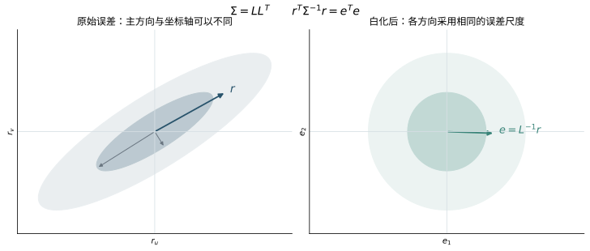
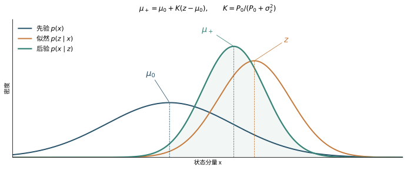
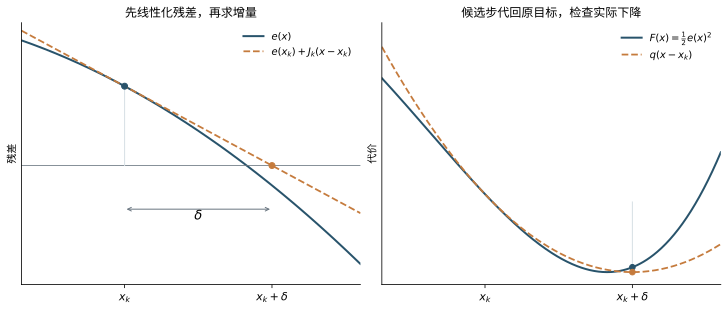
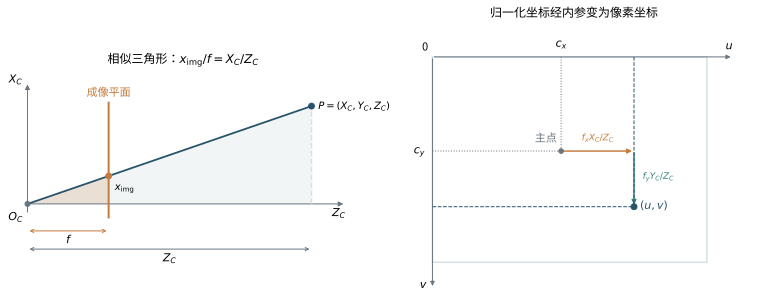
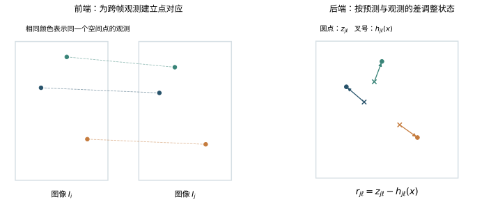
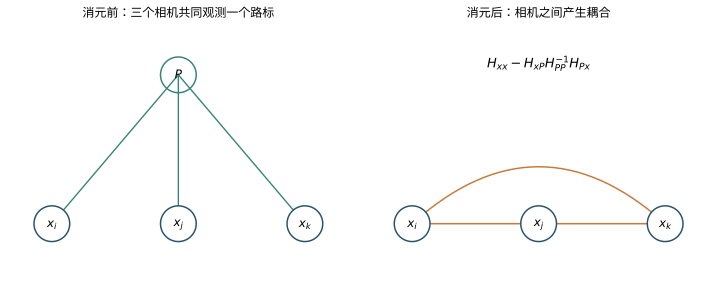
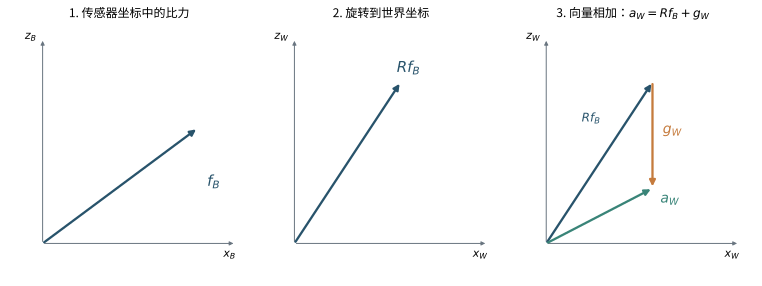
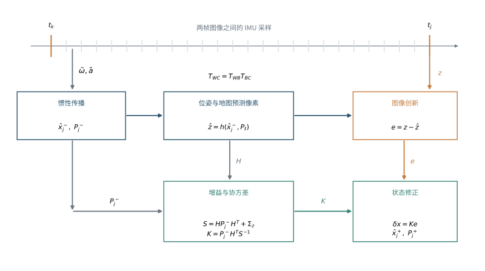
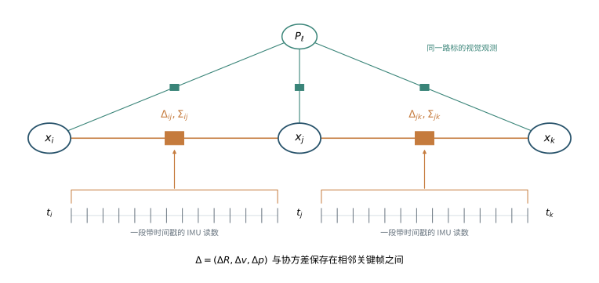

## 阅读目标与范围

视觉 SLAM 利用设备运动过程中拍到的图像，同时估计设备的运动轨迹和环境的三维结构。SLAM 是 simultaneous localization and mapping 的缩写，即“同时定位与建图”。加入惯性测量单元 IMU 后，图像中的几何关系与设备的运动规律共同约束这些未知量。

这项任务有一个贯穿全文的计算结构：先提出一组位置、朝向和地图的估计，用传感器模型预测读数，再根据预测与实际读数的差异修正估计。数学在这里承担具体工作。坐标变换负责把几何量写在同一套轴下；概率描述读数的误差；微积分说明未知量改变时预测怎样变化；线性代数把这些变化组织成可求解的方程。

### 传感器读数与待估计的几何量

数码图像由像素组成，每个像素保存亮度或颜色，位置用列、行两个数表示，后文记为 $(u,v)$。本笔记先从能在多幅图像中重复识别的角点等特征入手。一条视觉观测就是某个特征在某幅图像中的像素坐标。相机成像模型将像素与空间中的视线方向联系起来；空间点在这条视线上的距离，需要由多次观测及相机运动进一步确定。

相机运动包含位置和朝向的变化。选定设备上的一个参考点，它相对于固定参照的位置称为**位置**；设备各轴相对于固定参照的方向称为**姿态**。两者合起来称为**位姿**。不同时刻的位姿组成轨迹，环境中被反复观测的三维点可以组成一张稀疏地图。位置、姿态和地图是我们要估计的量，图像中的像素坐标是用来约束它们的读数。

IMU 是 inertial measurement unit，即惯性测量单元。本文采用的基本模型包含三轴陀螺仪和三轴加速度计；“三轴”表示沿设备上三根指定方向各输出一个分量。陀螺仪测量角速度，单位通常为弧度每秒。弧度用圆弧长与半径之比定义，角速度则是转角随时间的变化率。

加速度计测量**比力**，在本文的局部惯性模型中，它是单位质量所受非引力作用的合力。这个定义可以由两个现象理解：设备静放在桌上时，桌面提供支撑，比力的模长约为 $9.81\ {\rm m/s^2}$，方向沿支撑力；理想自由落体中，非引力作用为零，比力也为零。轨迹的二阶导数给出运动加速度。把比力换算到固定坐标系并加入重力，才得到这个运动加速度，第十章将逐步建立对应方程。[R3](#ref-r3)[R13](#ref-r13)

图像和惯性读数还带有时间戳。图像告诉我们环境相对于设备怎样变化，惯性读数描述短时间内的转动与运动变化。两者的融合需要一套共同的几何和时间描述。

### 从一个候选状态预测读数

把待估计的量统称为状态 $x$，把传感器读数记为 $z$。给定状态后，测量模型 $h$ 计算预测读数 $h(x)$。例如，给定相机位姿和一个三维点，就可以预测该点的像素位置。用 $n$ 表示测量误差，模型写为

$$
z=h(x)+n.
$$

一次观测到达后，$z$ 已知，$x$ 待求。对一个候选估计，定义残差为

$$
r(x)=z-h(x).
$$

残差将几何模型和数据连接起来。多个观测给出多个残差；求解器调整同一组未知量，使这些观测尽可能得到一致解释。哪些参数能够由数据确定、各条残差应有多大权重、怎样计算修正量，分别需要后文的可解性分析、概率模型和优化方法。

下文从普通代数、三角函数和二维坐标出发，逐步建立估计方法。实践可参考《视觉 SLAM 十四讲》的官方配套代码与勘误。[R1](#ref-r1)

## 第一章 线性代数与微积分的最小前提

测量模型连接着两类对象：一端是待估计的几何量，另一端是传感器输出的数字。本章先研究用实数向量表示的输入与输出。线性模型使我们能够直接看清测量约束了什么；一般非线性模型则可以在当前估计附近近似成线性模型。由此，矩阵求解与微分会进入同一个估计过程。

### 1.1 数字向量与物理向量

#### 从空间中的方向取得三个分量

一支从点 $P$ 指向点 $Q$ 的箭头描述位移。它有长度和方向，记为 $\overrightarrow{PQ}$。为了用数字表示它，先选三个长度为 $1$、两两垂直的方向 $\vec e_{A,1},\vec e_{A,2},\vec e_{A,3}$。它们构成一组**正交单位基**。再选原点 $O_A$，就得到坐标系 $A$。

任意三维向量 $\vec v$ 都可以沿这三根轴分解：

$$
\vec v=v_{A,1}\vec e_{A,1}
      +v_{A,2}\vec e_{A,2}
      +v_{A,3}\vec e_{A,3}.
$$

三个系数是它在 $A$ 中的分量，按列排列为

$$
v_A=\begin{bmatrix}v_{A,1}\\v_{A,2}\\v_{A,3}\end{bmatrix}
\in\mathbb R^3.
$$

$\mathbb R^3$ 表示所有由三个实数组成的列向量。下标 $A$ 说明这三个数沿哪组轴读取。换一组轴，同一支箭头通常会得到另一组三个数；第二章将推导两组分量之间的换算。

点的位置还涉及原点。点 $P$ 在 $A$ 中的位置坐标，是 $\overrightarrow{O_AP}$ 的分量。两个点的位置坐标相减，得到它们之间的位移。若原点改变而轴方向保持不变，各点的位置会一起改变，点间位移保持原值。这一关系使后面的位置变换含有平移项，而位移、速度等自由向量的换算只需处理方向。

#### 内积给出投影，范数给出长度

两支向量的内积定义为

$$
\vec a\cdot\vec b=\|\vec a\|\,\|\vec b\|\cos\alpha,
$$

其中 $\alpha$ 是夹角，$\|\vec a\|$ 表示长度。当 $\vec b$ 是单位向量时，内积就是 $\vec a$ 沿 $\vec b$ 方向的带符号投影长度。因此，向量沿坐标轴的分量为

$$
v_{A,i}=\vec e_{A,i}\cdot\vec v.
$$

将 $\vec v$ 的基展开式代入：$\vec e_{A,i}$ 与自身的内积为 $1$，与另外两根轴的内积为 $0$，恰好只留下第 $i$ 个系数。

内积也能直接由分量计算。在正交单位基下，勾股定理给出 $\|a\|^2=a_1^2+a_2^2+a_3^2$。分别用坐标和余弦定理展开 $\|a-b\|^2$：

$$
\begin{aligned}
\|a-b\|^2
&=\|a\|^2+\|b\|^2-2(a_1b_1+a_2b_2+a_3b_3),\\
\|a-b\|^2
&=\|a\|^2+\|b\|^2-2\|a\|\,\|b\|\cos\alpha.
\end{aligned}
$$

比较得到

$$
a^Tb=\sum_{i=1}^{3}a_ib_i,\qquad
\|a\|=\sqrt{a^Ta}.
$$

上标 $T$ 表示转置，列向量转成行向量后，$a^T$ 为 $1\times3$，$b$ 为 $3\times1$，所以 $a^Tb$ 是一个数。这种长度称为欧氏范数。相同定义也适用于 $\mathbb R^n$：$\|x\|^2=\sum_{i=1}^n x_i^2$。后面用它衡量一组残差的总大小。

例如，$a=(3,4,0)^T$ 的长度为 $5$；与第二根单位轴 $e_2=(0,1,0)^T$ 的内积为 $4$，正好读出第二个分量。

#### 叉积描述垂直方向与转动

三维转动还需要叉积。采用右手坐标系，约定 $e_1\times e_2=e_3$，并按循环次序得到 $e_2\times e_3=e_1$、$e_3\times e_1=e_2$。交换顺序会变号，相同轴的叉积为零。一般的 $a\times b$ 垂直于 $a,b$ 所在平面，长度为 $\|a\|\|b\|\sin\alpha$，方向遵循右手规则。

把 $a,b$ 沿基展开，再逐项相乘，得到

$$
a\times b=
\begin{bmatrix}
a_2b_3-a_3b_2\\
a_3b_1-a_1b_3\\
a_1b_2-a_2b_1
\end{bmatrix}.
$$

当 $a$ 固定时，输出是 $b$ 各分量的线性组合，可以写成

$$
a\times b=[a]_\times b,\qquad
[a]_\times=
\begin{bmatrix}
0&-a_3&a_2\\
a_3&0&-a_1\\
-a_2&a_1&0
\end{bmatrix}.
$$

$[a]_\times$ 是叉乘矩阵，表示“将输入与 $a$ 做叉乘”这项运算。它满足

$$
[a]_\times^T=-[a]_\times,\qquad
[a]_\times b=-[b]_\times a.
$$

前一性质称为反对称。第二章将由旋转的约束推出这样的矩阵，并把其中三个独立分量解释为角速度。

几何向量的加减、内积和叉积都在共同的坐标轴下计算，参与相加的量还要有相同单位。后文也会将位置、速度等不同物理量堆成较长的数字向量，例如 $(p^T,v^T)^T\in\mathbb R^6$。这种六维向量组织了六个未知数；每组三个分量仍保留各自的坐标系和单位。

### 1.2 矩阵为什么能表示运动与约束

#### 用矩阵组织输入与输出

一条线性测量关系可以是若干未知数的加权和。若输入 $x$ 有 $n$ 个分量，输出 $y$ 有 $m$ 个分量，写为

$$
y_i=\sum_{j=1}^{n}A_{ij}x_j,\qquad i=1,\ldots,m.
$$

将权重按 $m$ 行、$n$ 列排列，就得到矩阵 $A\in\mathbb R^{m\times n}$ 和表达式 $y=Ax$。第 $i$ 行计算第 $i$ 个输出；第 $j$ 列描述第 $j$ 个输入对全部输出的影响。

令 $e_j$ 为第 $j$ 个分量为 $1$、其余为 $0$ 的单位向量。因为 $x=\sum_jx_je_j$，所以

$$
Ax=\sum_jx_j(Ae_j).
$$

$Ae_j$ 正好是 $A$ 的第 $j$ 列。因此，一个线性变换由它对各根基向量的作用完全确定。第二章构造旋转矩阵时，将用这条性质把坐标轴的方向排成矩阵的列。

几何模型常由若干步骤组成。设先算 $y=Bx$，再算 $z=Ay$，代入后有

$$
z_i=\sum_j A_{ij}\sum_kB_{jk}x_k
=\sum_k\left(\sum_jA_{ij}B_{jk}\right)x_k.
$$

于是 $z=(AB)x$，矩阵乘法的规则为

$$
(AB)_{ik}=\sum_jA_{ij}B_{jk}.
$$

若 $B$ 为 $n\times p$、$A$ 为 $m\times n$，乘积 $AB$ 为 $m\times p$。中间的 $n$ 个分量由行乘列累加消去。按计算次序，右边的 $B$ 先作用。后文将空间点变换到相机，再映射到图像时，函数和导数都遵循这个次序。

转置把矩阵的行与列交换。除了前面的内积 $a^Tb$，还会出现**外积** $ab^T$：若 $a\in\mathbb R^m,b\in\mathbb R^n$，它是 $m\times n$ 矩阵，第 $(i,j)$ 个元素为 $a_ib_j$。第三章用误差向量的外积建立协方差。

#### 线性方程能确定哪些未知量

传感器给出输出后，求解方向反过来：已知 $A,b$，寻找满足 $Ax=b$ 的输入 $x$。这里先用相对位置约束说明解的结构。

设一维运动中的三个位置为 $x_1,x_2,x_3$，已知相邻位移分别为 $1$ 和 $2$ 个长度单位。两条关系可写成

$$
\underbrace{\begin{bmatrix}-1&1&0\\0&-1&1\end{bmatrix}}_A
\underbrace{\begin{bmatrix}x_1\\x_2\\x_3\end{bmatrix}}_x
=\underbrace{\begin{bmatrix}1\\2\end{bmatrix}}_b.
$$

逐条解出 $x_2=x_1+1$、$x_3=x_1+3$，因此所有解为

$$
x=\begin{bmatrix}c\\c+1\\c+3\end{bmatrix},
\qquad c\in\mathbb R.
$$

所有位置一起平移时，相邻位置之差保持不变。令 $d_0=(1,1,1)^T$，直接相乘有 $Ad_0=0$，所以 $A(x+cd_0)=Ax$。

所有满足 $Ad=0$ 的向量组成 $A$ 的**零空间** $\operatorname{null}(A)$。沿这些方向改变输入，预测保持原值。本例的零空间是 $\operatorname{span}\{(1,1,1)^T\}$，其中 $\operatorname{span}$ 表示该向量所有数倍构成的集合。

若一组向量中，只有将所有系数都取零才能使线性组合为零，就称它们线性独立。矩阵的**秩**是独立列的数量，也等于独立行的数量。对于有 $n$ 列的矩阵，秩与零空间维数满足

$$
\operatorname{rank}(A)+\dim\operatorname{null}(A)=n.
$$

本例的两个位移约束独立，秩为 $2$，三个未知分量还剩一个自由方向。选定 $x_1=0$ 就得到坐标表示 $(0,1,3)^T$。这相当于固定了整体平移的坐标自由度。SLAM 中相似的分析会用于找出能够保持所有测量预测不变的整体变换。

#### 从残差平方和推导最小二乘

带噪声的多条测量通常不能被一组参数同时精确满足。先考虑同一个标量 $x$ 得到 $m$ 次同等可靠的读数 $b_1,\ldots,b_m$，用平方和衡量它们与预测的差：

$$
F(x)=\frac12\sum_{i=1}^{m}(b_i-x)^2.
$$

定义平均值 $\bar b=\frac1m\sum_i b_i$，将每个差拆开并展开：

$$
\begin{aligned}
\sum_i(b_i-x)^2
&=\sum_i\bigl[(b_i-\bar b)+(\bar b-x)\bigr]^2\\
&=\sum_i(b_i-\bar b)^2+m(\bar b-x)^2.
\end{aligned}
$$

中间的交叉项为 $2(\bar b-x)\sum_i(b_i-\bar b)=0$。第一项已经由读数决定，第二项在 $x=\bar b$ 时最小。这就从平方目标得到平均值。第三章将说明高斯误差模型为何会导出这样的目标，以及不同精度应怎样加权。

对一般线性测量，预测为 $Ax$，观测为 $b$，残差为 $r=b-Ax$，目标是

$$
F(x)=\frac12\|b-Ax\|^2.
$$

沿任意方向 $d\in\mathbb R^n$ 将输入改成 $x+\varepsilon d$，精确展开得到

$$
\begin{aligned}
F(x+\varepsilon d)
&=\frac12(r-\varepsilon Ad)^T(r-\varepsilon Ad)\\
&=F(x)-\varepsilon d^TA^Tr
+\frac{\varepsilon^2}{2}\|Ad\|^2.
\end{aligned}
$$

在最小点，一阶系数必须为零：若它非零，选择足够小且符号合适的 $\varepsilon$ 就能降低目标。因此 $d^TA^Tr=0$ 对任意 $d$ 成立，得到

$$
A^T(b-Ax)=0
\quad\Longleftrightarrow\quad
\boxed{A^TAx=A^Tb.}
$$

这组 $n$ 维方程称为**正规方程**。在它的解处，一阶项消失，任意改动造成的剩余变化都是 $\frac12\|Ad\|^2\ge0$，所以它给出全局最小值。若 $A$ 的列线性独立，$Ad=0$ 只有零解，最小点也就唯一。

这个结果有一个几何解释。全部预测 $Ax$ 构成 $A$ 的列空间，$A^Tr=0$ 表示残差与每一列垂直。最佳预测是观测 $b$ 在列空间上的正交投影。设最佳解为 $x_*$，再沿列空间移动 $Ad$，由于 $r_*=b-Ax_*$ 与 $Ad$ 垂直，

$$
\|b-A(x_*+d)\|^2
=\|r_*-Ad\|^2
=\|r_*\|^2+\|Ad\|^2.
$$

新的误差平方因此至少与原来一样大。

**单位矩阵** $I_n$ 的主对角线为 $1$、其余为 $0$，满足 $I_nx=x$。对于可唯一撤销的方阵变换 $M$，逆矩阵 $M^{-1}$ 满足 $M^{-1}M=MM^{-1}=I$；方阵满秩时逆存在。因此，$A$ 列满秩时，正规方程在纸面上可写为

$$
x=(A^TA)^{-1}A^Tb.
$$

计算中通常通过矩阵分解直接求解方程。接下来引入的 SVD 会同时给出解、零空间以及解对测量扰动的敏感程度。

### 1.3 特征值 SVD 与不确定方向

#### 参数沿不同方向变化时，预测的反应不同

仍考虑线性预测 $Ax$。若输入沿单位方向 $d$ 改变 $\varepsilon$，预测变化为 $\varepsilon Ad$。所以 $\|Ad\|$ 衡量数据对这个参数方向的敏感程度。这里讨论方向强弱时，先将变量和输出的单位、尺度固定；第三章再引入测量噪声的尺度。

令 $H=A^TA$，有

$$
\|Ad\|^2=d^THd.
$$

$H$ 是实对称矩阵，且 $d^THd\ge0$，称为半正定；若对所有非零 $d$ 都严格大于零，则称为正定，记为 $H\succ0$。若非零向量 $v$ 满足

$$
Hv=\lambda v,
$$

则 $v$ 是特征向量，$\lambda$ 是特征值。沿这一方向，$H$ 的作用是按 $\lambda$ 缩放。对单位特征向量，$\|Av\|^2=\lambda$，因而特征值直接描述该方向在测量中的变化强度。

实对称矩阵的谱定理保证，可以选出一组正交单位特征向量作为整个输入空间的基。对 $A^TA$，特征值均非负：零值对应零空间，较小的正值对应较弱的线性约束。于是可确定性从“有多少条方程”进一步变成了“这些方程沿哪些方向独立、沿哪些方向敏感”。

#### SVD 将输入方向与输出方向配对

测量数和未知数可以不同，所以 $A$ 往往是长方形矩阵。取 $A^TA$ 的单位特征向量 $v_i$，对正特征值 $\lambda_i$ 定义

$$
\sigma_i=\sqrt{\lambda_i},\qquad
u_i=\frac{Av_i}{\sigma_i}.
$$

$\sigma_i$ 称为奇异值，表示输入方向 $v_i$ 的单位变化在输出中变成多长。由

$$
u_i^Tu_j
=\frac{v_i^TA^TAv_j}{\sigma_i\sigma_j}
=\frac{\lambda_jv_i^Tv_j}{\sigma_i\sigma_j}
$$

可知，这些 $u_i$ 也是正交单位向量。把输入和输出方向分别补齐成完整的正交基，就得到**奇异值分解**：

$$
\boxed{A=U\Sigma V^T.}
$$

对 $A\in\mathbb R^{m\times n}$，完整形式中的 $U$ 为 $m\times m$，$V$ 为 $n\times n$，$\Sigma$ 为 $m\times n$。$U,V$ 的列是正交单位向量，$\Sigma$ 的非零元素在主对角线上，按 $\sigma_1\ge\cdots\ge\sigma_r > 0$ 排列，数量 $r$ 等于秩。

乘法的三步分别是：$V^T$ 将输入沿 $v_i$ 这组轴读取分量，$\Sigma$ 逐轴缩放，$U$ 将结果沿输出轴组合起来。这使一个耦合的线性系统变成了若干独立的一维关系。

#### 从分解求解，并读出敏感方向

令 $y=V^Tx$、$c=U^Tb$。正交变换保持长度，因而

$$
\begin{aligned}
\|b-Ax\|^2
&=\|c-\Sigma y\|^2\\
&=\sum_{i=1}^{r}(c_i-\sigma_i y_i)^2
+\sum_{i=r+1}^{m}c_i^2.
\end{aligned}
$$

每个非零奇异值方向上的最优分量为 $y_i=c_i/\sigma_i$。后面的 $c_i^2$ 是观测在列空间之外的部分，构成最小残差。若 $r < n$，$y_{r+1},\ldots,y_n$ 是自由分量；将它们设为零可得到所有最小二乘解中长度最小的一个。

这个选解规则写为 $x=A^+b$，其中

$$
A^+=V\Sigma^+U^T.
$$

$\Sigma^+$ 将非零奇异值取倒数，并交换矩阵的行列尺寸；$A^+$ 称为伪逆。它求解受到约束的分量，同时为零空间方向选定最小长度的代表。

测量扰动也能沿同一组轴分析。若 $c_i$ 改变 $\delta c_i$，对应解的变化为

$$
\delta y_i=\frac{\delta c_i}{\sigma_i}.
$$

因此小奇异值会放大测量扰动。对非零奇异值，最大与最小之比描述最强、最弱方向的差距；形成 $A^TA$ 后，它的对应特征值是 $\sigma_i^2$，这个比例会被平方。实际求解常直接对原矩阵做 QR 或 SVD 分解，以保留较好的数值精度。

视觉几何还会产生一种齐次问题：寻找非零方向 $h$，使 $Ah$ 尽量接近零。固定尺度 $\|h\|=1$ 后，目标为

$$
\min_{\|h\|=1}\|Ah\|^2.
$$

写成 $h=Vy$，约束为 $\sum_i y_i^2=1$，目标为 $\sum_i\sigma_i^2y_i^2$，零空间方向的奇异值按零计。目标是各 $\sigma_i^2$ 的加权平均，最小值由最小奇异值对应的方向取得。因此可取 $V$ 的最后一列；最小奇异值有重数时，可以在相应子空间中选取单位向量。第六章会把两幅图像的部分几何约束整理成这种形式。

### 1.4 导数 雅可比与一阶近似

#### 用当前点附近的变化建立线性模型

一般测量函数 $h(x)$ 含有旋转、除法等非线性运算。为了计算一个修正量，可以先研究它在当前估计附近怎样变化。

对标量函数 $f(s)=s^2$，输入改成 $s+\varepsilon$ 时，

$$
f(s+\varepsilon)-f(s)=2s\varepsilon+\varepsilon^2.
$$

当 $\varepsilon$ 足够小时，主要变化为 $2s\varepsilon$。这个变化比例是导数，严格定义为

$$
f'(s)=\lim_{\varepsilon\to0}
\frac{f(s+\varepsilon)-f(s)}{\varepsilon}.
$$

于是 $f(s+\varepsilon)\approx f(s)+f'(s)\varepsilon$。几何上，这是在展开点附近用切线描述函数。

设 $f:\mathbb R^n\to\mathbb R^m$。只改变第 $j$ 个输入时，第 $i$ 个输出的变化率记为 $\partial f_i/\partial x_j$。将这些偏导数排成矩阵，得到雅可比

$$
J_f(x)=
\begin{bmatrix}
\dfrac{\partial f_1}{\partial x_1}&\cdots&
\dfrac{\partial f_1}{\partial x_n}\\
\vdots&&\vdots\\
\dfrac{\partial f_m}{\partial x_1}&\cdots&
\dfrac{\partial f_m}{\partial x_n}
\end{bmatrix}
\in\mathbb R^{m\times n}.
$$

每列描述一个输入分量对全部输出的影响，每行描述一个输出对全部输入的依赖。若函数可微，多个小改动的一阶影响相加，得到 Taylor 一阶近似：

$$
f(x+\delta x)=f(x)+J_f(x)\delta x+O(\|\delta x\|^2).
$$

这里采用附近二阶导数有界的条件；$O(\|\delta x\|^2)$ 表示余项的长度至多为某个常数乘以 $\|\delta x\|^2$。因此随着改变量缩小，一阶项会成为主要部分。

下面把每个分量展开一次：

$$
f(x,y)=
\begin{bmatrix}x^2+2y\\xy\end{bmatrix}.
$$

第一个输出的变化为 $2x\,\delta x+2\,\delta y+(\delta x)^2$；第二个输出的变化为 $y\,\delta x+x\,\delta y+\delta x\,\delta y$。收集一阶项可得

$$
J_f(x,y)=\begin{bmatrix}2x&2\\y&x\end{bmatrix}.
$$

在 $(2,3)$ 处取增量 $(0.01,-0.02)^T$，线性预测的输出变化为 $(0,-0.01)^T$；直接代入后的变化为 $(0.0001,-0.0102)^T$。两者差异恰好来自刚才列出的两个二阶项。

#### 链式法则连接一连串几何计算

SLAM 的预测通常经过多个函数。设先由 $s\in\mathbb R^k$ 算出 $x=g(s)\in\mathbb R^n$，再算 $y=f(x)\in\mathbb R^m$。小改动逐步传播：

$$
\delta x\approx J_g\delta s,\qquad
\delta y\approx J_f\delta x.
$$

代入得到链式法则

$$
\boxed{J_{f\circ g}(s)=J_f(g(s))J_g(s).}
$$

右侧的维度为 $(m\times n)(n\times k)$，结果为 $m\times k$。这与前面矩阵乘法描述复合变换的次序一致。

例如，相机预测可以拆成“把空间点写到相机坐标”以及“把相机坐标投影到像素”两步。第一步若将六维位姿增量变成三维点坐标增量，雅可比为 $3\times6$；第二步将三维点坐标增量变成二维像素增量，雅可比为 $2\times3$。两者相乘，便得到像素对位姿增量的 $2\times6$ 雅可比。第二章和第六章将分别建立这两个函数。

#### 用雅可比计算一次估计修正

回到观测模型。令当前估计为 $\hat x$，残差为 $r(x)=z-h(x)$。观测 $z$ 已固定，所以残差的雅可比 $J_{\rm res}$ 是预测雅可比的负值：

$$
J_{\rm res}=-J_h,\qquad
r(\hat x+\delta x)\approx r(\hat x)+J_{\rm res}(\hat x)\delta x.
$$

将它代入平方目标，得到关于修正量的线性最小二乘：

$$
\min_{\delta x}
\frac12\|r+J_{\rm res}\delta x\|^2.
$$

在 1.2 的正规方程中取 $A=J_{\rm res}$、$b=-r$，就得到

$$
J_{\rm res}^TJ_{\rm res}\,\delta x
=-J_{\rm res}^Tr.
$$

求出 $\delta x$，更新估计，再在新的位置重新计算残差与雅可比。这是第四章 Gauss Newton 方法的核心。这一步线性化问题的可解性和敏感程度，由当前雅可比的秩和奇异值描述，因而前面讨论的线性系统结构会再次出现。

标量目标的一阶偏导数组成**梯度** $\nabla F$，二阶偏导数组成 **Hessian** 矩阵 $\nabla^2F$。对 $F=\frac12r^Tr$，逐分量求导有

$$
\frac{\partial F}{\partial x_j}
=\sum_i r_i\frac{\partial r_i}{\partial x_j},
\qquad
\nabla F=J_{\rm res}^Tr.
$$

第四章会继续对这个式子求导，说明为何用 $J_{\rm res}^TJ_{\rm res}$ 近似 Hessian。

实现时还可以用独立的数值差分核对雅可比。若 $e_j$ 为第 $j$ 个单位方向，

$$
(J_f)_{:,j}\approx
\frac{f(x+\varepsilon e_j)-f(x-\varepsilon e_j)}{2\varepsilon}.
$$

有限差分使用的输入改动应与解析推导相同。普通实数向量直接相加；第二章为姿态定义的局部改动，则通过旋转复合完成。

### 1.5 积分与离散时间

测量模型除了连接几何量，还要连接不同时刻的状态。设 $p(t)$ 是设备参考点在一个固定坐标系中的位置，速度和加速度定义为

$$
v(t)=\frac{dp(t)}{dt},\qquad
a(t)=\frac{dv(t)}{dt}.
$$

在很短的时间段 $\Delta t_k$ 内，速度近似不变，位移约为 $v(t_k)\Delta t_k$。将各段累加，并让分段逐渐变细，就得到积分：

$$
p(t_1)-p(t_0)
=\lim\sum_kv(t_k)\Delta t_k
=\int_{t_0}^{t_1}v(t)\,dt.
$$

同样地，

$$
v(t_1)=v(t_0)+\int_{t_0}^{t_1}a(t)\,dt.
$$

积分将变化率累积为变化量，初值 $p(t_0),v(t_0)$ 决定从哪里、以什么速度开始。

将速度的积分表达式代入位置，可进一步写成

$$
\begin{aligned}
p(t_1)
&=p(t_0)+v(t_0)(t_1-t_0)
+\int_{t_0}^{t_1}\int_{t_0}^{t}a(\tau)\,d\tau\,dt\\
&=p(t_0)+v(t_0)(t_1-t_0)
+\int_{t_0}^{t_1}(t_1-\tau)a(\tau)\,d\tau.
\end{aligned}
$$

第二行可以按每一小段加速度的贡献理解：在时刻 $\tau$ 增加的速度为 $a(\tau)d\tau$，它对随后 $t_1-\tau$ 长的时间产生位移，所以位置积分带有这个剩余时间权重。

在长度为 $h$ 的一段时间内，若加速度恒为 $a_k$，两个积分给出

$$
\boxed{
v_{k+1}=v_k+a_kh,\qquad
p_{k+1}=p_k+v_kh+\frac12a_kh^2.
}
$$

位置中的 $\frac12$ 来自 $\int_0^h(h-\tau)\,d\tau=h^2/2$。也可以将增加的速度看成从 $0$ 均匀增长到 $a_kh$，其平均值为 $a_kh/2$。单位上，$v_kh$ 与 $a_kh^2$ 都是长度。

传感器按离散时刻采样，实际计算需要用这些样本近似连续积分。对一般微分方程 $\dot x=f(x,t)$，在区间内使用起点变化率可得 Euler 方法：

$$
x_{k+1}\approx x_k+f(x_k,t_k)h.
$$

中点法等方法利用更多采样近似积分。下一章推导满足旋转约束的姿态更新。

## 第二章 坐标变换 旋转与李群

预测图像时，要把地图点从固定参照变换到相机的轴下；积分惯性数据时，要将设备上的测量方向与固定参照联系起来。它们都需要回答同一个几何问题：一个量已在某组轴下给出，怎样在另一组轴下表示？

坐标变换建立测量函数，姿态更新则使求解器能够修正这个函数中的旋转。本章依次建立这两个环节。

### 2.1 首先固定全部坐标约定

#### 从原点与基向量推导坐标变换

沿用第一章的定义，坐标系 $A$ 由原点 $O_A$ 和正交单位基 $\vec e_{A1},\vec e_{A2},\vec e_{A3}$ 构成。另有坐标系 $B$，原点为 $O_B$，基向量为 $\vec e_{B1},\vec e_{B2},\vec e_{B3}$。两组轴均采用右手规则。

对同一个空间点 $Q$，分别用 $q_A,q_B$ 表示它的坐标列向量。相应的几何向量为

$$
\overrightarrow{O_AQ}=\sum_{i=1}^3(q_A)_i\vec e_{Ai},
\qquad
\overrightarrow{O_BQ}=\sum_{j=1}^3(q_B)_j\vec e_{Bj}.
$$

从 $O_A$ 到 $Q$，可以先到 $O_B$，再到 $Q$：

$$
\overrightarrow{O_AQ}
=\overrightarrow{O_AO_B}+\overrightarrow{O_BQ}.
$$

令 $p_{AB}$ 为 $\overrightarrow{O_AO_B}$ 在 $A$ 中的分量。对等式两边与 $\vec e_{Ai}$ 做内积，得到

$$
(q_A)_i=(p_{AB})_i+
\sum_{j=1}^3(\vec e_{Ai}\cdot\vec e_{Bj})(q_B)_j.
$$

定义矩阵

$$
(R_{AB})_{ij}=\vec e_{Ai}\cdot\vec e_{Bj},
$$

三个标量等式就合为

$$
\boxed{q_A=R_{AB}q_B+p_{AB}.}
$$

$R_{AB}$ 的第 $j$ 列是 $B$ 的第 $j$ 根单位轴在 $A$ 中的坐标。乘以 $q_B$ 时，将这三根轴按 $q_B$ 的分量加权组合，再加上原点间的位移，就得到 $q_A$。

本文采用的下标规则是：$R_{AB}$ 把 $B$ 中的分量换算到 $A$；$p_{AB}$ 是 $B$ 原点在 $A$ 中的位置。对两个点的变换式相减，平移项消去，得到自由向量的换算

$$
d_A=R_{AB}d_B.
$$

这里同一个物理方向在两组轴下有不同分量。矩阵的列同时记录了两组轴的相对朝向，所以 $R_{AB}$ 既描述姿态，也执行坐标换算。

#### 由坐标轴的性质得到旋转约束

设 $r_j$ 为 $R_{AB}$ 的第 $j$ 列。因为它们表示一组正交单位轴，

$$
r_i^Tr_j=
\begin{cases}
1,&i=j,\\
0,&i\ne j.
\end{cases}
$$

$R_{AB}^TR_{AB}$ 的第 $(i,j)$ 个元素正是 $r_i^Tr_j$，因此

$$
R_{AB}^TR_{AB}=I,\qquad
R_{AB}^{-1}=R_{AB}^T.
$$

这也说明换算保留长度和夹角。例如

$$
\|R_{AB}d_B\|^2
=d_B^TR_{AB}^TR_{AB}d_B
=d_B^Td_B.
$$

保持长度的正交变换还包括镜像反射。为了描述右手轴之间的朝向变化，需要进一步保持手性。矩阵的**行列式** $\det M$ 是有向体积的倍率：绝对值描述体积缩放，符号说明手性是否翻转。用 $\det(MN)=\det M\det N$ 和 $\det(M^T)=\det M$，从 $R^TR=I$ 得到 $(\det R)^2=1$。右手系之间的旋转取 $\det R=1$。

这些三维旋转矩阵的集合记为

$$
SO(3)=\{R\in\mathbb R^{3\times3}:R^TR=I,\ \det R=1\}.
$$

$SO$ 是特殊正交的缩写。九个矩阵元素受正交约束：第一根单位轴有两个方向自由度，第二根轴在与它垂直的平面内有一个方向自由度，第三根轴由右手规则确定，因此姿态有三个独立自由度。

反向坐标变换也已经确定。由 $q_A=R_{AB}q_B+p_{AB}$ 先减去平移，再乘逆旋转：

$$
\boxed{q_B=R_{AB}^T(q_A-p_{AB}).}
$$

#### 一次二维换算及其三维扩展

用一个局部算例核对以上规则。设二维坐标系 $A$ 的横轴向右、纵轴向上；$B$ 原点在 $A$ 中为 $(1,2)^T$，两根轴相对于 $A$ 逆时针转了 $90^\circ$。$B$ 的两根单位轴在 $A$ 中分别为 $(0,1)^T$、$(-1,0)^T$，所以

$$
R_{AB}=
\begin{bmatrix}0&-1\\1&0\end{bmatrix},
\qquad
p_{AB}=\begin{bmatrix}1\\2\end{bmatrix}.
$$

点的 $B$ 坐标为 $q_B=(2,1)^T$，表示从 $O_B$ 沿第一根轴走 $2$，再沿第二根轴走 $1$。这两步在 $A$ 中合成 $(-1,2)^T$，加上原点的位置得到

$$
q_A=
\begin{bmatrix}0&-1\\1&0\end{bmatrix}
\begin{bmatrix}2\\1\end{bmatrix}
+\begin{bmatrix}1\\2\end{bmatrix}
=\begin{bmatrix}0\\4\end{bmatrix}.
$$

反向计算为

$$
q_B=
\begin{bmatrix}0&1\\-1&0\end{bmatrix}
\left(
\begin{bmatrix}0\\4\end{bmatrix}
-\begin{bmatrix}1\\2\end{bmatrix}
\right)
=\begin{bmatrix}2\\1\end{bmatrix}.
$$

若在三维中让两组第三轴指向同一方向，则

$$
R_{AB}=
\begin{bmatrix}
0&-1&0\\
1&0&0\\
0&0&1
\end{bmatrix},
\qquad
p_{AB}=\begin{bmatrix}1\\2\\0\end{bmatrix}.
$$

此时 $q_B=(2,1,3)^T$ 对应 $q_A=(0,4,3)^T$。第三个分量沿共同的轴读取，二维中的旋转和平移计算原样保留。

#### 为实际传感器建立坐标系

现在将通用规则用于设备与环境：

| 记号 | 原点与轴的定义 | 所描述的量 |
|---|---|---|
| $W$ | 为局部运动选定的固定原点与固定轴 | 设备轨迹和地图的共同参照 |
| $B$ | 原点与轴固定在 IMU 上，随设备运动 | 惯性读数的测量方向；称为机体坐标系 |
| $C$ | 原点位于相机光学中心，轴固定在相机上 | 空间点相对于相机的方向与距离 |

本文取相机的 $x$ 轴向图像右方、$y$ 轴向下、$z$ 轴沿光轴向前。相机与 IMU 可以有不同的安装方向与原点，二者之间的固定换算将在下一节给出。

设 IMU 原点的连续位置为 $p_{WB}(t)$。在第 $i$ 个采样时刻 $t_i$，记

$$
R_i=R_{WB_i},\qquad
p_i=p_{WB}(t_i)=p_{WB_i},\qquad
v_i=\dot p_{WB}(t_i).
$$

$R_i$ 将时刻 $t_i$ 的机体分量换算到世界坐标；$p_i$ 是 IMU 原点的世界位置，$v_i$ 也在世界轴下表达。惯性部分通常将世界第三轴选为向上，使重力写为 $g_W=(0,0,-g)^T$，其中 $g > 0$ 是当地重力加速度大小。

<figure>
  
  <figcaption>图 1 · 同一个点在两套坐标中的表达。左图按位移相加得到 q_A，右图沿 B 的轴读取 q_B；R_AB 将后者转换到 A 的轴下，p_AB 连接两个原点。 点击图片可查看原图。</figcaption>
</figure>

### 2.2 齐次变换 复合与逆

#### 将旋转和平移写成一次乘法

设备位姿同时包含旋转 $R$ 和平移 $p$。为了方便连续换算，在点的三维坐标后附加一个常数 $1$：

$$
\bar q=\begin{bmatrix}q\\1\end{bmatrix},\qquad
T_{AB}=
\begin{bmatrix}
R_{AB}&p_{AB}\\
0_{1\times3}&1
\end{bmatrix}.
$$

按分块矩阵乘法，

$$
T_{AB}\bar q_B
=\begin{bmatrix}R_{AB}q_B+p_{AB}\\1\end{bmatrix}
=\bar q_A.
$$

这称为齐次表示，附加分量使平移进入同一次矩阵乘法。自由向量采用末分量为 $0$ 的表示：

$$
T_{AB}\begin{bmatrix}d_B\\0\end{bmatrix}
=\begin{bmatrix}R_{AB}d_B\\0\end{bmatrix}.
$$

乘法因而分别处理了点的位置和自由向量的方向。本节对点使用末分量为 $1$ 的代表；第六章会将齐次坐标扩展到投影几何，用 $\sim$ 表示相差非零倍数的等价关系。

#### 从代入得到变换的复合与逆

设点先从 $D$ 换算到 $B$，再从 $B$ 换算到 $A$：

$$
q_B=R_{BD}q_D+p_{BD},\qquad
q_A=R_{AB}q_B+p_{AB}.
$$

将第一式代入第二式，

$$
q_A=(R_{AB}R_{BD})q_D+
\bigl(p_{AB}+R_{AB}p_{BD}\bigr).
$$

因此

$$
\boxed{
T_{AD}=T_{AB}T_{BD},\quad
R_{AD}=R_{AB}R_{BD},\quad
p_{AD}=p_{AB}+R_{AB}p_{BD}.
}
$$

平移 $p_{BD}$ 沿 $B$ 的轴读取，先乘 $R_{AB}$ 就将它写到 $A$ 的轴下，随后可以与 $p_{AB}$ 相加。下标同时记录了计算顺序：右侧先执行 $D\to B$，再执行 $B\to A$。

沿用上一节二维算例，另设 $D$ 与 $B$ 的轴平行，$D$ 原点在 $B$ 中为 $(1,0)^T$。从 $A$ 看，这一位移沿上方，因此

$$
p_{AD}
=\begin{bmatrix}1\\2\end{bmatrix}
+\begin{bmatrix}0&-1\\1&0\end{bmatrix}
 \begin{bmatrix}1\\0\end{bmatrix}
=\begin{bmatrix}1\\3\end{bmatrix}.
$$

反向换算由上一节的逆旋转公式得到：

$$
q_B=R_{AB}^Tq_A-R_{AB}^Tp_{AB},
$$

$$
\boxed{
T_{BA}=T_{AB}^{-1}
=\begin{bmatrix}
R_{AB}^T&-R_{AB}^Tp_{AB}\\
0&1
\end{bmatrix}.
}
$$

逆变换的平移列表示 $A$ 原点在 $B$ 中的位置。例如算例中为 $-R_{AB}^Tp_{AB}=(-2,1)^T$，其中的两个数沿 $B$ 的轴读取。

这些变换保持任意两点之间的距离，称为刚体变换。它们的集合为

$$
SE(3)=\left\{
\begin{bmatrix}R&p\\0&1\end{bmatrix}:
R\in SO(3),\ p\in\mathbb R^3
\right\}.
$$

$SE$ 是特殊欧氏变换的缩写。旋转与平移合计六个自由度。变换可以复合，单位矩阵表示保持原样，逆矩阵撤销原变换；这些运算满足群的规则。$SO(3)$ 与 $SE(3)$ 的变换可以连续变化，复合和求逆也随之平滑变化，因此称为李群。[R2](#ref-r2)

#### 将相机和惯性传感器接到同一个模型中

在刚性安装模型中，相机与 IMU 的相对位姿是常量，记为

$$
T_{BC}=
\begin{bmatrix}R_{BC}&p_{BC}\\0&1\end{bmatrix}.
$$

$R_{BC}$ 将相机分量转到 IMU 坐标，$p_{BC}$ 是相机光学中心在 IMU 中的位置。这组固定参数称为外参，通过标定获得。

从相机到世界的变换由两步复合：

$$
T_{WC}=T_{WB}T_{BC},
$$

$$
R_{WC}=R_{WB}R_{BC},\qquad
p_{WC}=p_{WB}+R_{WB}p_{BC}.
$$

相机中心到 IMU 原点的偏移 $p_{BC}$ 称为杆臂。当设备转动时，这个偏移在世界中的方向随 $R_{WB}$ 改变，相机中心因此可以绕 IMU 原点运动。

实际视觉预测要走反方向。给定世界中的地图点 $P_W$，先写到 IMU 坐标，再写到相机坐标：

$$
q_B=R_{WB}^T(P_W-p_{WB}),
$$

$$
\boxed{
q_C=R_{BC}^T(q_B-p_{BC})
=R_{BC}^T\!\left[R_{WB}^T(P_W-p_{WB})-p_{BC}\right].
}
$$

也可使用已经复合的相机位姿写成

$$
q_C=R_{WC}^T(P_W-p_{WC}).
$$

每一步的几何含义明确：先取得从传感器中心指向地图点的位移，再沿传感器的轴读取它的三个分量。

设第 $j$ 个地图点的世界坐标为 $P_j$，第 $i$ 帧检测到的像素坐标为 $z_{ij}\in\mathbb R^2$。用 $\pi$ 表示将相机坐标投影到像素的函数，则在外参已标定时，预测与残差为

$$
\begin{aligned}
h_{ij}
&=\pi\!\left(
R_{BC}^T\left[R_i^T(P_j-p_i)-p_{BC}\right]
\right),\\
r_{ij}&=z_{ij}-h_{ij}.
\end{aligned}
$$

这里已经能看见测量的依赖关系：一个像素残差连接观测它的设备位姿和对应的地图点。第六章将推导 $\pi$ 的具体表达式。求解器随后需要调整 $R_i,p_i,P_j$，其中位置和地图点可以用向量增量相加，旋转的更新需要保持刚才得到的约束。

### 2.3 为什么不能直接对旋转矩阵做普通加法

#### 用三维小量修正姿态

旋转矩阵的列必须始终是一组正交单位轴。以单位姿态为例，令 $e_3=(0,0,1)^T$，用一个小量 $\varepsilon$ 构造线性近似

$$
\widetilde R=I+\varepsilon[e_3]_\times
=\begin{bmatrix}
1&-\varepsilon&0\\
\varepsilon&1&0\\
0&0&1
\end{bmatrix}.
$$

直接计算得到

$$
\widetilde R^T\widetilde R
=\operatorname{diag}(1+\varepsilon^2,1+\varepsilon^2,1).
$$

它在一阶上描述转动，但前两根轴的长度带有二阶误差。构造精确更新的方法是：将修正本身写成一个旋转，再与当前姿态复合。这个修正只有三个独立自由度，我们先从连续变化中找出它们。

#### 从正交约束得到角速度方程

设 $R(t)=R_{AB}(t)$ 将随设备转动的坐标系 $B$ 换算到固定参考系 $A$。对 $R^TR=I$ 求导，得到

$$
\dot R^TR+R^T\dot R=0.
$$

令 $S=R^T\dot R$，则 $S^T+S=0$，即 $S$ 是反对称矩阵。任意三阶反对称矩阵都可用三个独立数写成

$$
S=
\begin{bmatrix}
0&-\omega_3&\omega_2\\
\omega_3&0&-\omega_1\\
-\omega_2&\omega_1&0
\end{bmatrix}
=[\omega_B]_\times.
$$

乘回 $R$ 得到

$$
\boxed{\dot R=R[\omega_B]_\times.}
$$

这个向量具有角速度的物理意义。取固定在设备上的向量 $d_B$，在参考系中为 $d_A=Rd_B$。因为旋转保留叉积的长度、垂直方向与右手规则，

$$
\begin{aligned}
\dot d_A
&=R[\omega_B]_\times d_B\\
&=(R\omega_B)\times(Rd_B)
=\omega_A\times d_A,\qquad \omega_A=R\omega_B.
\end{aligned}
$$

向量末端的速度垂直于转轴和自身，大小为角速度乘到转轴的垂直距离，正是圆周运动的瞬时关系。因此 $\omega_B$ 是沿移动轴读取的角速度，$\omega_A$ 是沿固定轴读取的同一角速度，并且

$$
\dot R=[\omega_A]_\times R.
$$

理想陀螺仪给出的是沿设备测量轴表达的角速度。这个方程将它与姿态随时间的变化直接联系起来。

反对称矩阵形成一个三维线性空间，记为 $\mathfrak{so}(3)$，称为旋转群的李代数。这里的三维向量可以表示瞬时变化；下一节将这一变化积分成有限时间内的旋转。

### 2.4 指数映射与 Rodrigues 公式

#### 从角速度积分得到指数映射

设起始姿态为 $R_0=R(t_0)$，在随后长度为 $h$ 的时间段内，机体角速度 $\omega_B$ 为常量。定义从起点累积的相对旋转

$$
D(\tau)=R_0^TR(t_0+\tau),\qquad D(0)=I,
$$

并令 $\Omega=[\omega_B]_\times$。由上一节的方程，

$$
\frac{dD}{d\tau}=D\Omega.
$$

把解写成幂级数 $D(\tau)=C_0+C_1\tau+C_2\tau^2+\cdots$，代入后比较同次幂的系数：

$$
C_0=I,\qquad
(k+1)C_{k+1}=C_k\Omega.
$$

于是 $C_1=\Omega$、$C_2=\Omega^2/2$，继续递推得 $C_k=\Omega^k/k!$。这里 $k!=1\cdot2\cdots k$ 为阶乘，约定 $0!=1$。因此

$$
D(h)=I+h\Omega+\frac{h^2\Omega^2}{2!}
+\frac{h^3\Omega^3}{3!}+\cdots
=\exp(h\Omega).
$$

这就是矩阵指数。令 $\phi=\omega_Bh\in\mathbb R^3$，用大写 $\operatorname{Exp}$ 表示从三维旋转向量到矩阵的映射：

$$
\boxed{
\operatorname{Exp}(\phi)=\exp([\phi]_\times),\qquad
R(t_0+h)=R_0\operatorname{Exp}(\omega_Bh).
}
$$

小写 $\exp$ 的输入是矩阵，大写 $\operatorname{Exp}$ 的输入是三维向量。旋转向量的方向给出轴，长度 $\theta=\|\phi\|$ 给出以弧度计的转角；下面将从矩阵公式验证这一几何含义。[R2](#ref-r2)

#### 将幂级数收拢为可计算的形式

令 $A=[\phi]_\times$。由叉积分量式展开，对任意向量 $v$ 有

$$
\phi\times(\phi\times v)
=\phi(\phi^Tv)-\|\phi\|^2v.
$$

因此

$$
A^2=\phi\phi^T-\theta^2I.
$$

左乘 $A$，由于 $A\phi=0$，继续得到 $A^3=-\theta^2A$。再乘下去，所有奇数次幂都成为 $A$ 的倍数，所有正偶数次幂都成为 $A^2$ 的倍数。将指数级数分组：

$$
\begin{aligned}
\exp(A)
={}&I+\left(1-\frac{\theta^2}{3!}
+\frac{\theta^4}{5!}-\cdots\right)A\\
&+\left(\frac1{2!}-\frac{\theta^2}{4!}
+\frac{\theta^4}{6!}-\cdots\right)A^2.
\end{aligned}
$$

利用正弦、余弦的幂级数，两个系数分别为 $\sin\theta/\theta$ 与 $(1-\cos\theta)/\theta^2$，得到 Rodrigues 公式：

$$
\boxed{
\operatorname{Exp}(\phi)
=I+\frac{\sin\theta}{\theta}[\phi]_\times
+\frac{1-\cos\theta}{\theta^2}[\phi]_\times^2.
}
$$

在 $\theta=0$ 处取连续极限：两个系数分别趋于 $1$ 和 $1/2$，$\operatorname{Exp}(0)=I$。小角度计算可直接使用相应级数。

设 $\theta > 0$，单位轴为 $n=\phi/\theta$。把 $v$ 分为平行和垂直于轴的部分：

$$
v_\parallel=n(n^Tv),\qquad v_\perp=v-v_\parallel.
$$

代入 Rodrigues 公式，得到

$$
\operatorname{Exp}(\phi)v
=v_\parallel+\cos\theta\,v_\perp
+\sin\theta\,(n\times v_\perp).
$$

轴向分量保持原值，垂直平面内的分量按照二维正弦、余弦公式旋转。矩阵指数因此实现了绕 $n$ 转过 $\theta$ 的运动。

也可以直接验证旋转约束。因为 $A^T=-A$，

$$
\exp(A)^T\exp(A)=\exp(-A)\exp(A)=I.
$$

沿 $\exp(sA)$ 从 $s=0$ 连续变化到 $s=1$，正交矩阵的行列式保持为起点的 $+1$，所以得到的矩阵属于 $SO(3)$。

对随时间变化的角速度，算法将时间分段，按时间先后复合增量：

$$
R_N\approx R_0
\operatorname{Exp}(\omega_0h_0)
\operatorname{Exp}(\omega_1h_1)\cdots
\operatorname{Exp}(\omega_{N-1}h_{N-1}).
$$

每个 $\omega_k$ 是相应短区间内机体角速度的近似。这种有序乘积保留了转轴随时间变化的影响，第十章会据此推导姿态传播。

#### 用对数映射表示姿态之间的差异

给定两个姿态 $R_1,R_2$，相对旋转为 $R_1^TR_2$。为了将这个差异交给三维优化变量，需要从旋转矩阵反求旋转向量，记为 $\operatorname{Log}(R)$。

矩阵的迹 $\operatorname{tr}(R)$ 是对角元素之和。Rodrigues 公式中，$[n]_\times$ 的迹为 $0$，$[n]_\times^2=nn^T-I$ 的迹为 $1-3=-2$，所以

$$
\operatorname{tr}(R)=1+2\cos\theta.
$$

选择主值角 $0\le\theta\le\pi$，

$$
\theta=\arccos\left(\frac{\operatorname{tr}(R)-1}{2}\right).
$$

将 Rodrigues 公式与其转置相减，得到 $R-R^T=2\sin\theta[n]_\times$。用 $S^\vee$ 表示从 $S=[a]_\times$ 取回向量 $a$，则在 $0 < \theta < \pi$ 时

$$
\boxed{
\operatorname{Log}(R)
=\frac{\theta}{2\sin\theta}(R-R^T)^\vee.
}
$$

零角度附近使用连续极限。接近 $\pi$ 时，计算实现需单独从矩阵提取旋转轴；在恰好 $\pi$ 的旋转上，$n$ 与 $-n$ 描述相同的旋转，主值轴存在分支。这限定了对数作为平滑局部坐标的使用范围。

### 2.5 右扰动 左扰动与本文的选择

#### 将局部修正放在当前姿态的哪一侧

设当前旋转为 $R=R_{AB}$。将一个小旋转复合在右侧，

$$
R'=R\operatorname{Exp}(\delta\theta_B),
$$

称为右扰动。增量在输入侧、当前 $B$ 的轴下表达。也可以将同一变化放在左侧，

$$
R'=\operatorname{Exp}(\delta\theta_A)R,
$$

称为左扰动，此时增量沿输出侧 $A$ 的轴读取。

两者之间的换算由坐标变换决定。由于旋转保留叉积，

$$
R[a]_\times R^T=[Ra]_\times.
$$

将其逐项用于指数级数，得到 $R\operatorname{Exp}(a)R^T=\operatorname{Exp}(Ra)$，因此

$$
\boxed{
R\operatorname{Exp}(\delta\theta_B)
=\operatorname{Exp}(R\delta\theta_B)R,\qquad
\delta\theta_A=R\delta\theta_B.
}
$$

例如，当前设备第一根轴若指向参考系第二根轴，沿设备第一根轴的修正，在参考系中就沿第二根轴。左右乘法表达了同一修正在两套轴下的分量。

#### 定义误差，并推导几何量的一阶变化

用 $\widehat R,\widehat p$ 表示当前估计。本文使用右旋转误差和世界坐标中的加法位置误差：

$$
\boxed{
R_{\rm true}=\widehat R\operatorname{Exp}(\delta\theta),
\qquad
p_{\rm true}=\widehat p+\delta p.
}
$$

求解器得到具体修正 $\Delta\theta,\Delta p$ 后，执行

$$
\widehat R^{\,+}=\widehat R\operatorname{Exp}(\Delta\theta),
\qquad
\widehat p^{\,+}=\widehat p+\Delta p.
$$

六维增量的排列顺序为

$$
\Delta x=
\begin{bmatrix}\Delta\theta\\\Delta p\end{bmatrix}.
$$

误差向量 $\delta x=(\delta\theta^T,\delta p^T)^T$ 沿用相同顺序。这个约定使 1.4 的局部线性化能够用于姿态。以逆坐标变换为例，令 $P$ 是固定参考系中的点，当前局部坐标为 $q=R^T(P-p)$。在右旋转与加法位置修正后，

$$
q'=\operatorname{Exp}(-\delta\theta)
R^T(P-p-\delta p).
$$

用 $\operatorname{Exp}(-\delta\theta)=I-[\delta\theta]_\times+O(\|\delta\theta\|^2)$ 展开，并保留一阶项：

$$
\begin{aligned}
q'
&=q-[\delta\theta]_\times q-R^T\delta p
+O(\|\delta x\|^2)\\
&=q+[q]_\times\delta\theta-R^T\delta p
+O(\|\delta x\|^2).
\end{aligned}
$$

最后一步使用了 $a\times b=-b\times a$。于是局部雅可比为

$$
\boxed{
J_q=
\begin{bmatrix}[q]_\times&-R^T\end{bmatrix}
\in\mathbb R^{3\times6}.
}
$$

当移动坐标系取为相机坐标系时，$R,p$ 分别是 $R_{WC},p_{WC}$，预测为 $\pi(q)$。用链式法则，观测减预测的像素残差便有

$$
J_{\rm res}=-J_\pi
\begin{bmatrix}[q]_\times&-R^T\end{bmatrix}.
$$

第六章将给出 $J_\pi$ 的具体元素，第八章将用这个 $2\times6$ 矩阵构造位姿优化。若未知量采用 IMU 位姿，则沿 2.2 中包含外参的完整变换链求导。

#### 指数参数变化与局部旋转之间的换算

惯性积分中常先得到旋转向量 $\phi$，再写成 $\operatorname{Exp}(\phi)$。若输入变化使参数成为 $\phi+\varepsilon$，我们仍希望把变化表达为当前旋转右侧的一个小修正。定义 $3\times3$ 矩阵 $J_r(\phi)$ 满足

$$
\boxed{
\operatorname{Exp}(\phi+\varepsilon)
=\operatorname{Exp}(\phi)
\operatorname{Exp}\bigl(J_r(\phi)\varepsilon\bigr)
+O(\|\varepsilon\|^2).
}
$$

这就是 $SO(3)$ 的右雅可比：它把指数参数的变化换算成右扰动。这里 $\varepsilon$ 是小量，$\phi$ 可以是已经积累的有限转角。在零附近，

$$
J_r(\phi)=I-\frac12[\phi]_\times
+\frac16[\phi]_\times^2+O(\|\phi\|^3).
$$

附录 E.1 从指数的微分方程推导它的积分形式和闭式表达。第十一章的误差重置、第十二章的预积分偏置修正都会使用这个换算。[R2](#ref-r2)[R3](#ref-r3)

本文的位置增量采用世界坐标加法。一些开源库还采用完整的 $SE(3)$ 指数，同时表示旋转和平移；附录 E.2 给出该定义，并推导它与这里位置增量之间的关系。

### 2.6 四元数的最少必要知识

旋转矩阵适合直接变换空间点，程序存储姿态时也常使用单位四元数。它以四个数和一个单位长度约束描述同样的三个旋转自由度，并通过乘法复合旋转。[R3](#ref-r3)

本文将四元数记为 $\mathsf q=(w,u)$，标量部分 $w\in\mathbb R$ 放在前面，向量部分 $u\in\mathbb R^3$ 放在后面。采用 Hamilton 乘法：

$$
\mathsf q_1\otimes\mathsf q_2
=\left(
w_1w_2-u_1^Tu_2,\;
w_1u_2+w_2u_1+u_1\times u_2
\right).
$$

共轭定义为 $\mathsf q^*=(w,-u)$。直接相乘可得

$$
\mathsf q\otimes\mathsf q^*=(w^2+u^Tu,0).
$$

表示旋转时要求 $w^2+u^Tu=1$，此时共轭就是逆。将向量 $v$ 放入标量为零的四元数 $(0,v)$，旋转的作用定义为

$$
(0,v')=\mathsf q\otimes(0,v)\otimes\mathsf q^*.
$$

展开两次乘法可得

$$
v'=(w^2-u^Tu)v+2u(u^Tv)+2w(u\times v).
$$

附录 E.3 列出了展开的中间步骤。现在取单位轴 $n$ 和角度 $\theta$，令

$$
\mathsf q=\left(\cos\frac\theta2,\;
n\sin\frac\theta2\right).
$$

代入作用式，半角的平方与乘积通过倍角公式化为

$$
v'=\cos\theta\,v
+(1-\cos\theta)n(n^Tv)
+\sin\theta(n\times v).
$$

这与 Rodrigues 公式一致，也说明了四元数中半角的来源。特别地，取 $n=e_3$，前两个分量变为

$$
\begin{bmatrix}v'_1\\v'_2\end{bmatrix}
=\begin{bmatrix}\cos\theta&-\sin\theta\\
\sin\theta&\cos\theta\end{bmatrix}
\begin{bmatrix}v_1\\v_2\end{bmatrix},
\qquad v'_3=v_3.
$$

对坐标变换 $\mathsf q_{AB},\mathsf q_{BC}$，复合顺序与旋转矩阵一致：

$$
\mathsf q_{AC}=\mathsf q_{AB}\otimes\mathsf q_{BC},
\qquad R_{AC}=R_{AB}R_{BC}.
$$

一个小右旋转 $\Delta\theta$ 对应

$$
\delta\mathsf q=
\left(
\cos\frac{\|\Delta\theta\|}{2},\;
\frac{\Delta\theta}{\|\Delta\theta\|}
\sin\frac{\|\Delta\theta\|}{2}
\right)
\approx\left(1,\frac12\Delta\theta\right),
$$

在零处取连续极限 $(1,0,0,0)$。更新为

$$
\widehat{\mathsf q}^{\,+}
=\widehat{\mathsf q}\otimes\delta\mathsf q.
$$

因此可以用四元数保存姿态，同时让求解器计算三个独立的旋转增量。使用线性近似增量时，更新后归一化使四元数恢复单位长度。

四元数 $\mathsf q$ 与 $-\mathsf q$ 在作用式中给出相同结果，表示同一旋转。代码中的存储顺序、乘法约定、坐标映射方向和增量乘法侧需要共同确定；本文后续公式均沿用这里的标量在前、Hamilton 乘法和右扰动约定。[R3](#ref-r3)

## 第三章 概率 噪声与贝叶斯估计

设 $x$ 收集待求的位姿、地图点等未知量，$z_i$ 是第 $i$ 次观测。前两章建立的坐标变换让我们能从候选状态计算预测读数 $h_i(x)$。估计时要反过来：利用实际读数 $z_i$ 寻找合适的 $x$。

测量误差使这些关系难以同时精确满足。一个像素误差是否值得调整位姿，取决于图像定位的精度；一段运动预测是否可信，取决于此前累积的不确定性。概率模型为这些误差赋予尺度，并将已有估计与新观测合成一个待求解的目标。

### 3.1 测量误差与不确定性

在相同条件下反复检测一个图像特征，它的像素坐标会在某个位置附近波动。用随机变量 $Z$ 表示实验可能产生的读数，用小写 $z$ 表示已经记录下来的值。一般测量模型写成

$$
Z=h(x)+N,
$$

其中 $N$ 是测量噪声。给定它的分布后，读数分布由它平移 $h(x)$ 得到，均值为 $h(x)+\mu_N$；采用零均值噪声模型时，均值为 $h(x)$。

对于连续误差，以概率密度 $p_N(n)$ 描述它落在各个区间的频率：

$$
\Pr(a\le N\le b)=\int_a^b p_N(n)\,dn,
\qquad p_N(n)\ge0,
\qquad\int_{-\infty}^{\infty}p_N(n)\,dn=1.
$$

概率是曲线下的面积。若横轴以像素为单位，密度的单位就是每像素。密度越集中的区间，一次测量落入其中的概率越高。

分布的中心与宽度分别由期望和方差描述：

$$
\mu_N=\mathbb E[N]=\int n p_N(n)\,dn,
\qquad
\sigma_N^2=\mathbb E[(N-\mu_N)^2].
$$

这些积分在下文使用的噪声模型中均存在。非零均值表示系统偏差；零均值噪声围绕中心上下波动。标准差 $\sigma_N$ 与读数具有相同单位，因此可以直接用于表达像素定位精度。

图像观测通常同时有横、纵两个分量。设 $N=(N_u,N_v)^T$，则

$$
\Sigma_N
=\mathbb E[(N-\mu_N)(N-\mu_N)^T]
=\begin{bmatrix}
\mathbb E[(N_u-\mu_u)^2]&\mathbb E[(N_u-\mu_u)(N_v-\mu_v)]\\
\mathbb E[(N_v-\mu_v)(N_u-\mu_u)]&\mathbb E[(N_v-\mu_v)^2]
\end{bmatrix}.
$$

对角元描述两个方向各自的方差；非对角元描述两个分量怎样一起变化，称为协方差。例如沿斜边定位的特征，误差可能主要沿边缘方向延伸，此时坐标轴上的两个分量会相关。

对任意方向 $a$，投影误差为 $a^T(N-\mu_N)$。它的方差是

$$
\operatorname{Var}(a^TN)
=\mathbb E\!\left[a^T(N-\mu_N)(N-\mu_N)^Ta\right]
=a^T\Sigma_Na\ge0.
$$

协方差因此是半正定矩阵。它的特征向量给出误差分布的主方向，特征值给出这些方向上的方差。第一章的特征分解在这里有了具体用途：把各坐标之间的相关误差，转换为沿正交主方向的误差尺度。

同样可以用分布描述对未知状态的认识。观测之前的状态分布称为先验；加入读数后得到的状态分布称为后验。下文用 $p(x)$ 表示状态取值 $x$ 处的密度。

### 3.2 多元高斯与 Mahalanobis 距离

#### 从单位误差到一般协方差

本节采用高斯噪声模型，并令协方差正定。先考虑标准正态变量 $U$：

$$
p_U(u)=\frac1{\sqrt{2\pi}}\exp\left(-\frac{u^2}{2}\right),
\qquad\mathbb E[U]=0,\qquad\operatorname{Var}(U)=1.
$$

取 $n$ 个独立的标准正态变量组成向量。独立性使联合密度等于各分量密度的乘积，指数中的平方项相加：

$$
\begin{aligned}
p_U(u)
&=\prod_{j=1}^n\frac1{\sqrt{2\pi}}\exp\left(-\frac{u_j^2}{2}\right)\\
&=(2\pi)^{-n/2}\exp\left(-\frac12\sum_j u_j^2\right)
=(2\pi)^{-n/2}\exp\left(-\frac12u^Tu\right).
\end{aligned}
$$

取可逆矩阵 $L$，令 $X=\mu+LU$。矩阵 $L$ 调整各方向的尺度并混合分量，向量 $\mu$ 平移分布的中心。逐项计算可得

$$
\begin{aligned}
\mathbb E[X]&=\mu+L\mathbb E[U]=\mu,\\
\Sigma&=\mathbb E[(X-\mu)(X-\mu)^T]\\
&=L\mathbb E[UU^T]L^T=LL^T.
\end{aligned}
$$

反过来，对给定的正定协方差 $\Sigma$，Cholesky 分解能求得下三角矩阵 $L$，使 $\Sigma=LL^T$。

为了求变换后的密度，先将 $x$ 变回 $u=L^{-1}(x-\mu)$。线性变换把体积放大 $|\det L|$ 倍，同一部分概率分布到更大的体积内，密度相应除以这个倍率：

$$
\begin{aligned}
p_X(x)
&=\frac{p_U(L^{-1}(x-\mu))}{|\det L|}\\
&=\frac{1}{(2\pi)^{n/2}|\det L|}
\exp\left[-\frac12\big(L^{-1}(x-\mu)\big)^T
\big(L^{-1}(x-\mu)\big)\right]\\
&=\frac1{(2\pi)^{n/2}|\Sigma|^{1/2}}
\exp\left[-\frac12(x-\mu)^T\Sigma^{-1}(x-\mu)\right].
\end{aligned}
$$

最后一步用了 $|\Sigma|=(\det L)^2$ 与 $\Sigma^{-1}=L^{-T}L^{-1}$。其中 $|\Sigma|$ 表示行列式，$L^{-T}=(L^{-1})^T$。记这个分布为 $\mathcal N(\mu,\Sigma)$。

#### 将不同尺度的误差放到同一目标中

对残差 $r=x-\mu$，定义

$$
e=L^{-1}r.
$$

这个操作称为白化。白化后各方向的误差以自身标准差为尺度，协方差变为

$$
\operatorname{Cov}\!\left(L^{-1}(X-\mu)\right)
=L^{-1}\Sigma L^{-T}
=L^{-1}LL^TL^{-T}=I.
$$

因此其普通平方长度等于原残差的加权平方长度：

$$
e^Te=r^TL^{-T}L^{-1}r=r^T\Sigma^{-1}r
\equiv\|r\|_{\Sigma^{-1}}^2.
$$

右侧称为 Mahalanobis 平方距离。若两个坐标误差独立，则 $\Sigma=\operatorname{diag}(\sigma_u^2,\sigma_v^2)$，上式具体成为

$$
\|r\|_{\Sigma^{-1}}^2
=\left(\frac{r_u}{\sigma_u}\right)^2
+\left(\frac{r_v}{\sigma_v}\right)^2.
$$

若两分量相关，$L^{-1}$ 会同时混合两个分量。图中的椭圆在白化后变为圆；各方向相同的半径对应相同的误差代价。以后位置误差、像素误差和角度误差进入同一目标时，都先通过各自的噪声模型完成这一步。

<figure>
  
  <figcaption>图 2 · 残差的等代价椭圆经过白化变成圆。矩阵 L 同时描述各方向的尺度与相关性，L 的逆将这些误差转换到单位协方差坐标。 点击图片可查看原图。</figcaption>
</figure>

### 3.3 不确定性如何穿过一个非线性函数

估计器不仅计算状态，还要计算状态误差如何影响预测读数。设状态均值为 $\mu$、协方差为 $\Sigma_X$，输出为 $Y=f(X)$。令 $\delta X=X-\mu$，在均值处展开：

$$
Y\simeq f(\mu)+J\delta X,
\qquad J=\left.\frac{\partial f}{\partial x}\right|_\mu.
$$

这里采用一阶近似，将误差范围内的函数用局部线性关系表示。因为 $\mathbb E[\delta X]=0$，输出均值近似为 $f(\mu)$。减去均值，再计算偏差的外积：

$$
\begin{aligned}
Y-\mathbb E[Y]&\simeq J\delta X,\\
\Sigma_Y
&\simeq\mathbb E[(J\delta X)(J\delta X)^T]\\
&=\mathbb E[J\delta X\delta X^TJ^T]\\
&=J\mathbb E[\delta X\delta X^T]J^T
=J\Sigma_XJ^T.
\end{aligned}
$$

若 $f$ 为仿射函数，线性化没有余项，上式就是精确传播。相机投影和旋转一般需要局部近似，估计器随状态更新重新计算 $J$。

现在加入输出端的噪声 $N$，令 $Y=f(X)+N$、$\mathbb E[N]=0$。状态误差与噪声的交叉协方差记为 $C_{XN}=\mathbb E[\delta XN^T]$，则

$$
\begin{aligned}
\Sigma_Y
&\simeq\mathbb E[(J\delta X+N)(J\delta X+N)^T]\\
&=\mathbb E[J\delta X\delta X^TJ^T]
+\mathbb E[NN^T]\\
&\quad+\mathbb E[J\delta XN^T]
+\mathbb E[N\delta X^TJ^T]\\
&=J\Sigma_XJ^T+\Sigma_N+JC_{XN}+C_{XN}^TJ^T.
\end{aligned}
$$

在状态误差与新噪声独立的模型中，交叉项为零，得到常用的 $J\Sigma_XJ^T+\Sigma_N$。第十一章的惯性传播会沿时间反复使用这一关系：旧状态的不确定性经动力学传播，再加入这段时间内新产生的噪声。

### 3.4 从贝叶斯公式到最大后验

#### 由观测更新状态分布

已有状态先验 $p(x)$。测量模型给出在候选状态下产生读数 $z$ 的密度 $p(z\mid x)$，它作为 $x$ 的函数称为似然。把联合密度按两个顺序分解：

$$
p(x,z)=p(z\mid x)p(x)=p(x\mid z)p(z).
$$

对具有正边缘密度的观测 $z$，两边除以 $p(z)$，得到贝叶斯公式：

$$
p(x\mid z)=\frac{p(z\mid x)p(x)}{p(z)},
\qquad p(z)=\int p(z\mid x)p(x)\,dx.
$$

分子让先验与观测共同支持的状态获得较大权重；分母将这些权重归一化。数据已经给定时，$p(z)$ 相对于候选状态 $x$ 是常数，因此寻找后验峰值时可以先处理分子。

#### 高斯模型导出加权平方误差

以下先对欧氏状态向量推导；姿态的不确定性通过第二章的局部旋转误差表示。令 $x\in\mathbb R^n$，第 $i$ 个观测 $z_i\in\mathbb R^{d_i}$。取

$$
x\sim\mathcal N(\mu_0,P_0),
\qquad z_i=h_i(x)+n_i,
\qquad n_i\sim\mathcal N(0,\Sigma_i).
$$

这里 $P_0,\Sigma_i$ 正定且固定，各次噪声相互独立，并独立于先验状态。给定 $x$ 后，各观测的联合密度因而可写为乘积。令 $r_i(x)=z_i-h_i(x)$，就有

$$
p(x\mid z_{1:m})\propto
\exp\left[-\frac12(x-\mu_0)^TP_0^{-1}(x-\mu_0)\right]
\prod_{i=1}^m\exp\left[-\frac12r_i^T\Sigma_i^{-1}r_i\right].
$$

最大后验估计（maximum a posteriori，MAP）取使这个密度最大的状态。对密度取负对数，乘积变成求和，指数中的二次项进入目标：

$$
\begin{aligned}
-\log p(x\mid z_{1:m})
={}&\frac12(x-\mu_0)^TP_0^{-1}(x-\mu_0)
+\frac12\sum_i r_i^T\Sigma_i^{-1}r_i+C,\\
C={}&\frac n2\log(2\pi)+\frac12\log|P_0|\\
&+\sum_i\left[\frac{d_i}{2}\log(2\pi)+\frac12\log|\Sigma_i|\right]
+\log p(z_{1:m}).
\end{aligned}
$$

在本节模型中 $C$ 与 $x$ 无关，最优点由前两项决定。于是

$$
x^*=\arg\min_x
\frac12\|x-\mu_0\|_{P_0^{-1}}^2
+\frac12\sum_i\|z_i-h_i(x)\|_{\Sigma_i^{-1}}^2.
$$

只使用测量似然时，目标保留求和项，得到最大似然估计。相关测量则堆叠为一个向量，并用完整协方差白化；若协方差本身随状态变化，相应的对数行列式也保留在目标中。

现在可以把概率推断交给计算程序：程序输入状态猜测，计算预测、残差和权重，再寻找降低总代价的更新。第四章推导这一更新。

### 3.5 线性高斯融合的闭式解

先对一个状态分量完成整套推断。设先验为 $x\sim\mathcal N(\mu_0,P_0)$，独立观测为 $z=x+n$，$n\sim\mathcal N(0,\sigma_z^2)$。两个方差均为正。先验与似然相乘后，指数中的表达式为

$$
\begin{aligned}
\frac{(x-\mu_0)^2}{P_0}+\frac{(z-x)^2}{\sigma_z^2}
&=\left(\frac1{P_0}+\frac1{\sigma_z^2}\right)x^2\\
&\quad-2\left(\frac{\mu_0}{P_0}+\frac z{\sigma_z^2}\right)x
+\frac{\mu_0^2}{P_0}+\frac{z^2}{\sigma_z^2}\\
&=ax^2-2bx+c.
\end{aligned}
$$

其中 $a=1/P_0+1/\sigma_z^2$、$b=\mu_0/P_0+z/\sigma_z^2$，$c$ 收集其余常数。配方得到

$$
ax^2-2bx+c
=a\left(x-\frac ba\right)^2+c-\frac{b^2}{a}.
$$

与高斯密度的形式对照，后验的中心和方差分别为 $\mu_+=b/a$、$P_+=1/a$。写开即

$$
\mu_+=\frac{\sigma_z^2\mu_0+P_0z}{P_0+\sigma_z^2},
\qquad P_+=\frac{P_0\sigma_z^2}{P_0+\sigma_z^2}.
$$

再从后验均值中减去先验均值：

$$
\begin{aligned}
\mu_+-\mu_0
&=\frac{\sigma_z^2\mu_0+P_0z-(P_0+\sigma_z^2)\mu_0}
{P_0+\sigma_z^2}\\
&=\frac{P_0}{P_0+\sigma_z^2}(z-\mu_0).
\end{aligned}
$$

定义增益 $K=P_0/(P_0+\sigma_z^2)$，更新便成为

$$
\mu_+=\mu_0+K(z-\mu_0),
\qquad P_+=(1-K)P_0.
$$

$z-\mu_0$ 是新观测相对于当前预测的差，称为创新。观测方差越小，$K$ 越接近 $1$，后验中心越靠近观测；先验越精确，$K$ 越小，更新幅度也越小。后验精度 $1/P_+$ 等于两个输入精度之和。这是第十一章向量 Kalman 更新的标量形式。

<figure>
  
  <figcaption>图 3 · 线性高斯模型中的一次融合。先验与似然相乘后，后验均值向较精确的观测移动，分布宽度由两个精度之和决定。 点击图片可查看原图。</figcaption>
</figure>

### 3.6 条件独立与因子分解

一个状态会影响许多读数，而每条读数通常只涉及少数未知量。例如，同一地图点在两个时刻的像素位置分别取决于该点和对应相机位姿。给定这些未知量以后，两次独立成像噪声使条件密度分解为

$$
p(z_1,z_2\mid x)=p(z_1\mid x)p(z_2\mid x).
$$

共同的未知状态仍会让读数相关。以 $Z_1=X+N_1$、$Z_2=X+N_2$ 为例，设 $N_1,N_2$ 相互独立，且均与 $X$ 独立，则

$$
\operatorname{Cov}(Z_1,Z_2)
=\operatorname{Cov}(X+N_1,X+N_2)
=\operatorname{Var}(X).
$$

保留状态变量时，我们可以利用前一个乘积；把状态积分掉时，两条观测通过共同的 $X$ 联系起来：

$$
p(z_1,z_2)=\int p(x)p(z_1\mid x)p(z_2\mid x)\,dx.
$$

SLAM 通常显式保留位姿与地图变量，将后验写成

$$
p(x\mid z)\propto\prod_\alpha\phi_\alpha(x_\alpha).
$$

$x_\alpha$ 是一个先验或测量因子涉及的状态子集，非负函数 $\phi_\alpha$ 称为因子。因子图把状态画成圆，把因子画成方块，并将每个因子连接到它依赖的状态。取负对数后，每个因子成为一项局部代价；这一局部依赖关系将决定求解时哪些矩阵块为零。[R5](#ref-r5)

## 第四章 从非线性最小二乘到可计算的更新

经过第三章，估计问题成为一个加权误差和。令 $x$ 表示当前状态，把先验误差和各测量残差白化后堆成

$$
e(x)=\begin{bmatrix}
L_0^{-1}(x-\mu_0)\\
L_1^{-1}(z_1-h_1(x))\\
\vdots
\end{bmatrix},
\qquad P_0=L_0L_0^T,\quad\Sigma_i=L_iL_i^T.
$$

先验和观测在这里使用各自的协方差；其雅可比块分别为 $L_0^{-1}$ 与 $-L_i^{-1}J_{h_i}$。设堆叠向量共有 $m$ 个分量，目标为

$$
F(x)=\frac12 e(x)^Te(x)=\frac12\sum_{i=1}^m e_i(x)^2.
$$

相机投影含有深度除法，旋转又受正交约束，$e(x)$ 通常随状态非线性变化。求解器从当前估计附近建立一个线性问题，求出状态改变量，更新后再建立下一个线性问题。

### 4.1 Gauss Newton 的推导

#### 从状态增量到线性最小二乘

先对欧氏向量 $x\in\mathbb R^n$ 推导。当前估计为 $x_k$，待求增量为 $\delta\in\mathbb R^n$。在 $x_k$ 处计算残差 $e=e(x_k)$ 及雅可比 $J=\partial e/\partial x$，一阶展开为

$$
e(x_k+\delta)\simeq e+J\delta.
$$

代入目标并展开矩阵乘积：

$$
\begin{aligned}
q(\delta)
&=\frac12(e+J\delta)^T(e+J\delta)\\
&=\frac12\left(e^Te+e^TJ\delta
+\delta^TJ^Te+\delta^TJ^TJ\delta\right)\\
&=\frac12e^Te+\delta^TJ^Te
+\frac12\delta^TJ^TJ\delta.
\end{aligned}
$$

中间两项是互为转置的标量，所以相等。记 $g=J^Te$、$H=J^TJ$，对增量求导：

$$
\nabla_\delta q=g+H\delta.
$$

令导数为零，得到一次 Gauss–Newton 更新需要求解的线性方程：

$$
H\delta=-g,
\qquad x_{k+1}=x_k+\delta.
$$

当 $J$ 的列线性独立时，$H$ 正定，增量唯一。实现中可以直接求解该方程，也可以对 $J\delta\simeq-e$ 做 QR 分解。更新状态后，传感器预测随之改变，因此下一轮重新计算 $e$ 和 $J$。

<figure>
  
  <figcaption>图 4 · 一次局部更新。左图在当前估计处用切线近似残差，右图比较该线性残差形成的二次目标与原目标；候选步代回原函数后，再重新线性化。 点击图片可查看原图。</figcaption>
</figure>

#### 这个近似保留了目标的哪些项

从原目标直接按分量求导，可以看清 Gauss–Newton 与完整二阶展开的关系：

$$
\begin{aligned}
\frac{\partial F}{\partial x_a}
&=\sum_i e_i\frac{\partial e_i}{\partial x_a},\\
\frac{\partial^2 F}{\partial x_a\partial x_b}
&=\sum_i\frac{\partial e_i}{\partial x_a}
\frac{\partial e_i}{\partial x_b}
+\sum_i e_i\frac{\partial^2e_i}{\partial x_a\partial x_b}.
\end{aligned}
$$

排列为矩阵后，有

$$
\nabla F=J^Te,
\qquad\nabla^2F=J^TJ+\sum_i e_i\nabla^2e_i.
$$

Gauss–Newton 保留第一项 $J^TJ$。当残差较小，或残差函数在当前邻域接近线性时，第二项较弱。图中的切线表示这一局部近似；重新线性化让求解器随状态移动不断调整近似。

可以用一个标量残差核算这个过程。取 $e(x)=2-x^2$、$x > 0$，则 $J=-2x$。正规方程给出

$$
4x_k^2\delta=2x_k(2-x_k^2),
\qquad\delta=\frac{2-x_k^2}{2x_k}.
$$

从 $x_0=1$ 开始，得到 $x_1=1.5$、$x_2=1.4166667$、$x_3=1.4142157$。每轮都在新的位置计算导数；同样的运算在 SLAM 中同时更新许多位姿和地图参数。

#### 把增量应用到位姿

对位姿，第二章已经给出保持旋转约束的更新：

$$
R'=R\operatorname{Exp}(\delta\theta),
\qquad p'=p+\delta p.
$$

将各类状态的更新统一写为 $x\boxplus\delta$。雅可比改为对局部增量求导：

$$
J=\left.\frac{\partial e(x\boxplus\delta)}{\partial\delta}\right|_{\delta=0}.
$$

$\delta\theta$ 是当前旋转输入侧局部坐标中的三个旋转分量，$\delta p$ 是世界坐标中的三个位置分量。它们仍组成一个普通向量，前面的线性求解保持相同形式。求出增量后，再按各自的更新规则回到状态空间。[R2](#ref-r2)

### 4.2 LM 阻尼与信赖域

一阶近似适用于当前状态附近。若候选增量很大，实际代价与局部模型的预测可能相差较远。Levenberg–Marquardt（LM）在局部问题中加入对步长的惩罚：

$$
q_\lambda(\delta)=q(\delta)
+\frac\lambda2\delta^TD\delta,
\qquad\lambda > 0,\quad D\succ0.
$$

$D$ 为各分量设置尺度。变量完成单位和尺度调整后，可用 $D=I$；也可以根据 $H$ 的对角线取带正下限的 $D_{jj}$。对上述目标求导，得到

$$
g+H\delta+\lambda D\delta=0,
\qquad(H+\lambda D)\delta=-g.
$$

$\lambda$ 较小时接近 Gauss–Newton；$\lambda$ 较大时，$\delta\simeq-\lambda^{-1}D^{-1}g$，更新沿经过尺度调整的负梯度方向。

也可以直接限定一步允许移动的范围：

$$
\min_\delta q(\delta)
\quad\text{满足}\quad\delta^TD\delta\le\Delta^2.
$$

这个椭球称为信赖域。若最优点位于内部，梯度 $g+H\delta$ 为零；若位于边界，沿边界切向的变化仍须使一阶代价变化为零，因此目标梯度与边界法向 $D\delta$ 共线。用非负乘子 $\lambda$ 表示二者的比例，仍得到

$$
g+H\delta+\lambda D\delta=0.
$$

求出候选步后，计算原目标的实际下降量，并与局部模型的预测下降量比较：

$$
\eta=\frac{F(x)-F(x\boxplus\delta)}{q(0)-q(\delta)},
\qquad q(0)-q(\delta) > 0.
$$

两者吻合时接受更新，并可扩大信赖域；实际代价上升或下降比例不足时，拒绝该候选，保留当前状态，增大阻尼后重新求步。由此，求解器用每次真实计算的结果调整局部模型的使用范围。[R7](#ref-r7)

### 4.3 对应错误与鲁棒代价

图像前端需要判断不同图像中的哪些特征来自同一空间点。正确匹配的定位误差可以用前述噪声模型描述；错误匹配会引入另一类读数，称为外点。平方代价的梯度随误差线性增大，一条很大的错配残差可能主导整次状态更新。

鲁棒损失降低大残差的影响。对一组白化残差 $e_i$，令 $s_i=e_i^Te_i$，采用

$$
F_{\rm rob}(x)=\frac12\sum_i\rho(s_i).
$$

平方损失对应 $\rho(s)=s$。应用链式法则可得

$$
\begin{aligned}
\nabla_x\left[\frac12\rho(e_i^Te_i)\right]
&=\frac12\rho'(s_i)\nabla_x(e_i^Te_i)\\
&=\frac12\rho'(s_i)\,2J_i^Te_i
=w_iJ_i^Te_i,
\qquad w_i=\rho'(s_i).
\end{aligned}
$$

对单调不减的损失，$w_i\ge0$。在一次迭代中固定这些权重，并将 $e_i,J_i$ 同时乘以 $\sqrt{w_i}$，便得到一次加权最小二乘；状态更新后再计算权重。这是迭代重加权求解。

以 Huber 损失为例，令 $a=\|e_i\|$：

$$
\ell(a)=\begin{cases}
\tfrac12a^2,&a\le\delta_h,\\
\delta_h a-\tfrac12\delta_h^2,&a > \delta_h,
\end{cases}
\qquad\rho(s)=2\ell(\sqrt s).
$$

通过 $w=\ell'(a)/a$ 得到

$$
w=\begin{cases}
1,&a\le\delta_h,\\
\delta_h/a,&a > \delta_h.
\end{cases}
$$

在零点取连续极限 $w=1$。小残差保留原权重，大残差的权重按 $1/a$ 减小，梯度向量 $we_i$ 的长度被限制在 $\delta_h$。阈值以白化后的误差为尺度。

前端还可以用 RANSAC 筛选几何一致的对应：反复抽取一个最小样本，估计候选模型，计算其余观测对模型的支持程度，再用选中的内点重新估计。

设每次最小样本含 $m$ 个对应，内点比例为 $w$。在独立抽样模型中，全内点样本的概率为 $q=w^m$。连续 $N$ 次独立尝试都未抽中全内点组的概率为 $(1-q)^N$。要求至少抽中一次的概率达到 $p$，有

$$
\begin{aligned}
1-(1-q)^N&\ge p,\\
N\log(1-q)&\le\log(1-p),\\
N&\ge\left\lceil\frac{\log(1-p)}{\log(1-q)}\right\rceil,
\qquad 0 < p,q < 1.
\end{aligned}
$$

若一轮从 $M$ 个对应中不放回地均匀抽取 $m$ 个，且内点有 $I$ 个，则用组合数得到精确的单轮概率

$$
q=\frac{\binom Im}{\binom Mm},
\qquad\binom Mm=\frac{M!}{m!(M-m)!}.
$$

上式计数的是全内点样本；候选几何模型还要通过退化检查和残差检验。RANSAC 负责选择一致的对应集合，鲁棒损失在后续优化中控制剩余大残差的影响。

### 4.4 测量的局部依赖与块稀疏结构

现在将 $x$ 分成若干状态块 $x_1,\ldots,x_n$。第 $i$ 条残差只依赖其中一部分，例如一个像素残差只依赖观测它的相机位姿 $x_k$ 和对应地图点 $P_j$。对其余状态求偏导得到零，因此该残差的雅可比行块为

$$
J_i=\begin{bmatrix}0&\cdots&J_{i,x_k}&\cdots&J_{i,P_j}&\cdots&0\end{bmatrix}.
$$

把各残差堆叠后，$J$ 中只有少数位置含非零块。正规方程的第 $(a,b)$ 个块为

$$
H_{ab}=(J^TJ)_{ab}=\sum_iJ_{i,a}^TJ_{i,b}.
$$

只有同时依赖 $x_a$ 和 $x_b$ 的残差，才向这一块贡献直接耦合。于是因子图中的连接关系可以直接读成矩阵的非零结构。

以两个位姿 $x_1,x_2$ 和两个路标 $P_1,P_2$ 为例：$x_1$ 观测两个点，$x_2$ 观测 $P_2$。相应结构为

$$
J=\begin{bmatrix}
A_{11}&0&B_{11}&0\\
A_{12}&0&0&B_{12}\\
0&A_{22}&0&B_{22}
\end{bmatrix},
$$

$$
J^TJ=\begin{bmatrix}
H_1&0&C_{11}&C_{12}\\
0&H_2&0&C_{22}\\
C_{11}^T&0&D_1&0\\
C_{12}^T&C_{22}^T&0&D_2
\end{bmatrix}.
$$

例如 $H_1=A_{11}^TA_{11}+A_{12}^TA_{12}$ 收集第一帧的两个观测，$D_2=B_{12}^TB_{12}+B_{22}^TB_{22}$ 收集第二个路标的两个观测，$C_{12}=A_{12}^TB_{12}$ 表示第一帧与第二个路标的交叉块。

这里每个 $A,B$ 都是一块雅可比。例如像素残差有两个分量、位姿增量有六个分量时，$A$ 为 $2\times6$；三维点对应的 $B$ 为 $2\times3$。实际系统直接按这些小块组织和求解方程。

消元会将共享路标的位姿连接起来。设局部二次目标关于位姿增量 $\delta x$ 和点增量 $\delta P$ 的方程为

$$
\begin{bmatrix}H_{xx}&H_{xP}\\H_{Px}&H_{PP}\end{bmatrix}
\begin{bmatrix}\delta x\\\delta P\end{bmatrix}
=-\begin{bmatrix}g_x\\g_P\end{bmatrix}.
$$

在被消元点块可逆时，例如各点获得足够的非退化约束，或局部方程加入正阻尼后，可以从第二行解出点增量，并代回第一行，得到只含位姿的方程。第八章将结合重投影模型推导这一过程。下一章把位姿与地图都列为未知量，建立完整的 SLAM 问题。

## 第五章 SLAM 究竟要求解什么

### 5.1 轨迹、地图与图像观测

设一台已标定的相机在静态环境中运动，依次采集图像 $I_0,\ldots,I_N$，采集时刻为 $t_0,\ldots,t_N$。我们要从这些图像中估计两组量：相机在各时刻的位置与姿态，以及环境中可被重复观测的三维点。

沿用第二章的坐标约定，第 $i$ 帧相机的位姿为

$$
T_i=T_{WC_i}=
\begin{bmatrix}R_i&p_i\\0&1\end{bmatrix}.
$$

$R_i$ 把相机系中的向量转到世界系，$p_i$ 是相机光心在世界系中的位置。将第 $j$ 个静止路标点的世界坐标记为 $P_j$，轨迹与地图分别是

$$
\mathcal X=\{T_i\}_{i=0}^N,\qquad
\mathcal M=\{P_j\}_{j=1}^M.
$$

相机提供的图像记录了亮度或颜色。通过检测与匹配，可以把不同图像中的局部区域关联到同一个路标点。若第 $i$ 帧中与 $P_j$ 对应的像素为 $z_{ij}\in\mathbb R^2$，就得到一条带有物理对象编号的观测。所有这样的观测构成 $Z$，实际存在的下标对组成集合 $\mathcal O$。

每个 $z_{ij}$ 同时约束 $T_i$ 和 $P_j$：相机移动会改变这个点的像素位置，改变点的位置也会改变其投影。一个点被多个相机看到，又把这些相机的估计连接起来。SLAM 的“同时定位与建图”由这种共享变量产生。

若地图保持固定，求相机位姿就是定位；若相机位姿保持固定，求三维点就是建图。完整系统在二者之间传递信息，并在共同的目标函数中调整它们。为了建立这套目标，接下来需要确定三件事：空间点如何产生像素，哪些像素属于同一个点，以及带噪观测应怎样约束未知量。

### 5.2 投影丢失的深度信息

相机首先测到的是空间方向。以光心为原点，一个点的相机坐标为 $(X,Y,Z)$，针孔投影保留 $X/Z$ 与 $Y/Z$ 这两个比例。把三个坐标同时乘以任意正数，比例保持不变，因此同一个像素对应一条射线。

一张图像给出点所在的方向，点沿射线的位置还需要其他信息。相机移到另一位置后，同一个点又对应一条射线。若两台相机的相对位置已知，两条射线的交会可以确定点的位置；若相对位置也未知，就要利用多个共享点共同估计相机运动和场景结构。

这使初始化与后续跟踪形成不同的几何问题。初始化时，两帧或多帧中的像素对应需要同时确定相对运动和第一批地图点；地图建立后，新帧可以利用已有三维点求自己的位姿。新增观测再扩展地图，并修正早先的估计。

这里始终有一个离散选择：哪两处图像内容对应同一个物理点。系统通常先形成一组候选对应，用几何关系筛选，再在保留的对应上优化连续的位姿与点坐标。这些步骤交替进行，构成实际的估计过程。

### 5.3 将观测组织成后验分布

先在一组已确定的对应关系上建立模型。用 $h_{ij}(T_i,P_j)$ 表示由候选位姿和地图点预测出的像素，则

$$
z_{ij}=h_{ij}(T_i,P_j)+n_{ij}.
$$

给定轨迹和地图后，假定各观测噪声独立，且 $n_{ij}\sim\mathcal N(0,\Sigma_{ij})$，其中 $\Sigma_{ij}$ 是已知的正定像素协方差。于是联合似然为

$$
p(Z\mid\mathcal X,\mathcal M)
=\prod_{(i,j)\in\mathcal O}
p(z_{ij}\mid T_i,P_j).
$$

将先验记为 $p_0(\mathcal X,\mathcal M)$，Bayes 公式给出

$$
p(\mathcal X,\mathcal M\mid Z)
\propto p_0(\mathcal X,\mathcal M)
\prod_{(i,j)\in\mathcal O}p(z_{ij}\mid T_i,P_j).
$$

这里的乘积连接了整段轨迹：不同因子会共享同一个位姿或同一个点。按第三章的方法取负对数，令

$$
r_{ij}=z_{ij}-h_{ij}(T_i,P_j),
$$

就得到最大后验估计的目标

$$
F(\mathcal X,\mathcal M)
=-\log p_0(\mathcal X,\mathcal M)
+\frac12\sum_{(i,j)\in\mathcal O}
r_{ij}^T\Sigma_{ij}^{-1}r_{ij}.
$$

每条观测贡献一个误差项。它涉及的未知量只有 $T_i,P_j$，因此对其他位姿和点的偏导为零；第四章的稀疏结构由此出现在 SLAM 中。若先验也由局部约束构成，就可以把整个问题画成变量节点与因子节点连接的图。[R5](#ref-r5)

这个表达给出了计算的接口：前端提供对应像素 $z_{ij}$；相机模型计算预测值 $h_{ij}$；优化器利用残差及其导数更新轨迹和地图。第六章从成像几何推导 $h_{ij}$。

### 5.4 单目问题的参考系与尺度

在求最优解之前，需要选定世界坐标和长度单位。对已标定的单目相机，考虑下面一组同时作用于轨迹与地图的变换：

$$
P_j'=sQP_j+t,\qquad
p_i'=sQp_i+t,\qquad
R_i'=QR_i,
$$

其中 $s > 0$，$Q\in SO(3)$，$t\in\mathbb R^3$。变换后的相机坐标为

$$
\begin{aligned}
q_{ij}'&=R_i'^T(P_j'-p_i')\\
&=(QR_i)^T\bigl(sQP_j+t-sQp_i-t\bigr)\\
&=sR_i^T(P_j-p_i)=sq_{ij}.
\end{aligned}
$$

投影中的横纵坐标分别取 $X/Z$、$Y/Z$，共同因子 $s$ 会约去。因此这些变换保持所有预测像素不变，也保持上面的视觉误差不变。

这组相似变换包含三维平移、三维旋转和一个尺度，共七个自由度，称为单目 SLAM 的规范自由度。计算时可以固定首帧的位姿，再固定一项非零距离来选定长度单位。这样便为一族相同投影的解选出了一个代表。

米制尺度需要一条带有实际长度的信息，例如已标定的双目基线、已知物体尺寸或可辨识的惯性运动。除这七个参考自由度外，相机运动与点的几何配置还决定相对结构能恢复到什么程度；这一问题会具体表现为三角化和位姿求解中矩阵的秩。

## 第六章 从相机模型到三维几何

### 6.1 从相似三角形推导针孔相机

要计算 $h_{ij}(T_i,P_j)$，先将世界点变到相机坐标，再将三维坐标变成像素。前一步由刚体变换完成：

$$
q_{ij}=R_i^T(P_j-p_i).
$$

后一步由成像模型决定。取相机光心为原点，$x$ 轴向右、$y$ 轴向下、$z$ 轴向前。用位于光心前方 $z=f$ 处的虚拟成像平面表示图像，$f > 0$ 是物理焦距。这个平面给出与实际成像等价、方向便于计算的投影。

设 $q_C=(X,Y,Z)^T$，且 $Z > 0$。连接光心与空间点的射线是

$$
q(\lambda)=\lambda(X,Y,Z)^T.
$$

它与成像平面相交时满足 $\lambda Z=f$，所以交点为

$$
x'=fX/Z,\qquad y'=fY/Z.
$$

这是相似三角形关系。接着用横纵像素的物理间距 $s_x,s_y$ 把平面长度换成像素编号，并加上主点 $(c_x,c_y)$：

$$
\begin{aligned}
u&=\frac{x'}{s_x}+c_x=f_x\frac XZ+c_x,
& f_x&=\frac f{s_x},\\
v&=\frac{y'}{s_y}+c_y=f_y\frac YZ+c_y,
& f_y&=\frac f{s_y}.
\end{aligned}
$$

$f_x,f_y$ 的单位是像素，主点是光轴在图像上的交点。对像素轴正交的相机，投影函数与内参矩阵为

$$
\pi(q_C)=
\begin{bmatrix}f_xX/Z+c_x\\f_yY/Z+c_y\end{bmatrix},
\qquad
K=\begin{bmatrix}f_x&0&c_x\\0&f_y&c_y\\0&0&1\end{bmatrix}.
$$

把两个像素等式同乘 $Z$，可整理成齐次形式

$$
Z\bar z=Kq_C,\qquad \bar z=(u,v,1)^T.
$$

这个形式也给出了反向操作：左乘 $K^{-1}$，就得到像素对应的射线方向。点沿射线的位置由前面的 $Z$ 决定。[R4](#ref-r4)

于是，第五章中的测量模型已经可以计算：

$$
\boxed{
h_{ij}(T_i,P_j)=\pi\!\left(R_i^T(P_j-p_i)\right),\qquad
z_{ij}=h_{ij}(T_i,P_j)+n_{ij}.
}
$$

改变一个候选位姿或地图点，依次执行坐标变换与投影，就能观察它使哪些像素发生了多大变化。优化所需的雅可比正是这条计算链的导数。

<figure>
  
  <figcaption>图 5 · 针孔投影的两个计算环节。水平截面中的相似三角形给出 X_C/Z_C，内参再将归一化分量缩放、平移为像素坐标；纵向分量以同样方式计算。 点击图片可查看原图。</figcaption>
</figure>

### 6.2 标定、镜头畸变与深度定义

真实相机的参数通过标定得到。除了焦距和主点，镜头还会改变理想投影的位置。令归一化坐标为 $x=X/Z$、$y=Y/Z$，一种径向畸变模型写成

$$
\begin{aligned}
r^2&=x^2+y^2,\\
x_d&=x(1+k_1r^2+k_2r^4+\cdots),\\
y_d&=y(1+k_1r^2+k_2r^4+\cdots).
\end{aligned}
$$

随后计算 $u=f_xx_d+c_x$、$v=f_yy_d+c_y$。切向畸变与鱼眼镜头使用相应的成像模型。去畸变则根据标定参数，求回与理想针孔相机对应的像素或方向。[R4](#ref-r4)

以下几何推导使用已去畸变的像素，观测协方差也在这一坐标中给出。记射线向量

$$
\ell=K^{-1}\bar z
=\begin{bmatrix}(u-c_x)/f_x\$v-c_y)/f_y\\1\end{bmatrix}.
$$

它的第三个分量是 $1$，因此以轴向深度 $Z$ 乘它，恰好得到三维点：

$$
q_C=Z\ell.
$$

若传感器给的是光心到点的距离 $d_{\rm range}$，则由 $d_{\rm range}=\|q_C\|=Z\|\ell\|$ 得到

$$
q_C=d_{\rm range}\frac{\ell}{\|\ell\|}.
$$

两种深度量在反投影时采用不同的比例系数。处理 RGB-D 图像或其他传感器生成的深度图时，先按其数据定义选择这一系数，就能把每个像素放回正确的三维位置。

### 6.3 消去深度：两视图对极约束

初始化时，相机位姿和地图点都未知。对两帧中的同名点，直接引入每个点的三维坐标会产生许多未知量。我们先从两帧方程中消去点的深度，留下只约束相对运动的关系。

设两帧的世界位姿为 $(R_i,p_i)$、$(R_j,p_j)$。同一点在两相机中的坐标满足

$$
\begin{aligned}
q_j&=R_j^T(P-p_j)\\
&=R_j^T(R_iq_i+p_i-p_j)\\
&=\underbrace{R_j^TR_i}_{R}q_i
+\underbrace{R_j^T(p_i-p_j)}_t.
\end{aligned}
$$

这里 $R=R_{C_jC_i}$、$t=p_{C_jC_i}$，整个变换把第 $i$ 帧坐标变到第 $j$ 帧。由已去畸变的像素构造 $\ell_i=K_i^{-1}\bar z_i$、$\ell_j=K_j^{-1}\bar z_j$，将 $q_i=Z_i\ell_i$、$q_j=Z_j\ell_j$ 代入：

$$
Z_j\ell_j=Z_iR\ell_i+t.
$$

等式说明三条向量 $\ell_j,R\ell_i,t$ 共面。叉积 $t\times R\ell_i$ 垂直于这个平面，所以与 $\ell_j$ 的内积为零。也可以直接消元：在等式两边左乘 $\ell_j^T[t]_\times$，

$$
Z_j\ell_j^T[t]_\times\ell_j
=Z_i\ell_j^T[t]_\times R\ell_i
+\ell_j^T[t]_\times t.
$$

因为向量与自己的叉积垂直，左边和最后一项都为零。对相机前方的点 $Z_i > 0$，得到

$$
\boxed{\ell_j^TE\ell_i=0,\qquad E=[t]_\times R.}
$$

$E$ 称为本质矩阵。深度已经从这条关系中消去，同一对相机看到的所有点都应满足同一个 $E$。换回像素坐标后，

$$
\bar z_j^TF\bar z_i=0,\qquad
F=K_j^{-T}EK_i^{-1}.
$$

$F$ 称为基础矩阵；它把同一共面关系写在像素坐标中。

#### 用对应点求出本质矩阵

令 $\ell_i=(x_i,y_i,1)^T$、$\ell_j=(x_j,y_j,1)^T$，将 $E$ 的九个元素按行排成向量 $e$。展开上式，每个对应点产生一行：

$$
\begin{bmatrix}
x_jx_i&x_jy_i&x_j&y_jx_i&y_jy_i&y_j&x_i&y_i&1
\end{bmatrix}e=0.
$$

将各行堆成 $Ae=0$，在 $\|e\|=1$ 下最小化 $\|Ae\|^2$。八条独立约束使九维齐次未知量只剩一个尺度，这就是八点法的线性部分。恰好八个对应点时，$A$ 为 $8\times9$，解取完整 SVD 的右零空间向量；更多观测时取使 $\|Ae\|$ 最小的单位右奇异向量。求解前还可将坐标居中、缩放，以改善矩阵的数值尺度；求得矩阵后，先还原这次辅助坐标变换，再施加下面的本质矩阵结构。[R8](#ref-r8)

由 $E=[t]_\times R$ 还有

$$
EE^T=[t]_\times[t]_\times^T
=\|t\|^2I-tt^T.
$$

它沿 $t$ 的特征值为 $0$，在垂直于 $t$ 的两个方向上特征值均为 $\|t\|^2$。因此当 $t\ne0$ 时，本质矩阵的奇异值有两个相等、一个为零。将线性估计分解为

$$
E_{\rm lin}=U\operatorname{diag}(\sigma_1,\sigma_2,\sigma_3)V^T,
$$

再令

$$
\bar\sigma=\frac{\sigma_1+\sigma_2}{2},\qquad
E=U\operatorname{diag}(\bar\sigma,\bar\sigma,0)V^T,
$$

便把估计投影到这一本质矩阵结构上。

#### 从矩阵恢复相对运动

$EE^T$ 的零方向给出了平移方向，即 $t$ 与 $U$ 的第三列平行。旋转可以用下面的恒等式恢复。令

$$
e_3=(0,0,1)^T,\qquad
W=\begin{bmatrix}0&-1&0\\1&0&0\\0&0&1\end{bmatrix},
$$

选择 $\det U=\det V=1$ 的 SVD 符号约定；零奇异值对应的列可以调整符号来满足这一约定。由于 $[e_3]_\times W^T=\operatorname{diag}(1,1,0)$，并且 $U[e_3]_\times U^T=[Ue_3]_\times$，有

$$
E=\bar\sigma U[e_3]_\times W^TV^T
=\bar\sigma[Ue_3]_\times(UW^TV^T).
$$

这样就把 $E$ 分成了叉乘矩阵与旋转矩阵的乘积。改用 $W$ 时，$[e_3]_\times W=-\operatorname{diag}(1,1,0)$，得到与 $E$ 相差一个负号的矩阵，仍满足相同的齐次约束。因此旋转和平移方向的候选为

$$
R_a=UWV^T,\qquad R_b=UW^TV^T,\qquad
\hat t=\pm Ue_3.
$$

两种旋转与两种平移方向构成四组候选；将匹配点三角化，检查在两个相机中的深度均为正，便可选择与实际可见点一致的一组。[R4](#ref-r4)[R8](#ref-r8)

平移长度由选定的尺度决定，因为本质矩阵乘以任意非零常数后仍满足相同的对极约束。五点求解器同时利用对极方程和本质矩阵的非线性结构，可以在更小的样本上产生候选运动，常与 RANSAC 配合用于初始化。[R4](#ref-r4)

### 6.4 三角化与视线夹角

相对运动估计给出后，保留一组 $R,t$，就可以求每个点的深度。将上一节的两视图等式整理为

$$
\underbrace{\begin{bmatrix}R\ell_i&-\ell_j\end{bmatrix}}_{A\in\mathbb R^{3\times2}}
\begin{bmatrix}Z_i\\Z_j\end{bmatrix}
=-t.
$$

三个标量方程约束两个深度。测量有噪声时，求解

$$
\min_{Z_i,Z_j}
\left\|A\begin{bmatrix}Z_i\\Z_j\end{bmatrix}+t\right\|^2,
\qquad
A^TA\begin{bmatrix}Z_i\\Z_j\end{bmatrix}=-A^Tt.
$$

得到的世界点初值为 $P^{(0)}=R_i(Z_i\ell_i)+p_i$。随后将点重新投到两幅图像，以像素测量的协方差构造精化目标：

$$
\min_P\frac12\sum_{k\in\{i,j\}}
\left\|z_k-\pi_k\!\left(R_k^T(P-p_k)\right)\right\|_{\Sigma_k^{-1}}^2.
$$

这样，几何射线的交会给出初值，像素重投影误差给出与观测噪声一致的调整。带噪观测对应的两条空间射线通常错开，优化寻找的是能解释两个像素观测的三维点。

<figure>
  
  <figcaption>图 6 · 在相同基线和绘图尺度下，远点对应的两条视线夹角较小。三角化用两条视线的相对位置约束点的深度。 点击图片可查看原图。</figcaption>
</figure>

三角化的稳定性取决于两条射线提供的方向是否足够不同。令 $a=R\ell_i$、$b=\ell_j$，夹角为 $\alpha$，则

$$
A^TA=
\begin{bmatrix}a^Ta&-a^Tb\\-a^Tb&b^Tb\end{bmatrix},
$$

$$
\begin{aligned}
\det(A^TA)
&=\|a\|^2\|b\|^2-(a^Tb)^2\\
&=\|a\|^2\|b\|^2\sin^2\alpha.
\end{aligned}
$$

再将两列分别归一化，便可把纯粹的方向关系与参数尺度分开。归一化后的矩阵满足

$$
\widetilde A^T\widetilde A=
\begin{bmatrix}1&-\cos\alpha\\-\cos\alpha&1\end{bmatrix},
\qquad
\lambda_{\min}=1-|\cos\alpha|,\quad
\lambda_{\max}=1+|\cos\alpha|.
$$

当 $\alpha$ 接近 $0$ 时，$\lambda_{\min}\simeq\alpha^2/2$，某个深度组合的约束迅速变弱；平行或反平行时矩阵降秩。相机有平移且视线夹角足够大时，深度变化会明显改变第二幅图中的预测位置，因而更容易估计。

纯旋转保持光心不变，此时对应射线经旋转后重合，能够约束的是观察方向之间的旋转。增加平移基线，才会让这些射线对同一空间点形成深度约束。

### 6.5 已知基线与米制深度

双目相机把相对平移的长度作为标定信息提供给估计器。对经过校正、具有相同焦距与主点的两幅图像，设右相机位于左相机 $x$ 轴正方向，已知基线为 $b > 0$。本节记 $f=f_x$，以像素为单位。一个空间点的水平像素为

$$
u_L=fX/Z+c_x,\qquad
u_R=f(X-b)/Z+c_x.
$$

相减后横向坐标 $X$ 与主点都消去，得到视差与深度的关系：

$$
d=u_L-u_R=\frac{fb}{Z},\qquad
\boxed{Z=\frac{fb}{d}.}
$$

焦距和视差同用像素单位，它们的比值无量纲，深度因而继承基线的长度单位。相同的关系也适用于保持朝向、沿相机 $x$ 轴平移 $b$ 的两次观察；此时需要由其他信息给出这段位移长度 $b$。

在焦距与基线固定、视差误差较小的条件下，对 $Z(d)$ 求导：

$$
\delta Z\simeq-\frac{fb}{d^2}\delta d,
\qquad
\sigma_Z^2\simeq\left(\frac{fb}{d^2}\right)^2\sigma_d^2.
$$

取标准差并代入 $d=fb/Z$：

$$
\sigma_Z\simeq\frac{Z^2}{fb}\sigma_d.
$$

这说明相同的像素匹配精度，在远处会对应更大的深度不确定性。左右像素误差独立时，

$$
\sigma_d^2=\sigma_{u_L}^2+\sigma_{u_R}^2.
$$

这个传播近似用于 $\sigma_d$ 相对 $|d|$ 较小的区域。随着视差接近零，深度分布会变得明显不对称；第八章的逆深度参数化直接使用与视差线性相关的量。

<figure>
  
  <figcaption>图 7 · 左图为协方差的主方向；右图由一阶双目误差传播公式绘制，使用 f=400 px、b=0.1 m、视差标准差 0.5 px，显示深度误差随距离增长。 点击图片可查看原图。</figcaption>
</figure>

### 6.6 从已有地图估计新位姿

初始化得到一批地图点后，新帧的求解可以先固定这些点，只估计当前相机的位姿。若新图像中的像素 $z_j$ 已与三维点 $P_j$ 对应，目标为

$$
\min_{R,p}\frac12\sum_j
\left\|z_j-\pi\!\left(R^T(P_j-p)\right)\right\|_{\Sigma_j^{-1}}^2.
$$

每个点提供两个像素约束，多个点共同约束六维位姿。这类由三维点与二维像素对应求相机位姿的问题称为 PnP。几何求解器产生位姿候选，重投影误差最小化再利用全部保留的对应进行精化。[R4](#ref-r4)

两视图初始化与 PnP 使用同一个投影模型，但固定的量不同：初始化把相机相对运动与点的深度一起恢复；PnP 在一次求解中保持局部地图不变，估计新位姿。随后，联合优化会把新位姿和已有地图点一起调整。

这些求解都需要确定的对应关系：初始化需要跨帧的二维对应，三角化需要对应与相对位姿，PnP 需要二维像素与三维地图点的对应。前端负责从图像中构建这些输入。

## 第七章 前端如何把图像变成约束

### 7.1 建立像素之间的对应

第六章中的路标编号 $j$，来自对不同图像中局部外观的关联。前端先选取角点或其他可定位的图像位置，再用附近图案寻找它在另一帧中的位置。可以将局部图案编码为描述子，检索外观相近的候选；也可以直接估计局部图像的位移。

候选对应给出以后，使用同一相机运动检验它们的几何关系。例如，由第一帧的齐次像素 $\bar z_i$ 得到第二帧中的对极线

$$
l_j=F\bar z_i=(a,b,c)^T.
$$

对应像素 $(u_j,v_j)$ 应满足 $au_j+bv_j+c=0$。当 $a^2+b^2 > 0$ 时，它到这条线的像素距离为

$$
\epsilon_{\rm epi}
=\frac{|au_j+bv_j+c|}{\sqrt{a^2+b^2}}.
$$

分母把任意比例的直线系数归一化，使阈值具有像素单位。RANSAC 可以从小组候选中估计相对运动，再用这样的几何误差检验其他对应。保留的对应还可通过正深度与重投影误差进行精化。[R4](#ref-r4)[R8](#ref-r8)

与已有地图点关联的像素进入 PnP；只在图像之间找到对应的特征，则等待足够视差后进行三角化。特征在图像中的分布、跟踪长度和视差，决定它们能为后端提供哪些独立约束。下面从局部图像配准的方程中，可以直接看出一个角点提供的信息。

### 7.2 用一阶展开推导 Lucas Kanade 光流

把灰度图像写成函数 $I_i(u)$，其中 $u=(u_x,u_y)^T$ 是像素位置。通过插值，可以在非整数位置读取亮度。对没有遮挡、曝光变化已校正的小窗口，近似认为对应点亮度保持不变，并用同一个二维位移 $d$ 描述窗口内的运动：

$$
I_j(u+d)\simeq I_i(u).
$$

于是可以直接求图像配准问题

$$
F(d)=\frac12\sum_{u\in\mathcal P}
\left[I_j(u+d)-I_i(u)\right]^2.
$$

这一步估计的是像素位移。设当前位移为 $d_k$，在目标图像的 $u+d_k$ 处采样，并记

$$
e_u=I_j(u+d_k)-I_i(u),\qquad
g_u=\nabla I_j(u+d_k).
$$

对增量 $\delta d$ 作一阶展开：

$$
I_j(u+d_k+\delta d)-I_i(u)
\simeq e_u+g_u^T\delta d.
$$

代入目标、对 $\delta d$ 求导并令其为零，得到

$$
\underbrace{\sum_{u\in\mathcal P}g_ug_u^T}_{A}
\delta d=-\sum_{u\in\mathcal P}g_ue_u,\qquad
d_{k+1}=d_k+\delta d.
$$

若将每个图像梯度写成 $(I_x,I_y)^T$，左侧矩阵就是

$$
A=
\begin{bmatrix}
\sum I_x^2&\sum I_xI_y\\
\sum I_xI_y&\sum I_y^2
\end{bmatrix}.
$$

这个 $2\times2$ 矩阵由窗口内实际的亮度变化构成。平坦区域的两个特征值都小，任何小位移都难以从亮度中分辨。若窗口只含一条竖直边，梯度都沿水平方向，便有

$$
A=\begin{bmatrix}\sum I_x^2&0\\0&0\end{bmatrix}.
$$

沿边缘上下移动，窗口中的亮度几乎不变，因此竖直位移没有约束；水平位移会跨过边缘，可以被估计。这是孔径问题。角点附近存在不同方向的梯度，能够使两维位移都受到约束。

每求出一次增量，就在新的 $u+d_{k+1}$ 处重新采样和线性化。对于较大的位移，先在缩小的图像上求解，再把位移按分辨率比例放大，作为更细一层的初值。图像金字塔通过这种方式扩大局部迭代的收敛范围。最终的跟踪位置提供跨帧像素对应，随后交给几何检验和位姿求解。

### 7.3 用亮度残差估计位姿

光流为每个局部窗口估计二维位移。对于静止场景，这些位移还应符合相机的共同运动。若参考帧中某像素的深度已有估计，就可以用相机位姿直接预测它在目标图像中的位置。

先将参考像素反投影并转到世界系：

$$
P(u)=R_i\!\left(Z_i(u)K_i^{-1}\bar u\right)+p_i.
$$

再用候选目标位姿 $(R_j,p_j)$ 计算目标像素：

$$
q_j=R_j^T(P(u)-p_j),\qquad
w(u;R_j,p_j)=\pi_j(q_j).
$$

$w$ 是由几何决定的图像坐标映射，也称扭曲函数。用这个位置在目标图像中采样，就得到光度残差

$$
r_{\rm photo}(u)=I_j(w(u))-I_i(u).
$$

本节采用“目标采样亮度减参考亮度”的符号。许多像素共享同一个目标位姿，所以把这些残差一起最小化，就能估计产生它们的共同运动。

求导时，按实际计算顺序逐段传播变化。像素移动 $\delta w$ 引起亮度变化 $\nabla I_j(w)^T\delta w$；三维点变化 $\delta q_j$ 引起像素变化 $J_\pi\delta q_j$；位姿增量 $\delta x_j$ 又引起三维坐标变化 $J_{\rm geo}\delta x_j$。合起来是

$$
J_{\rm photo}
=\underbrace{\nabla I_j(w)^T}_{1\times2}
\underbrace{J_\pi(q_j)}_{2\times3}
\underbrace{J_{\rm geo}}_{3\times6}.
$$

这条链说明了直接法如何使用图像：在几何投影的导数左侧再乘图像梯度，把位姿更新直接连接到亮度误差。后两项与重投影优化中的坐标变换、投影导数相同。

若曝光存在增益和偏移，可以把残差扩展为

$$
r_{\rm photo}
=I_j(w)-b_j-\exp(a_j-a_i)\bigl(I_i(u)-b_i\bigr).
$$

$a_i$ 表示对数亮度增益，$b_i$ 表示亮度偏移。固定参考帧的亮度参数作为基准后，其余参数可以随位姿共同估计。选用像素位置、亮度或其他图像特征作观测，会得到不同的残差；它们都通过同一个三维运动与投影关系连接到状态。

### 7.4 跟踪、关键帧与局部地图

连续视频中，相邻许多帧只带来很小的视角变化。跟踪线程可以逐帧估计当前位姿，而后端保留一组关键帧，用于持续优化轨迹和地图。新增关键帧通常提供新的视差、可见区域，或接替即将离开视野的特征。

一帧进入后端时，需要保留的内容包括位姿初值、与已有地图点的对应，以及能够用于生成新点的特征轨迹。已有点支持当前帧定位，跨帧轨迹支持三角化，新的观测又会改变旧点和旧位姿的估计。

关键帧因而也规定了优化问题的变量集合。保留哪些位姿、哪些点、哪些观测，决定了残差连接到哪些变量。对一个观测而言，前端给出实际像素 $z_{ij}$，当前几何估计给出预测像素 $\hat z_{ij}$，两者之差就是送入联合优化的重投影残差。

<figure>
  
  <figcaption>图 8 · 前端给跨帧观测分配共同的点编号，后端用当前位姿与地图预测其像素位置。箭头从预测位置指向观测位置，表示观测减预测的重投影残差。 点击图片可查看原图。</figcaption>
</figure>

## 第八章 联合优化地图与轨迹

### 8.1 从逐帧定位到光束法平差

跟踪提供了位姿初值，三角化提供了地图点初值。现在把两者都作为变量，让不同图像中的共享点共同修正这些初值。对第 $i$ 帧中点 $j$ 的观测，计算

$$
q_{ij}=R_i^T(P_j-p_i),\qquad
\hat z_{ij}=\pi_i(q_{ij}),\qquad
r_{ij}=z_{ij}-\hat z_{ij}.
$$

一个点的位置变化会改变它在所有可见帧中的投影；一帧的位姿变化会改变这一帧中所有点的投影。共同优化要求这些变化彼此相容。以第五章的高斯目标为基础，加入第四章的鲁棒核，得到

$$
\min_{\{R_i,p_i,P_j\}}
\frac12\|e_{\rm prior}\|^2+
\frac12\sum_{(i,j)\in\mathcal O}
\rho\!\left(r_{ij}^T\Sigma_{ij}^{-1}r_{ij}\right).
$$

$e_{\rm prior}$ 是已经白化的先验残差；没有额外先验时可省去这一项。$\rho(s)=s$ 给出加权最小二乘，其他鲁棒核降低大残差观测对当前更新的影响。数据关联、标定参数和观测协方差在这次求解中保持固定，位姿与地图点按选定的世界参考系和尺度进行更新。

这就是 Bundle Adjustment，简称 BA，常译作光束法平差。每个相机中心向可见点发出一组视线，许多这样的视线束通过共享的三维点相连。调整点和相机，使投影尽可能符合像素观测，就是这个名称所描述的计算。[R7](#ref-r7)

第四章已经给出求解非线性最小二乘的步骤。应用到这里，需要为每条重投影残差求出它对相机和地图点的导数，然后把这些小块累加成一个共同的线性系统。

### 8.2 亲手推导重投影雅可比

先固定一个观测下标，简记 $q=R^T(P-p)=(X,Y,Z)^T$。对投影的第一个分量

$$
u=f_xX/Z+c_x
$$

分别求导，得到

$$
\frac{\partial u}{\partial X}=\frac{f_x}{Z},\qquad
\frac{\partial u}{\partial Y}=0,\qquad
\frac{\partial u}{\partial Z}=-\frac{f_xX}{Z^2}.
$$

对 $v=f_yY/Z+c_y$ 同样处理，将两个输出的偏导按行排列：

$$
J_\pi=
\begin{bmatrix}
f_x/Z&0&-f_xX/Z^2\\
0&f_y/Z&-f_yY/Z^2
\end{bmatrix}.
$$

这一步给出三维坐标变化到像素变化的关系。下一步把三维坐标变化写成状态增量。沿用第二章的右旋转扰动，位置和点坐标在世界系中相加：

$$
R'=R\operatorname{Exp}(\delta\theta),\qquad
p'=p+\delta p,\qquad P'=P+\delta P.
$$

把更新后的量代入坐标变换，并保留一阶项：

$$
\begin{aligned}
q'&=\operatorname{Exp}(-\delta\theta)R^T
(P+\delta P-p-\delta p)\\
&\simeq q-[\delta\theta]_\times q
-R^T\delta p+R^T\delta P\\
&=q+[q]_\times\delta\theta-R^T\delta p+R^T\delta P.
\end{aligned}
$$

最后一步用了 $\delta\theta\times q=-q\times\delta\theta$。由于 $r=z-\pi(q)$，预测像素的变化在残差中带负号，因此

$$
\begin{aligned}
r'&\simeq r-J_\pi(q'-q)\\
&=r+J_\theta\delta\theta+J_p\delta p+J_P\delta P,
\end{aligned}
$$

$$
\boxed{
J_\theta=-J_\pi[q]_\times,\qquad
J_p=J_\pi R^T,\qquad
J_P=-J_\pi R^T.
}
$$

三个块的尺寸都是 $2\times3$。同一观测对未参与它的其他相机和点的导数为零。第七章光度残差中的几何导数也由这一步得到：在固定世界点、只更新目标位姿时，

$$
J_{\rm geo}=\begin{bmatrix}[q]_\times&-R^T\end{bmatrix}.
$$

亮度残差采用“目标采样减参考亮度”，所以它的完整导数是 $\nabla I^T J_\pi J_{\rm geo}$；像素残差采用“观测减预测”，对应 $-J_\pi J_{\rm geo}$。两者的符号都能沿各自的计算过程逐步确定。

可以用一个局部变化检查位置导数。保持点固定，让相机沿自身 $x$ 轴移动 $\delta s$，即世界位置增量 $\delta p=R(\delta s,0,0)^T$。代入 $J_p$，得

$$
\delta r_u=\frac{f_x}{Z}\delta s.
$$

相机向右移动，点在图像中的预测位置向左移动，因此“观测减预测”增大。例如 $f_x=400$ 像素、$Z=4$ 米时，导数为 $100$ 像素/米；若当前横向残差为 $1$ 像素且只允许这一个自由度变化，线性方程 $1+100\delta s=0$ 给出 $\delta s=-0.01$ 米。

在完整 BA 中，点也可以移动，其他相机的观测会共同决定这些修正如何分配。若相机和点同时增加同一个世界平移 $\delta t$，则 $J_p\delta t+J_P\delta t=0$，正好对应第五章的全局平移自由度。

### 8.3 从单条观测到 Schur 补

先将每条残差和雅可比白化。若 $\Sigma_{ij}=L_{ij}L_{ij}^T$，左乘 $L_{ij}^{-1}$ 后，误差各方向的尺度便以相应标准差计量。采用第四章的迭代重加权近似时，再把当前非负鲁棒权重的平方根乘进去，并在这次线性求解中固定该权重。[R7](#ref-r7)

将这些操作后的残差记为 $\widetilde r_{ij}$，对相机六维增量 $\delta x_i=(\delta\theta_i^T,\delta p_i^T)^T$ 的导数记为 $A_{ij}$，对点的导数记为 $B_{ij}$。这一条观测的线性残差是

$$
\widetilde r_{ij}+A_{ij}\delta x_i+B_{ij}\delta P_j.
$$

展开它的平方，可直接读出对法方程的贡献：

$$
H^{ij}=
\begin{bmatrix}
A_{ij}^TA_{ij}&A_{ij}^TB_{ij}\\
B_{ij}^TA_{ij}&B_{ij}^TB_{ij}
\end{bmatrix},\qquad
g^{ij}=
\begin{bmatrix}
A_{ij}^T\widetilde r_{ij}\\
B_{ij}^T\widetilde r_{ij}
\end{bmatrix}.
$$

这四个矩阵块分别落在相机自身、相机与点之间、点与相机之间、点自身的位置。逐条观测累加，便得到整个 $H$ 和 $g$。同一个点被三帧看到时，三条残差分别连接各自的相机与这个点；它们共享同一个点增量。

把所有相机增量叠成 $\delta x_c$，所有地图点增量叠成 $\delta x_l$，法方程为

$$
\begin{bmatrix}H_{cc}&H_{cl}\\H_{lc}&H_{ll}\end{bmatrix}
\begin{bmatrix}\delta x_c\\\delta x_l\end{bmatrix}
=-\begin{bmatrix}g_c\\g_l\end{bmatrix}.
$$

在独立点观测、先验也不直接连接不同地图点的 BA 中，$H_{ll}$ 按点分成 $3\times3$ 的对角块：每条观测只含一个点，因此没有产生不同点之间的交叉项。对具有足够深度约束的点，这些小块可以分别求解。

假定参与消元的点块可逆，第二行给出

$$
\delta x_l=-H_{ll}^{-1}(g_l+H_{lc}\delta x_c).
$$

代入第一行并合并 $\delta x_c$ 的系数，得到

$$
\underbrace{(H_{cc}-H_{cl}H_{ll}^{-1}H_{lc})}_{S}
\delta x_c
=-g_c+H_{cl}H_{ll}^{-1}g_l.
$$

$S$ 称为 Schur 补。先解这个只含相机增量的系统，再用上一式回代点增量。实现中对每个点块执行线性求解，就能完成公式中表示为 $H_{ll}^{-1}$ 的作用；深度约束较弱的点可延迟初始化，或使用适当的秩处理与阻尼。[R7](#ref-r7)

消去点后，共同看到它的相机之间出现新的耦合。原因可以从回代式读出：给定一组相机修正，点会随之选择自己的最佳修正；将这项最佳响应代回目标，就得到相机修正之间必须满足的关系。地图点虽然暂时离开线性系统，它连接多帧的观测信息仍保留在 $S$ 中。

<figure>
  
  <figcaption>图 9 · 消去一个被多个相机观测的路标后，它对各个位姿的约束进入约化矩阵，共同观测该点的位姿因此相互耦合。 点击图片可查看原图。</figcaption>
</figure>

求出的增量构成一次候选更新：

$$
R_i' = R_i\operatorname{Exp}(\delta\theta_i),\qquad
p_i'=p_i+\delta p_i,\qquad
P_j'=P_j+\delta P_j.
$$

用新状态重新投影，便能计算原始非线性目标的实际变化。按照第四章的步长或信赖域规则接受更新后，再计算新的残差、雅可比和鲁棒权重，开始下一次线性求解。像素对应由此经过“预测投影—残差—线性增量—重新投影”的循环，逐步修正轨迹和地图。

### 8.4 逆深度参数化与远处的点

到这里，地图点一直用世界坐标 $P_j$ 表示。对于刚被观察到、深度约束较弱的点，另一种参数选择更接近图像直接提供的信息：在一个锚定帧 $a$ 中保存方向与逆深度。

令锚定帧中的射线为 $\ell_a=(\alpha,\beta,1)^T$，轴向深度为 $Z_a > 0$，逆深度为 $\rho=1/Z_a$，则

$$
P=R_a\frac{\ell_a}{\rho}+p_a.
$$

$(\alpha,\beta,\rho)$ 仍是三个参数，分别描述方向的两个自由度和沿方向的位置。若把锚定像素的方向当作给定量，就只优化 $\rho$；这一选择相当于把该方向的测量误差暂时固定。

将这个点投到第 $i$ 帧时，

$$
q_i=\frac{1}{\rho}R_i^TR_a\ell_a+R_i^T(p_a-p_i).
$$

投影满足 $\pi_i(cq)=\pi_i(q)$，因此对 $\rho > 0$ 可把投影的输入整体乘以 $\rho$：

$$
\hat z_i
=\pi_i\!\left(R_i^TR_a\ell_a
+\rho R_i^T(p_a-p_i)\right).
$$

这个表达在 $\rho$ 趋于零时仍有清楚的几何意义：平移项逐渐消失，投影只由相对旋转与观察方向决定。它直接体现了远处的点主要提供旋转信息，而其深度与平移效应较难区分。

逆深度与图像测量之间也有更均匀的尺度。第六章的平行双目给出

$$
d=fb\rho,\qquad
\sigma_\rho=\frac{\sigma_d}{fb}.
$$

在固定焦距和基线下，视差与逆深度是线性关系，同样的视差误差对应同样的逆深度误差。深度标准差 $\sigma_Z\simeq Z^2\sigma_d/(fb)$ 随距离平方增长，而很远的点在逆深度中聚集到零附近。参数化由此更贴近小视差测量的变化尺度。

逆深度残差同时依赖锚定帧、目标帧和点参数，雅可比也会出现相应的块。锚定帧离开窗口时，可以把同一个世界点变换到新的锚定帧，重新计算方向和逆深度；也可以随窗口策略一起消去该点。

### 8.5 滑动窗口如何保留历史信息

每增加一帧，都会增加位姿、观测和可能的新地图点。滑动窗口只保留近期的一组变量，并把较早的观测压缩成作用于保留变量的先验因子。决定移走一组变量后，先收集现有先验以及所有涉及这些变量的观测因子；仅依赖保留变量的其他观测继续留在目标中。

把待消去的增量记为 $\delta x_m$，保留的增量记为 $\delta x_r$。只对收集到的因子进行线性化，所得局部目标为

$$
E(\delta x_m,\delta x_r)
=\frac12
\begin{bmatrix}\delta x_m\\\delta x_r\end{bmatrix}^{\!T}
\begin{bmatrix}H_{mm}&H_{mr}\\H_{rm}&H_{rr}\end{bmatrix}
\begin{bmatrix}\delta x_m\\\delta x_r\end{bmatrix}
+\begin{bmatrix}g_m\\g_r\end{bmatrix}^{\!T}
\begin{bmatrix}\delta x_m\\\delta x_r\end{bmatrix}+C.
$$

为了看清消元留下什么，先把含 $\delta x_m$ 的项集中起来：

$$
E=\frac12\delta x_m^TH_{mm}\delta x_m
+\delta x_m^T(H_{mr}\delta x_r+g_m)
+\frac12\delta x_r^TH_{rr}\delta x_r+g_r^T\delta x_r+C.
$$

假定 $H_{mm}$ 正定，记 $k=H_{mr}\delta x_r+g_m$，对前两项配方：

$$
\begin{aligned}
&\frac12\delta x_m^TH_{mm}\delta x_m+\delta x_m^Tk\\
&=\frac12(\delta x_m+H_{mm}^{-1}k)^TH_{mm}
(\delta x_m+H_{mm}^{-1}k)-\frac12k^TH_{mm}^{-1}k.
\end{aligned}
$$

展开最后一项：

$$
\begin{aligned}
-\frac12k^TH_{mm}^{-1}k
={}&-\frac12\delta x_r^TH_{rm}H_{mm}^{-1}H_{mr}\delta x_r\\
&-\delta x_r^TH_{rm}H_{mm}^{-1}g_m
-\frac12g_m^TH_{mm}^{-1}g_m.
\end{aligned}
$$

与原有的保留变量项合并，得到

$$
E=\frac12(\delta x_m+H_{mm}^{-1}k)^TH_{mm}
(\delta x_m+H_{mm}^{-1}k)
+\frac12\delta x_r^TH_{\rm prior}\delta x_r
+g_{\rm prior}^T\delta x_r+C',
$$

其中

$$
\boxed{
\begin{aligned}
H_{\rm prior}&=H_{rr}-H_{rm}H_{mm}^{-1}H_{mr},\\
g_{\rm prior}&=g_r-H_{rm}H_{mm}^{-1}g_m.
\end{aligned}}
$$

固定 $\delta x_r$ 后，对 $\delta x_m$ 最小化只需令第一个平方项为零，因此留下的目标正是 $H_{\rm prior},g_{\rm prior}$ 所描述的二次型。这与 8.3 节消去地图点时的代数相同。

从概率角度，收集到的因子乘积在局部近似为 $\exp(-E)$。对旧变量积分，令 $y=\delta x_m+H_{mm}^{-1}k$，得到

$$
\begin{aligned}
\int\exp(-E)\,d\delta x_m
={}&\exp\!\left[-\frac12\delta x_r^TH_{\rm prior}\delta x_r
-g_{\rm prior}^T\delta x_r-C'\right]\\
&\cdot\underbrace{\int\exp(-\tfrac12y^TH_{mm}y)\,dy}
_{(2\pi)^{d_m/2}|H_{mm}|^{-1/2}},
\end{aligned}
$$

其中 $d_m$ 是被消去变量的维数。在线性化矩阵固定的这一步，积分后的乘数与 $\delta x_r$ 无关，保留变量仍由同一个二次型约束。这个高斯因子就是边缘化先验。它与未参与压缩的观测、新增观测一起组成下一次窗口优化的目标。[R6](#ref-r6)

实际保存的内容包括先验的矩阵或平方根形式，以及产生它的线性化参考状态。窗口内仍保留的原始观测，可以在状态更新后重新计算残差与雅可比；历史观测经过压缩后，则通过当时的局部二次近似继续约束当前变量。状态相关性和这一参考点的处理会影响估计的一致性，后面介绍误差状态滤波时会进一步解释。[R6](#ref-r6)

### 8.6 滤波与平滑怎样处理同一段历史

边缘化也给出了滤波和平滑的共同描述。用 $x_i$ 表示时刻 $i$ 的位姿状态，设当前时刻为 $t$，完整后验包含历史位姿与地图：

$$
p(x_{0:t},\mathcal M\mid Z_{0:t}).
$$

若将历史位姿积分掉，就得到当前状态与地图的边缘分布：

$$
p(x_t,\mathcal M\mid Z_{0:t})
=\int p(x_{0:t},\mathcal M\mid Z_{0:t})\,dx_{0:t-1}.
$$

滤波递推维护这样的当前信息；滑窗平滑则额外保留最近一段时间的状态，让新观测能够共同调整它们。地图变量也可以依据可见性和计算预算保留或消去。

在线性高斯模型下，若二者使用相同观测并保留完整相关性，对历史作积分的顺序不改变最终公共变量的边缘分布。上一节的 Schur 补就是这一积分在信息矩阵上的计算。

在非线性问题中，保留哪些状态还决定哪些原始测量能够重新线性化。滑窗保留更多状态和观测，需要解更大的问题，也有机会在改进后的估计附近重新展开这些观测；递归滤波把更多历史压缩到当前分布中。二者由此在计算量、线性化方式与历史信息的表示之间作出不同选择。

## 第九章 回环、地图与全局一致性

### 9.1 局部误差怎样积累成漂移

局部跟踪和窗口优化不断估计新运动，也不断继承此前的误差。先考虑一维：第 $k$ 步真实位移为 $d_k$，估计为 $d_k+\epsilon_k$，经过 $n$ 步后的位置误差为

$$
e_n=\sum_{k=1}^n\epsilon_k.
$$

若误差独立、零均值且方差为 $\sigma^2$，第三章的协方差传播给出

$$
\mathbb E[e_n]=0,\qquad
\operatorname{Var}(e_n)=n\sigma^2.
$$

因此位置误差的均方根为 $\sqrt n\sigma$。若每一步还含有共同偏差 $b$，就会额外积累出 $nb$ 的系统误差。

三维运动中，旋转会把局部位移转到世界系。若一段局部位移为 $d_k$，位置更新为

$$
p_{k+1}=p_k+R_kd_k.
$$

对 $R_k$ 使用右扰动，旋转误差 $\delta\theta_k$ 和局部位移误差 $\delta d_k$ 共同产生

$$
\begin{aligned}
\delta(R_kd_k)
&\simeq R_k[\delta\theta_k]_\times d_k+R_k\delta d_k\\
&=-R_k[d_k]_\times\delta\theta_k+R_k\delta d_k.
\end{aligned}
$$

早先积累的朝向误差因而会改变后续位移在世界系中的方向。即使每一小段运动都较好地解释了附近图像，整条轨迹仍可能逐渐偏离真实位置。这种随运动积累的误差称为漂移。

当相机再次看到较早观察过的环境，可以把当前图像与历史关键帧、地图点重新建立对应。这条跨越长时间的联系称为回环约束。地点检索先产生候选，再沿用第七章的对应筛选和几何验证，得到可用于求解的相对关系。一次回环把此前分别积累误差的轨迹段重新连接起来。

### 9.2 位姿图怎样分配回环修正

对全局校正，可以用每个关键帧的位姿作为节点，用估计出的相对运动作为边，组成位姿图。相邻关键帧之间的边维持局部运动关系，回环边将时间相隔较远的节点连接起来。

仍令 $T_i=T_{WC_i}$。第 $j$ 帧中的点先经 $T_j$ 转到世界系，再经 $T_i^{-1}$ 转到第 $i$ 帧，因此预测的相对变换为

$$
T_{C_iC_j}=T_i^{-1}T_j.
$$

令测量 $\hat T_{ij}$ 也表示从第 $j$ 帧到第 $i$ 帧的变换。若预测相对位姿写成 $\hat T_{ij}\operatorname{Exp}_{SE(3)}(\epsilon)$，左乘测量的逆即可得到误差变换。所以一种一致的残差定义是

$$
r_{ij}^{\rm pose}
=\operatorname{Log}_{SE(3)}
\!\left(\hat T_{ij}^{-1}T_i^{-1}T_j\right).
$$

它在测量与预测完全一致时为零，并把旋转和平移偏差变成六维局部坐标。使用附录 E.2 定义的完整位姿对数，若括号中的误差变换为 $T_e=[R_e,p_e;0,1]$，则

$$
\phi=\operatorname{Log}(R_e),\qquad
\rho=J_l(\phi)^{-1}p_e,\qquad
r_{ij}^{\rm pose}=(\phi^T,\rho^T)^T.
$$

这里 $J_l(\phi)$ 是附录 E.1 推导的左雅可比，完整位姿指数的平移分量满足 $p_e=J_l(\phi)\rho$。令 $\Omega_{ij}$ 是这一局部坐标中的信息矩阵，$\mathcal E$ 是所有边的下标集合。在把相对测量视为独立约束的模型中，固定一个参考位姿后求解

$$
\min_{\{T_i\}}
\frac12\sum_{(i,j)\in\mathcal E}
(r_{ij}^{\rm pose})^T\Omega_{ij}r_{ij}^{\rm pose}.
$$

每条边关联两个节点，节点更新会同时改变与它相连的多条残差，求解器由此把一次回环的影响传递到图中其他位姿。[R5](#ref-r5)

可以在一维闭合路径上看清权重如何决定修正的分配。设各段位移估计为 $d_1,\ldots,d_n$，其和为闭合误差 $c=\sum_kd_k$。要使修正后的路径闭合，各段修正 $\eta_k$ 应满足

$$
\sum_k\eta_k=-c.
$$

按各段的独立误差方差 $\sigma_k^2 > 0$ 加权，求

$$
\min_{\eta_1,\ldots,\eta_n}
\frac12\sum_{k=1}^n\frac{\eta_k^2}{\sigma_k^2},
\qquad \sum_k\eta_k=-c.
$$

用 $\eta_n=-c-\sum_{k < n}\eta_k$ 消去最后一个变量，对其余各变量求导，得到

$$
\frac{\eta_k}{\sigma_k^2}
-\frac{\eta_n}{\sigma_n^2}=0\qquad(k < n).
$$

所有 $\eta_k/\sigma_k^2$ 相等，再代回总和约束：

$$
\boxed{\eta_k=-\frac{\sigma_k^2}{\sum_j\sigma_j^2}\,c.}
$$

方差大的运动段获得更大的修正，精确的运动段被保留得更多。这里将闭合作为精确约束；在实际位姿图中，回环测量也有自己的协方差，与其他边一起按权重折中。三维图沿用同一加权原则，并通过局部线性化处理旋转。

对于存在相对尺度漂移的单目地图，可进一步用 $Sim(3)$ 相似变换表示节点间校正，把尺度一同纳入残差。已有可靠米制尺度时，则可在刚体位姿上进行全局校正。变量的自由度由系统已经得到哪些可观测信息决定。

### 9.3 位姿修正怎样作用到地图

回环改变了关键帧位姿，地图也需要随这些位姿保持一致。对刚体位姿校正，考虑一个以关键帧 $a$ 为参考的地图点。校正前，它在该帧中的坐标为

$$
q_a=R_a^T(P-p_a).
$$

若关键帧更新为 $(R_a',p_a')$，先保持这个局部坐标，点在世界系中的相应更新就是

$$
\boxed{P'=R_a'R_a^T(P-p_a)+p_a'.}
$$

也可用齐次坐标写成 $\bar P'=T_a'T_a^{-1}\bar P$。把更新后的点重新变回该相机系：

$$
R_a'^T(P'-p_a')=R_a^T(P-p_a)=q_a,
$$

因此这一更新保留了点在参考关键帧中的投影。它把位姿图给出的全局校正传到地图上，为后续地图精化提供一致的初值。

不同关键帧一般得到不同修正，而同一个点会被多个关键帧观察。全局或局部 BA 再利用这些共享观测，调整点和相机，使各帧的重投影共同减小。稠密地图也需要把位姿校正传到表面、体素或其他地图参数上，其具体更新方式由地图表达决定。

### 9.4 将惯性测量加入同一个估计问题

前面建立的视觉约束连接图像采集时刻的位姿与环境点。在相邻图像之间，惯性传感器还会提供一串更高频率的运动测量：陀螺仪测角速度，加速度计测比力。它们可以约束这段时间内的姿态、速度和位置变化。

为了表达这些变化，状态需要从相机位姿扩展为 IMU 机体系 $B$ 的运动状态。例如在时刻 $i$ 保存

$$
x_i=(R_{WB_i},v_{WB_i},p_{WB_i},b_{g_i},b_{a_i}).
$$

速度 $v_{WB_i}$ 用来连接加速度与位置；陀螺仪偏置 $b_{g_i}$ 和加速度计偏置 $b_{a_i}$ 表示读数中随时间缓慢变化的偏移。相机和 IMU 固定在同一刚体上，已知外参就能从机体位姿得到相机位姿，继续使用前面推导的投影残差。

于是后端目标自然增加一类连接相邻运动状态的因子：

$$
F=F_{\rm prior}+\sum F_{\rm camera}+\sum F_{\rm inertial}.
$$

相机因子通过环境点约束位姿，惯性因子通过时间段内的读数约束运动状态之间的变化。推导惯性因子的起点是测量本身：静止放置的加速度计仍有与重力有关的输出，因而从它的读数到世界系加速度之间还需要姿态变换与重力项。下一章从这个物理关系建立运动方程。

## 第十章 IMU 测量与捷联惯性导航

相机在曝光时刻给出像素观测。相邻图像之间，估计器可以用 IMU 的角速度和比力读数推进运动状态，得到下一次曝光时刻的姿态、速度和位置预测。这个预测随后进入相机模型，产生预计看到的像素位置。视觉修正从实际像素与预测像素之差开始。

本章建立这条计算链的前半段。采用局部世界系 $W$，在所讨论的区域和时间内将其近似视为不旋转，重力视为常量。地球自转与大范围导航的修正在附录 D 中推导。[R3](#ref-r3)[R13](#ref-r13)

### 10.1 从机体读数到世界系运动

IMU 的三根测量轴固定在设备上，组成机体系 $B$。设备转动时，这三根轴随之转动；描述整条轨迹的世界系 $W$ 保持固定。因而，同一个物理向量需要用姿态将它在机体系中的三个分量转换到世界系。

记 $R=R_{WB}$ 为从 $B$ 到 $W$ 的旋转。对向量 $u$，

$$
u_W=Ru_B.
$$

$R$ 的三列是机体三根单位轴在世界系中的坐标。记 $p=p_{WB}$ 为 IMU 原点在世界系中的位置，$v=\dot p$ 为其世界系速度，单位分别为米和米每秒。世界系竖直轴向上，取

$$
g_W=\begin{bmatrix}0&0&-g\end{bmatrix}^T,
\qquad g\approx9.81\ \mathrm{m/s^2}.
$$

相机也固定在这台设备上。相机系 $C$ 的原点在光心，成像轴由相机模型规定；它与 IMU 的安装关系由外参 $T_{BC}$ 描述。于是

$$
T_{WC}=T_{WB}T_{BC}.
$$

只要有机体位姿与外参，就可以使用前面已经推导的相机模型预测像素。第十三章将把这条复合关系展开成视觉惯性优化的雅可比。

IMU 实际提供的是带时间戳的读数。姿态、速度、位置以及传感器偏置是需要估计的状态。本文用帽子表示当前估计，例如 $\hat R,\hat p,\hat b_g$。偏置描述较慢变化的读数偏移，噪声描述较快的随机波动；在运动积分中，两者都会影响状态预测。

### 10.2 比力与角速度的测量模型

陀螺仪给出角速度。只绕一根固定轴转动时，角速度为该转角的时间导数 $\omega=\dot\theta$；三维角速度向量的方向按右手定则指出瞬时旋转轴，长度表示转动速率。将机体相对本章世界系的角速度用机体系表达，记为 $\omega_B$，其测量模型为

$$
\tilde\omega=\omega_B+b_g+n_g.
$$

$\tilde\omega$ 是读数，$b_g$ 是真实陀螺偏置，$n_g$ 是零均值测量噪声，单位均为 $\mathrm{rad/s}$。给定初始姿态，对角速度进行时间积分才能得到后续姿态。

加速度计的模型从受力关系得到。令 $a_W=\dot v$ 为 IMU 测量点的平动加速度，$F_{\mathrm{other},W}$ 为引力以外的合力。在局部惯性近似中，

$$
m a_W=m g_W+F_{\mathrm{other},W}.
$$

单位质量受到的非引力作用称为比力。先解出它在世界系中的表达，再换到测量轴：

$$
f_B=R^T\frac{F_{\mathrm{other},W}}m
=R^T(a_W-g_W).
$$

理想加速度计输出 $f_B$。一个直观的装置模型是外壳内的小质量块：支撑或推进外壳时，内部约束产生可检测的受力信号；整体自由下落时，外壳和质量块共同下落。加入真实偏置 $b_a$ 与测量噪声 $n_a$，

$$
\tilde a=R^T(a_W-g_W)+b_a+n_a.
$$

这些量的单位均为 $\mathrm{m/s^2}$。解出用于轨迹积分的加速度：

$$
a_W=g_W+R(\tilde a-b_a-n_a).
$$

计算顺序由这条式子确定：在机体系中扣除偏置，将比力转到世界系，再加上世界系重力。[R3](#ref-r3)[R13](#ref-r13)

<figure>
  
  <figcaption>图 10 · 从比力到运动加速度：先用姿态将传感器分量转到世界坐标，再将比力与重力首尾相加。图中沿一个平面画出这两个向量运算。 点击图片可查看原图。</figcaption>
</figure>

静止时 $a_W=0$，理想读数为 $f_B=-R^Tg_W$。若两套轴对齐，读数为 $(0,0,g)^T$，转到世界系后恰好抵消向下的重力。理想自由落体时 $a_W=g_W$，比力为零。这两个受力情景分别对应桌面支撑与无非引力作用。

在确认静止且加速度偏置已知的条件下，$f_B=-R^Tg_W$ 提供了竖直方向在机体系中的表达，从而约束两个倾斜自由度。绕竖直的航向仍有自由度：若 $Q$ 满足 $Qg_W=g_W$，则

$$
-(QR)^Tg_W=-R^TQ^Tg_W=-R^Tg_W.
$$

同一个静止读数对应一族绕重力轴旋转的姿态。运动时，平动加速度也进入比力关系；重力、姿态与偏置的联合初始化将在第十四章处理。

### 10.3 姿态、速度与位置的传播

取惯导状态

$$
x=(R,v,p,b_g,b_a).
$$

姿态决定如何解释传感器方向，速度积分成位置，两个偏置决定如何从读数中恢复运动输入。

先求姿态的变化率。$R$ 的每一列是一根随设备转动的机体轴。角速度在世界系中的表达为 $\omega_W=R\omega_B$，因此每一列 $r$ 满足 $\dot r=\omega_W\times r$。将三列并排，并用旋转保持叉积的性质，

$$
\dot R=[\omega_W]_\times R=R[\omega_B]_\times.
$$

把两类测量模型代入，得到连续时间运动方程：

$$
\dot R=R[\tilde\omega-b_g-n_g]_\times,
$$

$$
\dot v=g_W+R(\tilde a-b_a-n_a),\qquad \dot p=v.
$$

偏置也需要一个时间模型。常用的随机游走模型令相邻区间的偏置增量独立、均值为零，协方差与区间时长成正比：

$$
\begin{aligned}
b_{g,k+1}&=b_{g,k}+w_{bg,k},
& w_{bg,k}&\sim\mathcal N(0,Q_{wg}h_k),\\
b_{a,k+1}&=b_{a,k}+w_{ba,k},
& w_{ba,k}&\sim\mathcal N(0,Q_{wa}h_k).
\end{aligned}
$$

这里 $h_k=t_{k+1}-t_k$ 来自采样时间戳，$Q_{wg},Q_{wa}$ 是偏置增量的协方差强度。它的连续时间写法为

$$
\dot b_g=n_{wg},\qquad \dot b_a=n_{wa}.
$$

$n_{wg},n_{wa}$ 驱动持续存在的偏置变化，$n_g,n_a$ 直接扰动测量。随机游走参数由所用 IMU 在相应时间尺度上的数据确定，测量噪声和偏置模型的统计含义在下一章展开。[R11](#ref-r11)[R13](#ref-r13)

程序推进的是名义状态 $\hat x$。用当前偏置估计构造输入：

$$
\hat\omega_k=\tilde\omega_k-\hat b_{g,k},
\qquad
\hat f_k=\tilde a_k-\hat b_{a,k},
\qquad
\hat a_{W,k}=g_W+\hat R_k\hat f_k.
$$

在一个采样区间内，把机体系角速度冻结为 $\hat\omega_k$，旋转微分方程的解为

$$
\hat R_{k+1}
=\hat R_k\operatorname{Exp}(\hat\omega_kh_k).
$$

角速度乘时间成为旋转向量；由于输入表达在机体系中，旋转增量乘在右侧。再将世界系加速度近似冻结为 $\hat a_{W,k}$，积分得到

$$
\hat v(t_k+\tau)=\hat v_k+\hat a_{W,k}\tau,
$$

$$
\begin{aligned}
\hat v_{k+1}&=\hat v_k+\hat a_{W,k}h_k,\\
\hat p_{k+1}
&=\hat p_k+\int_0^{h_k}
(\hat v_k+\hat a_{W,k}\tau)\,d\tau\\
&=\hat p_k+\hat v_kh_k+\tfrac12\hat a_{W,k}h_k^2.
\end{aligned}
$$

这三式右侧均使用区间起点的量。偏置增量的均值为零，所以无新观测时，名义偏置保持原值。读数中的未知噪声和剩余偏置误差由协方差传播描述。

传感器随刚体运动，通过计算姿态将读数转到导航坐标系中积分，这种实现称为捷联惯性导航。上面的离散模型冻结了每步角速度和世界系加速度；后续的误差与预积分推导沿用这一模型。工程实现也可采用中点、Runge–Kutta 或分段常值输入下的解析积分，并据此计算对应的雅可比与协方差。[R12](#ref-r12)[R13](#ref-r13)

### 10.4 偏置和姿态误差的累积

令 $\delta p=p-\hat p$、$\delta v=v-\hat v$，偏置误差为 $\delta b=b-\hat b$。这些量统一采用真实减名义的方向。先考察姿态固定且准确、初始位置与速度准确的情况。若机体系中的剩余加速度偏置为常量 $\delta b_a$，名义世界系加速度比真实值多出 $R\delta b_a$，因而

$$
\delta\dot v=-R\delta b_a,\qquad
\delta\dot p=\delta v.
$$

依次积分，

$$
\delta v(t)=-\int_0^tR\delta b_a\,d\tau
=-R\delta b_a t,
$$

$$
\delta p(t)=-\int_0^tR\delta b_a\tau\,d\tau
=-\tfrac12R\delta b_a t^2.
$$

姿态误差还会改变比力投影。取设备实际静止且真实姿态为 $I$，理想比力为 $(0,0,g)^T$。设绕第二轴的真实减名义小角差为 $\delta\theta_y$，名义姿态便是 $R_y(-\delta\theta_y)$。算法计算的加速度为

$$
\hat a_W
=g_W+R_y(-\delta\theta_y)
\begin{bmatrix}0\\0\\g\end{bmatrix}=
\begin{bmatrix}
-g\sin\delta\theta_y\\
0\\
g(\cos\delta\theta_y-1)
\end{bmatrix}.
$$

真实加速度为零，所以一阶水平加速度误差为 $\delta a_x\approx g\delta\theta_y$。固定倾角误差经两次积分给出

$$
\delta p_x(t)\approx
\tfrac12g\delta\theta_y t^2.
$$

若该倾斜轴上还有恒定陀螺偏置误差 $\delta b_{g,y}$，从正确初始姿态出发，局部小角近似给出

$$
\delta\theta_y(t)\approx-\delta b_{g,y}t.
$$

代入加速度误差并连续积分，

$$
\delta a_x(t)\approx-g\delta b_{g,y}t,
$$

$$
\delta v_x(t)\approx-\tfrac12g\delta b_{g,y}t^2,
\qquad
\delta p_x(t)\approx-\tfrac16g\delta b_{g,y}t^3.
$$

这里的三次项对应短时间、小角度、无外部修正时的倾斜误差通道。完整三维模型需要同时描述姿态、速度、位置及偏置的相关误差；相机观测到来后，更新将通过这些相关性作用到各个状态。

<figure>
  
  <figcaption>图 11 · 在短时、小角度、固定倾斜轴且无外部修正的模型中，分别积分恒定加速度偏置、初始倾角误差与陀螺偏置，得到对应的位置误差增长曲线。 点击图片可查看原图。</figcaption>
</figure>

## 第十一章 误差状态与 Kalman 滤波

传播到相机曝光时刻后，名义状态给出机体位姿 $\hat T_{WB}$。与已知外参复合，便得到相机位姿 $\hat T_{WC}$。对世界点 $P_l$，相机模型预测

$$
\hat q_{C,l}
=R_{BC}^T\!\left[\hat R^T(P_l-\hat p)-p_{BC}\right],
\qquad
\hat z_l=\pi(\hat q_{C,l}).
$$

前端提供像素观测 $z_l$，二者之差 $e_l=z_l-\hat z_l$ 叫作创新。接下来的计算要由这个像素差推断状态如何修正。为推导一次更新，本章暂将地图点和外参视为已知，保留十五维惯导核心状态；第十三章将未知地图点与历史位姿一起纳入估计。

### 11.1 预测状态及其局部误差

名义状态为

$$
\hat x=(\hat R,\hat v,\hat p,\hat b_g,\hat b_a).
$$

沿用第二章的右扰动约定，用一个局部旋转连接真实与名义姿态：

$$
R=\hat R\operatorname{Exp}(\delta\theta).
$$

$\delta\theta\in\mathbb R^3$ 表达在名义机体局部轴中。其余变量采用加法误差：

$$
\begin{aligned}
v&=\hat v+\delta v,\qquad p=\hat p+\delta p,\\
b_g&=\hat b_g+\delta b_g,\qquad
b_a=\hat b_a+\delta b_a.
\end{aligned}
$$

速度和位置误差表达在世界系，偏置误差表达在传感器轴中。按固定顺序堆叠，

$$
\delta x=
\begin{bmatrix}
\delta\theta\\\delta v\\\delta p\\
\delta b_g\\\delta b_a
\end{bmatrix}\in\mathbb R^{15}.
$$

完整运动可以很大，局部线性化要求真实状态与名义状态之间的误差足够小。误差状态扩展 Kalman 滤波器（ESKF）据此用非线性方程推进名义状态，用线性模型描述其附近的误差分布。[R3](#ref-r3)

令误差均值为 $\mu$，协方差为

$$
P=\mathbb E[(\delta x-\mu)(\delta x-\mu)^T].
$$

$P$ 为 $15\times15$。姿态使用矩阵或四元数存储，局部自由度仍为三，因此协方差的维数由局部误差决定。对角块描述各变量的不确定性，非对角块描述它们共同变化的关系。陀螺偏置会影响后续姿态，姿态会影响速度和位置；这些相关性正是视觉能间接修正偏置的渠道。

### 11.2 误差动力学

对同一份读数，名义输入与真实输入满足

$$
\hat\omega=\tilde\omega-\hat b_g,
\qquad
\omega_B=\hat\omega-\delta b_g-n_g,
$$

$$
\hat f=\tilde a-\hat b_a,
\qquad
f_B=\hat f-\delta b_a-n_a.
$$

以名义轨迹为展开点，保留小扰动的一阶项。姿态部分记

$$
E=[\delta\theta]_\times,\qquad
A=[\hat\omega]_\times,\qquad
D=[\delta b_g+n_g]_\times.
$$

由 $R\approx\hat R(I+E)$ 和乘积求导，

$$
\dot R\approx\hat R A(I+E)+\hat R\dot E.
$$

真实旋转方程同时给出

$$
\dot R\approx\hat R(I+E)(A-D).
$$

左乘 $\hat R^T$，展开并舍去二阶项 $ED$：

$$
A(I+E)+\dot E=(I+E)(A-D),
$$

$$
\dot E=EA-AE-D.
$$

叉积矩阵的交换子满足

$$
[u]_\times[v]_\times-[v]_\times[u]_\times
=[u\times v]_\times.
$$

因此 $EA-AE=[\delta\theta\times\hat\omega]_\times$，恢复成向量即得

$$
\delta\dot\theta
=-[\hat\omega]_\times\delta\theta-\delta b_g-n_g.
$$

第一项来自局部误差坐标随名义机体轴转动；偏置和测量噪声的负号来自真实角速度的表达。

对速度，将两条运动方程相减，已知重力项抵消：

$$
\begin{aligned}
\delta\dot v
&=\hat R\operatorname{Exp}(\delta\theta)
(\hat f-\delta b_a-n_a)-\hat R\hat f\\
&\approx\hat R(E\hat f-\delta b_a-n_a).
\end{aligned}
$$

其中 $E\hat f$ 是小误差乘已知工作点输入，保留为一阶项；$E\delta b_a,En_a$ 属于二阶扰动。由

$$
E\hat f=\delta\theta\times\hat f
=-[\hat f]_\times\delta\theta,
$$

得到

$$
\delta\dot v
=-\hat R[\hat f]_\times\delta\theta
-\hat R\delta b_a-\hat Rn_a.
$$

位置与偏置的关系为

$$
\delta\dot p=\delta v,\qquad
\delta\dot b_g=n_{wg},\qquad
\delta\dot b_a=n_{wa}.
$$

本章将重力向量固定。第十四章初始化中估计重力时，会另外引入其增量变量。[R3](#ref-r3)[R13](#ref-r13)

将五组关系组织成

$$
\delta\dot x=F\delta x+Ln,
\qquad
n=\begin{bmatrix}n_g\\n_a\\n_{wg}\\n_{wa}\end{bmatrix}.
$$

$F$ 为 $15\times15$，$L$ 为 $15\times12$，每个小块为 $3\times3$：

$$
F=\begin{bmatrix}
-[\hat\omega]_\times&0&0&-I&0\\
-\hat R[\hat f]_\times&0&0&0&-\hat R\\
0&I&0&0&0\\
0&0&0&0&0\\
0&0&0&0&0
\end{bmatrix},
$$

$$
L=\begin{bmatrix}
-I&0&0&0\\
0&-\hat R&0&0\\
0&0&0&0\\
0&0&I&0\\
0&0&0&I
\end{bmatrix}.
$$

这个结构说明噪声进入状态的路径：陀螺噪声先影响姿态，加速度噪声先影响速度，再由运动关系传到位置。协方差传播要计算这些路径在整个采样区间内的作用。

### 11.3 传播不确定性

#### 用区间积分定义噪声强度

先取一个标量噪声 $n(t)$。零均值高斯白噪声模型通过它在区间内的积分定义：

$$
w_h=\int_t^{t+h}n(\tau)\,d\tau
\sim\mathcal N(0,qh),
$$

并令不相交区间的增量独立。$q$ 是连续噪声强度；独立增量相加，使方差与总时长成正比。累积过程称为 Wiener 过程，白噪声是它在积分意义下的形式导数。

这个模型也写成

$$
\mathbb E[n(t)n(s)]=q\,\delta(t-s).
$$

$\delta(t-s)$ 是 Dirac 脉冲，所用积分性质为

$$
\int\delta(t-s)\varphi(s)\,ds=\varphi(t).
$$

它将噪声的双重时间积分化为只保留相同时刻贡献的单积分。对上一节的十二维噪声，

$$
\mathbb E[n(t)n(s)^T]=Q_c\,\delta(t-s).
$$

四类噪声独立时，

$$
Q_c=\operatorname{diag}(Q_g,Q_a,Q_{wg},Q_{wa})
\in\mathbb R^{12\times12}.
$$

各块为 $3\times3$；三轴独立且同强度时，可取 $Q_g=\sigma_g^2I$ 等。$\sigma_g$ 是陀螺噪声密度。对测量噪声，$q$ 的单位为“读数单位的平方乘秒”；对偏置驱动噪声，强度单位为“偏置单位的平方除秒”。[R11](#ref-r11)[R13](#ref-r13)

#### 将噪声从注入时刻传播到区间终点

在长度为 $h$ 的区间内冻结 $F,L$。对误差方程使用积分因子，

$$
\frac{d}{d\tau}
\left(e^{-F\tau}\delta x(t_k+\tau)\right)
=e^{-F\tau}Ln(t_k+\tau).
$$

积分后得到

$$
\delta x_{k+1}=\Phi\delta x_k+w_k,
\qquad \Phi=e^{Fh},
$$

$$
w_k=\int_0^h e^{F(h-\tau)}Ln(t_k+\tau)\,d\tau.
$$

$\Phi$ 为状态转移矩阵，将已有误差传到下一时刻。噪声在时刻 $\tau$ 进入系统后，还要经历长度为 $h-\tau$ 的误差传播，因而带有系数 $e^{F(h-\tau)}L$。

记此系数为 $M(\tau)$，新增误差的协方差为

$$
\begin{aligned}
Q_d
&=\mathbb E[w_kw_k^T]\\
&=\int_0^h\int_0^h
M(\tau)\,
\mathbb E[n(t_k+\tau)n(t_k+s)^T]\,
M(s)^T\,d\tau\,ds\\
&=\int_0^h M(\tau)Q_cM(\tau)^T\,d\tau.
\end{aligned}
$$

最后一步使用 Dirac 积分规则。更换积分变量后，

$$
Q_d=\int_0^h
e^{F\tau}LQ_cL^Te^{F^T\tau}\,d\tau.
$$

$Q_d$ 为十五维状态的新增协方差。起点误差与本区间噪声独立时，

$$
P_{k+1}^-=\Phi P_k^+\Phi^T+Q_d.
$$

上标 $+$ 表示观测更新之后，$-$ 表示下一次观测更新之前。若系数随时间变化，则使用相应的时变状态转移矩阵；短区间的一阶近似为 $\Phi\approx I+Fh$、$Q_d\approx LQ_cL^Th$。

#### 位置和速度的交叉协方差

对一维关系 $\dot p=v,\dot v=n_a$，单个区间中新噪声带来的变化为

$$
\Delta v^n=\int_0^h n_a(\tau)\,d\tau,
$$

$$
\begin{aligned}
\Delta p^n
&=\int_0^h\int_0^s n_a(\tau)\,d\tau\,ds\\
&=\int_0^h(h-\tau)n_a(\tau)\,d\tau.
\end{aligned}
$$

第二式交换了三角形积分区域的次序。权重 $h-\tau$ 表示一次加速度扰动影响后续位置的时长。对白噪声强度 $q_a$，双积分规则给出

$$
\begin{aligned}
\operatorname{Var}(\Delta v^n)
&=q_a\int_0^h1\,d\tau=q_ah,\\
\operatorname{Cov}(\Delta p^n,\Delta v^n)
&=q_a\int_0^h(h-\tau)\,d\tau
=\tfrac12q_ah^2,\\
\operatorname{Var}(\Delta p^n)
&=q_a\int_0^h(h-\tau)^2\,d\tau
=\tfrac13q_ah^3.
\end{aligned}
$$

仅在这个两维例子中按 $(p,v)$ 排列，得到

$$
Q_d=q_a
\begin{bmatrix}
h^3/3&h^2/2\\
h^2/2&h
\end{bmatrix}.
$$

同一份加速度噪声同时影响位置和速度，因而产生非零交叉块。三维惯导中的姿态、偏置还会通过 $F$ 增加更多相关项。

#### 由连续强度得到采样参数

把一个离散噪声样本建模为区间平均，

$$
\bar n=\frac1h\int_0^h n(t)\,dt,
$$

则

$$
\operatorname{Var}(\bar n)=\frac{qh}{h^2}=\frac qh.
$$

因此样本标准差为 $\sigma/\sqrt h$，积分增量的标准差为 $\sigma\sqrt h$，其中 $\sigma=\sqrt q$。偏置随机游走描述的是偏置增量，它的标准差按 $\sqrt h$ 缩放。实际参数转换使用传感器相应的滤波与采样模型。[R11](#ref-r11)

离散积分还需决定怎样在两次采样之间使用这个数。将 $\bar n$ 保持为区间常量，会产生

$$
\Delta v_{\mathrm{hold}}^n=h\bar n,\qquad
\Delta p_{\mathrm{hold}}^n=\tfrac12h^2\bar n.
$$

其位置方差为 $qh^3/4$。连续白噪声积分中的位置变化可分解为

$$
\Delta p^n=\tfrac12h^2\bar n+\xi,
\qquad
\xi=\int_0^h\left(\tfrac h2-\tau\right)n(\tau)\,d\tau.
$$

由权重积分，$\operatorname{Cov}(\xi,\bar n)=0$，且

$$
\operatorname{Var}(\xi)
=q\int_0^h\left(\tfrac h2-\tau\right)^2d\tau
=\frac{qh^3}{12}.
$$

因此 $qh^3/4+qh^3/12=qh^3/3$。$\xi$ 记录区间内噪声作用时间的差异。第十二章的离散预积分采用常值样本近似，其协方差与该模型配套。

### 11.4 用视觉创新求状态修正

传播后已有名义状态和先验误差分布

$$
\delta x\sim\mathcal N(0,P^-).
$$

将本次图像中参与更新的像素观测堆成 $z\in\mathbb R^m$，预测函数记为 $h_{\mathrm{obs}}(x)$。观测模型为

$$
z=h_{\mathrm{obs}}(x)+\eta,\qquad
\eta\sim\mathcal N(0,\Sigma_z).
$$

假设这次观测噪声与已有状态误差独立。围绕当前名义状态展开，

$$
h_{\mathrm{obs}}(x)
\approx h_{\mathrm{obs}}(\hat x)+H\delta x,
$$

$$
e=z-h_{\mathrm{obs}}(\hat x)
\approx H\delta x+\eta.
$$

$H$ 为 $m\times15$，是像素预测对本章局部误差变量的雅可比。创新 $e$ 保持像素单位；$H$ 将不同状态单位的误差映射到像素变化。

<figure>
  
  <figcaption>图 12 · 一帧图像到达时的更新关系。IMU 传播状态与协方差，位姿、外参和地图共同预测像素，图像创新通过增益修正状态。雅可比与先验协方差共同决定增益。 点击图片可查看原图。</figcaption>
</figure>

由贝叶斯公式，$p(\delta x\mid e)\propto p(e\mid\delta x)p(\delta x)$。代入高斯密度并取负对数，得到

$$
\begin{aligned}
\mathcal J(\delta x)
={}&\tfrac12\delta x^T(P^-)^{-1}\delta x\\
&+\tfrac12(e-H\delta x)^T
\Sigma_z^{-1}(e-H\delta x).
\end{aligned}
$$

这里先取 $P^-,\Sigma_z$ 正定以展开代数。第一项度量状态修正相对先验的不确定性，第二项度量该修正解释创新后剩余的像素误差。求导，

$$
\nabla\mathcal J
=(P^-)^{-1}\delta x
-H^T\Sigma_z^{-1}(e-H\delta x).
$$

令导数为零，记 Hessian 为 $A$：

$$
A=(P^-)^{-1}+H^T\Sigma_z^{-1}H,
$$

$$
A\widehat{\delta x}=H^T\Sigma_z^{-1}e.
$$

对二次型配方，

$$
\mathcal J(\delta x)
=\tfrac12(\delta x-\widehat{\delta x})^T
A(\delta x-\widehat{\delta x})+\text{常数}.
$$

所以后验均值为 $\widehat{\delta x}$，协方差为 $P_c=A^{-1}$。定义创新协方差

$$
S=HP^-H^T+\Sigma_z.
$$

从 $A$ 的定义计算，

$$
AP^-=I+H^T\Sigma_z^{-1}HP^-,
$$

$$
\begin{aligned}
AP^-H^T
&=H^T+H^T\Sigma_z^{-1}HP^-H^T\\
&=H^T\Sigma_z^{-1}S.
\end{aligned}
$$

第二式右乘 $S^{-1}$，给出正规方程的解：

$$
\widehat{\delta x}=Ke,\qquad
K=P^-H^TS^{-1}.
$$

这就是 Kalman 增益。它同时使用状态不确定性、像素噪声和投影对状态的敏感度。再利用上述两式，

$$
A\left(P^- -P^-H^TS^{-1}HP^-\right)=I,
$$

因此

$$
P_c=A^{-1}
=P^- -P^-H^TS^{-1}HP^-.
$$

这一步是 Woodbury 恒等式在本问题中的直接验证。

视觉更新对速度和偏置的作用也能从分块乘法看出来。已知地图点与外参时，投影直接依赖姿态和位置，

$$
H=\begin{bmatrix}H_\theta&0&H_p&0&0\end{bmatrix}.
$$

陀螺偏置对应的增益行为

$$
K_{b_g}
=\left(P^-_{b_g,\theta}H_\theta^T
+P^-_{b_g,p}H_p^T\right)S^{-1}.
$$

所以图像创新经过传播过程中形成的交叉协方差，能够修正陀螺偏置。速度和加速度偏置也按相同机制更新。

剩余线性误差为

$$
\epsilon_c
=\delta x-\widehat{\delta x}
=(I-KH)\delta x-K\eta.
$$

由更新前误差与观测噪声独立，取协方差得到 Joseph 形式：

$$
P_c=(I-KH)P^-(I-KH)^T+K\Sigma_zK^T.
$$

展开后，

$$
P_c=P^- -KHP^- -P^-H^TK^T+KSK^T.
$$

代入 $KS=P^-H^T$，即回到前面的 $A^{-1}$。Joseph 形式保留两个显式半正定项，常用于数值实现；其中线性系统通过矩阵分解求解。[R3](#ref-r3)

### 11.5 注入修正并更新误差坐标

将 $\widehat{\delta x}$ 注入名义状态：

$$
\hat R^+=\hat R^-\operatorname{Exp}(\widehat{\delta\theta}),
$$

$$
\hat v^+=\hat v^-+\widehat{\delta v},
\qquad
\hat p^+=\hat p^-+\widehat{\delta p},
$$

$$
\hat b_g^+=\hat b_g^-+\widehat{\delta b_g},
\qquad
\hat b_a^+=\hat b_a^-+\widehat{\delta b_a}.
$$

后续误差以这些新名义值为参考。加法变量的新误差直接等于旧误差减去修正量，例如 $v-\hat v^+=\delta v-\widehat{\delta v}$。

对姿态，记已注入的修正为 $a=\widehat{\delta\theta}$，旧误差为 $a+\epsilon$。同一个真实姿态在新旧参考下满足

$$
R=\hat R^-\operatorname{Exp}(a+\epsilon)
=\hat R^+\operatorname{Exp}(\delta\theta_{\mathrm{new}}).
$$

代入 $\hat R^+=\hat R^-\operatorname{Exp}(a)$ 并移项：

$$
\operatorname{Exp}(\delta\theta_{\mathrm{new}})
=\operatorname{Exp}(-a)\operatorname{Exp}(a+\epsilon).
$$

第二章的右雅可比将指数参数变化换算成右侧的小旋转：

$$
\operatorname{Exp}(a+\epsilon)
=\operatorname{Exp}(a)
\operatorname{Exp}(J_r(a)\epsilon)
+O(\|\epsilon\|^2).
$$

于是

$$
\delta\theta_{\mathrm{new}}\approx J_r(a)\epsilon,
$$

$$
J_r(a)=I-\tfrac12[a]_\times+\tfrac16[a]_\times^2+\cdots.
$$

$P_c$ 描述旧局部坐标中的剩余误差；按这一坐标变换得到新协方差：

$$
G=\operatorname{diag}(J_r(a),I,I,I,I),
\qquad
P^+=GP_cG^T.
$$

速度、位置使用世界系加法误差，偏置使用固定传感器轴中的加法误差，因此其重置块为单位矩阵。姿态相关的交叉协方差随 $G$ 一起变换。误差均值在一阶近似下归零，名义值与 $P^+$ 成为下一段 IMU 传播的起点。[R2](#ref-r2)[R3](#ref-r3)

实际 SLAM 中，地图点坐标也需要从多帧图像估计，同一个点会同时约束若干历史位姿。把这些状态保留在窗口内，可以用后来的观测重新修正过去的轨迹。下一章据此将两帧之间的高速 IMU 读数整理成可反复使用的状态间约束。

## 第十二章 从积分到 IMU 预积分

### 12.1 将高速读数接入多帧估计

滑动窗口同时估计若干时刻的状态与地图点。一次视觉更新可能改变较早的姿态，随后所有与它相连的测量都要重新计算残差。两张关键帧之间常含有许多 IMU 样本；若每次改变起点状态，都重新执行第十章的整段传播，大量计算会重复。

预积分将这段数据写成两端状态之间的相对约束。计算时先选定参考偏置，整理出相对旋转、比力造成的速度与位置增量、它们的协方差及偏置敏感度。优化器改变两端状态时，可以直接重算约束残差。[R12](#ref-r12)

<figure>
  
  <figcaption>图 13 · 两个关键帧之间的多次 IMU 采样汇总为预积分增量与协方差。视觉因子连接位姿与路标，预积分因子连接相邻惯性状态。 点击图片可查看原图。</figcaption>
</figure>

### 12.2 把起点状态移出积分

令 $i,j$ 为两个关键帧时刻，$\Delta t_{ij}=t_j-t_i$。把时刻 $i$ 的机体轴固定下来，记作 $B_i$。$R_i^T$ 将世界系向量换到这套起点轴，$R_i^TR(t)$ 将时刻 $t$ 的机体系向量换到起点轴。

先用真实运动关系推导相对量。对速度积分，

$$
v_j-v_i=g_W\Delta t_{ij}
+\int_{t_i}^{t_j}R(t)f_B(t)\,dt.
$$

将已知形式的重力贡献移到左侧，再左乘 $R_i^T$，定义

$$
\Delta v_{ij}
=R_i^T(v_j-v_i-g_W\Delta t_{ij})
=\int_{t_i}^{t_j}R_i^TR(t)f_B(t)\,dt.
$$

对位置再积分一次。沿用 1.5 节的积分次序交换，时刻 $t$ 的比力作用于位置的时长为 $t_j-t$：

$$
\begin{aligned}
p_j-p_i
={}&v_i\Delta t_{ij}
+\tfrac12g_W\Delta t_{ij}^2\\
&+\int_{t_i}^{t_j}(t_j-t)R(t)f_B(t)\,dt.
\end{aligned}
$$

于是定义

$$
\Delta p_{ij}
=R_i^T\left(p_j-p_i-v_i\Delta t_{ij}
-\tfrac12g_W\Delta t_{ij}^2\right),
$$

$$
\Delta p_{ij}
=\int_{t_i}^{t_j}(t_j-t)R_i^TR(t)f_B(t)\,dt.
$$

相对旋转定义为

$$
\Delta R_{ij}=R_i^TR_j.
$$

这些积分只含相对于起点轴的转动和比力。绝对起点信息集中在回代关系中：

$$
\begin{aligned}
R_j&=R_i\Delta R_{ij},\\
v_j&=v_i+g_W\Delta t_{ij}+R_i\Delta v_{ij},\\
p_j&=p_i+v_i\Delta t_{ij}
+\tfrac12g_W\Delta t_{ij}^2+R_i\Delta p_{ij}.
\end{aligned}
$$

因此，给定同一组相对增量，改变起点状态只需改变这三条式子的回代结果。

### 12.3 从离散运动方程推出递推

用实际读数在参考偏置 $\bar b_g,\bar b_a$ 处计算预积分。令 $D_k,V_k,P_k^\Delta$ 分别为 $\Delta R_{ik},\Delta v_{ik},\Delta p_{ik}$ 的估计；这里 $P_k^\Delta$ 是三维位置增量。初值为

$$
D_i=I,\qquad V_i=0,\qquad P_i^\Delta=0.
$$

对 IMU 采样区间 $[t_k,t_{k+1}]$，记

$$
h_k=t_{k+1}-t_k,\qquad
\omega_k=\tilde\omega_k-\bar b_g,\qquad
f_k=\tilde a_k-\bar b_a,
$$

$$
A_k=\operatorname{Exp}(\omega_kh_k).
$$

采用第十章的起点值积分。旋转直接满足

$$
R_i^TR_{k+1}=R_i^TR_kA_k,
$$

所以 $D_{k+1}=D_kA_k$。速度传播减去本步重力贡献再换到起点系，给出

$$
V_{k+1}=V_k+D_kf_kh_k.
$$

位置递推可从定义逐项消元。记 $\tau=t_k-t_i$，则

$$
v_k-v_i-g_W\tau=R_iV_k.
$$

将本步位置传播代入两个相邻预积分位置之差，并用
$(\tau+h_k)^2-\tau^2=2\tau h_k+h_k^2$：

$$
\begin{aligned}
P_{k+1}^\Delta-P_k^\Delta
=R_i^T\big[
&(v_k-v_i-g_W\tau)h_k\\
&+\tfrac12R_kf_kh_k^2
\big].
\end{aligned}
$$

因此三条递推为

$$
\begin{aligned}
D_{k+1}&=D_kA_k,\\
V_{k+1}&=V_k+D_kf_kh_k,\\
P_{k+1}^\Delta&=P_k^\Delta+V_kh_k
+\tfrac12D_kf_kh_k^2.
\end{aligned}
$$

右侧全部使用更新前的量。这些递推依赖采样数据、时间间隔和参考偏置，起点的绝对姿态、速度、位置已被代数消去。

### 12.4 在新偏置处修正预积分

窗口中的偏置变量也会被观测更新。令
$\delta b_g=b_g-\bar b_g$、
$\delta b_a=b_a-\bar b_a$；
本节的增量表示当前偏置变量相对预积分参考值的改动。一阶修正写成

$$
\Delta R(b_g)\simeq
\overline{\Delta R}\operatorname{Exp}(J_{Rg}\delta b_g),
$$

$$
\begin{aligned}
\Delta v(b_g,b_a)&\simeq\overline{\Delta v}
+J_{vg}\delta b_g+J_{va}\delta b_a,\\
\Delta p(b_g,b_a)&\simeq\overline{\Delta p}
+J_{pg}\delta b_g+J_{pa}\delta b_a.
\end{aligned}
$$

横线表示在参考偏置处缓存的结果，五个 $3\times3$ 雅可比分别记录旋转、速度、位置对两类偏置的敏感度。

先推导旋转雅可比。旧相对旋转的变化为
$D_k\operatorname{Exp}(J_{Rg,k}\delta b_g)$；
本步角增量的变化由右雅可比给出：

$$
\operatorname{Exp}((\omega_k-\delta b_g)h_k)
\simeq A_k
\operatorname{Exp}(-J_r(\omega_kh_k)\delta b_g h_k).
$$

利用旋转共轭关系

$$
\operatorname{Exp}(\epsilon)A_k
=A_k\operatorname{Exp}(A_k^T\epsilon),
$$

可以将两个小扰动都移到名义新旋转 $D_kA_k$ 的右侧。它们一阶相加，系数为

$$
J_{Rg,k+1}
=A_k^TJ_{Rg,k}-J_r(\omega_kh_k)h_k.
$$

速度和位置还依赖 $D_kf_k$。其对陀螺偏置的变化为

$$
\begin{aligned}
D_k\operatorname{Exp}(J_{Rg,k}\delta b_g)f_k-D_kf_k
&\simeq D_k[J_{Rg,k}\delta b_g]_\times f_k\\
&=-D_k[f_k]_\times J_{Rg,k}\delta b_g.
\end{aligned}
$$

对加速度偏置的变化为 $D_k(-\delta b_a)$。将这两项代入速度、位置递推，得到

$$
\begin{aligned}
J_{vg,k+1}&=J_{vg,k}
-D_k[f_k]_\times J_{Rg,k}h_k,\\
J_{va,k+1}&=J_{va,k}-D_kh_k,\\
J_{pg,k+1}&=J_{pg,k}+J_{vg,k}h_k
-\tfrac12D_k[f_k]_\times J_{Rg,k}h_k^2,\\
J_{pa,k+1}&=J_{pa,k}+J_{va,k}h_k
-\tfrac12D_kh_k^2.
\end{aligned}
$$

五个雅可比从零开始，在每一步使用旧值更新。一阶修正适用于参考偏置附近；需要新的展开点时，在更新后的偏置处重新积分缓存的样本。[R12](#ref-r12)

### 12.5 传播相对测量的协方差

计算预积分残差的权重，需要知道这些相对量的误差。先将偏置在区间内固定，定义

$$
\Delta R_{ik}^{\mathrm{true}}
=D_k\operatorname{Exp}(\eta_{R,k}),
$$

$$
\Delta v_{ik}^{\mathrm{true}}=V_k+\eta_{v,k},
\qquad
\Delta p_{ik}^{\mathrm{true}}=P_k^\Delta+\eta_{p,k}.
$$

将误差按旋转、速度、位置排成九维列向量 $\eta_k$。旋转采用右局部误差，速度与位置增量表达在起点系。

将测量噪声放回同一个离散模型。例如，本步比力项的误差为

$$
\begin{aligned}
D_k\operatorname{Exp}(\eta_{R,k})(f_k-n_{a,k})-D_kf_k
&\simeq D_k([\eta_{R,k}]_\times f_k-n_{a,k})\\
&=-D_k[f_k]_\times\eta_{R,k}-D_kn_{a,k}.
\end{aligned}
$$

旋转误差按上一节相同的扰动运输关系传播。收集各项系数，得到

$$
\eta_{k+1}
=\mathcal A_k\eta_k+
\mathcal B_k
\begin{bmatrix}n_{g,k}\\n_{a,k}\end{bmatrix},
$$

$$
\mathcal A_k=
\begin{bmatrix}
A_k^T&0&0\\
-D_k[f_k]_\times h_k&I&0\\
-\tfrac12D_k[f_k]_\times h_k^2&Ih_k&I
\end{bmatrix},
$$

$$
\mathcal B_k=
\begin{bmatrix}
-J_r(\omega_kh_k)h_k&0\\
0&-D_kh_k\\
0&-\tfrac12D_kh_k^2
\end{bmatrix}.
$$

各小块为 $3\times3$，$\mathcal A_k$ 为 $9\times9$，$\mathcal B_k$ 为 $9\times6$。若本步样本噪声与此前误差独立，按协方差传播规则，

$$
\Sigma^\Delta_{k+1}
=\mathcal A_k\Sigma^\Delta_k\mathcal A_k^T
+\mathcal B_k\Sigma_{n,k}\mathcal B_k^T,
\qquad
\Sigma^\Delta_i=0.
$$

三轴同强度、两类噪声独立的区间平均模型给出

$$
\Sigma_{n,k}
=\operatorname{diag}\left(
\frac{\sigma_g^2}{h_k}I,\frac{\sigma_a^2}{h_k}I
\right).
$$

这里将平均样本作为区间常值输入，正是第十一章已经区分的离散近似。完整九维协方差保留交叉块，例如过去的陀螺噪声会经 $D_k$ 同时影响后续速度与位置。

### 12.6 由相对测量建立状态间因子

给定窗口中的候选状态 $x_i,x_j$，它们预测出相对旋转及去除重力、初速贡献后的速度和位置增量。将这些预测与偏置修正后的预积分量比较，采用观测减预测约定：

$$
r_R=\operatorname{Log}
\left((R_i^TR_j)^T\Delta R_{ij}^c\right),
$$

$$
r_v=\Delta v_{ij}^c
-R_i^T(v_j-v_i-g_W\Delta t_{ij}),
$$

$$
r_p=\Delta p_{ij}^c
-R_i^T\left(p_j-p_i-v_i\Delta t_{ij}
-\tfrac12g_W\Delta t_{ij}^2\right).
$$

旋转残差先组成两个旋转之间的差异，再以对数映射表示成三维小量。按
$r^{\mathrm{imu}}=(r_R^T,r_v^T,r_p^T)^T$ 堆叠，因子代价为

$$
\frac12(r^{\mathrm{imu}})^T
(\Sigma^\Delta_{ij})^{-1}r^{\mathrm{imu}}.
$$

协方差与残差的对应可以从真实端点处看出。由
$\Delta R^{\mathrm{true}}=\Delta R^c\operatorname{Exp}(\eta_R)$，
在局部对数分支上有

$$
r_R=\operatorname{Log}
\left((\Delta R^c\operatorname{Exp}(\eta_R))^T
\Delta R^c\right)
=-\eta_R.
$$

另外两块同样为 $-\eta_v,-\eta_p$，所以本章局部高斯模型中的整组残差为 $-\eta$，完整协方差仍为 $\Sigma^\Delta$。

偏置随机游走另产生节点间约束。以零增量为均值，取

$$
r^b=
\begin{bmatrix}
b_{g,i}-b_{g,j}\\
b_{a,i}-b_{a,j}
\end{bmatrix},
\qquad
Q_{b,ij}
=\operatorname{diag}(Q_{wg},Q_{wa})\Delta t_{ij}.
$$

下一章将把这两类惯性约束和视觉残差一起组成窗口目标。

### 12.7 在实际积分器中使用这些量

一个区间的计算结果包括预积分增量、完整协方差、参考偏置和五个偏置雅可比。求解窗口时，两端状态决定运动预测，当前偏置决定一阶修正，二者共同决定因子残差。需要重新积分时，缓存的原始 IMU 样本提供新的展开结果。

本章的均值、雅可比与噪声递推均由同一套起点值离散模型得到。VINS-Mono 的 integration_base.h 使用中点式积分，因而在两端测量及对应导数之间采用另一套离散关系；阅读实现时，可沿着测量、均值递推、偏置雅可比、协方差、残差这条顺序逐项对应。[S13](#ref-s13)

## 第十三章 将视觉与惯性放进同一个估计问题

预积分给出了相邻状态之间的运动约束，图像给出了状态与地图点之间的投影约束。联合估计要寻找一组轨迹、速度、偏置和地图，使这两类观测在各自噪声范围内相容。

### 13.1 用机体状态预测相机观测

窗口中时刻 $i$ 的惯导状态为

$$
x_i=(R_{WB_i},v_{WB_i},p_{WB_i},b_{g,i},b_{a,i}).
$$

相机与 IMU 固定在同一刚体上。外参 $T_{BC}$ 中，$R_{BC}$ 将相机轴换到机体轴，$p_{BC}$ 是光心相对 IMU 原点的位置，用机体系表达。由刚体变换复合，

$$
R_{WC_i}=R_{WB_i}R_{BC},
\qquad
p_{WC_i}=p_{WB_i}+R_{WB_i}p_{BC}.
$$

偏离 IMU 原点的光心会随机体转动而移动，项 $R_{WB_i}p_{BC}$ 描述这段杆臂的世界系位置。

现在将地图点坐标 $P_l$ 也作为未知量。它从相机系到世界系满足

$$
P_l=p_{WB_i}
+R_{WB_i}\left(p_{BC}+R_{BC}q_{C_i,l}\right).
$$

移项并逐次换轴，得到投影预测：

$$
\begin{aligned}
q_{B_i,l}&=R_{WB_i}^T(P_l-p_{WB_i}),\\
q_{C_i,l}&=R_{BC}^T(q_{B_i,l}-p_{BC}),\\
r_{il}^{\mathrm{cam}}&=z_{il}-\pi(q_{C_i,l}).
\end{aligned}
$$

这里采用观测减预测残差。视觉因子直接连接 $x_i$ 与 $P_l$，预积分因子连接 $x_i$ 与相邻状态；同一个机体状态出现在两类约束中。

### 13.2 由投影关系推导联合雅可比

先固定外参，略去时间和地图点下标。按照右旋转扰动及世界系加法增量，令

$$
R_{WB}'=R_{WB}\operatorname{Exp}(\delta\theta_B),
\qquad
p_{WB}'=p_{WB}+\delta p_{WB},
\qquad
P'=P+\delta P.
$$

代入 $q_B=R_{WB}^T(P-p_{WB})$，作一阶展开：

$$
\begin{aligned}
q_B'
&=\operatorname{Exp}(-\delta\theta_B)
R_{WB}^T(P+\delta P-p_{WB}-\delta p_{WB})\\
&\simeq q_B-[\delta\theta_B]_\times q_B
+R_{WB}^T(\delta P-\delta p_{WB})\\
&=q_B+[q_B]_\times\delta\theta_B
+R_{WB}^T(\delta P-\delta p_{WB}).
\end{aligned}
$$

由固定外参关系，$\delta q_C=R_{BC}^T\delta q_B$。再对像素投影线性化，记 $J_\pi=\partial\pi/\partial q_C$，则残差变化为

$$
\delta r^{\mathrm{cam}}=-J_\pi\delta q_C.
$$

因此

$$
J_{\theta_B}=-J_\pi R_{BC}^T[q_B]_\times,
$$

$$
J_{p_{WB}}=J_\pi R_{BC}^TR_{WB}^T,
\qquad
J_P=-J_\pi R_{BC}^TR_{WB}^T.
$$

这三块分别放入窗口中机体姿态、机体位置和地图点对应的列。速度与偏置通过相邻 IMU 因子连接到这些状态，所有增量由同一个线性系统联合求解。

### 13.3 组成滑窗目标并求解

记待估计变量集合为 $\mathcal X$，其中包含窗口状态 $\{x_i\}$ 和地图点 $\{P_l\}$，也可以使用第八章的逆深度参数化。令 $\mathcal E_I$ 为相邻关键帧的惯性连接，$\mathcal O$ 为像素观测集合。采用上一章的区间固定偏置预积分，将偏置随机游走单独放在节点之间，得到

$$
\begin{aligned}
\min_{\mathcal X}\quad
&\frac12\|r_{\mathrm{prior}}\|^2\\
&+\frac12\sum_{(i,j)\in\mathcal E_I}
\|r_{ij}^{\mathrm{imu}}\|_{\Sigma_{ij}^{-1}}^2\\
&+\frac12\sum_{(i,j)\in\mathcal E_I}
\|r_{ij}^{b}\|_{Q_{b,ij}^{-1}}^2\\
&+\frac12\sum_{(i,l)\in\mathcal O}
\rho_{\mathrm{robust}}
\left(\|r_{il}^{\mathrm{cam}}\|_{\Sigma_{il}^{-1}}^2\right).
\end{aligned}
$$

$r^{\mathrm{imu}}$ 为九维旋转、速度、位置残差，$r^b$ 为六维偏置残差；$r_{\mathrm{prior}}$ 是已经白化的边缘化先验。视觉项使用第四章的鲁棒损失处理数据关联中的外点。

这套分解将两类惯性因子的噪声独立处理，省略区间内偏置变化与九维增量之间的相关项。采用十五维联合预积分时，将这两项替换为一个带完整联合协方差的因子即可。

各传感器残差通过协方差换成统一的统计尺度。若 $\Sigma=LL^T$，则

$$
\|r\|_{\Sigma^{-1}}^2=\|L^{-1}r\|^2.
$$

因此，像素、弧度、速度和米制位置都通过白化进入同一个最小二乘系统。线性化后求局部增量，旋转按指数映射更新，位置、速度、偏置和地图点作加法更新。地图点可用 Schur 补消去；移出窗口的状态则形成新的边缘化先验。偏置改动需要新的预积分展开点时，重新积分相应区间。VINS-Mono 的窗口优化采用了这类信息组织方式。[S2](#ref-s2)[R12](#ref-r12)

<figure>
  
  <figcaption>图 14 · 视觉惯性估计的因子图。圆表示状态或地图点，方块表示先验和测量约束；相邻惯性因子、跨帧视觉观测与回环共同连接整段轨迹。 点击图片可查看原图。</figcaption>
</figure>

### 13.4 视觉系统向融合后端提供什么信息

上面的目标直接使用像素和 IMU 读数形成约束，这种接口称为紧耦合。即使某组图像单独只能弱约束一部分运动，它仍能通过相应的残差和雅可比参与联合求解。

另一种接口由视觉系统先求出位姿及其协方差，再把该位姿作为惯性估计器的观测，称为松耦合。这样可以将视觉模块与惯性模块分别实现；融合时使用的是视觉位姿所保留下来的信息。两者的区别在于进入后端的测量层级，以及该接口如何表达观测间的相关性。若视觉位姿计算已经使用过 IMU，融合模型还需描述这部分共同数据产生的相关性。

### 13.5 用多帧轨迹约束状态：MSCKF

滑窗可以长期保存地图点，也可以在线性化后消去每条特征轨迹中的点变量。多状态约束 Kalman 滤波器（MSCKF）沿后一条路线，将多帧图像的几何信息用于状态更新。[R9](#ref-r9)[S4](#ref-s4)

同一个点在多张图像中的投影依赖不同曝光时刻的相机位姿。因此，滤波状态中保留当前 IMU 状态和若干历史位姿，历史位姿称为克隆。每个克隆代表固定的过去时刻，后续观测仍能修正该时刻的位姿估计。

克隆时，历史位姿由当前状态和外参确定。若其局部误差为 $\delta c=J_c\delta x$，扩展误差和协方差为

$$
\begin{bmatrix}\delta x\\\delta c\end{bmatrix}
=\begin{bmatrix}I\\J_c\end{bmatrix}\delta x,
$$

$$
P_{\mathrm{aug}}=
\begin{bmatrix}
P&PJ_c^T\\
J_cP&J_cPJ_c^T
\end{bmatrix}.
$$

确定性克隆保留了共同随机来源。若原误差维数为 $d$，扩展协方差的秩至多仍为 $d$，所以此刻的 $P_{\mathrm{aug}}$ 是奇异的半正定矩阵。后续使用创新形式 $K=PH^T(HPH^T+\Sigma_z)^{-1}$；正定观测噪声 $\Sigma_z$ 保证创新协方差可逆。

对一条已建立多帧对应的特征轨迹，用当前位姿三角化地图点作为线性化参考。将所有相关像素堆叠并白化，得到

$$
e=H_x\delta x+H_P\delta P+n,\qquad
\operatorname{Cov}(n)=I.
$$

这里 $\delta x$ 包含当前状态及克隆误差，$\delta P$ 是临时地图点误差；$H_x,H_P$ 是预测函数的导数，与 13.2 节残差雅可比相差一个负号。

地图点增量能解释的残差位于 $H_P$ 的列空间中。取它的正交补基 $N$，满足

$$
N^TH_P=0,\qquad N^TN=I.
$$

左乘后，地图点项消去：

$$
e_o=N^Te=N^TH_x\delta x+N^Tn.
$$

于是 $H_o=N^TH_x$，新噪声协方差为 $N^TIN=I$，可以直接进入第十一章的 Kalman 更新。

这也可由最小二乘看出。用一组正交基将残差分解为 $H_P$ 列空间内和垂直于它的两部分；优化 $\delta P$ 可以消去前一部分，留下

$$
\min_{\delta P}
\|e-H_x\delta x-H_P\delta P\|^2
=\|N^T(e-H_x\delta x)\|^2.
$$

它与第八章的 Schur 消元使用同一个局部消元原理。更新完成后，可以移除已用完的特征轨迹，并在窗口容量内保留需要的历史位姿。

### 13.6 在线性化中保持共同的不可观方向

将轨迹与整个地图一起平移，图像相对几何与 IMU 运动读数保持不变。绕世界重力轴共同旋转，也保留相同的内部测量。这些变换在联合估计中产生共同的不可观方向，第十四章将给出证明。

非线性模型的这种不变性，应当在用于估计的线性化系统中得到对应。如果不同时间的雅可比使用了不相容的状态参考，原有共同零空间可能被破坏，滤波器便会从线性化误差中获得虚假的信息增益。FEJ 方法对指定变量的雅可比使用一致的早期估计作为展开点，以保留相关可观性结构。[R6](#ref-r6)

这使初始化成为联合估计的一部分：需要为可估计变量给出合适的起点，同时为全局坐标自由度选定基准。

## 第十四章 初始化、可观性与标定

### 14.1 为联合估计建立初始状态

第十三章的求解从一组当前估计开始。除了视觉轨迹和地图，还需给出速度、米制尺度、重力方向与偏置，使第一轮线性化落在有意义的邻域内。

坐标基准可以先选择。若世界系竖直轴已经与重力对齐，初始位置与水平航向可自行指定，设备的初始倾斜则由数据估计。若直接使用第一帧机体系作为初始参考系，可以设该帧旋转为 $I$，同时把重力在这套轴中的方向列为未知量。

有静止数据时，局部模型给出

$$
\overline{\tilde\omega}\approx b_g,\qquad
\overline{\tilde a}\approx-R_0^Tg_W+b_a.
$$

陀螺均值提供偏置初值；在加速度偏置已有标定的条件下，第二式提供初始竖直方向。若数据从运动中开始，也可以先建立视觉重建，再用 IMU 对齐其尺度、重力和速度。

### 14.2 用预积分对齐视觉重建

设视觉重建的临时坐标系为 $V$，重力方向尚待估计。视觉给出旋转 $R_{VC_i}$ 和任意尺度的位置 $\bar p_{VC_i}$。给定外参，机体旋转为

$$
R_{VB_i}=R_{VC_i}R_{BC}^T.
$$

设 $s > 0$ 将视觉重建单位换成米。由相机位置与机体位置的杆臂关系，

$$
s\bar p_{VC_i}
=p_{VB_i}+R_{VB_i}p_{BC},
$$

从而

$$
p_{VB_i}=s\bar p_{VC_i}-R_{VB_i}p_{BC}.
$$

$p_{BC}$ 已用米表示；整体平移可在选择最终世界原点时处理。

旋转关系适合先求陀螺偏置，因为它不含尺度、速度和重力。对参考偏置处的预积分旋转 $\overline{\Delta R}_{ij}$，记

$$
e_{R,ij}
=\operatorname{Log}
\left(\overline{\Delta R}_{ij}^{\,T}
R_{VB_i}^TR_{VB_j}\right).
$$

偏置修正后的相对旋转为
$\overline{\Delta R}_{ij}\operatorname{Exp}(J_{Rg,ij}\delta b_g)$，
因此对应残差可写成

$$
\operatorname{Log}
\left(\operatorname{Exp}(-J_{Rg,ij}\delta b_g)
\operatorname{Exp}(e_{R,ij})\right).
$$

在小旋转误差下，它约为 $e_{R,ij}-J_{Rg,ij}\delta b_g$。堆叠区间求最小二乘，

$$
\min_{\delta b_g}\sum_{ij}
\|e_{R,ij}-J_{Rg,ij}\delta b_g\|^2,
$$

其正规方程为

$$
\left(\sum_{ij}J_{Rg,ij}^TJ_{Rg,ij}\right)\delta b_g
=\sum_{ij}J_{Rg,ij}^Te_{R,ij}.
$$

更新陀螺偏置并重新积分后，转向平移部分。在短初始化窗口内，先以一个共同的加速度偏置描述各帧，令其相对参考值的改动为 $\delta b_a$。利用第十二章的偏置雅可比，

$$
\begin{aligned}
v_j^V-v_i^V
={}&g^V\Delta t\\
&+R_{VB_i}
\left(\overline{\Delta v}_{ij}+J_{va,ij}\delta b_a\right),
\end{aligned}
$$

$$
\begin{aligned}
s(\bar p_{VC_j}-\bar p_{VC_i})
&-(R_{VB_j}-R_{VB_i})p_{BC}\\
={}&v_i^V\Delta t+\tfrac12g^V\Delta t^2\\
&+R_{VB_i}
\left(\overline{\Delta p}_{ij}+J_{pa,ij}\delta b_a\right).
\end{aligned}
$$

旋转和预积分系数固定后，尺度 $s$、各时刻速度 $v_i^V$、重力 $g^V$ 和偏置增量 $\delta b_a$ 都只以一次项出现。每条向量式给出三个标量约束，堆叠后可形成线性初值问题；已有偏置标定也可作为先验或固定值加入。它的可解性取决于这些列是否能由当前运动区分。

随后施加重力大小约束 $\|g^V\|=g$。这把重力限制在一个球面上，局部只需两个方向参数。设当前单位方向为 $u_g$，取矩阵 $B_g\in\mathbb R^{3\times2}$ 满足

$$
u_g^TB_g=0,\qquad B_g^TB_g=I.
$$

二维小量 $\delta\gamma$ 产生切向移动 $B_g\delta\gamma$，且

$$
\|u_g+B_g\delta\gamma\|^2
=1+\|\delta\gamma\|^2.
$$

归一化后得到新的重力向量：

$$
g_{\mathrm{new}}^V
=g\,\frac{u_g+B_g\delta\gamma}
{\|u_g+B_g\delta\gamma\|}.
$$

在此约束下继续精化尺度、速度和偏置。最后选择旋转 $Q$，使 $Qg^V=g_W$，并选择世界原点平移 $t_0$，统一变换所有量：

$$
\begin{aligned}
R_{WB_i}&=QR_{VB_i},&
v_i^W&=Qv_i^V,\\
p_{WB_i}&=Qp_{VB_i}+t_0,&
P_l^W&=QP_l^V+t_0.
\end{aligned}
$$

这里的视觉位置与地图点已经过尺度换算。旋转对齐、速度与重力求解、偏置精化构成了常见视觉惯性初始化中的几个子问题；VINS-Mono 和 ORB-SLAM3 的具体组织可对照各自实现。[S1](#ref-s1)[S2](#ref-s2)

### 14.3 从测量不变性判断可观自由度

可观性研究不同状态是否能由输入和观测区分。轨迹与地图的共同坐标变换可能保留所有测量，这类描述自由称为规范自由度；特定运动还可能产生额外的不可观方向。

在重力方向固定、标定已知且运动充分的局部视觉惯性模型中，保留三维全局平移和绕重力轴的一维全局旋转。令 $Q$ 满足 $Qg_W=g_W$，$t$ 为任意固定平移，作变换

$$
R_i'=QR_i,\qquad
p_i'=Qp_i+t,\qquad
v_i'=Qv_i,\qquad
P_l'=QP_l+t.
$$

视觉中的机体系点坐标保持不变：

$$
R_i'^T(P_l'-p_i')
=R_i^TQ^TQ(P_l-p_i)
=R_i^T(P_l-p_i).
$$

由于 $Q$ 与时间无关，$R_i'^T\dot R_i'=R_i^T\dot R_i$，陀螺测量关系也保持不变。对加速度计，

$$
R_i'^T(a_i'-g_W)
=R_i^TQ^T(Qa_i-g_W)
=R_i^T(a_i-g_W).
$$

于是这四个变化方向在全部内部测量中均无法区分。[R6](#ref-r6) 固定一个位置原点和一个水平航向，为它们选择坐标基准，其余待估变量仍由数据约束。

在线性系统中，这种不变性表现为零空间。设全部状态沿规范变化路径 $\mathcal X(\alpha)$ 变化，而预测观测恒定。对 $\alpha$ 求导，

$$
H d=0,\qquad
d=\left.\frac{d\mathcal X(\alpha)}{d\alpha}\right|_{\alpha=0},
$$

其中导数用局部参数表示，$H$ 为堆叠且白化的观测雅可比。因此 $H^THd=0$，正规方程沿该方向没有曲率。

米制尺度的作用不同。暂取相机与 IMU 共点，保持旋转，按 $\lambda$ 缩放位置、地图和速度，图像投影仍相同，而加速度变为 $\lambda a_W$。比力随之改变

$$
f_B'-f_B=(\lambda-1)R^Ta_W.
$$

加速度测量因此能够提供尺度信息。尺度与未知偏置的分离还依赖运动：若整段数据中 $R^Ta_W=c$ 为常量，取

$$
b_a'=b_a+(1-\lambda)c
$$

即可使缩放后的加速度计读数与原来相同。改变姿态和平动加速度，会改变这些变量对观测的作用，提供区分尺度与偏置的约束。

### 14.4 由多时刻观测检查运动激励

沿给定输入与轨迹，考虑无噪声的局部线性模型

$$
\delta x_{k+1}=\Phi_k\delta x_k,\qquad
e_k=H_k\delta x_k.
$$

逐步代入，

$$
\delta x_1=\Phi_0\delta x_0,\qquad
\delta x_2=\Phi_1\Phi_0\delta x_0.
$$

再将它们代入对应观测，便把所有观测写成同一个初始误差的函数：

$$
\begin{bmatrix}e_0\\e_1\\e_2\\\vdots\end{bmatrix}
=\underbrace{\begin{bmatrix}
H_0\\
H_1\Phi_0\\
H_2\Phi_1\Phi_0\\
\vdots
\end{bmatrix}}_{\mathcal O_{\mathrm{obs}}}
\delta x_0.
$$

若 $\mathcal O_{\mathrm{obs}}d=0$，沿 $d$ 的小初始误差不会改变这段轨迹上的任何线性化观测。运动激励通过改变 $H_k,\Phi_k$，使不同未知量在多时刻数据中的作用能够分开。

实际还要比较观测变化与噪声大小。设堆叠观测噪声协方差为正定矩阵 $\Sigma_e=L_eL_e^T$。再用具有合理物理尺度的正对角矩阵 $D_x$，把不同单位的状态写成 $\delta x_0=D_x\xi$。白化、无量纲化后的观测矩阵为

$$
\mathcal O_w=L_e^{-1}\mathcal O_{\mathrm{obs}}D_x.
$$

其较小的非零奇异值表示，相应尺度的状态扰动只造成相对噪声很小的观测变化，因此该方向难以准确估计。可逆白化和缩放保持秩，奇异值的数值大小则依赖所用单位和统计尺度。

### 14.5 将空间和时间标定放进测量模型

前面的投影和惯导模型以标定后的读数为输入。相机内参及畸变决定像素对应的射线，外参 $T_{BC}$ 决定机体与光心之间的刚体关系，IMU 比例因子和轴向标定决定读数的物理单位与方向。这些量可以离线估计，也可以在有相应运动约束时作为窗口变量联合估计。[R10](#ref-r10)[S4](#ref-s4)

时间标定决定图像使用轨迹上的哪个状态。定义两只时钟的关系为

$$
t_I=t_C+\tau,
$$

其中 $\tau$ 是待标定的常量偏移。相机标签为 $t_C$ 的观测，应由 IMU 时间轴上 $t_C+\tau$ 的位姿预测。若同一个特征的像素轨迹为 $u(t)$，其时间导数 $\dot u(t)$ 就是光流，一阶展开为

$$
u(t_C+\tau+\delta\tau)
\approx u(t_C+\tau)
+\dot u(t_C+\tau)\delta\tau.
$$

因此，观测减预测残差对时间偏移的雅可比为

$$
J_\tau=-\dot u(t_C+\tau).
$$

这给出了时间偏移进入优化的具体一列，也说明运动中的图像如何提供时间标定信息。

滚动快门将同一帧的不同行对应到不同轨迹时刻。例如，若帧时间戳对应首行曝光中点，令 $\alpha(r)$ 表示行 $r$ 从首行到末行的归一化位置，$t_{\mathrm{read}}$ 为首末行曝光中点之间的时长，则

$$
t_r^I=t_C+\tau+\alpha(r)t_{\mathrm{read}}.
$$

各行用对应时刻的位姿预测像素。空间外参、时间偏移和运动状态因而通过同一个投影关系耦合，标定数据需要让这些参数产生可区分的观测变化。Kalibr 的相机与 IMU 标定流程提供了具体的数据与参数组织方式。[R10](#ref-r10)

### 14.6 由静止数据估计噪声参数

第十一章的 $Q_c$ 决定传播协方差，第十三章的残差权重依赖它。可以在固定安装与温度条件下记录静止数据，用不同时间尺度的统计量估计白噪声和偏置变化的强度。[R11](#ref-r11)

将一维读数按长度为 $\tau$ 的不重叠区间平均，得到 $\bar y_k(\tau)$，共 $M$ 个区间。相邻平均值之差消除了常量读数，Allan 方差估计为

$$
\sigma_A^2(\tau)
=\frac{1}{2(M-1)}
\sum_{k=1}^{M-1}
\left(\bar y_{k+1}(\tau)-\bar y_k(\tau)\right)^2.
$$

先考虑强度为 $q$ 的白噪声。每段均值方差为 $q/\tau$，相邻均值独立，因此

$$
\mathbb E[\sigma_A^2(\tau)]
=\tfrac12\left(\frac q\tau+\frac q\tau\right)
=\frac q\tau.
$$

Allan 标准差随 $\tau^{-1/2}$ 下降。

再考虑偏置随机游走 $\dot b=n_w$，驱动强度为 $q_b$。对相邻的两个区间，将 $b(t)$ 的积分表达代入区间平均，可得

$$
\begin{aligned}
\bar b_2-\bar b_1
={}&\int_0^\tau\frac{s}{\tau}n_w(s)\,ds\\
&+\int_\tau^{2\tau}
\frac{2\tau-s}{\tau}n_w(s)\,ds.
\end{aligned}
$$

两段噪声独立，使用第十一章的加权积分方差公式，

$$
\begin{aligned}
\operatorname{Var}(\bar b_2-\bar b_1)
&=q_b\int_0^\tau\left(\frac s\tau\right)^2ds
+q_b\int_\tau^{2\tau}
\left(\frac{2\tau-s}{\tau}\right)^2ds\\
&=\frac{2q_b\tau}{3}.
\end{aligned}
$$

所以随机游走贡献的 Allan 方差为 $q_b\tau/3$，标准差随 $\tau^{1/2}$ 上升。在白噪声与随机游走独立的模型区间内，

$$
\mathbb E[\sigma_A^2(\tau)]
=\frac q\tau+\frac{q_b\tau}{3}.
$$

这些系数可以对应到测量噪声密度 $\sqrt q$ 和偏置驱动强度 $\sqrt{q_b}$。固定总记录时长下，较大的 $\tau$ 对应较少的区间，因此拟合时还需考虑各时间尺度的数据支持，以及传感器内部滤波和温度条件。[R11](#ref-r11)

## 第十五章 开源系统与研究前沿

> 资料核查日期：2026 年 11 月 8 日。方括号中的 S 编号对应文末一手来源。

### 15.1 怎样选择学习对象

前面的推导形成了三个相连的计算环节：前端提供图像对应或几何观测，估计器根据残差更新运动与地图，地图管理保存关键帧并加入回环约束。读开源系统时，可以沿这三个接口追踪数据：一次观测由谁产生、约束哪些参数、最终保存为怎样的地图。

VINS-Mono、OpenVINS、ORB-SLAM3 和 Basalt 对应预积分、滤波、滑窗、边缘化与回环的实现。DROID-SLAM、MASt3R-SLAM、VIGS-SLAM 和 VGGT-SLAM 2.0 则将学习模型接入这些计算环节，分别提供对应关系、深度或三维重建先验。下文先把已有公式定位到代码，再讨论这些观测与地图表示的变化。

比较性能时，一起记录传感器配置、数据集、成功率、计算设备和评测协议。纯 RGB、RGB+IMU 与 RGB-D 的输入信息各有侧重；在线估计和结束后的全局优化也对应不同输出。表中按这些配置列出代表性开源方案。[S1–S12](#ref-s1)

### 15.2 系统总览

**经典视觉惯性系统**

| 系统 | 传感器 | 估计核心 | 地图与范围 |
|---|---|---|---|
| ORB-SLAM3 [S1](#ref-s1) | 单/双目、RGB-D；惯性模式 | MAP、BA | 稀疏点；回环、多地图 |
| VINS 系列 [S2–S3](#ref-s2) | 单目+IMU；双目配置 | 紧耦合滑窗 | 稀疏点；位姿图 |
| OpenVINS [S4](#ref-s4) | 相机+IMU | EKF、MSCKF | 克隆位姿；核心为 VIO |
| Basalt [S5–S6](#ref-s5) | 相机；可加 IMU | 平方根滑窗 | 稀疏点；独立建图流程 |

ORB-SLAM3 的惯性配置包括单目+IMU 和双目+IMU；它结合特征匹配、局部与全局 BA，并用关键帧、地图点及 Atlas 管理长期信息。VINS-Mono 面向单目+IMU；VINS-Fusion 支持单目+IMU、双目+IMU 和双目三类配置，并提供回环与位姿图模块。OpenVINS 支持单目或多相机，维护短期特征轨迹，也可保留长期路标。Basalt 支持标定相机的视觉惯性配置及纯视觉配置；其建图流程可利用从 VIO 中恢复的非线性因子和回环约束。[S1–S6](#ref-s1)

这四类系统分别适合阅读完整地图管理、预积分与边缘化、协方差与一致性，以及平方根数值计算。下一节将把这些学习目标与公式逐项连接。

**学习方法与多传感器延展**

| 系统 | 传感器 | 估计核心 | 地图与范围 |
|---|---|---|---|
| DROID-SLAM [S7](#ref-s7) | 单/双目、RGB-D | 学习匹配、稠密 BA | 关键帧深度；全局优化 |
| DPVO / DPV-SLAM [S8](#ref-s8) | 单目 | patch 匹配、可微 BA | 稀疏 patches；VO/SLAM |
| MASt3R-SLAM [S9](#ref-s9) | RGB | pointmap 先验、全局优化 | 稠密 pointmap；回环 |
| VGGT-SLAM 2.0 [S10](#ref-s10) | 未标定 RGB | 子图重建、关键帧图 | 稠密点云；回环 |
| VIGS-SLAM [S11](#ref-s11) | RGB+IMU | 稠密视觉惯性 BA | 3D Gaussians；回环 |
| FAST-LIVO2 [S12](#ref-s12) | LiDAR+RGB+IMU | 迭代 Kalman 滤波 | 体素地图；LIVO |

DROID-SLAM 学习对应关系与置信度，再用几何优化共同更新深度和位姿；DPVO 用稀疏 patches 研究观测密度与计算量的取舍。MASt3R-SLAM 支持已知或未知标定的中心相机，将双视图重建先验用于跟踪、融合和全局 Gauss–Newton 优化；VGGT-SLAM 2.0 则研究前馈重建子图之间的长期一致性。VIGS-SLAM 把视觉惯性状态估计连接到 Gaussian 建图；FAST-LIVO2 通过顺序滤波更新，在统一体素地图中结合点几何与图像 patches。具体机制见 15.5 节。[S7–S12](#ref-s7)

DROID-SLAM、DPVO、MASt3R-SLAM 和 VGGT-SLAM 2.0 的官方基本方案以视觉输入估计运动。OpenVINS 的核心是 VIO，状态中可保留长期路标，并提供连接全局建图系统的扩展；ORB-SLAM3 则在系统内组织回环、重定位和多地图合并。[S1, S4, S7–S10]

### 15.3 先读经典视觉惯性系统

#### 15.3.1 VINS：联合目标函数的直接实例

设窗口状态为

$$
\mathcal X=\{R_i,p_i,v_i,b_{g,i},b_{a,i}\}_{i\in\mathcal W}
\cup\{\rho_j\},
$$

其中 $\mathcal W$ 是保留的关键帧集合，$\rho_j$ 是某特征相对于锚定帧的逆深度。最重要的工作是找到程序中三类残差的落点：

$$
E(\mathcal X)=
\|r_{\rm prior}\|^2+
\sum_{(i,k)}\|r^{\rm IMU}_{ik}\|_{\Sigma_{ik}^{-1}}^2+
\sum_{(i,j)}\rho_{\rm robust}
\!\left(\|r^{\rm cam}_{ij}\|_{\Sigma_{ij}^{-1}}^2\right).
$$

这三个项分别来自第八、十二和十三章：先验保留已移出窗口的信息，IMU 项连接相邻状态，视觉项连接位姿与地图点。读代码时逐项追踪参数块的注册、残差的状态依赖、雅可比的块顺序，以及状态离开窗口后留下的先验。

VINS-Mono 的预积分实现采用中点积分，并提供偏置的一阶修正和重新传播入口。沿第十二章的推导阅读时，先把前向 Euler 递推替换为中点近似，再核对旋转方向、重力定义及误差状态块的排列。这样可以逐项对照增量、雅可比和协方差。[S2, S13]

VINS-Fusion 扩展到单目惯性、双目惯性和纯双目配置，并提供在线外参、时间偏移标定以及视觉回环。具体实现以所运行仓库和分支为准，Mono 论文与 Fusion 代码可沿各自的残差和状态定义分别阅读。[S3](#ref-s3)

#### 15.3.2 OpenVINS：从多帧特征到状态更新

在多个克隆位姿上观测同一特征，线性化后得到

$$
r=H_x\delta x+H_f\delta f+n.
$$

$\delta x$ 是相机/IMU 状态误差，$\delta f$ 是该路标误差。取矩阵 $N$ 使 $N^\top H_f=0$，左乘后有

$$
N^\top r=N^\top H_x\delta x+N^\top n.
$$

这一步消去路标增量，将多视图观测转换为对状态的约束。实现先三角化以确定线性化点，再构造特征雅可比和左零空间。若像素噪声协方差为 $\Sigma$，投影后使用 $N^T\Sigma N$；也可以先白化，再进行正交投影。

OpenVINS 的官方文档将 IMU 传播、测量更新、FEJ 和状态类型分别展开。可先读 State、Propagator 和 UpdaterHelper，定位当前导航状态、历史位姿克隆与长期路标在协方差中的块。FEJ 为相应雅可比保存一致的早期线性化点，以维持第十四章推导的不可观方向。[S4](#ref-s4)

#### 15.3.3 ORB-SLAM3：局部窗口之外的历史信息

局部 VIO 的主要计算对象是近时刻状态。ORB-SLAM3 还维护关键帧与地图点的共视关系，以及多个地图组成的 Atlas。视觉跟踪失效后可以建立新地图，重新看到已建图区域时再合并。其视觉惯性部分使用紧耦合 MAP，包括惯性初始化阶段。[S1](#ref-s1)

回环加入后，历史位姿通过共享路标、相邻惯性因子和回环边共同参与优化。一个位姿的改动会改变相邻残差，求解器再沿图中的连接调整其他状态。第九章的位姿图在这里对应 LoopClosing、地图合并与后续 BA 的调用关系。

地图合并先确定两张地图之间允许的变换：纯单目地图需要处理尺度，完成惯性初始化的地图则已有重力方向与米制尺度。随后把匹配的关键帧和路标放入同一坐标描述，再通过优化分配各处的修正。

#### 15.3.4 Basalt：平方根形式的求解与边缘化

前文若用正规方程解释最小二乘，会出现 $H=J^\top J$。当 $J$ 满列秩时，二范数条件数满足

$$
\kappa_2(J^\top J)=\kappa_2(J)^2.
$$

所以形成正规方程可能放大数值病态。平方根方法直接操作残差与雅可比的分解，尽量避免先形成 $J^\top J$。Basalt 的相关论文用零空间投影消去路标、以平方根形式保存边缘化先验，并通过 QR 更新该先验；论文说明它与相应 Schur 消元在精确算术下的等价关系及秩亏处理。[S6](#ref-s6)

平方根表示直接保存线性化问题的分解，减少形成正规方程带来的条件数放大。Basalt 还从局部 VIO 累积的信息中恢复非线性因子，再结合回环进行全局建图；官方教程分别运行 VIO 与 mapping，便于追踪局部先验怎样进入长期地图。[S5](#ref-s5)

### 15.4 源码阅读入口

下面的文件覆盖一条观测进入系统后的主要计算路径。阅读时可同时画出状态块与因子连接，逐项标出代码所实现的公式。

#### 15.4.1 VINS-Mono

- **预积分：**[vins_estimator/src/factor/integration_base.h](https://github.com/HKUST-Aerial-Robotics/VINS-Mono/blob/master/vins_estimator/src/factor/integration_base.h)。追踪 delta_p、delta_q、delta_v 的参考坐标系，以及协方差和偏置雅可比的递推。[S13](#ref-s13)
- **IMU 因子：**[vins_estimator/src/factor/imu_factor.h](https://github.com/HKUST-Aerial-Robotics/VINS-Mono/blob/master/vins_estimator/src/factor/imu_factor.h)。检查两端状态如何进入残差，以及白化在哪里进行。[S13](#ref-s13)
- **滑窗：**[vins_estimator/src/estimator.cpp](https://github.com/HKUST-Aerial-Robotics/VINS-Mono/blob/master/vins_estimator/src/estimator.cpp)。检查状态、视觉因子与惯性因子如何共同进入优化问题。[S14](#ref-s14)
- **边缘化：**[vins_estimator/src/factor/marginalization_factor.cpp](https://github.com/HKUST-Aerial-Robotics/VINS-Mono/blob/master/vins_estimator/src/factor/marginalization_factor.cpp)。列出被消去的变量，检查保留下来的先验如何关联当前参数。[S14](#ref-s14)

#### 15.4.2 OpenVINS

- **状态传播：**[ov_msckf/src/state/Propagator.cpp](https://github.com/rpng/open_vins/blob/master/ov_msckf/src/state/Propagator.cpp)。检查均值与协方差如何同步传播，以及相机时间戳怎样截取 IMU 积分区间。[S15](#ref-s15)
- **视觉更新：**[ov_msckf/src/update/UpdaterMSCKF.cpp](https://github.com/rpng/open_vins/blob/master/ov_msckf/src/update/UpdaterMSCKF.cpp)。结合[官方 MSCKF 与 UpdaterHelper 说明](https://docs.openvins.com/namespaceov__msckf.html)，找到三角化、特征消元、门限检验与滤波更新各自的位置。[S4, S16]

#### 15.4.3 ORB-SLAM3

- **预积分状态结构：**[include/ImuTypes.h](https://github.com/UZ-SLAMLab/ORB_SLAM3/blob/master/include/ImuTypes.h)。检查测量、偏置、标定、预积分增量及偏置修正接口怎样组织。[S17](#ref-s17)
- **优化：**[src/Optimizer.cc](https://github.com/UZ-SLAMLab/ORB_SLAM3/blob/master/src/Optimizer.cc)。分别列出视觉 BA 与惯性 BA 使用的顶点和边，联系前文的变量与残差。[S17](#ref-s17)

#### 15.4.4 Basalt

- **平方根估计：**[src/vi_estimator/sqrt_keypoint_vio.cpp](https://github.com/VladyslavUsenko/basalt/blob/master/src/vi_estimator/sqrt_keypoint_vio.cpp)。检查线性化系统怎样组织、何时执行边缘化，以及如何检查零空间。[S18](#ref-s18)

这些入口集中列于文末 [S13–S18](#ref-s13)。先跟踪一个特征轨迹和相邻两帧之间的一段 IMU 数据，列出涉及的参数块、残差与雅可比；再沿调用关系扩展到滑窗和全局地图。

### 15.5 学习模型改变了什么

#### 15.5.1 DROID 与 DPVO：学习观测，再进行几何优化

DROID-SLAM 用循环网络更新像素对应关系和置信度，再由稠密 BA 联合调整位姿与逐像素深度。学习模块给几何优化器提供观测与权重，后端继续使用投影、位姿扰动和迭代求解。[S7](#ref-s7)

DPVO 采用稀疏图像 patches，通过学习的匹配更新与可微 BA 降低稠密对应的计算量。原论文研究单目 VO；同一官方仓库中的 DPV-SLAM 进一步提供 SLAM 后端与回环配置。运行实验时将所用方法及回环开关写入记录。[S8](#ref-s8)

用前文的语言可以把这种方法理解成：网络给出某种目标对应 $\tilde u_{ij}$ 和权重 $W_{ij}$，几何模块求解类似

$$
\min_{\{T_i,d_i\}}\sum_{ij}
\left\|
\pi\!\left(T_j^{-1}T_i\,\pi^{-1}(u_i,d_i)\right)-\tilde u_{ij}
\right\|_{W_{ij}}^2 .
$$

这个目标抽取了两类方法共有的“对应预测—几何优化”结构。$u_i$ 是图像坐标，$d_i$ 是深度，$\pi^{-1}$ 将像素及深度提升到三维，$T_i$ 把相机坐标变到世界坐标；随后 $T_j^{-1}$ 将点变到目标相机，再投影到其图像。采用逆深度参数化时，将提升函数的深度参数写成 $1/\rho_i$。

#### 15.5.2 MASt3R-SLAM：融合双视图预测与全局几何

MASt3R-SLAM 将双视图重建和匹配先验用于跟踪、局部 pointmap 融合、回环与全局 Gauss–Newton 优化。已知标定时，它使用标定约束；未知标定时，通过 pointmap 建立中心相机的射线表达。[S9](#ref-s9)

不同图像对各自预测的三维点含有噪声、尺度差异和局部几何差异。共享观测使这些预测相互联系：同一帧、同一路标或一次回访会给两个局部结果提供共同约束，随后由全局优化调整位姿与点图。第八章的联合估计因此从稀疏路标扩展到了网络预测的稠密几何。

#### 15.5.3 VGGT-SLAM 2.0：子图之间也要设计合适的约束

VGGT-SLAM 1.0 在 $SL(4)$ 上使用十五自由度变换对齐未标定重建子图。2.0 利用重叠图像的位姿与标定一致性约束子图，并加入关键帧图优化及基于 VGGT attention 的回环验证。官方主分支提供 2.0，version1.0 分支保留初版实现。[S10](#ref-s10)

这里的子图变换用于处理未标定重建的投影歧义；设备运动则仍由刚体位姿表示。阅读这类系统时，可沿第十四章的方法检查新增变换参数受到哪些重叠观测约束，以及平面场景中哪些方向变弱。

#### 15.5.4 VIGS-SLAM：与惯性导航主线最直接的现代连接

VIGS-SLAM 在统一优化中联合估计位姿、深度和 IMU 状态，用学习稠密对应关系构造视觉约束，使用 IMU 预积分和分阶段初始化，再维护 3D Gaussian 地图及回环后的高斯一致性。作者项目与代码明确标为 ECCV 2026，并已公开实现。[S11](#ref-s11)

在这条实现中，学习的稠密对应进入视觉残差，预积分连接惯性状态，3D Gaussian 地图增加几何与颜色的优化目标。可分别追踪位姿更新如何作用到深度与高斯地图，以及回环后如何保持地图一致。论文提供在线结果和最终全局 BA、颜色精修后的结果；实时演示由手机采集数据、桌面 GPU 完成计算。[S11](#ref-s11)

#### 15.5.5 FAST-LIVO2：传感器增加后，估计主线仍然连续

FAST-LIVO2 用误差状态迭代 Kalman 滤波融合 LiDAR、视觉与 IMU，在统一体素地图中组织点几何和光度约束。[S12](#ref-s12) 它的传播部分对应第十一章，测量更新再加入 LiDAR 的米制距离和点到表面的关系。可以从一个 LiDAR 点残差与一个图像 patch 残差出发，比较它们分别怎样约束同一组位姿变量。

## 第十六章 评测与实践

### 16.1 从数据集的观测条件开始

EuRoC 提供双目图像、同步 IMU、标定和运动真值，图像每相机 20 Hz、IMU 200 Hz，可用于比较单目、双目及其惯性配置。[S19](#ref-s19) TUM-VI 提供同步相机、IMU、广角图像和光度标定；room 序列有全程动捕真值，corridor、magistrale、outdoors、slides 等序列提供起止片段真值，评测时据此选取对应时间段。[S20](#ref-s20)

对齐前先统一时间戳和被评价的物理原点。若输出为相机光心轨迹，真值为 IMU 原点轨迹，就利用已知外参转换到同一原点。ORB-SLAM3 的 EuRoC 说明分别给出纯视觉轨迹的左相机参考系与惯性轨迹的机体参考系。[S1](#ref-s1)

### 16.2 对齐自由度是评测的一部分

设估计位置为 $\hat p_k$，真值为 $p_k^\star$，允许的对齐变换为 $S$。位置 ATE 的一种常见 RMSE 定义是

$$
\mathrm{ATE}_{\rm RMSE}
=\sqrt{\frac1N\sum_{k=1}^{N}
\|S(\hat p_k)-p_k^\star\|^2}.
$$

纯单目几何估计具有尺度规范自由度，常用 $Sim(3)$ 对齐；标定双目和 RGB-D 已有米制尺度，常用 $SE(3)$。一般充分激励的 VIO 保留全局位置与航向自由度，与此对应的对齐使用三维平移和绕重力的旋转；采用完整 $SE(3)$ 的基准则按其协议报告。对齐使用的自由度会被误差统计吸收，因此将所选变换与指标一起记录。[S21](#ref-s21)

令 $T_k$ 表示机体到世界的位姿，间隔为 $\Delta$ 的相对位姿误差可写为

$$
E_{k,\Delta}
=\left[(T_k^\star)^{-1}T_{k+\Delta}^\star\right]^{-1}
\left[\hat T_k^{-1}\hat T_{k+\Delta}\right].
$$

分别统计 $E_{k,\Delta}$ 的平移长度与旋转角，得到相对位姿误差（RPE）。间隔 $\Delta$ 可以由固定时间或固定行程定义。ATE 描述对齐后的整体轨迹误差，RPE 刻画不同区间的漂移；对滤波器，再结合实际状态误差检查预测协方差的一致性。[S22](#ref-s22)

### 16.3 一个最小、可解释的实验序列

1. 先运行静止 IMU：检查陀螺均值、加速度计模长、重力符号及预测速度是否接近零。
2. 用自己生成的无噪声运动与无噪声投影，验证传播和重投影残差能归零；再用有限差分检查关键雅可比。
3. 加入已知偏置与噪声，检查误差增长是否符合推导；比较开启和关闭视觉更新。
4. 在同一 EuRoC 序列保持相同标定与时间范围，比较纯视觉、纯惯性、视觉惯性；记录初始化失败与跟踪失败。
5. 比较有无回环，并分别保存在线输出和最终修正后的轨迹。增加最新学习模块时，先确认改动的是匹配、权重、深度先验还是地图表示。

将每次实验对应到一个可检查的计算环节：无噪声漂移先追踪坐标与积分，偏置增长对应误差动力学，尺度波动对应运动激励，回环后的变化对应全局约束与地图修正。

## 附录 A 常用符号与检查顺序

### A.1 符号表

| 符号 | 含义 | 约定 |
|---|---|---|
| $W,B,C$ | 世界系、IMU 系、相机系 | 轴方向与单位 |
| $R_{AB}$ | 从 B 系到 A 系的旋转 | 向量左乘列表示 |
| $p_{AB}$ | B 原点在 A 系的位置 | 平移表达在 A 系 |
| $T_{AB}$ | B 到 A 的刚体变换 | $T_{AB}^{-1}=T_{BA}$ |
| $R_i,p_i,v_i$ | 第 i 个机体状态 | 视觉章节会明确指相机 |
| $T_{BC}$ | 相机到 IMU 的固定外参 | $T_{WC}=T_{WB}T_{BC}$ |
| $P_j$ | 第 j 个世界地图点 | 下标 $j$ 表示路标编号 |
| $z_{ij},r_{ij}$ | 像素观测、视觉残差 | $r=$ 观测减预测 |
| $K,\pi$ | 相机内参与投影 | $K$ 在滤波章节另表示增益 |
| $[a]_\times$ | 叉积矩阵 | $[a]_\times b=a\times b$ |
| $\operatorname{Exp},\operatorname{Log}$ | SO(3) 指数与对数 | 输入输出分别为向量和旋转 |
| $\delta\theta$ | 右乘局部姿态误差 | $R_{\rm true}=\hat R\operatorname{Exp}(\delta\theta)$ |
| $g_W$ | 世界系重力加速度 | 本文为 $(0,0,-g)$ |
| $\tilde\omega,\tilde a$ | 陀螺与加速度计输出 | 后者为含偏置噪声的比力 |
| $b_g,b_a$ | 陀螺与加速度计偏置 | 分别以 rad/s 与 m/s$^2$ 表示 |
| $P,\Sigma,Q$ | 状态、测量、过程噪声协方差 | 注意连续与离散定义 |
| $J,H$ | 雅可比、近似 Hessian 或观测矩阵 | 依上下文辨认，检查尺寸 |
| $\Phi$ | 误差状态转移矩阵 | 连接两个时刻的误差坐标 |
| $\Delta R,\Delta v,\Delta p$ | IMU 预积分量 | 都相对起点局部坐标 |
| $\rho_j$ | 路标逆深度 | 鲁棒核另用 $\rho(\cdot)$ |

表中按使用位置区分常见符号：相机章节的 $K$ 为内参，滤波章节的 $K$ 为增益；$P_j$ 表示地图点，$P$ 表示状态协方差。每段推导同时给出其维度与坐标含义。

### A.2 一份公式的五步自检

第一步看坐标系：相加的量是否同系，变换矩阵的相邻下标是否相接。第二步看单位：位置残差为米，速度残差为米每秒，姿态残差为弧度；白化后才适合直接比较。第三步看极限：零运动、零噪声、单位旋转时公式是否退回直观结果。第四步看对称性：共同平移能否保持视觉投影不变；绕重力轴共同旋转是否仍保留视觉惯性测量。第五步做数值差分：按真实更新规则扰动，比较解析雅可比和有限差分。

误差状态描述未知真值相对于当前估计的随机偏差，优化增量表示求解器算出的状态改变量。两者使用同一组局部坐标，分别服务于不确定性传播和迭代更新。

## 附录 B 八道推导练习与答案

### B.1 回环与全局平移自由度

**题目。** 一维三个位置只有相对观测 $z_{01}=x_1-x_0$、$z_{12}=x_2-x_1$。写出观测矩阵，再加入回环 $z_{20}=x_0-x_2$，判断全局平移是否可观。

**解答。** 原矩阵为

$$
A=\begin{bmatrix}-1&1&0\\0&-1&1\end{bmatrix}.
$$

它满足 $A(1,1,1)^T=0$。新一行 $(1,0,-1)$ 也与该向量正交。因此闭环可以约束相对误差，却无法区分 $(x_0,x_1,x_2)$ 与 $(x_0+c,x_1+c,x_2+c)$。固定 $x_0=0$ 是选择坐标原点。

### B.2 十米处的双目深度误差

**题目。** $f=400$ px、$b=0.1$ m，两个相机的像素噪声标准差各为 $0.5$ px，独立。求 $Z=10$ m 处的一阶深度标准差。

**解答。** 视差为两个像素位置之差。独立性给出 $\sigma_d^2=0.5^2+0.5^2$，所以 $\sigma_d\approx0.707$ px。代入 $\sigma_Z=Z^2\sigma_d/(fb)$，得到 $\sigma_Z\approx100\times0.707/40=1.77$ m。

### B.3 共同平移方向的雅可比

**题目。** 用 $q=R^T(P-p)$、$r=z-\pi(q)$，证明共同平移方向属于视觉雅可比的零空间。

**解答。** $J_p=J_\pi R^T$，$J_P=-J_\pi R^T$。于是 $J_p\delta t+J_P\delta t=0$。这是对 gauge 不变性的局部验证；如果代码得不到抵消，通常存在符号或坐标约定错误。

### B.4 静止且倾斜时加速度计应输出什么

**题目。** 某静止 IMU 的姿态为任意 $R$，偏置和噪声为零。写出测量，并证明积分使用的世界加速度是零。

**解答。** 静止时平动加速度为零，因此 $\tilde a=-R^Tg_W$。代回 $\dot v=g_W+R\tilde a$，得到 $g_W-RR^Tg_W=0$。机体轴与世界轴对齐时，$R=I$，测量具体为 $(0,0,g)^T$；任意倾斜姿态则由 $-R^Tg_W$ 给出三个分量。

### B.5 两类惯性误差的位置漂移

**题目。** 在无视觉修正的短时模型下，恒定加速度偏置 $0.02$ m/s$^2$ 在十秒后导致多大位置误差？一度固定倾斜误差把重力漏到水平面时呢？

**解答。** 第一种为 $\tfrac12bt^2=1$ m。第二种在小角度近似下为 $\tfrac12g(\pi/180)t^2\approx8.56$ m。两次计算分别保持题设误差源为常量，并对相应的水平加速度误差积分两次。

### B.6 采样率翻倍时白噪声怎样变

**题目。** 在连续白噪声密度固定、采样代表区间平均且滤波假设成立时，采样间隔从 $\Delta t$ 减半，单个样本标准差与一次积分增量标准差如何变化？

**解答。** 样本标准差 $\sigma/\sqrt{\Delta t}$ 增大 $\sqrt2$ 倍；单步积分增量标准差 $\sigma\sqrt{\Delta t}$ 减小为原来的 $1/\sqrt2$。同一总时间内步数翻倍，各步方差相加后仍为同一连续模型的总方差。提高采样率同时缩短了离散积分间隔，可更细地描述时变运动。

### B.7 预积分与起点位姿的分离

**题目。** 给出 $\Delta v_{ij}$ 的定义，解释为什么优化改变 $R_i$ 或 $v_i$ 后，不一定要重新逐个累加 IMU 测量。

**解答。** 定义 $\Delta v_{ij}=R_i^T(v_j-v_i-g_W\Delta t)$。在同一离散模型下，它可用相对旋转与去偏置的 IMU 比力递推，只依赖这段测量、时间间隔与所选偏置参考值；起点绝对姿态和速度已经被分离到回代关系 $v_j=v_i+g_W\Delta t+R_i\Delta v_{ij}$。偏置参考值明显改变时，仍需一阶修正或重积分。

### B.8 视觉创新如何修正偏置

**题目。** 视觉观测函数只显式依赖位姿和点，偏置对应的直接观测雅可比可能为零。为什么 Kalman 更新仍可能修正偏置？

**解答。** IMU 误差传播建立偏置与位姿之间的交叉协方差。若视觉雅可比的非零块为 $H_{\rm pose}$，增益的偏置块包含 $P_{b,\rm pose}H_{\rm pose}^TS^{-1}$，其中 $S$ 为创新协方差。因此图像创新会沿这个交叉块修正偏置。运动激励决定这些状态之间能形成多强的约束。

## 附录 C 可运行的数值验证

配套的 [slam_math_checks.py](slam_math_checks.py) 只依赖 Python 3 与 NumPy。它验证 SO(3) 右雅可比、视觉重投影雅可比、相机与 IMU 非零外参、Schur 消元、MSCKF 零空间消元、线性高斯 MAP 与 Kalman 等价、gauge 不变性，以及无噪声 IMU 积分与预积分回代。

运行命令为 `python3 slam_math_checks.py`。输出给出各项最大绝对差，并按双精度计算的容差检查结果。可将脚本中的状态、外参和运动参数改为自己的配置，检查解析雅可比与离散递推。

双精度检查中，重投影解析雅可比与中心差分的最大绝对差约为 $3.4\times10^{-7}$；Schur 消元与完整线性系统的解在 $10^{-14}$ 量级内一致；采用同一离散模型的预积分回代差在 $10^{-13}$ 内。每一项分别对应局部求导、变量消元或离散运动递推。

尺度检查固定 IMU 偏置，计算尺度扰动对给定加速度下测量预测的影响。第十四章进一步把偏置加入未知量，并通过整段运动分析联合可观性。脚本中的 log_so3 用于远离 $\pi$ 的局部差分；接近 $\pi$ 时使用相应的旋转轴提取分支。

修改姿态、非零外参和运动方向后重新运行，可逐步检查变换方向、扰动定义以及各雅可比块的符号。

## 附录 D 从局部 VIO 到地固惯性导航

### D.1 在转动坐标系中求速度和加速度

第十章在局部近似固定的世界系中积分运动。与全球位置数据结合时，可以直接使用随地球转动的地固坐标系。这样得到的是设备相对地球的运动，导数中也需要计入坐标轴本身的转动。

取地心近似惯性系 $I$ 和地心地固系 $E$（ECEF）。两者原点均在地心，$I$ 的轴在此模型中近似不随地球转动，$E$ 的轴固定在地球上。令

$$
\Omega=\omega_{IE}^{E}
$$

为地固系相对惯性系的角速度，表达在地固轴下，本附录将其近似为常量。$R_{IE}$ 把地固坐标变到惯性坐标，满足

$$
\dot R_{IE}=R_{IE}[\Omega]_\times.
$$

对任意物理向量 $u$，有 $u_I=R_{IE}u_E$。使用乘积法则求导，再将结果换回地固轴：

$$
\begin{aligned}
R_{IE}^T\dot u_I
&=R_{IE}^T\dot R_{IE}u_E+\dot u_E\\
&=\Omega\times u_E+\dot u_E.
\end{aligned}
$$

左侧是物理向量相对惯性系的导数、用地固轴表达；右侧 $\dot u_E$ 是地固分量的时间导数。记作

$$
\left(\frac{du}{dt}\Big|_I\right)^E
=\dot u_E+\Omega\times u_E.
$$

令 $p_E$ 为 IMU 相对地心的位置，$v_E=\dot p_E$ 为地固速度。第一次应用上式，

$$
v_I^E=v_E+\Omega\times p_E.
$$

再对这个惯性速度使用同一求导关系，

$$
\begin{aligned}
a_I^E
&=\frac{d v_I^E}{dt}+\Omega\times v_I^E\\
&=\dot v_E+\Omega\times v_E
+\Omega\times(v_E+\Omega\times p_E)\\
&=\dot v_E+2\Omega\times v_E
+\Omega\times(\Omega\times p_E).
\end{aligned}
$$

两个 $\Omega\times v_E$ 分别来自位置变化和再次换算导数。这就是科里奥利项系数 $2$ 的来源。[Vermeer 讲义 §5.4](https://users.aalto.fi/~mvermeer/nav_en.pdf)

### D.2 从比力得到地固导航方程

令 $g_{\mathrm{grav}}^E(p_E)$ 为引力加速度，$R_{EB}$ 为从机体到地固系的旋转。加速度计理想比力仍由受力关系得到：

$$
f_B=\tilde a-b_a-n_a,
\qquad
R_{EB}f_B=a_I^E-g_{\mathrm{grav}}^E(p_E).
$$

代入上一节的 $a_I^E$，解出地固速度导数：

$$
\begin{aligned}
\dot v_E
={}&R_{EB}f_B+g_{\mathrm{grav}}^E(p_E)
-2\Omega\times v_E\\
&-\Omega\times(\Omega\times p_E).
\end{aligned}
$$

将与位置有关的引力和离心贡献合并，定义有效重力

$$
g_{\mathrm{eff}}^E(p_E)
=g_{\mathrm{grav}}^E(p_E)
-\Omega\times(\Omega\times p_E).
$$

于是平移方程为

$$
\dot p_E=v_E,\qquad
\dot v_E=R_{EB}f_B+g_{\mathrm{eff}}^E(p_E)
-2\Omega\times v_E.
$$

姿态方程也从旋转复合求导。陀螺仪给出机体相对惯性系的角速度
$\omega_B=\tilde\omega-b_g-n_g$，
而

$$
R_{IB}=R_{IE}R_{EB}.
$$

因此

$$
\begin{aligned}
\dot R_{IB}
&=\dot R_{IE}R_{EB}+R_{IE}\dot R_{EB}\\
&=R_{IB}[\omega_B]_\times.
\end{aligned}
$$

代入 $\dot R_{IE}=R_{IE}[\Omega]_\times$ 并左乘 $R_{IE}^T$，得到

$$
[\Omega]_\times R_{EB}+\dot R_{EB}
=R_{EB}[\omega_B]_\times.
$$

移项后，地固姿态传播为

$$
\dot R_{EB}
=R_{EB}[\omega_B]_\times-[\Omega]_\times R_{EB}.
$$

设备相对地面静止时，理想输入为
$\omega_B=R_{EB}^T\Omega$、
$f_B=-R_{EB}^Tg_{\mathrm{eff}}^E$。
代入即可得到 $\dot R_{EB}=0,\dot v_E=0$。

局部模型中的 $g_W$ 对应小区域内近似恒定的有效重力。地球名义自转速率约为 $7.29\times10^{-5}\ \mathrm{rad/s}$，科里奥利加速度的大小不超过 $2\|\Omega\|\|v_E\|$；可以结合运动时长、速度和误差预算判断这些项的影响。[WGS 84 参数](https://earth-info.nga.mil/index.php?action=wgs84&dir=wgs84)

协方差传播沿用第十一章的线性化方法。采用地固系加法速度、位置误差及右局部姿态误差，令
$\Gamma_g=\partial g_{\mathrm{eff}}^E/\partial p_E$
在当前估计位置求值，则速度误差的一阶关系为

$$
\begin{aligned}
\delta\dot v_E
={}&-\hat R_{EB}[\hat f]_\times\delta\theta
-2[\Omega]_\times\delta v_E
+\Gamma_g\delta p_E\\
&-\hat R_{EB}\delta b_a-\hat R_{EB}n_a.
\end{aligned}
$$

相对于局部模型，科里奥利项增加速度误差的耦合，重力梯度增加位置到速度误差的耦合。由这些导数组织新的 $F,L$，即可继续计算状态转移矩阵和过程协方差。

### D.3 将 GNSS 和静止条件作为观测

GNSS 给出的定位结果通常对应天线参考点。假设它已转换到同一地固坐标系并与惯导时间对齐，记观测为 $z_G$。设 $\ell_B$ 是 IMU 原点到天线参考点的杆臂，用机体系表达，则

$$
z_G=p_E+R_{EB}\ell_B+n_G.
$$

这与相机光心的位置关系相同。使用观测减预测残差，

$$
r_G=z_G-p_E-R_{EB}\ell_B.
$$

对右旋转误差和地固位置增量线性化，

$$
\delta r_G
=\hat R_{EB}[\ell_B]_\times\delta\theta-\delta p_E.
$$

因此，天线位置观测同时约束位置和杆臂引起的姿态变化；它的测量协方差进入与第十一章相同的创新更新或最小二乘因子。

若视觉、接触信息或平台工作状态确认 IMU 测量点相对地面静止，可以将零速度作为观测条件，称为零速更新（ZUPT）：

$$
z_Z=0=v_E+n_Z,\qquad
e_Z=-\hat v_E.
$$

按 $(\delta\theta,\delta v_E,\delta p_E,\delta b_g,\delta b_a)$ 排列，预测函数的雅可比为

$$
H_Z=\begin{bmatrix}0&I&0&0&0\end{bmatrix}.
$$

约束协方差表达静止条件及实际微动的不确定性。零加速度条件同时适用于静止和匀速运动，因此速度约束依赖对平台运动状态的判断；OpenVINS 的零速更新说明给出了这两类条件的区别及检测方法。[OpenVINS 零速更新](https://docs.openvins.com/update-zerovelocity.html)

## 附录 E 旋转微分与表示的推导补充

第二章用旋转矩阵建立坐标换算，并采用右旋转扰动与世界坐标中的加法位置增量。本附录补全三项较长的计算：指数参数变化的微分、完整位姿指数中的平移，以及四元数对向量的作用。记号与第二章相同。[R2](#ref-r2)[R3](#ref-r3)

### E.1 从指数的导数推导左右雅可比

#### 指数参数变化需要重新表达为局部旋转

设旋转为 $\operatorname{Exp}(\phi)$，其中 $\phi\in\mathbb R^3$。当参数变成 $\phi+\varepsilon$ 时，定义右雅可比 $J_r(\phi)$ 使

$$
\operatorname{Exp}(\phi+\varepsilon)
=\operatorname{Exp}(\phi)
\operatorname{Exp}\bigl(J_r(\phi)\varepsilon\bigr)
+O(\|\varepsilon\|^2).
$$

左边改变指数中的三个参数，右边在已有旋转之后复合一个小旋转。$J_r$ 换算这两种局部表示。

旋转的次序会进入这个换算。由三重积公式，对任意 $u,v,w$ 有

$$
\begin{aligned}
u\times(v\times w)-v\times(u\times w)
&=v(u^Tw)-u(v^Tw)\\
&=(u\times v)\times w.
\end{aligned}
$$

因此

$$
[u]_\times[v]_\times-[v]_\times[u]_\times
=[u\times v]_\times.
$$

当两个轴不平行时，交换矩阵次序产生非零项，指数参数的直接相加与旋转复合的局部关系因而包含修正。

#### 由微分方程得到积分表达式

令 $A=[\phi]_\times$、$E=[\varepsilon]_\times$，再引入标量 $\tau$ 控制参数变化的大小：

$$
F(s,\tau)=\exp\bigl(s(A+\tau E)\bigr),
\qquad 0\le s\le1.
$$

$s$ 表示指数从零累积到完整值的过程。这个矩阵函数满足

$$
\frac{\partial F}{\partial s}
=(A+\tau E)F,\qquad F(0,\tau)=I.
$$

定义 $U(s)=\left.\partial F(s,\tau)/\partial\tau\right|_{\tau=0}$。对上式关于 $\tau$ 求导，再令 $\tau=0$，得到

$$
\frac{dU}{ds}=AU+E\exp(sA),\qquad U(0)=0.
$$

为消去含 $U$ 的第一项，对 $\exp(-sA)U(s)$ 求导：

$$
\begin{aligned}
\frac{d}{ds}\bigl(\exp(-sA)U(s)\bigr)
&=-A\exp(-sA)U+\exp(-sA)\bigl(AU+E\exp(sA)\bigr)\\
&=\exp(-sA)E\exp(sA).
\end{aligned}
$$

其中 $A$ 与自己的指数可交换，所以含 $U$ 的两项抵消。两边从 $0$ 积分到 $1$：

$$
\exp(-A)U(1)
=\int_0^1\exp(-sA)E\exp(sA)\,ds.
$$

使用 $R[a]_\times R^T=[Ra]_\times$，被积函数等于
$[\operatorname{Exp}(-s\phi)\varepsilon]_\times$。叉乘矩阵对其向量参数线性，因此

$$
\exp(-A)U(1)
=\left[
\left(\int_0^1\operatorname{Exp}(-s\phi)\,ds\right)\varepsilon
\right]_\times.
$$

再看右雅可比的定义式。把其中 $\varepsilon$ 换成 $\tau\varepsilon$，先左乘 $\operatorname{Exp}(-\phi)$，再对 $\tau$ 在零处求导，得到

$$
\exp(-A)U(1)=[J_r(\phi)\varepsilon]_\times.
$$

比较两式可知

$$
\boxed{J_r(\phi)=\int_0^1\operatorname{Exp}(-s\phi)\,ds.}
$$

#### 积分得到闭式，级数得到零点附近的表达

令 $\theta=\|\phi\|$。Rodrigues 公式给出

$$
\operatorname{Exp}(-s\phi)
=I-\frac{\sin(s\theta)}{\theta}A
+\frac{1-\cos(s\theta)}{\theta^2}A^2.
$$

三个矩阵系数分别积分：

$$
\int_0^1\frac{\sin(s\theta)}{\theta}\,ds
=\frac{1-\cos\theta}{\theta^2},
$$

$$
\int_0^1\frac{1-\cos(s\theta)}{\theta^2}\,ds
=\frac{\theta-\sin\theta}{\theta^3}.
$$

所以

$$
\boxed{
J_r(\phi)
=I-\frac{1-\cos\theta}{\theta^2}[\phi]_\times
+\frac{\theta-\sin\theta}{\theta^3}[\phi]_\times^2.
}
$$

在 $\theta=0$ 处按连续极限计算。展开正弦、余弦后，

$$
J_r(\phi)
=I-\frac12[\phi]_\times
+\frac16[\phi]_\times^2+O(\|\phi\|^3),
\qquad J_r(0)=I.
$$

同样定义左雅可比：

$$
\operatorname{Exp}(\phi+\varepsilon)
=\operatorname{Exp}\bigl(J_l(\phi)\varepsilon\bigr)
\operatorname{Exp}(\phi)+O(\|\varepsilon\|^2).
$$

将右局部增量变到输出侧，可得 $J_l(\phi)=\operatorname{Exp}(\phi)J_r(\phi)$。代入积分并令积分变量反向，

$$
\boxed{
J_l(\phi)
=\int_0^1\operatorname{Exp}(s\phi)\,ds
=J_r(-\phi).
}
$$

因而左雅可比的闭式中，一次叉乘项的符号变为正，二次项保持原值。[R2](#ref-r2)[R3](#ref-r3)

#### 这项换算怎样用于误差重置

设旧名义姿态为 $\widehat R$，真实姿态为
$R_{\rm true}=\widehat R\operatorname{Exp}(\delta\theta_{\rm old})$。求解器得到修正 $a$，执行 $\widehat R^+=\widehat R\operatorname{Exp}(a)$。把旧误差写成修正加剩余量：

$$
\delta\theta_{\rm old}=a+\varepsilon.
$$

新误差由 $R_{\rm true}=\widehat R^+\operatorname{Exp}(\delta\theta_{\rm new})$ 定义。消去 $\widehat R$：

$$
\operatorname{Exp}(\delta\theta_{\rm new})
=\operatorname{Exp}(-a)\operatorname{Exp}(a+\varepsilon).
$$

用右雅可比的定义，

$$
\operatorname{Exp}(\delta\theta_{\rm new})
=\operatorname{Exp}\bigl(J_r(a)\varepsilon\bigr)
+O(\|\varepsilon\|^2).
$$

因此局部上有

$$
\delta\theta_{\rm new}
=J_r(a)\varepsilon+O(\|\varepsilon\|^2).
$$

误差重置的旋转块就是 $G_\theta=J_r(a)$。第十一章将用它重新表达修正后的误差协方差。

### E.2 完整 $SE(3)$ 指数中的旋转与平移

第二章的主要更新为 $R'=R\operatorname{Exp}(\Delta\theta)$、
$p'=p+\Delta p$，其中 $\Delta p$ 在世界坐标中表达。另一种实现把旋转和平移一起放入一个六维指数参数。其定义为

$$
\xi=
\begin{bmatrix}\phi\\\rho\end{bmatrix}\in\mathbb R^6,
\qquad
\xi^\wedge=
\begin{bmatrix}
[\phi]_\times&\rho\\
0&0
\end{bmatrix}.
$$

$\phi$ 是旋转参数，$\rho$ 是指数中的三维平移参数。令 $A=[\phi]_\times$，直接进行分块乘法，对 $k\ge1$ 得到

$$
(\xi^\wedge)^k
=\begin{bmatrix}
A^k&A^{k-1}\rho\\
0&0
\end{bmatrix}.
$$

因此，四阶矩阵指数的旋转块为 $\exp(A)$，平移列为

$$
\begin{aligned}
p_\xi
&=\left(I+\frac{A}{2!}+\frac{A^2}{3!}+\cdots\right)\rho\\
&=\left(\int_0^1\exp(sA)\,ds\right)\rho\\
&=J_l(\phi)\rho.
\end{aligned}
$$

第二行由对指数级数逐项积分得到：
$\int_0^1s^k/k!\,ds=1/(k+1)!$。完整位姿指数于是为

$$
\boxed{
\operatorname{Exp}_{SE(3)}(\xi)
=\begin{bmatrix}
\operatorname{Exp}(\phi)&J_l(\phi)\rho\\
0&1
\end{bmatrix}.
}
$$

旋转与平移的耦合来自同一个矩阵指数的累积。在选定的旋转对数局部支上，若 $J_l(\phi)$ 可逆，给定 $T=(R,p)$，其六维对数参数为

$$
\phi=\operatorname{Log}(R),\qquad
\rho=J_l(\phi)^{-1}p.
$$

再将指数用于右乘更新：

$$
T'=T\operatorname{Exp}_{SE(3)}(\xi).
$$

按第二章的变换复合式，

$$
R'=R\operatorname{Exp}(\phi),\qquad
p'=p+RJ_l(\phi)\rho.
$$

所以它与世界坐标加法增量的对应关系是

$$
\Delta p=RJ_l(\phi)\rho.
$$

当 $\phi,\rho$ 都是小量时，平移的一阶项为 $R\rho$，耦合修正为
$O(\|\phi\|\|\rho\|)$。这给出了在两种参数化之间换算增量和雅可比的依据。[R2](#ref-r2)

### E.3 四元数对向量的作用为何等于 Rodrigues 旋转

采用第二章的 Hamilton 乘法，令单位四元数为 $\mathsf q=(w,u)$，
满足 $w^2+u^Tu=1$，其共轭为 $\mathsf q^*=(w,-u)$。对输入向量 $v$，第一步乘法是

$$
\mathsf q\otimes(0,v)=(-u^Tv,\;wv+u\times v).
$$

将结果再右乘 $(w,-u)$。标量部分为

$$
-wu^Tv+(wv+u\times v)^Tu=0,
$$

因为叉积 $u\times v$ 与 $u$ 垂直。向量部分为

$$
\begin{aligned}
v'
&=(u^Tv)u+w(wv+u\times v)
-(wv+u\times v)\times u\\
&=(u^Tv)u+w^2v+2w(u\times v)
-(u\times v)\times u.
\end{aligned}
$$

三重积公式给出

$$
(u\times v)\times u=(u^Tu)v-u(u^Tv),
$$

代回得到

$$
\boxed{
v'=(w^2-u^Tu)v+2u(u^Tv)+2w(u\times v).
}
$$

现在取 $w=\cos(\theta/2)$、$u=n\sin(\theta/2)$，其中 $\|n\|=1$。由倍角公式，

$$
w^2-u^Tu=\cos\theta,\qquad
2u(u^Tv)=(1-\cos\theta)n(n^Tv),
$$

$$
2w(u\times v)=\sin\theta(n\times v).
$$

所以

$$
v'=\cos\theta\,v
+(1-\cos\theta)n(n^Tv)
+\sin\theta(n\times v),
$$

恰好是 Rodrigues 公式。这证明了半角形式与实际旋转角之间的关系。

Hamilton 乘法满足结合律，并且
$(\mathsf q_1\otimes\mathsf q_2)^*
=\mathsf q_2^*\otimes\mathsf q_1^*$。因此先用 $\mathsf q_{BC}$ 作用，再用 $\mathsf q_{AB}$ 作用，等价于一次使用
$\mathsf q_{AB}\otimes\mathsf q_{BC}$：

$$
\begin{aligned}
&(0,v_A)\\
&=\mathsf q_{AB}\otimes
\bigl(\mathsf q_{BC}\otimes(0,v_C)\otimes\mathsf q_{BC}^*\bigr)
\otimes\mathsf q_{AB}^*\\
&=(\mathsf q_{AB}\otimes\mathsf q_{BC})
\otimes(0,v_C)\otimes
(\mathsf q_{AB}\otimes\mathsf q_{BC})^*.
\end{aligned}
$$

旋转矩阵与四元数的复合顺序由此一致。其对应的旋转矩阵也可从作用式直接读出：

$$
R(\mathsf q)
=(w^2-u^Tu)I+2uu^T+2w[u]_\times.
$$

将四元数四个分量同时取负，右边保持原值，得到 $\mathsf q$ 与 $-\mathsf q$ 的双重表示。[R3](#ref-r3)

## 参考资料

### 数学与视觉基础

- **[R1]** 高翔等，《视觉 SLAM 十四讲》第二版：[官方配套代码与勘误](https://github.com/gaoxiang12/slambook2)。
- **[R2]** Solà, Deray, Atchuthan, [A micro Lie theory for state estimation in robotics](https://arxiv.org/abs/1812.01537)。旋转局部坐标与雅可比的参考。
- **[R3]** Solà, [Quaternion kinematics for the error-state Kalman filter](https://arxiv.org/abs/1711.02508)。四元数约定、误差状态与重置的参考。
- **[R4]** [OpenCV 官方相机标定与三维重建文档](https://docs.opencv.org/4.x/d9/d0c/group__calib3d.html)。相机模型与几何估计接口。
- **[R5]** Dellaert, [Factor Graphs and GTSAM](https://gtsam.org/tutorials/intro.html)。因子图与稀疏推断。
- **[R6]** [OpenVINS FEJ 文档](https://docs.openvins.com/fej.html)；Demmel 等，[Square Root Marginalization for Sliding-Window Bundle Adjustment](https://arxiv.org/abs/2109.02182)。分别讨论估计一致性与平方根边缘化。
- **[R7]** [Ceres 官方非线性最小二乘求解文档](https://ceres-solver.readthedocs.io/latest/nnls_solving.html)。信赖域、线性求解器及 Schur 方法。
- **[R8]** Hartley 与 Zisserman，[作者两视图几何教程](https://www.robots.ox.ac.uk/~az/tutorials/tutoriala.pdf)。
- **[R9]** [OpenVINS MSCKF 零空间投影推导](https://docs.openvins.com/update-null.html)。
- **[R10]** [Kalibr 相机与 IMU 标定说明](https://github.com/ethz-asl/kalibr/wiki/camera-imu-calibration)。
- **[R11]** [Kalibr IMU 噪声模型](https://github.com/ethz-asl/kalibr/wiki/IMU-Noise-Model)。噪声密度、偏置随机游走、采样与 Allan 方差。
- **[R12]** Forster, Carlone, Dellaert, Scaramuzza, [On-Manifold Preintegration for Real-Time Visual-Inertial Odometry](https://arxiv.org/abs/1512.02363)，IEEE Transactions on Robotics, 2017；[DOI](https://doi.org/10.1109/TRO.2016.2597321)。
- **[R13]** [OpenVINS IMU 连续传播推导](https://docs.openvins.com/propagation.html)；[离散传播推导](https://docs.openvins.com/propagation_discrete.html)。其姿态定义和四元数约定须先转换再与本文比较。

### 系统与评测资料

- **[S1]** ORB-SLAM3：[论文](https://arxiv.org/abs/2007.11898)；[作者仓库](https://github.com/UZ-SLAMLab/ORB_SLAM3)。
- **[S2]** [VINS-Mono 作者仓库与完整特性说明](https://github.com/HKUST-Aerial-Robotics/VINS-Mono)。
- **[S3]** [VINS-Fusion 作者仓库](https://github.com/HKUST-Aerial-Robotics/VINS-Fusion)。
- **[S4]** OpenVINS：[总文档](https://docs.openvins.com/)；[MSCKF/FEJ/状态管理说明](https://docs.openvins.com/namespaceov__msckf.html)；[作者仓库](https://github.com/rpng/open_vins)。
- **[S5]** Basalt：[项目页](https://cvg.cit.tum.de/research/vslam/basalt)；[非线性因子恢复论文](https://arxiv.org/abs/1904.06504)；[官方运行教程](https://github.com/VladyslavUsenko/basalt/blob/master/doc/VioMapping.md)。
- **[S6]** [Square Root Marginalization 论文](https://arxiv.org/abs/2109.02182)；[官方项目页](https://cvg.cit.tum.de/research/vslam/rootvo)。
- **[S7]** DROID-SLAM：[论文](https://arxiv.org/abs/2108.10869)；[作者仓库](https://github.com/princeton-vl/DROID-SLAM)。
- **[S8]** DPVO：[论文](https://arxiv.org/abs/2208.04726)；[包含 DPV-SLAM 的作者仓库及回环配置](https://github.com/princeton-vl/DPVO)。
- **[S9]** MASt3R-SLAM：[CVPR 2025 论文](https://openaccess.thecvf.com/content/CVPR2025/html/Murai_MASt3R-SLAM_Real-Time_Dense_SLAM_with_3D_Reconstruction_Priors_CVPR_2025_paper.html)；[项目页](https://edexheim.github.io/mast3r-slam/)；[作者仓库](https://github.com/rmurai0610/MASt3R-SLAM)。
- **[S10]** VGGT-SLAM：[1.0 论文](https://proceedings.nips.cc/paper_files/paper/2025/hash/bc65ab11abfbad890171109686233f4e-Abstract-Conference.html)；[2.0 论文](https://arxiv.org/html/2601.19887v2)；[作者仓库与版本说明](https://github.com/MIT-SPARK/VGGT-SLAM)。
- **[S11]** VIGS-SLAM：[项目页](https://vigs-slam.github.io/)；[论文及评测细节](https://arxiv.org/html/2512.02293v2)；[作者仓库](https://github.com/cvg/VIGS-SLAM)。
- **[S12]** FAST-LIVO2：[论文](https://arxiv.org/abs/2408.14035)；[作者仓库](https://github.com/hku-mars/FAST-LIVO2)。
- **[S13]** [VINS integration_base.h](https://github.com/HKUST-Aerial-Robotics/VINS-Mono/blob/master/vins_estimator/src/factor/integration_base.h)；[imu_factor.h](https://github.com/HKUST-Aerial-Robotics/VINS-Mono/blob/master/vins_estimator/src/factor/imu_factor.h)。
- **[S14]** [VINS estimator.cpp](https://github.com/HKUST-Aerial-Robotics/VINS-Mono/blob/master/vins_estimator/src/estimator.cpp)；[marginalization_factor.cpp](https://github.com/HKUST-Aerial-Robotics/VINS-Mono/blob/master/vins_estimator/src/factor/marginalization_factor.cpp)。
- **[S15]** [OpenVINS Propagator.cpp](https://github.com/rpng/open_vins/blob/master/ov_msckf/src/state/Propagator.cpp)。
- **[S16]** [OpenVINS UpdaterMSCKF.cpp](https://github.com/rpng/open_vins/blob/master/ov_msckf/src/update/UpdaterMSCKF.cpp)。
- **[S17]** [ORB-SLAM3 ImuTypes.h](https://github.com/UZ-SLAMLab/ORB_SLAM3/blob/master/include/ImuTypes.h)；[Optimizer.cc](https://github.com/UZ-SLAMLab/ORB_SLAM3/blob/master/src/Optimizer.cc)。
- **[S18]** [Basalt sqrt_keypoint_vio.cpp](https://github.com/VladyslavUsenko/basalt/blob/master/src/vi_estimator/sqrt_keypoint_vio.cpp)。
- **[S19]** [EuRoC 官方数据说明](https://projects.asl.ethz.ch/datasets/euroc-mav/)。
- **[S20]** [TUM-VI 官方数据说明](https://cvg.cit.tum.de/data/datasets/visual-inertial-dataset)。
- **[S21]** [RPG 官方轨迹评估工具与对齐协议](https://github.com/uzh-rpg/rpg_trajectory_evaluation)。
- **[S22]** [OpenVINS 评测指标文档](https://docs.openvins.com/eval-metrics.html)。
